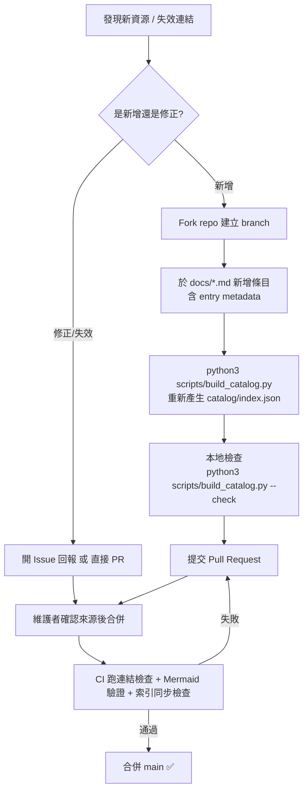

# Contributing / 貢獻指南

Thank you for helping tech leaders find trustworthy resources faster.
感謝你協助 tech leader 更快找到可信賴的資源。

## Ground rules / 基本規則

1. **Real, verifiable sources only / 只收真實可驗證來源**
   Every entry needs at least one URL that resolves today: official docs,
   official engineering blogs, open-source repos, or published papers.
   Never invent URLs, titles, or star counts.
   每則條目至少一個今日可開啟的 URL（官方文件、官方工程部落格、開源 repo、
   已發表論文）。嚴禁編造 URL、文章標題或 star 數。

2. **Legal & compliant / 合規合法**
   Only publicly available material. Open-source projects must have their
   SPDX license recorded. Proprietary products link to their official product
   page only. No paywalled or leaked content.
   僅收公開資料；開源專案須標註 SPDX license；商業產品只連官方產品頁；
   不收付費牆內或未授權內容。

3. **Bilingual entries / 雙語條目**
   Keep English terminology, add a Traditional Chinese (zh-TW) one-liner.
   英文術語保留，並附正體中文一句話解釋。

4. **Neutral tone / 中立客觀**
   Curate, don't advertise. Include caveats ("注意事項") where relevant.
   策展而非廣告，相關處附注意事項。

## Entry format / 條目格式

```markdown
### <English Name> | <Short Name>
<!-- entry:id=<category>/<slug> type=<method|skill|mcp|prompt|loop|tool|platform|paper|guide|policy|benchmark> roles=<PM,QA,DEV,RD,SRE,PLATFORM,ERP,EM,DATA,ALL> tags=<tag1,tag2> license=<SPDX|n/a|proprietary> last_verified=YYYY-MM-DD -->
- **一句話**: <one-line English definition>
- **一句話（繁中）**: <正體中文一句話定義>
- **適用角色**: PM / QA / DEV / RD / SRE / Platform / ERP
- **來源 Sources**: [Title](URL) — 官方 / 書籍 / 社群 (license)
- **注意事項**: <optional caveats>
```

## Update flow / 更新流程



## Local checks / 本地檢查

```bash
# regenerate the machine-readable catalog / 重新產生機器可讀索引
python3 scripts/build_catalog.py

# verify metadata completeness + index freshness / 驗證中繼資料與索引
python3 scripts/build_catalog.py --check

# verify all Mermaid blocks render / 驗證所有 Mermaid 圖語法
python3 scripts/check_mermaid.py
```

## Staleness / 保鮮

A weekly GitHub Action re-checks every URL. If a link dies, it opens an
issue labelled `broken-link`. Entries with `last_verified` older than 90 days
appear in the CI warning list — re-verify the source and bump the date.

每週 GitHub Action 自動重驗所有連結，失效連結自動開 `broken-link` issue；
超過 90 天未驗證的條目會列入 CI 警告，請重新查核並更新 `last_verified`。

## Adding a whole new category / 新增整個分類

Open an issue first so the taxonomy stays coherent — see `catalog/schema.md`
for the ID conventions.

請先開 issue 討論，確保分類學一致性（ID 命名規則見 `catalog/schema.md`）。
