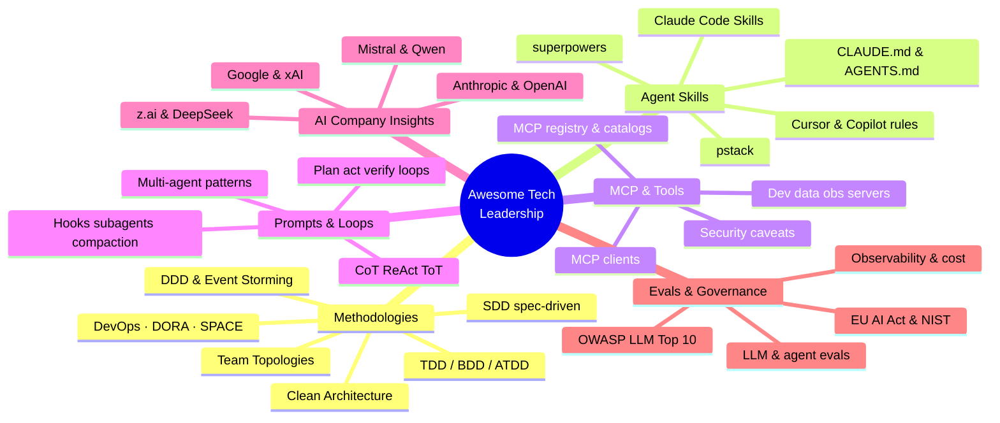
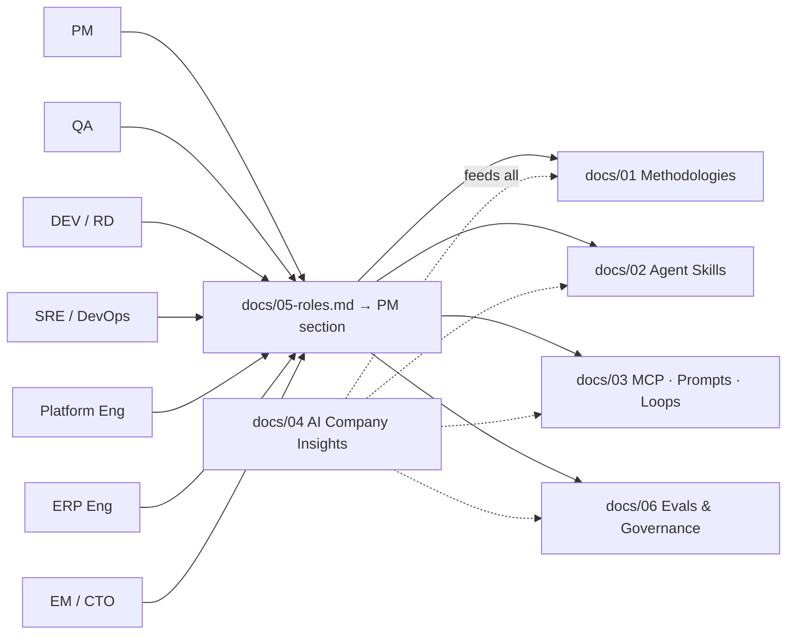
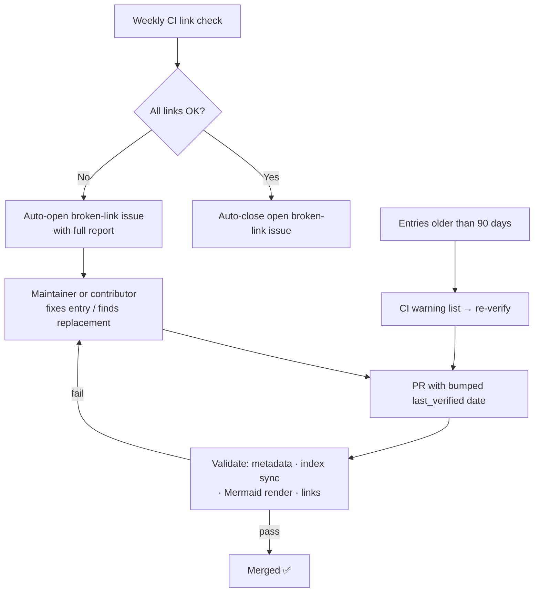

# Awesome Tech Leadership

> **A curated, bilingual (English / 繁體中文) knowledge base for tech leaders** —
> engineering methodologies (TDD, BDD, SDD, Clean Architecture…), AI agent
> skills, MCP servers, prompts, loops, evals, and governance. Every entry has a
> verifiable source and a freshness date.

**繁體中文版 README 👉 [README.zh-TW.md](README.zh-TW.md)**

---

## What is this? / 這是什麼？

Tech leaders today juggle two stacks at once: **decades of engineering
methodology** (how to build software well) and a **fast-moving AI tooling
ecosystem** (how to build with agents safely). This repo maps both, side by
side, so you can find the right methodology, skill, MCP server, prompt pattern,
loop, or eval — for you and for every role on your team.

現今的 tech leader 必須同時掌握兩大堆疊：**數十年的軟體工程方法論**（如何把軟體做好）
與**快速演進的 AI 工具生態**（如何安全地與 agent 共建）。本 repo 並列兩者，
幫助你與團隊中的每個角色，快速找到合適的方法論、skill、MCP server、
prompt 模式、loop、eval 資源。

## Who is this for? / 為誰而做？

| Role / 角色 | What you'll find / 你能找到什麼 |
|---|---|
| **PM** / Product | Spec-driven workflows, PRD/story AI assists, roadmap tooling |
| **QA** / QE | AI test generation, contract & mutation testing, flaky-test governance |
| **DEV / RD** | Coding-agent landscape, refactoring & review tooling, codebase navigation |
| **SRE / DevOps** | Incident AI, observability, chaos engineering, DORA measurement |
| **Platform Eng** | IDP & golden paths, GitOps, IaC with AI assists |
| **ERP** | SAP/Odoo/Dynamics/NetSuite AI assists, legacy-modernization patterns |
| **EM / Tech Lead / CTO** | AI adoption strategy, team topology, compliance (EU AI Act, NIST) |

## Start here / 快速上手

| If you want… / 如果你想… | Go to / 去看 |
|---|---|
| Learn a methodology (TDD, BDD, SDD, DDD, Clean Architecture…) | [docs/01-methodologies.md](docs/01-methodologies.md) |
| Find agent skills & rules (superpowers, pstack, Claude Code skills…) | [docs/02-agent-skills.md](docs/02-agent-skills.md) |
| Find MCP servers, prompt patterns & agent loops | [docs/03-mcp-prompts-loops.md](docs/03-mcp-prompts-loops.md) |
| Read official AI-company engineering insights | [docs/04-ai-companies.md](docs/04-ai-companies.md) |
| Get role-based tool & method recommendations | [docs/05-roles.md](docs/05-roles.md) |
| Set up evals, observability & governance | [docs/06-evals-env-governance.md](docs/06-evals-env-governance.md) |
| Browse the machine-readable index (JSON) | [catalog/index.json](catalog/index.json) |
| Contribute or fix a dead link | [CONTRIBUTING.md](CONTRIBUTING.md) |

## Map / 內容地圖

## Roles at a glance / 角色導覽

## Source & compliance policy / 來源與合規政策

- **Verifiable sources only / 只收可驗證來源** — official docs, official
  engineering blogs, open-source repos, published papers. Every entry carries
  its URL and a `last_verified` date. No invented links, ever.
- **Legal & compliant / 合規合法** — publicly available material only;
  open-source entries record their SPDX license; proprietary products link to
  official product pages only. See [LICENSE](LICENSE) for the third-party
  content note.
- **Bilingual & neutral / 雙語中立** — English terminology with 繁體中文
  one-liners; curated, not advertised.

## Keeping it fresh / 持續更新機制

This repo is built to stay current — freshness is automated, not promised:

- `python3 scripts/build_catalog.py` — regenerates [catalog/index.json](catalog/index.json) from `docs/*.md`
- `python3 scripts/build_catalog.py --check` — validates entry metadata + index sync
- `python3 scripts/check_mermaid.py --render` — validates every Mermaid diagram renders

## Contributing / 貢獻

New resources, dead-link fixes, and new categories are welcome — see
[CONTRIBUTING.md](CONTRIBUTING.md) for the entry format and update flow /
歡迎新增資源、回報失效連結與提案新分類，格式與流程見
[CONTRIBUTING.md](CONTRIBUTING.md)。

## License / 授權

Code and original content: [MIT](LICENSE). Curated third-party references remain
the property of their respective owners; open-source entries carry their own
SPDX licenses.
程式碼與原創內容採 MIT；收錄之第三方資料版權歸原作者所有，開源條目依其個別授權。
