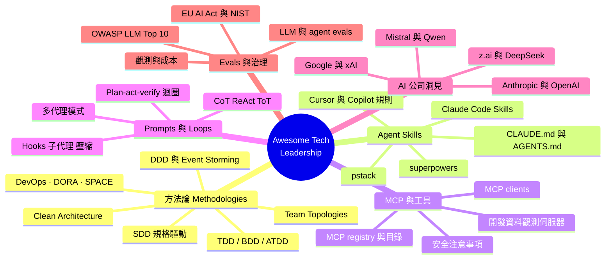
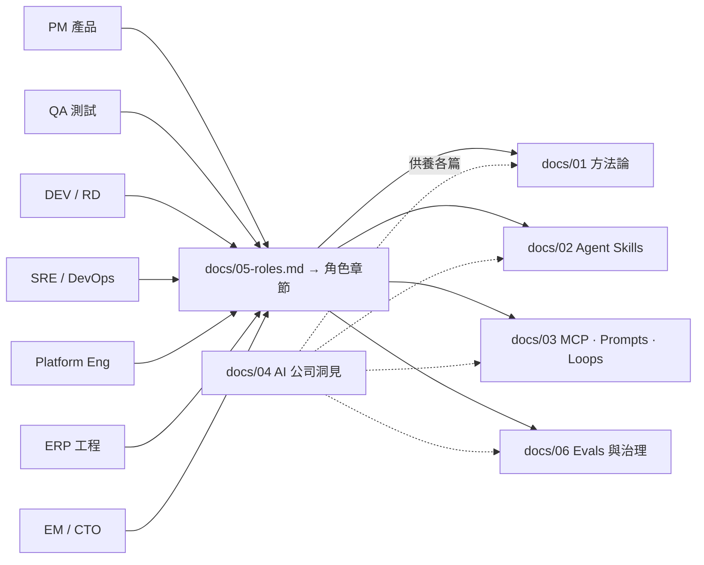
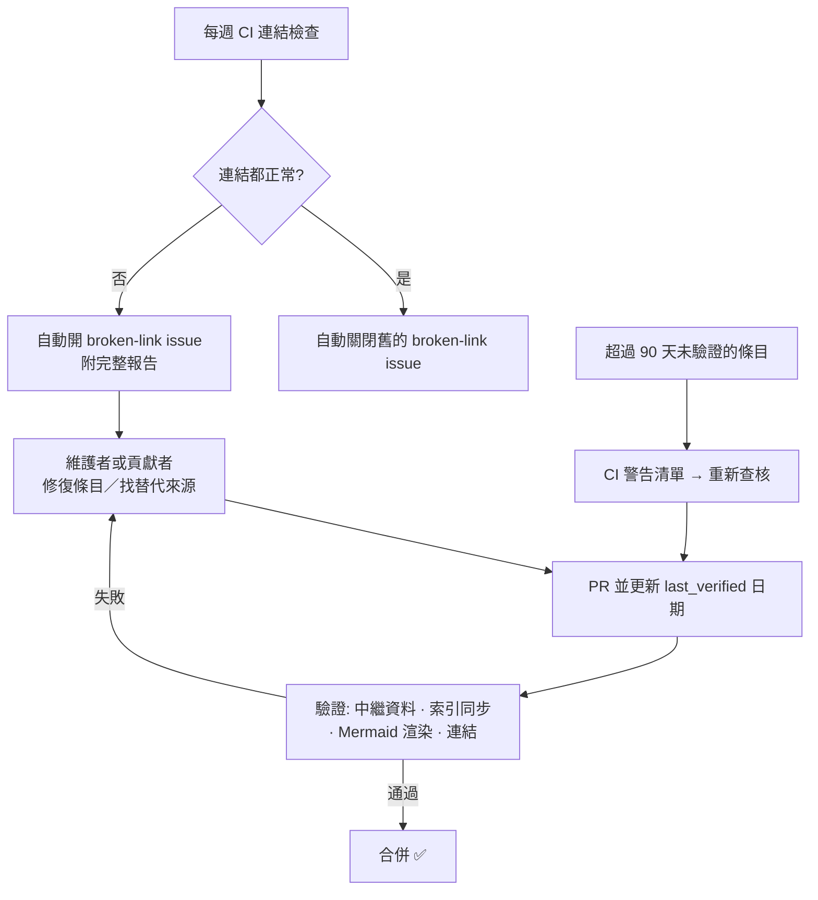

# Awesome Tech Leadership — 繁體中文版

> **給 tech leader 的雙語（English / 繁體中文）知識庫** —
> 軟體工程方法論（TDD、BDD、SDD、Clean Architecture⋯）、AI agent skills、
> MCP servers、prompts、loops、evals 與治理。每則條目都有可驗證的來源與保鮮日期。

**English README 👉 [README.md](README.md)**

---

## 這是什麼？

現今的 tech leader 必須同時掌握兩大堆疊：**數十年的軟體工程方法論**（如何把軟體做好）
與**快速演進的 AI 工具生態**（如何安全地與 agent 共建）。本 repo 並列兩者，
幫助你與團隊中的每個角色——PM、QA、DEV、RD、SRE、Platform engineer、ERP 工程師——
快速找到合適的方法論、skill、MCP server、prompt 模式、loop 與 eval 資源。

## 為誰而做？

| 角色 | 你能找到什麼 |
|---|---|
| **PM** / 產品 | Spec-driven 流程、PRD／user story AI 輔助、roadmap 工具 |
| **QA** / 測試 | AI 測試生成、contract & mutation testing、flaky test 治理 |
| **DEV / RD** | Coding agent 全景、重構與 review 工具、codebase 導覽 |
| **SRE / DevOps** | Incident AI、觀測、混沌工程、DORA 度量 |
| **Platform Eng** | IDP 與 golden paths、GitOps、IaC + AI 輔助 |
| **ERP** | SAP／Odoo／Dynamics／NetSuite AI 輔助、legacy 現代化模式 |
| **EM / Tech Lead / CTO** | AI 導入策略、team topology、合規（EU AI Act、NIST） |

## 數據一覽

| | |
|---|---|
| 策展條目 | **447** 條，橫跨 6 大領域 |
| 驗證來源 | **736** 個 — 含 51 篇 arXiv 論文、226 個 GitHub repo |
| 角色指南 | **8** 角色 — PM · QA · DEV/RD · SRE · Platform · ERP · Data · EM/CTO |
| AI 公司 | **14** 家 — Anthropic · OpenAI · Google · xAI · Mistral · Qwen · z.ai · DeepSeek 等 |
| Mermaid 圖表 | **15** 張 |
| 最後驗證 | 2026-11-09（全部連結 HTTP 實測） |

## 快速上手

| 如果你想… | 去看 |
|---|---|
| 學習方法論（TDD、BDD、SDD、DDD、Clean Architecture⋯） | [docs/01-methodologies.md](docs/01-methodologies.md) |
| 找 agent skills 與規則（superpowers、pstack、Claude Code skills⋯） | [docs/02-agent-skills.md](docs/02-agent-skills.md) |
| 找 MCP servers、prompt 模式與 agent loops | [docs/03-mcp-prompts-loops.md](docs/03-mcp-prompts-loops.md) |
| 讀各大 AI 公司官方工程分享 | [docs/04-ai-companies.md](docs/04-ai-companies.md) |
| 依角色取得工具與方法建議 | [docs/05-roles.md](docs/05-roles.md) |
| 建立 evals、觀測與治理 | [docs/06-evals-env-governance.md](docs/06-evals-env-governance.md) |
| 瀏覽機器可讀索引（JSON） | [catalog/index.json](catalog/index.json) |
| 貢獻或修復失效連結 | [CONTRIBUTING.md](CONTRIBUTING.md) |

## 內容地圖

## 角色導覽

## 來源與合規政策

- **只收可驗證來源** — 官方文件、官方工程部落格、開源 repo、已發表論文。
  每則條目都附 URL 與 `last_verified` 日期，嚴禁編造連結。
- **合規合法** — 僅收公開資料；開源條目標註 SPDX license；商業產品只連官方
  產品頁。第三方內容版權說明見 [LICENSE](LICENSE)。
- **雙語中立** — 英文術語保留、附繁體中文一句話；策展而非廣告。

## 持續更新機制

保鮮是自動化的，不是口號：

- `python3 scripts/build_catalog.py` — 由 `docs/*.md` 重新產生 [catalog/index.json](catalog/index.json)
- `python3 scripts/build_catalog.py --check` — 驗證條目中繼資料與索引同步
- `python3 scripts/check_mermaid.py --render` — 驗證所有 Mermaid 圖皆可渲染

## 貢獻

歡迎新增資源、回報失效連結、提案新分類 — 條目格式與更新流程見
[CONTRIBUTING.md](CONTRIBUTING.md)。

## 授權

程式碼與原創內容採 [MIT](LICENSE)；收錄之第三方資料版權歸原作者所有，
開源條目依其個別 SPDX 授權使用。
