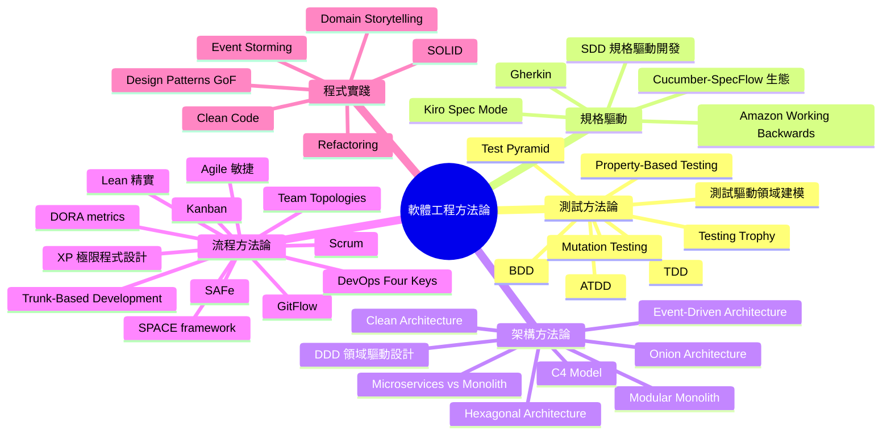
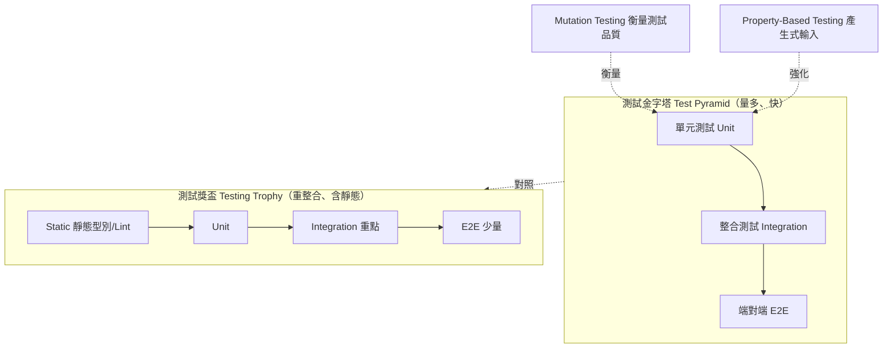

# 01 軟體工程方法論 | Software Engineering Methodologies

本文件收錄軟體工程各領域的方法論與實踐，協助 tech leader、工程師、PM、QA、DEV、RD、SRE、Platform、ERP 快速找到可落地的做法與真實來源。
A curated set of software engineering methodologies and practices — with verified, real-world sources — for tech leaders, engineers, PMs, QA, developers, SRE and platform practitioners.
每個條目提供中英一句話定義、適用角色，以及官方文件、原著或開源 repo 的可點連結。
Each entry gives a one-line definition (English + 繁體中文), applicable roles, and clickable sources (official docs, original books/papers, or open-source repos).
角色縮寫 Roles：PM 產品 / QA 品保 / DEV 開發 / RD 研發 / SRE 可靠性 / PLATFORM 平台 / ERP 企業系統 / EM 工程主管 / DATA 資料 / ALL 通用。來源均經驗證；開源專案標註 SPDX license。最後驗證 2026-11-08。

> Part of [Awesome Tech Leadership](../README.md) · [README (EN)](../README.md) · [繁體中文](../README.zh-TW.md)

## 全景圖

## 測試方法論

### Test-Driven Development | TDD
<!-- entry:id=methodologies/test-driven-development type=method roles=QA,DEV,RD tags=tdd,testing,unit-testing license=n/a last_verified=2026-11-08 -->
- **一句話**: Write a failing test first, make it pass with the simplest code, then refactor — Red/Green/Refactor.
- **一句話（繁中）**: 先寫一個會失敗的測試，再寫最少的程式讓它通過，最後重構 —— 紅/綠/重構循環。
- **適用角色**: QA、DEV、RD
- **來源 Sources**: [Test-Driven Development: By Example — Kent Beck (Addison-Wesley)](https://www.informit.com/store/test-driven-development-by-example-9780321146533) — 書籍（原著）; [Agile Alliance — TDD](https://agilealliance.org/glossary/tdd/) — 官方

### Behavior-Driven Development | BDD
<!-- entry:id=methodologies/behavior-driven-development type=method roles=PM,QA,DEV,RD tags=bdd,testing,behavior license=n/a last_verified=2026-11-08 -->
- **一句話**: Describe system behavior in business-readable Given/When/Then examples that bridge developers, testers and product.
- **一句話（繁中）**: 用業務可讀的 Given/When/Then 範例描述系統行為，拉近開發、測試與產品的共同語言。
- **適用角色**: PM、QA、DEV、RD
- **來源 Sources**: [Dan North — Introducing BDD](https://dannorth.net/introducing-bdd/) — 官方（提出者原文）; [Cucumber — What is BDD?](https://cucumber.io/docs/bdd/) — 官方

### Acceptance Test-Driven Development | ATDD
<!-- entry:id=methodologies/acceptance-test-driven-development type=method roles=PM,QA,DEV,RD tags=atdd,testing,acceptance license=n/a last_verified=2026-11-08 -->
- **一句話**: Team agrees on acceptance tests before coding, so all stakeholders share one definition of "done".
- **一句話（繁中）**: 開發前先由團隊共同定義「驗收測試」，讓利害關係人對完成條件有共識。
- **適用角色**: PM、QA、DEV、RD
- **來源 Sources**: [Agile Alliance — ATDD](https://agilealliance.org/glossary/atdd/) — 官方; [Specification by Example — Gojko Adzić](https://gojko.net/books/specification-by-example/) — 書籍（原著）

### Growing OO Software, Guided by Tests | GOOS
<!-- entry:id=methodologies/test-first-domain-modeling type=method roles=DEV,RD,QA tags=goos,tdd,domain-modeling,ddd license=n/a last_verified=2026-11-08 -->
- **一句話**: Drive domain-model design through tests first, capturing behavior and invariants as executable examples (outside-in, test-first OO design).
- **一句話（繁中）**: 以測試先行來驅動領域模型設計，把行為與不變性具體化為可執行範例（outside-in、test-first 的物件導向設計）。
- **適用角色**: DEV、RD、QA
- **來源 Sources**: [Growing Object-Oriented Software, Guided by Tests — Freeman & Pryce](https://growing-object-oriented-software.com/) — 書籍（原著官網）; [GOOS (Addison-Wesley)](https://www.informit.com/store/growing-object-oriented-software-guided-by-tests-9780321503626) — 書籍（原著）
- **注意事項**: 俗稱 "DDD-by-test"，但該名詞並非標準命名方法論；本條以 GOOS（test-first 領域建模）為代表來源。

### Test Pyramid | Pyramid
<!-- entry:id=methodologies/test-pyramid type=method roles=QA,DEV,RD tags=test-pyramid,testing,strategy license=n/a last_verified=2026-11-08 -->
- **一句話**: Keep many fast unit tests at the base, fewer integration tests, and very few end-to-end tests at the top.
- **一句話（繁中）**: 底層放大量快速的單元測試、中層整合測試、頂層少量端對端測試，以兼顧速度與信心。
- **適用角色**: QA、DEV、RD
- **來源 Sources**: [Martin Fowler — The Test Pyramid](https://www.martinfowler.com/bliki/TestPyramid.html) — 官方; [Martin Fowler — The Practical Test Pyramid](https://martinfowler.com/articles/practical-test-pyramid.html) — 官方

### Testing Trophy | Trophy
<!-- entry:id=methodologies/testing-trophy type=method roles=QA,DEV,RD tags=testing-trophy,testing,strategy license=n/a last_verified=2026-11-08 -->
- **一句話**: A testing strategy that weights integration tests more than the pyramid and adds static analysis at the base.
- **一句話（繁中）**: 一種測試策略：相較金字塔更重視整合測試，並在最底層加入靜態分析（型別/Lint）。
- **適用角色**: QA、DEV、RD
- **來源 Sources**: [Kent C. Dodds — The Testing Trophy and Testing Classifications](https://kentcdodds.com/blog/the-testing-trophy-and-testing-classifications) — 官方（提出者文章）

### Mutation Testing | Mutation
<!-- entry:id=methodologies/mutation-testing type=method roles=QA,DEV,RD tags=mutation-testing,testing,quality license=n/a last_verified=2026-11-08 -->
- **一句話**: Measure test quality by injecting small faults (mutants) into code and checking whether the tests catch them.
- **一句話（繁中）**: 透過在程式中注入小錯誤（突變體），檢查測試能否偵測，以量化「測試的品質」而非「覆蓋率」。
- **適用角色**: QA、DEV、RD
- **來源 Sources**: [PIT — pitest.org](https://pitest.org/) — 官方; [hcoles/pitest](https://github.com/hcoles/pitest) — 社群 (Apache-2.0); [stryker-mutator/stryker-js](https://github.com/stryker-mutator/stryker-js) — 社群 (Apache-2.0)

### Property-Based Testing | PBT
<!-- entry:id=methodologies/property-based-testing type=method roles=DEV,RD,QA tags=property-based-testing,testing,generative license=n/a last_verified=2026-11-08 -->
- **一句話**: Instead of fixed examples, state general properties the code must satisfy and let the framework generate many random inputs.
- **一句話（繁中）**: 不寫死範例，而是宣告程式「必須恆成立的性質」，由框架自動產生大量隨機輸入來驗證。
- **適用角色**: DEV、RD、QA
- **來源 Sources**: [Hypothesis](https://hypothesis.works/) — 官方; [HypothesisWorks/hypothesis](https://github.com/HypothesisWorks/hypothesis) — 社群 (MPL-2.0／混合授權); [QuickCheck — Claessen & Hughes](https://www.cse.chalmers.se/~rjmh/QuickCheck/) — 論文（原始論文）

## 規格驅動

### Spec-Driven Development | SDD
<!-- entry:id=methodologies/spec-driven-development type=method roles=PM,QA,DEV,RD,PLATFORM tags=sdd,spec,ai-agent,workflow license=n/a last_verified=2026-11-08 -->
- **一句話**: Treat the specification as the primary artifact — specs drive planning, implementation and validation, especially alongside AI coding agents.
- **一句話（繁中）**: 以「規格」為核心產出物，讓規格驅動規劃、實作與驗證；在 AI 協作時代尤為重要。
- **適用角色**: PM、QA、DEV、RD、PLATFORM
- **來源 Sources**: [github/spec-kit](https://github.com/github/spec-kit) — 社群 (MIT)
- **注意事項**: GitHub spec-kit 提供 specify / plan / tasks / implement 工作流；先寫 why/what，再寫 how。

### Amazon Working Backwards | PR/FAQ
<!-- entry:id=methodologies/amazon-working-backwards type=method roles=PM,RD,DEV,EM tags=working-backwards,product,pr-faq license=n/a last_verified=2026-11-08 -->
- **一句話**: Start from the customer and write the press release and FAQ before building anything.
- **一句話（繁中）**: 從客戶出發，動工前先寫「新聞稿（PR）+ 常見問題（FAQ）」，以此倒推產品設計。
- **適用角色**: PM、RD、DEV、EM
- **來源 Sources**: [Working Backwards: Inside Stories of Amazon's Invention Mechanism — Bryar & Carr](https://www.amazon.com/Working-Backwards-Inside-Stories-Invention/dp/1250267595) — 書籍（原著）; [Working Backwards 官網](https://workingbackwards.com/) — 官方

### Kiro Spec Mode | Kiro
<!-- entry:id=methodologies/kiro-spec-mode type=method roles=PM,QA,DEV,RD tags=kiro,spec,ai-agent license=n/a last_verified=2026-11-08 -->
- **一句話**: An AI IDE mode that turns prompts into structured specs (requirements, design, tasks) before code is generated.
- **一句話（繁中）**: AI IDE 的規格模式：把提示轉成結構化規格（需求、設計、任務）後才生成程式碼。
- **適用角色**: PM、QA、DEV、RD
- **來源 Sources**: [Kiro — Specs 文件](https://kiro.dev/docs/specs/) — 官方; [Kiro 官網](https://www.kiro.dev/) — 官方

### Gherkin | Gherkin
<!-- entry:id=methodologies/gherkin type=method roles=PM,QA,DEV tags=gherkin,bdd,dsl license=n/a last_verified=2026-11-08 -->
- **一句話**: A plain-language syntax (Given/When/Then/Scenario) for writing executable, business-readable examples.
- **一句話（繁中）**: 一種近似自然語言的語法（Given/When/Then/Scenario），用來寫業務可讀、可執行的範例。
- **適用角色**: PM、QA、DEV
- **來源 Sources**: [Cucumber — Gherkin Reference](https://cucumber.io/docs/gherkin/reference/) — 官方; [cucumber/gherkin](https://github.com/cucumber/gherkin) — 社群 (MIT)

### Cucumber / SpecFlow Ecosystem | Cucumber
<!-- entry:id=methodologies/cucumber-specflow-ecosystem type=method roles=QA,DEV,PM tags=cucumber,specflow,bdd,dotnet license=n/a last_verified=2026-11-08 -->
- **一句話**: The tooling family that runs Gherkin-based BDD across languages — Cucumber (JS/Ruby/JVM) and Reqnroll/SpecFlow for .NET.
- **一句話（繁中）**: 執行 Gherkin BDD 的跨語言工具生態：Cucumber（JS/Ruby/JVM）與 .NET 端的 Reqnroll／SpecFlow。
- **適用角色**: QA、DEV、PM
- **來源 Sources**: [Cucumber 官網](https://www.cucumber.io/) — 官方; [cucumber/cucumber-js](https://github.com/cucumber/cucumber-js) — 社群 (MIT); [SpecFlow 官網](https://specflow.org/) — 官方（歷史專案）; [reqnroll/Reqnroll](https://github.com/reqnroll/Reqnroll) — 社群 (BSD-3-Clause)
- **注意事項**: SpecFlow 原 repo 已停止維護，社群由 Reqnroll（BSD-3-Clause）延續。

## 架構方法論

### Clean Architecture | Clean Architecture
<!-- entry:id=methodologies/clean-architecture type=method roles=DEV,RD,ERP,PLATFORM tags=clean-architecture,architecture,solid license=n/a last_verified=2026-11-08 -->
- **一句話**: Organize code into concentric rings so business rules never depend on frameworks, UI, or databases (Dependency Rule).
- **一句話（繁中）**: 以同心圓分層，讓業務規則不依賴框架、UI 或資料庫，依賴方向一律由外向內（依賴規則）。
- **適用角色**: DEV、RD、ERP、PLATFORM
- **來源 Sources**: [Robert C. Martin — The Clean Architecture](https://blog.cleancoder.com/uncle-bob/2012/08/13/the-clean-architecture.html) — 官方（作者原文）

### Hexagonal Architecture | Ports & Adapters
<!-- entry:id=methodologies/hexagonal-architecture type=method roles=DEV,RD,ERP,PLATFORM tags=hexagonal-architecture,ports-adapters,architecture license=n/a last_verified=2026-11-08 -->
- **一句話**: Put the application core behind "ports", and plug in UI/database/external systems as interchangeable "adapters".
- **一句話（繁中）**: 把應用核心放在「埠（ports）」之後，將 UI/資料庫/外部系統當成可替換的「轉接器（adapters）」接入。
- **適用角色**: DEV、RD、ERP、PLATFORM
- **來源 Sources**: [Alistair Cockburn — Hexagonal Architecture](https://alistair.cockburn.us/hexagonal-architecture/) — 官方（提出者原文）

### Onion Architecture | Onion
<!-- entry:id=methodologies/onion-architecture type=method roles=DEV,RD,ERP tags=onion-architecture,architecture,ddd license=n/a last_verified=2026-11-08 -->
- **一句話**: Build layers of rings around a domain core, with all dependencies pointing inward toward the domain model.
- **一句話（繁中）**: 以領域模型為圓心逐層建構，所有依賴皆指向內層的領域模型。
- **適用角色**: DEV、RD、ERP
- **來源 Sources**: [Jeffrey Palermo — The Onion Architecture (Part 1)](https://jeffreypalermo.com/2008/07/the-onion-architecture-part-1/) — 官方（提出者原文）

### Domain-Driven Design | DDD
<!-- entry:id=methodologies/domain-driven-design type=method roles=PM,DEV,RD,QA,ERP tags=ddd,modeling,ubiquitous-language license=n/a last_verified=2026-11-08 -->
- **一句話**: Model software around the business domain with a ubiquitous language, bounded contexts, and explicit domain logic.
- **一句話（繁中）**: 以業務領域為核心建模，透過通用語言、限界上下文與顯性領域邏輯應對複雜度。
- **適用角色**: PM、DEV、RD、QA、ERP
- **來源 Sources**: [Domain-Driven Design — Eric Evans (Addison-Wesley)](https://www.informit.com/store/domain-driven-design-tackling-complexity-in-heart-9780321125217) — 書籍（原著）; [DomainLanguage.com](https://www.domainlanguage.com/ddd/) — 官方

### Event-Driven Architecture | EDA
<!-- entry:id=methodologies/event-driven-architecture type=method roles=DEV,RD,SRE,PLATFORM,ERP,DATA tags=eda,event-driven,messaging,events license=n/a last_verified=2026-11-08 -->
- **一句話**: Components communicate by producing and reacting to events, decoupling producers from consumers in time and space.
- **一句話（繁中）**: 元件透過「產出／回應事件」溝通，讓生產者與消費者在時間與空間上解耦。
- **適用角色**: DEV、RD、SRE、PLATFORM、ERP、DATA
- **來源 Sources**: [Martin Fowler — What do you mean by "Event-Driven"?](https://martinfowler.com/articles/201701-event-driven.html) — 官方; [Microsoft Azure — Event-driven architecture style](https://learn.microsoft.com/en-us/azure/architecture/guide/architecture-styles/event-driven) — 官方; [Martin Fowler — Event Sourcing](https://martinfowler.com/eaaDev/EventSourcing.html) — 官方

### Microservices vs Monolith | Monolith
<!-- entry:id=methodologies/microservices-vs-monolith type=method roles=DEV,RD,SRE,PLATFORM,ERP,EM tags=microservices,monolith,architecture license=n/a last_verified=2026-11-08 -->
- **一句話**: Choose between independently deployable services and a single deployable unit based on team size and complexity, not fashion.
- **一句話（繁中）**: 依團隊規模與複雜度在「獨立部署的微服務」與「單一部署單元」間取捨，而非追逐潮流。
- **適用角色**: DEV、RD、SRE、PLATFORM、ERP、EM
- **來源 Sources**: [Martin Fowler & James Lewis — Microservices](https://martinfowler.com/articles/microservices.html) — 官方; [Martin Fowler — MonolithFirst](https://www.martinfowler.com/bliki/MonolithFirst.html) — 官方; [DHH — The Majestic Monolith](https://signalvnoise.com/svn3/the-majestic-monolith/) — 社群

### Modular Monolith | Mod Monolith
<!-- entry:id=methodologies/modular-monolith type=method roles=DEV,RD,ERP,PLATFORM tags=modular-monolith,modularity,ddd license=n/a last_verified=2026-11-08 -->
- **一句話**: A single deployable application with strongly bounded internal modules, gaining modularity benefits without distributed-system cost.
- **一句話（繁中）**: 單一部署單元但內部有強邊界模組，取得模組化好處而無分散式系統成本。
- **適用角色**: DEV、RD、ERP、PLATFORM
- **來源 Sources**: [Kamil Grzybek — Modular Monolith 系列](https://kamilgrzybek.com/blog/series/modular-monolith) — 社群; [kgrzybek/modular-monolith-with-ddd](https://github.com/kgrzybek/modular-monolith-with-ddd) — 社群 (MIT)

### C4 Model | C4
<!-- entry:id=methodologies/c4-model type=method roles=PM,DEV,RD,SRE,PLATFORM,ERP tags=c4,architecture-diagrams,modeling license=n/a last_verified=2026-11-08 -->
- **一句話**: A four-level hierarchical way to visualize software architecture — Context, Container, Component, and Code.
- **一句話（繁中）**: 以四個層級（系統脈絡、容器、元件、程式碼）由宏觀到微觀描繪軟體架構。
- **適用角色**: PM、DEV、RD、SRE、PLATFORM、ERP
- **來源 Sources**: [The C4 model（官網）](https://www.c4model.com/) — 官方; [structurizr/java](https://github.com/structurizr/java) — 社群 (Apache-2.0)

## 流程方法論

### Agile Manifesto | Agile
<!-- entry:id=methodologies/agile-manifesto type=method roles=ALL tags=agile,manifesto,values license=n/a last_verified=2026-11-08 -->
- **一句話**: Value individuals/interactions, working software, customer collaboration and responding to change over processes and tools.
- **一句話（繁中）**: 重視「個人與互動、可用的軟體、客戶合作、回應變化」勝過「流程與工具、完整文件、合約談判、遵循計畫」。
- **適用角色**: ALL（全角色通用）
- **來源 Sources**: [Manifesto for Agile Software Development](https://agilemanifesto.org/) — 官方; [Principles behind the Agile Manifesto](https://agilemanifesto.org/principles.html) — 官方

### Scrum | Scrum
<!-- entry:id=methodologies/scrum type=method roles=PM,QA,DEV,RD,ERP,EM tags=scrum,agile,framework license=n/a last_verified=2026-11-08 -->
- **一句話**: An iterative framework with fixed-length Sprints, three accountabilities, and five events to deliver a "Done" increment.
- **一句話（繁中）**: 以固定長度 Sprint 迭代交付「完成」增量的框架，含三種角色職責與五個事件。
- **適用角色**: PM、QA、DEV、RD、ERP、EM
- **來源 Sources**: [The Scrum Guide](https://thescrumguide.org/) — 官方; [Agile Alliance — Scrum](https://agilealliance.org/glossary/scrum/) — 官方

### Kanban | Kanban
<!-- entry:id=methodologies/kanban type=method roles=PM,QA,DEV,RD,SRE,PLATFORM,ERP,EM tags=kanban,flow,wip license=n/a last_verified=2026-11-08 -->
- **一句話**: Visualize workflow, limit work-in-progress, and manage flow to improve lead time incrementally without big-bang change.
- **一句話（繁中）**: 以視覺化工作流、限制在製品（WIP）、管理流動來漸進改善前置時間，不需大幅變革。
- **適用角色**: PM、QA、DEV、RD、SRE、PLATFORM、ERP、EM
- **來源 Sources**: [Agile Alliance — Kanban](https://agilealliance.org/glossary/kanban/) — 官方; [Kanban University](https://kanban.university/) — 官方; [Kanban: Successful Evolutionary Change — David J. Anderson](https://www.amazon.com/Kanban-Successful-Evolutionary-Change-Technology/dp/0984521402) — 書籍（原著）

### Scaled Agile Framework | SAFe
<!-- entry:id=methodologies/safe type=method roles=PM,RD,DEV,QA,ERP,EM tags=safe,scaling,agile license=n/a last_verified=2026-11-08 -->
- **一句話**: A knowledge base of proven practices for scaling Lean-Agile across portfolios, large solutions, and programs.
- **一句話（繁中）**: 一套用於把 Lean-Agile 規模化到大型解決方案、投資組合與群組層級的實踐知識庫。
- **適用角色**: PM、RD、DEV、QA、ERP、EM
- **來源 Sources**: [SAFe — Scaled Agile Framework](https://scaledagileframework.com/) — 官方

### Lean Software Development | Lean
<!-- entry:id=methodologies/lean-software-development type=method roles=PM,RD,DEV,SRE,PLATFORM,ERP,EM tags=lean,waste,value-stream license=n/a last_verified=2026-11-08 -->
- **一句話**: Eliminate waste, amplify learning, decide late/deliver fast, empower the team, build integrity in, and see the whole.
- **一句話（繁中）**: 消除浪費、強化學習、延後決策/快速交付、賦能團隊、內建品質、綜觀全局。
- **適用角色**: PM、RD、DEV、SRE、PLATFORM、ERP、EM
- **來源 Sources**: [Lean Software Development（Poppendieck）](https://leansoftwaredevelopment.com/) — 官方; [Lean Software Development: An Agile Toolkit — Poppendieck](https://www.informit.com/store/lean-software-development-an-agile-toolkit-9780321627346) — 書籍（原著）; [The Lean Startup — Eric Ries](https://theleanstartup.com/) — 書籍（衍生）

### Extreme Programming | XP
<!-- entry:id=methodologies/extreme-programming type=method roles=DEV,RD,QA,EM tags=xp,engineering-practices,tdd license=n/a last_verified=2026-11-08 -->
- **一句話**: Improve software quality and responsiveness through engineering practices like TDD, pair programming, CI and continuous refactoring.
- **一句話（繁中）**: 透過 TDD、結對程式設計、持續整合與持續重構等工程實踐，提升軟體品質與應變力。
- **適用角色**: DEV、RD、QA、EM
- **來源 Sources**: [Extreme Programming: A Gentle Introduction](http://www.extremeprogramming.org/) — 社群; [Agile Alliance — XP](https://www.agilealliance.org/glossary/xp/) — 官方; [Extreme Programming Explained — Kent Beck (O'Reilly)](https://www.oreilly.com/library/view/extreme-programming-explained/0321278658/) — 書籍（原著）

### Trunk-Based Development | Trunk
<!-- entry:id=methodologies/trunk-based-development type=method roles=DEV,RD,SRE,PLATFORM,EM tags=trunk-based,ci,version-control license=n/a last_verified=2026-11-08 -->
- **一句話**: Everyone commits to a single short-lived branch (trunk/main) with small, frequent changes to enable continuous integration.
- **一句話（繁中）**: 所有人把小幅、頻繁的變更提交到單一短命分支（trunk/main），以達成真正的持續整合。
- **適用角色**: DEV、RD、SRE、PLATFORM、EM
- **來源 Sources**: [Trunk Based Development（官網）](https://trunkbaseddevelopment.com/) — 官方

### GitFlow | GitFlow
<!-- entry:id=methodologies/gitflow type=method roles=DEV,RD,ERP,EM tags=gitflow,branching,git license=n/a last_verified=2026-11-08 -->
- **一句話**: A branching model with long-lived branches (main, develop, feature, release, hotfix) suited to versioned releases.
- **一句話（繁中）**: 一種含長命分支（main、develop、feature、release、hotfix）的分支模型，適合有版本發布節奏的專案。
- **適用角色**: DEV、RD、ERP、EM
- **來源 Sources**: [Vincent Driessen — A successful Git branching model](https://nvie.com/posts/a-successful-git-branching-model/) — 官方（提出者原文）; [nvie/gitflow](https://github.com/nvie/gitflow) — 社群 (BSD-style，授權見 repo)
- **注意事項**: 適合版本發布型專案；持續部署的 web 服務建議改用 Trunk-Based Development。

### DevOps Four Keys | Four Keys
<!-- entry:id=methodologies/devops-four-keys type=benchmark roles=SRE,PLATFORM,DEV,RD,PM,EM tags=four-keys,metrics,devops license=n/a last_verified=2026-11-08 -->
- **一句話**: Google's four key software delivery metrics — deployment frequency, lead time, change failure rate, time to restore.
- **一句話（繁中）**: Google 提出的四項軟體交付關鍵指標：部署頻率、變更前置時間、變更失敗率、服務恢復時間。
- **適用角色**: SRE、PLATFORM、DEV、RD、PM、EM
- **來源 Sources**: [Google Cloud — Using the Four Keys](https://cloud.google.com/blog/products/devops-sre/using-the-four-keys-to-measure-your-devops-performance) — 官方; [dora-team/fourkeys](https://github.com/dora-team/fourkeys) — 社群 (Apache-2.0); [Google Cloud — DevOps measurement](https://cloud.google.com/architecture/devops/devops-measurement) — 官方

### DORA Metrics | DORA
<!-- entry:id=methodologies/dora-metrics type=benchmark roles=SRE,PLATFORM,DEV,RD,PM,EM tags=dora,metrics,benchmarks license=n/a last_verified=2026-11-08 -->
- **一句話**: Research-backed software delivery performance metrics (the "four keys") correlated with organizational performance, with industry benchmark tiers.
- **一句話（繁中）**: 有研究實證的軟體交付效能指標（即「四鍵」），與組織效能相關，並提供業界基準分級。
- **適用角色**: SRE、PLATFORM、DEV、RD、PM、EM
- **來源 Sources**: [DORA 官網](https://dora.dev/) — 官方; [DORA — Research](https://dora.dev/research/) — 官方; [Accelerate — Forsgren, Humble, Kim (IT Revolution)](https://itrevolution.com/product/accelerate/) — 書籍（原著）

### SPACE Framework | SPACE
<!-- entry:id=methodologies/space-framework type=paper roles=PM,RD,DEV,SRE,EM tags=space,productivity,metrics license=n/a last_verified=2026-11-08 -->
- **一句話**: Measure developer productivity across Satisfaction, Performance, Activity, Communication and Efficiency — not a single metric.
- **一句話（繁中）**: 從「滿意度、績效、活動、溝通協作、效率與流動」五面向衡量開發者生產力，而非單一指標。
- **適用角色**: PM、RD、DEV、SRE、EM
- **來源 Sources**: [Forsgren et al. — The SPACE of Developer Productivity (ACM Queue)](https://queue.acm.org/doi/10.1145/3454122.3454124) — 論文（原始論文）; [Microsoft Research — SPACE of Developer Productivity](https://www.microsoft.com/en-us/research/publication/the-space-of-developer-productivity-theres-more-to-it-than-you-think/) — 官方; [CACM — The SPACE of Developer Productivity](https://cacm.acm.org/practice/the-space-of-developer-productivity/) — 論文（轉載）

### Team Topologies | Team Top
<!-- entry:id=methodologies/team-topologies type=method roles=PM,RD,DEV,SRE,PLATFORM,EM tags=team-topologies,organization,platform license=n/a last_verified=2026-11-08 -->
- **一句話**: Organize teams into four fundamental types with clear interaction modes to reduce cognitive load and improve flow.
- **一句話（繁中）**: 以四種基本團隊型態與明確互動模式組織團隊，降低認知負荷、改善價值流動。
- **適用角色**: PM、RD、DEV、SRE、PLATFORM、EM
- **來源 Sources**: [Team Topologies 官網](https://teamtopologies.com/) — 官方; [Team Topologies — Skelton & Pais (IT Revolution)](https://itrevolution.com/product/team-topologies/) — 書籍（原著）

## 程式實踐

### SOLID Principles | SOLID
<!-- entry:id=methodologies/solid type=method roles=DEV,RD,ERP tags=solid,design,principles license=n/a last_verified=2026-11-08 -->
- **一句話**: Five object-oriented design principles — SRP, OCP, LSP, ISP, DIP — that keep code maintainable and flexible.
- **一句話（繁中）**: 五項物件導向設計原則 —— 單一職責、開放封閉、里氏替換、介面隔離、依賴反轉 —— 讓程式碼可維護且有彈性。
- **適用角色**: DEV、RD、ERP
- **來源 Sources**: [Robert C. Martin — The Principles of OOD](http://butunclebob.com/ArticleS.UncleBob.PrinciplesOfOod) — 官方（作者原文）; [Agile Software Development: Principles, Patterns, and Practices — Robert C. Martin](https://www.informit.com/store/agile-software-development-principles-patterns-and-9780135974445) — 書籍（原著）

### Clean Code | Clean Code
<!-- entry:id=methodologies/clean-code type=method roles=DEV,RD,ERP tags=clean-code,readability,craftsmanship license=n/a last_verified=2026-11-08 -->
- **一句話**: Write code that is readable, expressive and minimal — meaningful names, small functions, and few comments.
- **一句話（繁中）**: 寫出可讀、表意、精簡的程式碼 —— 有意義的命名、小函式、少註解。
- **適用角色**: DEV、RD、ERP
- **來源 Sources**: [Clean Code: A Handbook of Agile Software Craftsmanship — Robert C. Martin](https://www.informit.com/store/clean-code-handbook-of-agile-software-craftsmanship-9780132350884) — 書籍（原著）

### Refactoring | Refactor
<!-- entry:id=methodologies/refactoring type=method roles=DEV,RD,ERP tags=refactoring,code-smells,design license=n/a last_verified=2026-11-08 -->
- **一句話**: Improve internal structure without changing observable behavior, in small, safe, test-backed steps.
- **一句話（繁中）**: 在不改變可觀察行為的前提下改善內部結構，以小步、安全、有測試保障的方式進行。
- **適用角色**: DEV、RD、ERP
- **來源 Sources**: [Martin Fowler — Refactoring](https://refactoring.com/) — 官方; [refactoring.guru — Design Patterns & Refactoring](https://refactoring.guru/design-patterns) — 社群

### Design Patterns | GoF
<!-- entry:id=methodologies/design-patterns type=method roles=DEV,RD,ERP tags=design-patterns,gof,object-oriented license=n/a last_verified=2026-11-08 -->
- **一句話**: 23 classic reusable object-oriented design patterns (creational, structural, behavioral) from the "Gang of Four".
- **一句話（繁中）**: 「四人幫（GoF）」提出的 23 個經典可重用物件導向設計模式，分為建立、結構、行為三類。
- **適用角色**: DEV、RD、ERP
- **來源 Sources**: [Design Patterns: Elements of Reusable Object-Oriented Software — GoF (Addison-Wesley)](https://www.informit.com/store/design-patterns-elements-of-reusable-object-oriented-9780201633610) — 書籍（原著）; [Hillside Group — Patterns](https://hillside.net/patterns) — 社群; [refactoring.guru — Design Patterns](https://refactoring.guru/design-patterns) — 社群

### Domain Storytelling | Domain Story
<!-- entry:id=methodologies/domain-storytelling type=method roles=PM,QA,DEV,RD,ERP tags=domain-storytelling,modeling,collaboration license=n/a last_verified=2026-11-08 -->
- **一句話**: Collaboratively model the domain by telling and picturing "domain stories" — who does what, with what, in what order.
- **一句話（繁中）**: 透過講述並圖示「領域故事」協作建模 —— 誰、做了什麼、用什麼、依序如何進行。
- **適用角色**: PM、QA、DEV、RD、ERP
- **來源 Sources**: [Domain Storytelling 官網](https://domainstorytelling.org/) — 官方; [Domain Storytelling — Hofer & Ghita-Živković (Addison-Wesley)](https://www.informit.com/store/domain-storytelling-collaborative-domain-driven-9780137458912) — 書籍（原著）; [WPS/egon.io](https://github.com/WPS/egon.io) — 社群 (授權見 repo)

### Event Storming | Event Storm
<!-- entry:id=methodologies/event-storming type=method roles=PM,QA,DEV,RD,ERP tags=event-storming,modeling,workshop license=n/a last_verified=2026-11-08 -->
- **一句話**: A collaborative, workshop-based way to map a business domain by exploring domain events on a timeline.
- **一句話（繁中）**: 一種工作坊式的協作建模法，透過在時間軸上探索「領域事件」來描繪業務領域全貌。
- **適用角色**: PM、QA、DEV、RD、ERP
- **來源 Sources**: [EventStorming.com — Alberto Brandolini](https://eventstorming.com/) — 官方
