# 02 AI Agent Skills 生態系 | AI Agent Skills Ecosystem

> 本篇整理 AI coding agent 的「Skills 生態系」：技能規格標準、知名開源 skill / prompt 合集、各家 CLI agent 的規則與技能機制，以及「方法論 skill 化」的實例。
> This section maps the AI agent skills landscape: specs (SKILL.md, AGENTS.md), curated skill & prompt collections, per-CLI rule ecosystems, and methodology-as-skills examples.
> 所有條目皆於 2026-11-08 以 GitHub API 與官方文件實查驗證；stars 數為當日快照。
> All entries were verified on 2026-11-08 against the GitHub API and official docs; star counts are same-day snapshots.
> pstack 與 superpowers 是本篇重點條目（使用者點名），另有獨立的移植版與方法論條目可交叉對照。

> Part of [Awesome Tech Leadership](../README.md) · [README (EN)](../README.md) · [繁體中文](../README.zh-TW.md)

## 生態地圖

```mermaid
flowchart TB
    subgraph SPEC["規格標準 Specs"]
        AS["Agent Skills 開放規格<br/>SKILL.md · agentskills.io"]
        AG["AGENTS.md 開放標準<br/>Agentic AI Foundation"]
        CL["CLAUDE.md / Claude Code Skills<br/>Anthropic"]
        CU[".cursor/rules · .mdc<br/>Cursor"]
        CO[".github/copilot-instructions.md<br/>GitHub Copilot"]
        WI[".windsurf/rules · Cascade<br/>Cognition / Devin"]
        KI[".kiro/steering<br/>AWS Kiro"]
    end

    subgraph PACKS["skills / prompt 合集 Collections"]
        PST["pstack<br/>(Poteto @ Cursor)"]
        SP["obra/superpowers"]
        ASK["anthropics/skills"]
        AWES["awesome 合集<br/>(awesome-claude-code 等)"]
        WS["wshobson/agents · contains-studio/agents"]
    end

    subgraph CLI["各家 CLI / IDE 生態 Harnesses"]
        GC["Gemini CLI extensions"]
        OX["OpenAI Codex prompts<br/>+ openai/skills"]
        AE["Aider conventions"]
        CN["Cline .clinerules"]
        RO["Roo Code .roo/rules"]
    end

    subgraph METH["方法論 skill 化 Methodology-as-Skills"]
        TDD["TDD / 規劃 / 前置腦暴 skills"]
        CA["Clean Architecture skills"]
        FV["formal verification / statechart skills"]
        BS["book-to-skill<br/>方法論書籍 → skill"]
    end

    AS --> PST
    AS --> SP
    AS --> ASK
    AS --> WS
    AG --> CU
    AG --> CO
    AG --> WI
    AG --> KI
    AG --> GC
    PST --> TDD
    PST --> FV
    SP --> TDD
    SP --> CA
    AWES --> CLI
    BS --> METH
```

---

## 規格標準與官方文件 | Specs & Official Guides

### Agent Skills Specification | Agent Skills 規格
<!-- entry:id=skills/agent-skills-spec type=policy roles=ALL tags=spec,skill-format,progressive-disclosure license=Apache-2.0 last_verified=2026-11-08 -->
- **一句話**: The open, vendor-neutral format for extending AI agents — a folder with a `SKILL.md` plus bundled scripts and references, loaded via progressive disclosure.
- **一句話（繁中）**: AI agent 技能的開放規格：一個資料夾 + `SKILL.md` + 附帶腳本/參考文件，採「漸進式披露」載入，跨工具可攜。
- **適用角色**: 全角色（工程師、PM、QA、SRE 皆可把自己的 SOP 封裝成 skill）
- **來源 Sources**: [agentskills.io](https://agentskills.io) — 官方 · [agentskills/agentskills](https://github.com/agentskills/agentskills) — 官方 (Apache-2.0, 27,064★) · [agent-skills-spec.md](https://github.com/anthropics/skills/blob/main/spec/agent-skills-spec.md) — 官方
- **亮點 / 怎麼開始用**: 三層漸進式披露（metadata 常駐 → SKILL.md 觸發才載 → 附帶檔案按需）；欄位簡單（`name` / `description` / `license` / `compatibility` / `metadata`）；建一個資料夾放 `SKILL.md` 即是 skill。

### Claude Code Skills | Claude Code Skills
<!-- entry:id=skills/claude-code-skills type=guide roles=ALL tags=skill-format,claude-code,authoring license=proprietary last_verified=2026-11-08 -->
- **一句話**: Official docs for writing SKILL.md skills for Claude Code — frontmatter fields, dynamic context, tool grants, and the evaluation loop.
- **一句話（繁中）**: Claude Code 官方的 skill 撰寫文件：frontmatter 欄位、動態指令碼注入、工具授權與評估迴圈。
- **適用角色**: 工程師、Platform、任何要把重複流程 skill 化的人
- **來源 Sources**: [Extend Claude with skills](https://code.claude.com/docs/en/skills) — 官方 (proprietary)
- **亮點 / 怎麼開始用**: 放到 `~/.claude/skills/<name>/SKILL.md`（個人）或 `.claude/skills/<name>/SKILL.md`（專案）；支援 `` !`command` `` 動態注入、`$ARGUMENTS` 參數、`context: fork` / `allowed-tools` 執行控制。
- **注意事項**: SKILL.md 建議 500 行以內；`description` + `when_to_use` 合計截斷於 1,536 字元，是最影響觸發的欄位。

### CLAUDE.md Best Practices | CLAUDE.md 最佳實踐
<!-- entry:id=skills/claude-md-best-practices type=guide roles=ALL tags=claude-code,project-memory,workflow license=proprietary last_verified=2026-11-08 -->
- **一句話**: How to write CLAUDE.md project memory and tune Claude Code — tell Claude what it can't see, give it a check to run, enforce rules that can't have exceptions.
- **一句話（繁中）**: CLAUDE.md 專案記憶與 Claude Code 調校指南：寫下程式碼裡看不到的知識、給驗證指令、訂定不可違反的規則。
- **適用角色**: 全角色
- **來源 Sources**: [Best practices for Claude Code](https://code.claude.com/docs/en/best-practices) — 官方 (proprietary)
- **亮點 / 怎麼開始用**: 在 repo 根目錄建 `CLAUDE.md`，只放「程式碼裡讀不到的事實」與常用指令；內容變成「程序」時搬去 skill，事實留在 CLAUDE.md。

### AGENTS.md Standard | AGENTS.md 開放標準
<!-- entry:id=skills/agents-md-standard type=policy roles=ALL tags=spec,agents-md,cross-tool license=MIT last_verified=2026-11-08 -->
- **一句話**: A simple, open format (a "README for agents") adopted by 60k+ projects, now stewarded by the Agentic AI Foundation under the Linux Foundation.
- **一句話（繁中）**: 給 coding agent 的「README」開放格式，已被 6 萬+ 專案採用，現由 Linux 基金會下的 Agentic AI Foundation 維護。
- **適用角色**: 全角色（跨工具專案必備）
- **來源 Sources**: [agents.md](https://agents.md) — 官方 · [agentsmd/agents.md](https://github.com/agentsmd/agents.md) — 官方 (MIT, 25,395★)
- **亮點 / 怎麼開始用**: 在 repo 根目錄放 `AGENTS.md`（純 Markdown、無 schema）；monorepo 可放嵌套檔，離被改檔案最近的優先；Codex、Gemini CLI、Cursor、Copilot、Windsurf、Devin、Aider、RooCode 等皆支援。

### Cursor Rules | Cursor Rules
<!-- entry:id=skills/cursor-rules type=guide roles=DEV tags=rules,cursor,context license=proprietary last_verified=2026-11-08 -->
- **一句話**: Project rules as `.cursor/rules/*.mdc` with frontmatter controlling four activation modes — Always, Auto Attached (globs), Agent Requested (description), Manual.
- **一句話（繁中）**: Cursor 的專案規則檔 `.mdc`，用 frontmatter 控制四種啟用模式：永遠、依檔案 glob 附加、agent 智慧選用、手動 @ 提及。
- **適用角色**: DEV（用 Cursor 的工程師）
- **來源 Sources**: [Cursor Rules 官方文件](https://cursor.com/docs/context/rules) — 官方 (proprietary)
- **亮點 / 怎麼開始用**: `/create-rule` 或手動在 `.cursor/rules/` 建 `.mdc`（純 `.md` 會被忽略）；`description` / `globs` / `alwaysApply` 三個欄位定義全部行為；優先序 Team Rules → Project Rules → User Rules，並支援 AGENTS.md。

### GitHub Copilot Custom Instructions | Copilot 指令
<!-- entry:id=skills/copilot-instructions type=guide roles=PM,DEV tags=rules,copilot,prompt-files license=proprietary last_verified=2026-11-08 -->
- **一句話**: Repo-wide `.github/copilot-instructions.md`, path-based `.github/instructions/*.instructions.md`, reusable `.github/prompts/*.prompt.md`, and `.github/agents` custom agents.
- **一句話（繁中）**: Copilot 的客製化體系：全 repo 指令檔、依路徑生效的指令檔、可重複使用的 prompt file，以及自訂 agent 定義。
- **適用角色**: DEV、PM（prompt files 可當團隊模板）
- **來源 Sources**: [Custom instructions for GitHub Copilot](https://docs.github.com/en/copilot/concepts/prompting-and-context/custom-instructions) — 官方 (proprietary)
- **亮點 / 怎麼開始用**: 在 `.github/copilot-instructions.md` 寫專案慣例（保持短、通用）；三層作用域 personal → repository → organization，路徑指令優於全 repo 指令；同時相容 AGENTS.md / CLAUDE.md / GEMINI.md。

### Windsurf / Cascade Rules | Windsurf Rules
<!-- entry:id=skills/windsurf-rules type=guide roles=DEV tags=rules,windsurf,devin license=proprietary last_verified=2026-11-08 -->
- **一句話**: Cascade rules in `.windsurf/rules/` (globs or natural-language scoped) plus `global_rules.md`, with enterprise system-level rules and auto-generated Memories.
- **一句話（繁中）**: Windsurf（現屬 Cognition / Devin）的規則系統：`.windsurf/rules/` 目錄（依 glob 或自然語言描述生效）、全域規則檔、企業層級系統規則，另有自動記憶機制。
- **適用角色**: DEV（用 Windsurf / Devin 的工程師）
- **來源 Sources**: [Memories & Rules（docs.devin.ai）](https://docs.devin.ai/windsurf/plugins/cascade/memories) — 官方 (proprietary)
- **亮點 / 怎麼開始用**: 建 `.windsurf/rules/my-rule.md` 並以 glob 或描述限定生效範圍；每檔 12,000 字元上限；企業可部署系統級規則（如 `/etc/windsurf/rules/*.md`）強制套用且不可被使用者覆蓋。
- **注意事項**: 官方文件已由 docs.windsurf.com 遷移至 docs.devin.ai；第三方文章提到的 `.devin/rules/` 優先路徑與四種 activation mode 未見於官方頁面，採用前請以官方文件為準。

### Kiro Steering | Kiro Steering
<!-- entry:id=skills/kiro-steering type=guide roles=DEV tags=rules,kiro,steering license=proprietary last_verified=2026-11-08 -->
- **一句話**: Markdown "steering" files in `.kiro/steering/` encoding persistent project knowledge with inclusion modes: always, fileMatch, manual, and auto (skill-like).
- **一句話（繁中）**: Kiro 的「導向檔」機制：把專案長期知識寫成 Markdown，可設定永遠載入、依檔案路徑載入、手動載入或智慧觸發。
- **適用角色**: DEV（用 Kiro 的工程師、架構師）
- **來源 Sources**: [Kiro Steering 官方文件](https://kiro.dev/docs/steering/) — 官方 (proprietary)
- **亮點 / 怎麼開始用**: 在 `.kiro/steering/` 建 `product.md` / `tech.md` / `structure.md` 三件基礎檔；`auto` 模式（name + description 觸發）概念等同 skill；`#[[file:<path>]]` 語法嵌入即時檔案內容；亦相容 AGENTS.md。

---

## 知名開源 skill / prompt 合集 | Skill & Prompt Collections

### pstack | pstack
<!-- entry:id=skills/pstack type=skill roles=DEV,EM tags=skill-pack,methodology,anti-slop license=n/a last_verified=2026-11-08 -->
- **一句話**: Lauren Tan (poteto)'s opinionated skill stack that turns a coding agent into a rigorous engineering team — 40+ skills, 23 playbooks, routed by `/poteto-mode`.
- **一句話（繁中）**: Cursor 工程師 Lauren Tan（poteto，React Compiler core team）的個人技能棧：40+ skills、23 種任務 playbook，由 `/poteto-mode` 路由，主打「寫得少但品質高、驗證優先」。
- **適用角色**: DEV、EM（追求產出品質與平行委派的工程師與 Tech Lead）
- **來源 Sources**: [cursor/plugins 的 pstack 目錄](https://github.com/cursor/plugins/tree/main/pstack) — 官方 (repo 無 LICENSE, cursor/plugins 15,717★) · [pstack README](https://github.com/cursor/plugins/blob/main/pstack/README.md) — 官方
- **亮點 / 怎麼開始用**: Cursor 內 `/add-plugin pstack`；`/poteto-mode` 依任務（bug-fix / feature / perf / hillclimb…）路由到 23 種 playbook；`/arena`（N 個平行實作互評）、`/interrogate`（多模型對抗式 review）、`/unslop`（去 AI 垃圾碼）；24 條 engineering principles（Attack the Premise、Prove It Works、Fix Root Causes…）。
- **注意事項**: 上游 repo（cursor/plugins）無 LICENSE 檔，社群文章稱可自由 fork；商用採用前請自行確認授權。非 Cursor harness 請改用下方兩個移植版。

### pstack Standalone Mirror | pstack mirror
<!-- entry:id=skills/pstack-mirror-backnotprop type=skill roles=DEV tags=skill-pack,pstack,mirror license=MIT last_verified=2026-11-08 -->
- **一句話**: Standalone mirror of cursor/plugins/pstack, rewritten to work in any harness, installable with `npx skills add backnotprop/pstack`.
- **一句話（繁中）**: pstack 的獨立鏡像，改寫成不依賴 Cursor、任何 harness 都能裝，一條指令安裝。
- **適用角色**: DEV（Claude Code / Codex / Pi / OpenCode 使用者）
- **來源 Sources**: [backnotprop/pstack](https://github.com/backnotprop/pstack) — 社群 (MIT, 3,813★)
- **亮點 / 怎麼開始用**: `npx skills add backnotprop/pstack`（skills CLI 互動式挑選）；與上游保持同步（MIRROR.md 流程）；含 skill 相依表（如 `architect` 需連同 `arena`、`how` 一起裝）。

### pstack Multi-harness Port | pstack-claude
<!-- entry:id=skills/pstack-claude-port type=skill roles=DEV tags=skill-pack,pstack,multi-harness license=MIT last_verified=2026-11-08 -->
- **一句話**: Ports of Poteto's pstack to Claude Code, Codex, Copilot, Gemini, Muse, OpenCode and more, with per-role model setup via `/setup-pstack`.
- **一句話（繁中）**: pstack 的多工具移植版（Claude Code、Codex、Copilot、Gemini 等），預先完成 Cursor 專有名詞翻譯，並附 `/setup-pstack` 配每個角色用的模型。
- **適用角色**: DEV（Claude Code / Codex / Copilot CLI 使用者）
- **來源 Sources**: [michael-denyer/pstack-claude](https://github.com/michael-denyer/pstack-claude) — 社群 (MIT, 4,144★)
- **亮點 / 怎麼開始用**: Claude Code 內 `/plugin marketplace add michael-denyer/pstack-claude` 然後 `/plugin install pstack@pstack-claude`；`/setup-pstack` 按角色（judgment、hardest tasks、bug-fix…）配置模型與 reasoning 預算；附 SessionStart hook 自動路由任務。

### Superpowers | superpowers
<!-- entry:id=skills/superpowers type=skill roles=DEV,QA tags=skill-pack,methodology,tdd license=MIT last_verified=2026-11-08 -->
- **一句話**: A complete software development methodology for coding agents, delivered as composable skills that trigger automatically — brainstorm → spec → plan → TDD → subagent execution → review.
- **一句話（繁中）**: 把整套軟體開發方法論做成可組合 skills 的框架：先釐清需求、寫 spec、寫計畫、紅綠 TDD、subagent 分工執行、互相 review，全程自動觸發。
- **適用角色**: DEV、QA（想要紀律化 agent 工作流的工程師與 Tech Lead）
- **來源 Sources**: [obra/superpowers](https://github.com/obra/superpowers) — 社群 (MIT, 314,437★) · [Claude 官方 plugin marketplace](https://claude.com/plugins/superpowers) — 官方（Anthropic 驗證、100 萬+ 安裝）
- **亮點 / 怎麼開始用**: `/plugin install superpowers@claude-plugins-official`；`brainstorming` + `writing-plans` + `test-driven-development` 強制先想清楚、真紅綠 TDD / YAGNI / DRY；`subagent-driven-development` 讓主 agent 當工頭、subagent 逐任務實作並被逐段檢查，可自主跑數小時；`writing-skills` 用 TDD 思維開發 skill 本身。

### Anthropic Official Skills | anthropics/skills
<!-- entry:id=skills/anthropics-skills type=skill roles=ALL tags=skill-pack,documents,official license=n/a last_verified=2026-11-08 -->
- **一句話**: Official public repository for Agent Skills — document skills (docx/pdf/pptx/xlsx), skill-creator, mcp-builder, and the canonical Agent Skills spec.
- **一句話（繁中）**: Anthropic 官方 skill 倉庫：文件處理系列（docx/pdf/pptx/xlsx）、skill-creator、mcp-builder，以及官方規格文件。
- **適用角色**: 全角色（文件工作重的 PM / 行政特別有用）
- **來源 Sources**: [anthropics/skills](https://github.com/anthropics/skills) — 官方 (repo 無 LICENSE, 189,288★)
- **亮點 / 怎麼開始用**: 複製 `skills/<name>/` 到你的 skills 目錄；`pdf` / `docx` / `xlsx` / `pptx` 用腳本做確定性處理，不把整份文件塞進 context；`skill-creator` 是「幫你寫 skill 的 skill」。
- **注意事項**: repo 級無 LICENSE（內含 THIRD_PARTY_NOTICES.md），個別 skill 授權需逐一確認。

### Skills CLI | skills.sh
<!-- entry:id=skills/skills-cli type=tool roles=ALL tags=cli,installer,ecosystem license=MIT last_verified=2026-11-08 -->
- **一句話**: The open agent skills tool — `npx skills add <repo>` installs SKILL.md skills from any GitHub repo into Claude Code, Codex, Cursor, OpenCode and more.
- **一句話（繁中）**: 開放的 skill 安裝工具：`npx skills add <repo>` 一鍵把 GitHub repo 的 skills 裝進各種 coding agent。
- **適用角色**: 全角色
- **來源 Sources**: [vercel-labs/skills](https://github.com/vercel-labs/skills) — 官方 (MIT, 38,578★) · [skills.sh](https://skills.sh) — 官方
- **亮點 / 怎麼開始用**: `npx skills add backnotprop/pstack`（互動式搜尋、挑選、挑目標 agent）；已成社群散佈 skill 的事實標準通路。

### Codex Skills Catalog | openai/skills
<!-- entry:id=skills/openai-skills-catalog type=skill roles=DEV tags=skill-pack,codex,catalog license=n/a last_verified=2026-11-08 -->
- **一句話**: OpenAI's official Skills Catalog for Codex — curated SKILL.md skills installable into Codex.
- **一句話（繁中）**: OpenAI 官方的 Codex 技能目錄，收錄可裝進 Codex 的 SKILL.md skills。
- **適用角色**: DEV（用 Codex 的工程師）
- **來源 Sources**: [openai/skills](https://github.com/openai/skills) — 官方 (repo 無 LICENSE, 28,596★)
- **亮點 / 怎麼開始用**: 瀏覽 repo 內的 skill 目錄並依其 README 安裝到 Codex；官方背書代表 OpenAI 也採用 SKILL.md 格式，可作為跨工具 skill 的參考來源。
- **注意事項**: repo 級無 LICENSE 標示。

### Awesome Claude Code Subagents | VoltAgent subagents
<!-- entry:id=skills/awesome-claude-code-subagents type=prompt roles=DEV tags=subagents,prompts,collection license=MIT last_verified=2026-11-08 -->
- **一句話**: A collection of 100+ specialized Claude Code subagents covering a wide range of development use cases.
- **一句話（繁中）**: 100+ 專業化 Claude Code subagent 合集，涵蓋各種開發情境。
- **適用角色**: DEV
- **來源 Sources**: [VoltAgent/awesome-claude-code-subagents](https://github.com/VoltAgent/awesome-claude-code-subagents) — 社群 (MIT, 26,418★)
- **亮點 / 怎麼開始用**: 把 `.md` agent 定義檔放進 `.claude/agents/`；依領域分類（後端、前端、DevOps…）；適合學習怎麼寫 subagent 角色系統提示詞。

### Awesome Claude Code | awesome-claude-code
<!-- entry:id=skills/awesome-claude-code type=guide roles=ALL tags=awesome-list,index,collection license=n/a last_verified=2026-11-08 -->
- **一句話**: A hand-picked collection of resources for Claude Code — skills, agents, status lines, tooling and plugins.
- **一句話（繁中）**: Claude Code 資源精選清單：skills、agents、status line、工具與 plugin，是這個生態的入口索引。
- **適用角色**: 全角色（找資源的第一站）
- **來源 Sources**: [hesreallyhim/awesome-claude-code](https://github.com/hesreallyhim/awesome-claude-code) — 社群 (無明確授權, 57,525★)
- **亮點 / 怎麼開始用**: 直接讀 README 的分類索引；收錄最廣、更新勤（pstack 移植版等都被列入）。
- **注意事項**: GitHub 判定授權為 NOASSERTION（無標準授權聲明），再散佈前需確認。

### Multi-tool Agents & Skills | wshobson/agents
<!-- entry:id=skills/wshobson-agents type=prompt roles=DEV,PLATFORM tags=agents,skills,multi-harness license=MIT last_verified=2026-11-08 -->
- **一句話**: Plugins, agents, skills and commands written once in Markdown and adapted by generators to Claude Code, Codex CLI, Cursor, OpenCode, Copilot and Pi.
- **一句話（繁中）**: 「一次撰寫、多工具生成」的 agents/skills/commands 庫，用產生器把同一份 Markdown 轉成各工具格式並附驗證與 evals。
- **適用角色**: DEV、PLATFORM（多工具混用團隊）
- **來源 Sources**: [wshobson/agents](https://github.com/wshobson/agents) — 社群 (MIT, 42,304★)
- **亮點 / 怎麼開始用**: 依 README 把對應工具的產出目錄複製到你的設定位置；跨 harness 產生器 + 驗證 + evals 的工程化做法，適合研究「多工具一致性」。

### Contains Studio Agents | contains-studio/agents
<!-- entry:id=skills/contains-studio-agents type=prompt roles=PM,DEV tags=agents,roles,collection license=n/a last_verified=2026-11-08 -->
- **一句話**: The agent collection actually in use at contains-studio — role-based agents for strategy, design and engineering.
- **一句話（繁中）**: Contains Studio 團隊公開的實戰 agent 集合，以工作室角色編制組織（strategy / design / engineering）。
- **適用角色**: PM、DEV（看角色化分工實例）
- **來源 Sources**: [contains-studio/agents](https://github.com/contains-studio/agents) — 社群 (repo 無 LICENSE, 12,422★)
- **亮點 / 怎麼開始用**: 複製 `.md` agent 檔到 `.claude/agents/`；每支 agent 有明確職責邊界。
- **注意事項**: 2025-07 後未更新、repo 無 LICENSE；導入前建議確認與現行規格的相容性與授權。

### Awesome Cursor Rules (legacy) | awesome-cursorrules
<!-- entry:id=skills/awesome-cursorrules type=prompt roles=DEV tags=rules,cursor,collection license=CC0-1.0 last_verified=2026-11-08 -->
- **一句話**: A curated list of hundreds of `.cursorrules` configuration files for many stacks and domains.
- **一句話（繁中）**: 大型 `.cursorrules` 規則檔精選集，涵蓋各種技術棧與領域。
- **適用角色**: DEV（Cursor 使用者）
- **來源 Sources**: [PatrickJS/awesome-cursorrules](https://github.com/PatrickJS/awesome-cursorrules) — 社群 (CC0-1.0, 41,132★)
- **亮點 / 怎麼開始用**: 按技術棧挑 `.cursorrules` 內容貼進專案；收錄量最大，可當「規則怎麼寫」的樣本庫。
- **注意事項**: `.cursorrules` 是舊格式，新版 Cursor 建議改放 `.cursor/rules/*.mdc`。

### Awesome Cursor Rules (.mdc) | awesome-cursor-rules-mdc
<!-- entry:id=skills/awesome-cursor-rules-mdc type=prompt roles=DEV tags=rules,cursor,collection license=CC0-1.0 last_verified=2026-11-08 -->
- **一句話**: Curated list of modern Cursor rules as `.mdc` files for the `.cursor/rules/` format.
- **一句話（繁中）**: 新版 `.mdc` 格式的 Cursor 規則精選集，對應 `.cursor/rules/` 目錄。
- **適用角色**: DEV（Cursor 使用者）
- **來源 Sources**: [sanjeed5/awesome-cursor-rules-mdc](https://github.com/sanjeed5/awesome-cursor-rules-mdc) — 社群 (CC0-1.0, 3,584★)
- **亮點 / 怎麼開始用**: 下載 `.mdc` 檔放進 `.cursor/rules/`；直接對應新版 frontmatter（description / globs / alwaysApply）規格。

### Claude Code Skills Marketplace | daymade/claude-code-skills
<!-- entry:id=skills/claude-code-skills-marketplace type=skill roles=DEV tags=skill-pack,marketplace,workflows license=MIT last_verified=2026-11-08 -->
- **一句話**: A marketplace-style collection of production-ready Claude Code skills for development workflows.
- **一句話（繁中）**: 市集形式的 Claude Code skill 合集，主打 production-ready 的開發工作流技能。
- **適用角色**: DEV
- **來源 Sources**: [daymade/claude-code-skills](https://github.com/daymade/claude-code-skills) — 社群 (MIT, 1,520★)
- **亮點 / 怎麼開始用**: 依 README 挑 skill 複製到 `.claude/skills/`；workflow 導向（code review、release 等）；MIT 授權好合規採用。

### Chinese Claude Code Skills Collections | 中文 skill 合集
<!-- entry:id=skills/claude-code-skills-zh type=prompt roles=ALL tags=skill-pack,chinese,collection license=MIT last_verified=2026-11-08 -->
- **一句話**: Chinese-community curated collections of Claude Code skills / agents / plugins, organized by scenario and copy-paste ready.
- **一句話（繁中）**: 中文社群的 Claude Code skills / agents / plugins 精選合集，按場景分類、複製即裝。
- **適用角色**: 全角色（團隊導入與內部教學）
- **來源 Sources**: [laolaoshiren/claude-code-skills-zh](https://github.com/laolaoshiren/claude-code-skills-zh) — 社群 (MIT, 907★) · [helloianneo/awesome-claude-code-skills](https://github.com/helloianneo/awesome-claude-code-skills) — 社群 (MIT, 517★)
- **亮點 / 怎麼開始用**: 依場景分類索引挑 skill，複製即裝；中文說明與推薦等級降低導入門檻；含原創中文 skill。

### Humanizer | humanizer
<!-- entry:id=skills/humanizer type=skill roles=ALL tags=skill-pack,writing,editing license=MIT last_verified=2026-11-08 -->
- **一句話**: Agent skill that removes signs of AI-generated writing, based on Wikipedia's comprehensive "Signs of AI writing" guide.
- **一句話（繁中）**: 把 AI 味文章改回自然人寫風格的 skill，方法論來自維基百科的「AI 寫作痕跡」條目。
- **適用角色**: 全角色（寫文件、規格、對外溝通者）
- **來源 Sources**: [blader/humanizer](https://github.com/blader/humanizer) — 社群 (MIT, 66,273★)
- **亮點 / 怎麼開始用**: 裝 skill 後叫 Claude「humanize 這段文字」；把編輯知識精準拆成可檢測模式（inflated symbolism、rule of three、em dash 濫用…），是單一職責 skill 的典範。

---

## 各家 CLI Agent 的 skills / 規則生態 | CLI & IDE Ecosystems

### Gemini CLI Extensions | Gemini CLI
<!-- entry:id=skills/gemini-cli-extensions type=tool roles=DEV tags=cli,extensions,gemini license=Apache-2.0 last_verified=2026-11-08 -->
- **一句話**: Extensions package prompts, MCP servers, custom commands, themes, hooks, sub-agents and agent skills into an installable format for Gemini CLI.
- **一句話（繁中）**: Gemini CLI 的擴充機制：把 prompts、MCP server、自訂指令、hooks、sub-agent 與 agent skills 打包成可安裝的 extension。
- **適用角色**: DEV（終端機派工程師）
- **來源 Sources**: [google-gemini/gemini-cli](https://github.com/google-gemini/gemini-cli) — 官方 (Apache-2.0, 108,779★) · [extensions 官方文件](https://github.com/google-gemini/gemini-cli/blob/main/docs/extensions/index.md) — 官方
- **亮點 / 怎麼開始用**: `gemini extensions install <GitHub repo URL>`；extension 亦吃 SKILL.md 格式，跨工具互通；官方 gallery 可發布自己的擴充；專案脈絡用 `GEMINI.md`（可於 `.gemini/settings.json` 調整，相容 AGENTS.md）。

### Codex Prompts & Collaboration Modes | Codex prompts
<!-- entry:id=skills/codex-prompts type=prompt roles=DEV tags=prompts,codex,official license=Apache-2.0 last_verified=2026-11-08 -->
- **一句話**: Codex's core ships built-in prompt templates (review, guardian, permissions, compact, realtime, persistent mode) and collaboration-mode templates alongside AGENTS.md support.
- **一句話（繁中）**: Codex 核心內建 prompt 模板系統（review、guardian、權限、context 壓縮、即時協作模式等），並以 AGENTS.md 為專案脈絡標準。
- **適用角色**: DEV（用 Codex CLI / Codex app）
- **來源 Sources**: [openai/codex](https://github.com/openai/codex) — 官方 (Apache-2.0, 133,749★，`codex-rs/prompts/templates`、`codex-rs/collaboration-mode-templates`) · 官方技能目錄 [openai/skills](https://github.com/openai/skills) — 官方 (28,596★)
- **亮點 / 怎麼開始用**: repo 放 `AGENTS.md` Codex 自動讀取；內建模板即官方 prompt 工程樣本（guardian 安全審查、permissions、review）；collaboration-mode-templates 可切換協作模式。

### Aider Conventions | Aider conventions
<!-- entry:id=skills/aider-conventions type=prompt roles=DEV tags=conventions,aider,pair-programming license=Apache-2.0 last_verified=2026-11-08 -->
- **一句話**: Small markdown convention files (e.g. "prefer httpx over requests") loaded via `/read`, `--read`, or `.aider.conf.yml` to steer the AI pair programmer.
- **一句話（繁中）**: Aider 的慣例檔：小型 Markdown 規範檔，用 `/read` 或設定檔載入，讓 AI 結對程式設計師遵守你的技術偏好。
- **適用角色**: DEV（終端機派工程師）
- **來源 Sources**: [Aider conventions 官方文件](https://aider.chat/docs/usage/conventions.html) — 官方 · [Aider-AI/conventions](https://github.com/Aider-AI/conventions) — 官方 (Apache-2.0, 206★) · [Aider-AI/aider](https://github.com/Aider-AI/aider) — 官方 (Apache-2.0, 50,022★)
- **亮點 / 怎麼開始用**: 寫 `CONVENTIONS.md` 後 `aider --read CONVENTIONS.md`；要常駐就在 `.aider.conf.yml` 加 `read:`；read-only 載入 + prompt caching 友善；官方社群 conventions 倉庫可直接抄。

### Cline Rules | Cline rules
<!-- entry:id=skills/cline-rules type=prompt roles=DEV tags=rules,cline,customization license=Apache-2.0 last_verified=2026-11-08 -->
- **一句話**: Version-controlled, toggleable rule files in `.clinerules/` or `.cline/rules/`, with glob-scoped conditional rules and a community prompt library.
- **一句話（繁中）**: Cline 的「指令即程式碼」規則系統：`.clinerules/` 目錄、可開關、可用 glob 限定生效範圍，另有社群 prompt 庫。
- **適用角色**: DEV（用 Cline 的工程師）
- **來源 Sources**: [Cline Rules 官方文件](https://docs.cline.bot/customization/cline-rules) — 官方 · [cline/cline](https://github.com/cline/cline) — 官方 (Apache-2.0, 71,459★) · [cline/prompts](https://github.com/cline/prompts) — 社群 (repo 無 LICENSE, 1,216★)
- **亮點 / 怎麼開始用**: 建 `.clinerules/my-rule.md` 或用 `/newrule`；自動相容讀入 `.cursorrules`、`.windsurfrules`、AGENTS.md；`paths:` frontmatter 做條件式生效；cline/prompts 內含 `writing-effective-clinerules.md`（MUST / SHOULD / NEVER 指令式語言）。

### Roo Code Rules | Roo Code rules
<!-- entry:id=skills/roo-code-rules type=prompt roles=DEV tags=rules,roo-code,customization license=Apache-2.0 last_verified=2026-11-08 -->
- **一句話**: Hierarchical rules in `.roo/rules/` and `~/.roo/rules/` with per-mode rule directories (`rules-code/`), merged alphabetically into the system prompt.
- **一句話（繁中）**: Roo Code 的分層規則：工作區與全域 `rules/` 目錄、按模式（code / architect…）分的規則目錄，依檔名排序合併進 system prompt。
- **適用角色**: DEV（用 Roo Code 的工程師）
- **來源 Sources**: [Roo Code custom instructions 官方文件](https://roocodeinc.github.io/Roo-Code/features/custom-instructions) — 官方 · [RooCodeInc/Roo-Code](https://github.com/RooCodeInc/Roo-Code) — 官方 (Apache-2.0, 24,237★)
- **亮點 / 怎麼開始用**: 建 `.roo/rules/`（目錄優先，舊 `.roorules` 單檔仍相容）；模式別規則 `rules-{modeSlug}/` 讓不同 agent 模式吃不同規範；載入順序明確（專案贏過全域），並支援 AGENTS.md。

---

## Skill 開發方法論 | Skill Authoring

### Skill Authoring & Progressive Disclosure | Skill authoring
<!-- entry:id=skills/skill-authoring-progressive-disclosure type=method roles=ALL tags=methodology,authoring,progressive-disclosure license=proprietary last_verified=2026-11-08 -->
- **一句話**: Anthropic's engineering guidance on Agent Skills — package procedural knowledge, use three-level progressive disclosure, start with an evaluation, iterate with Claude.
- **一句話（繁中）**: Anthropic 的 skill 開發方法論：把「程序性知識」打包、善用三層漸進式披露、先做評估找缺口、與 Claude 一同迭代。
- **適用角色**: 全角色（要量產 skill 的團隊）
- **來源 Sources**: [Equipping agents for the real world with Agent Skills](https://www.anthropic.com/engineering/equipping-agents-for-the-real-world-with-agent-skills) — 官方 · [Claude Code skills 文件](https://code.claude.com/docs/en/skills) — 官方
- **亮點 / 怎麼開始用**: 先跑代表性任務找 agent 的能力缺口，再把成功做法寫成 skill；description 決定觸發，是 skill 最重要的欄位；skill 的可打包量「幾乎無上限」（附帶檔案按需載入）。
- **注意事項**: 官方安全警示——只從可信來源裝 skill，審核時讀完所有附帶檔、留意外傳指示。

### skill-creator | skill-creator
<!-- entry:id=skills/skill-creator type=skill roles=ALL tags=meta-skill,authoring,official license=n/a last_verified=2026-11-08 -->
- **一句話**: A meta-skill that helps you write, structure, and evaluate new skills following Anthropic's best practices.
- **一句話（繁中）**: 幫你「寫 skill 的 skill」：依官方最佳實踐建立、組織、評估新 skill。
- **適用角色**: 全角色（要開箱即用 skill 開發流程的人）
- **來源 Sources**: [anthropics/skills 的 skill-creator](https://github.com/anthropics/skills/tree/main/skills/skill-creator) — 官方 (repo 無 LICENSE, 189,288★)
- **亮點 / 怎麼開始用**: 裝好後叫 Claude「幫我建一個 skill」；內建範本與檢查清單；可搭配 `claude plugin eval` 做 skill 觸發率評估。
- **注意事項**: 所在 repo 級無 LICENSE，商用前需確認授權。

### Superpowers Writing Skills | writing-skills
<!-- entry:id=skills/writing-skills-superpowers type=skill roles=DEV tags=methodology,authoring,tdd license=MIT last_verified=2026-11-08 -->
- **一句話**: Superpowers' skill for creating and verifying skills — treat skill development like TDD: write, run against real prompts, verify before deployment.
- **一句話（繁中）**: Superpowers 的 skill 開發法：用 TDD 思維做 skill——寫完要用真實 prompt 驗證，部署前先證明有效。
- **適用角色**: DEV
- **來源 Sources**: [obra/superpowers 的 writing-skills](https://github.com/obra/superpowers/tree/main/skills/writing-skills) — 社群 (MIT, 314,437★)
- **亮點 / 怎麼開始用**: 安裝 superpowers 後，建立 skill 時觸發 `writing-skills`；「skill 也要先驗證再上線」的紀律；示範 skill 間互相引用的組合式寫法。

---

## 方法論 → skill 化案例 | Methodology-as-Skills

### Superpowers TDD / Planning / Brainstorming | superpowers methodology
<!-- entry:id=skills/superpowers-tdd-methodology type=skill roles=DEV,QA tags=methodology,tdd,planning license=MIT last_verified=2026-11-08 -->
- **一句話**: Classic methodologies (true red/green TDD, YAGNI, DRY, spec-first planning) encoded as auto-triggering skills that force agents to think before coding.
- **一句話（繁中）**: 把經典方法論（真紅綠 TDD、YAGNI、DRY、spec 優先規劃）做成自動觸發的 skills，強迫 agent 先想清楚再寫 code。
- **適用角色**: DEV、QA
- **來源 Sources**: [obra/superpowers 的 test-driven-development](https://github.com/obra/superpowers/tree/main/skills/test-driven-development) — 社群 (MIT, 314,437★) · [obra/superpowers](https://github.com/obra/superpowers) — 社群 (MIT, 314,437★)
- **亮點 / 怎麼開始用**: `/plugin install superpowers@claude-plugins-official`；`test-driven-development` 強制先寫失敗測試；`brainstorming` 任何新功能前先釐清需求；`writing-plans` 產出「品味差的熱血 junior 也能照做」的實作計畫。

### pstack Engineering Discipline Skills | pstack discipline
<!-- entry:id=skills/pstack-engineering-discipline type=skill roles=DEV tags=methodology,tdd,formal-verification license=MIT last_verified=2026-11-08 -->
- **一句話**: Engineering-discipline skills — `/tdd`, `/unslop` (anti-slop), `/statechart` (TLA+ → Mermaid), `/create-formal-verification-skill` — turning rigor practices into repeatable agent workflows.
- **一句話（繁中）**: 工程紀律系列：TDD、去垃圾碼、狀態圖形式化（TLA+ → Mermaid）、把形式驗證做成專案 skill 讓下個 agent 重跑。
- **適用角色**: DEV（併發 / 不變式問題亦適合 SRE）
- **來源 Sources**: [backnotprop/pstack](https://github.com/backnotprop/pstack) — 社群 (MIT, 3,813★，追蹤上游 cursor/plugins/pstack)
- **亮點 / 怎麼開始用**: `npx skills add backnotprop/pstack` 挑 `tdd` / `statechart` 等；`/create-formal-verification-skill` 挑風險最高的性質做形式驗證並留下可重跑的專案 skill；`/statechart` 把狀態機形式化結果輸出成 Mermaid；`/unslop` + 24 條 principles 把「反 AI 垃圾碼」變成可執行紀律。

### Clean Architecture Skills | clean-architecture-claude-skills
<!-- entry:id=skills/clean-architecture-claude-skills type=skill roles=DEV tags=methodology,clean-architecture,review license=MIT last_verified=2026-11-08 -->
- **一句話**: Clean Architecture primitives for Claude Code — skills for reviewing, writing use cases, inverting dependencies, and generating tests, for any OO language.
- **一句話（繁中）**: 把 Clean Architecture 拆成一組 Claude Code skills：審查、寫 use case、依賴反轉、產生測試，適用任何 OO 語言。
- **適用角色**: DEV（架構師、後端工程師）
- **來源 Sources**: [PanGan21/clean-architecture-claude-skills](https://github.com/PanGan21/clean-architecture-claude-skills) — 社群 (MIT, 1★)
- **亮點 / 怎麼開始用**: 複製 skills 到 `.claude/skills/`；示範「把一本方法論書拆成多支單職責 skill」；依賴反轉檢查 skill 可當 code review 關卡。
- **注意事項**: 小眾專案（1★、2026-04 後未更新），參考其拆解思路大於直接採用。

### Product-to-Delivery Skills | levnikolaevich/claude-code-skills
<!-- entry:id=skills/levnikolaevich-claude-code-skills type=skill roles=PM,DEV,QA tags=methodology,product,delivery license=MIT last_verified=2026-11-08 -->
- **一句話**: Standalone skills covering product discovery, architecture, implementation, technical foundations, reviews and delivery — with explicit scope and verification.
- **一句話（繁中）**: 覆蓋產品探索、架構、實作、基礎技術、review 到交付的全流程 skills，每個都有明確範圍與驗證步驟。
- **適用角色**: PM、DEV、QA（端到端流程）
- **來源 Sources**: [levnikolaevich/claude-code-skills](https://github.com/levnikolaevich/claude-code-skills) — 社群 (MIT, 589★)
- **亮點 / 怎麼開始用**: 依 README 挑單一 skill 或整組安裝（Claude Code 與 Codex 皆支援）；把「產品開發生命週期」整條鏈 skill 化；每支 skill 明訂 scope + 驗證。

### Book-to-Skill | book-to-skill
<!-- entry:id=skills/book-to-skill type=tool roles=ALL tags=methodology,generator,learning license=MIT last_verified=2026-11-08 -->
- **一句話**: Turn any technical book PDF into a Claude Code skill — study, reference and apply a book's methodology while you work.
- **一句話（繁中）**: 把任何技術書 PDF 轉成 Claude Code skill，讓書中的方法論變成你工作的即時參考與流程。
- **適用角色**: 全角色（想把方法論書「兌現」成工作流的人）
- **來源 Sources**: [virgiliojr94/book-to-skill](https://github.com/virgiliojr94/book-to-skill) — 社群 (MIT, 37,307★)
- **亮點 / 怎麼開始用**: 依 README 對 PDF 執行轉換流程，產出含可引用章節 reference 檔的 skill 目錄；「方法論 → skill 化」的自動化捷徑。
