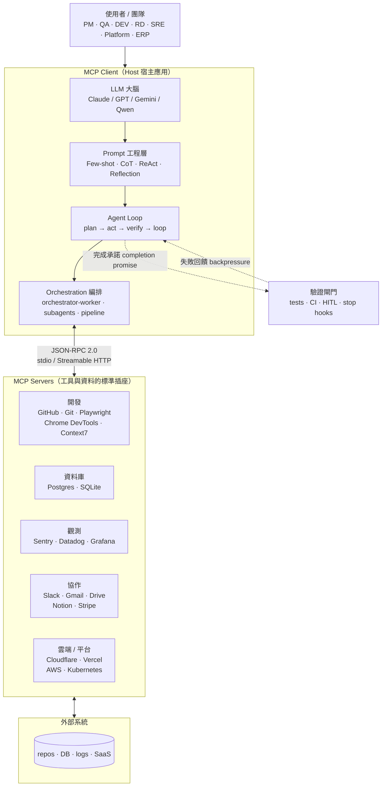
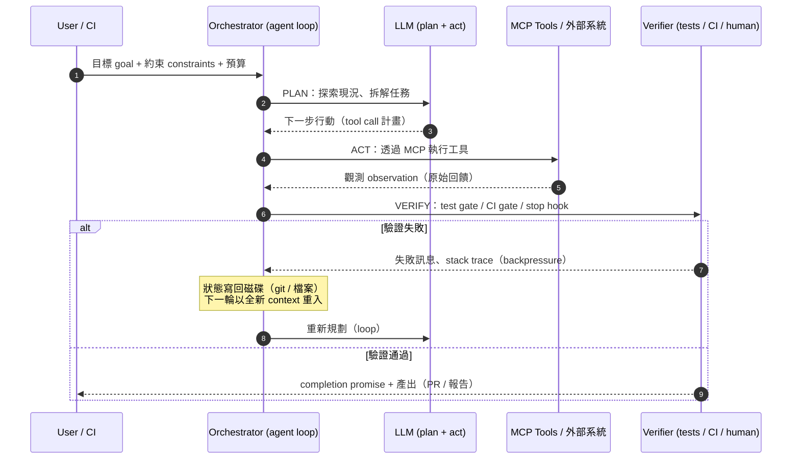

# 03 MCP × Prompt × Agent Loops | MCP, Prompts & Agent Loops

> 給 tech leader 的 MCP、Prompt 工程與 Agent Loop 實戰地圖：MCP 讓模型安全連上工具與資料，Prompt 模式決定模型怎麼想，Agent Loop 決定任務怎麼收斂、何時算完成。
> A practical map of MCP, prompt engineering and agent loops: MCP connects models to tools and data safely, prompt patterns decide how models think, agent loops decide how tasks converge and when they are done.
> 每條皆附真實來源（官方文件、開源 repo、學術論文），可直接作為選型清單與教學索引；開源專案標註 SPDX 授權與 stars（2026-11-08 查證）。
> Every entry carries a real source (official docs, open-source repos, papers) so this file doubles as a selection checklist and teaching index.

> Part of [Awesome Tech Leadership](../README.md) · [README (EN)](../README.md) · [繁體中文](../README.zh-TW.md)

## 全景圖

## Agent Loop 典型流程

## MCP 規格與生態

### Model Context Protocol Specification | MCP Spec
<!-- entry:id=mcp/spec type=guide roles=DEV,RD,PLATFORM tags=mcp,spec,protocol license=n/a last_verified=2026-11-08 -->
- **一句話**: The open protocol standardizing how LLM applications connect to external tools and data sources over JSON-RPC 2.0.
- **一句話（繁中）**: LLM 應用與外部工具／資料來源之間的開源標準協定，讓「模型 × 工具」不必一對一客製整合。
- **適用角色**: DEV、RD、Platform
- **來源 Sources**: [MCP Specification (2026-07-28)](https://modelcontextprotocol.io/specification/2026-07-28) — 官方、[modelcontextprotocol/modelcontextprotocol](https://github.com/modelcontextprotocol/modelcontextprotocol) — 官方 (license 未明確標示, 9.6k stars)
- **怎麼開始用 / 範例**: 先讀 Overview 掌握 Host / Client / Server 三角色、Resources / Prompts / Tools 三種 server 能力、stdio 與 Streamable HTTP 兩種 transport；文件站提供 llms.txt 方便程式化取用。
- **注意事項 / 陷阱**: 規格改版快（2025-06-18 → 2026-07-28，另有 Tasks、Skills over MCP、MCP Apps 等 extensions），導入前確認 client 支援的規格版本。

### MCP Official SDKs & Inspector | SDKs & Inspector
<!-- entry:id=mcp/official-sdks type=tool roles=DEV,RD tags=mcp,sdk,testing license=MIT last_verified=2026-11-08 -->
- **一句話**: Ten official language SDKs plus the Inspector tool for building and testing MCP servers and clients.
- **一句話（繁中）**: 官方 10 種語言 SDK 加上 Inspector 測試工具，是自建 MCP server 的起點。
- **適用角色**: DEV、RD
- **來源 Sources**: [python-sdk](https://github.com/modelcontextprotocol/python-sdk) — 官方 (MIT, 24.8k stars)、[typescript-sdk](https://github.com/modelcontextprotocol/typescript-sdk) — 官方 (license 未明確標示, 13.7k stars)、[go-sdk](https://github.com/modelcontextprotocol/go-sdk) — 官方 (license 未明確標示, 5.3k stars)、[java-sdk](https://github.com/modelcontextprotocol/java-sdk) — 官方 (MIT, 3.8k stars)、[csharp-sdk](https://github.com/modelcontextprotocol/csharp-sdk)、[kotlin-sdk](https://github.com/modelcontextprotocol/kotlin-sdk)、[swift-sdk](https://github.com/modelcontextprotocol/swift-sdk)、[php-sdk](https://github.com/modelcontextprotocol/php-sdk)、[ruby-sdk](https://github.com/modelcontextprotocol/ruby-sdk)、[rust-sdk](https://github.com/modelcontextprotocol/rust-sdk) — 官方、[inspector](https://github.com/modelcontextprotocol/inspector) — 官方 (license 未明確標示, 11.3k stars)
- **怎麼開始用 / 範例**: 用熟悉的語言 SDK 建一個只含單一 tool 的 server，再用 Inspector 逐項測 tool schema、權限與錯誤回應。
- **注意事項 / 陷阱**: 各 SDK 授權不一（python-sdk / java-sdk 為 MIT，其餘多數 GitHub 偵測為未明確標示）；成熟度以 Python / TypeScript 最高；Inspector 是開發期工具，別當生產監控。

### MCP Registry | Registry
<!-- entry:id=mcp/registry type=platform roles=DEV,RD,PLATFORM tags=mcp,registry,discovery license=n/a last_verified=2026-11-08 -->
- **一句話**: The official community-driven registry service for publishing and discovering MCP servers.
- **一句話（繁中）**: 官方、社群驅動的 MCP server 注冊表，回答「這個 server 叫什麼、在哪、是否官方」的基準問題。
- **適用角色**: DEV、RD、Platform
- **來源 Sources**: [registry.modelcontextprotocol.io](https://registry.modelcontextprotocol.io) — 官方、[modelcontextprotocol/registry](https://github.com/modelcontextprotocol/registry) — 官方 (license 未明確標示, 7.5k stars)
- **怎麼開始用 / 範例**: 用 namespace（如 `io.github/owner/repo`）搜尋 server 並比對安裝指引；自家 server 發布走 registry 的發行流程。
- **注意事項 / 陷阱**: 上架不等於通過安全審查，安裝前仍要做來源與授權檢查（見 MCP 安全章節）。

### MCP Directories & Lists | Directories
<!-- entry:id=mcp/directories type=platform roles=PM,DEV,RD,QA tags=mcp,directory,discovery license=n/a last_verified=2026-11-08 -->
- **一句話**: Community catalogs — mcp.so, Smithery, Glama, PulseMCP and awesome-mcp-servers — for finding and comparing MCP servers.
- **一句話（繁中）**: 社群整理的 MCP server 目錄、市場與排行，用來快速找現成 server、比較熱門度。
- **適用角色**: PM、DEV、RD、QA
- **來源 Sources**: [mcp.so](https://mcp.so) — 社群、[Smithery](https://smithery.ai) — 社群、[Glama MCP Directory](https://glama.ai/mcp) — 社群、[PulseMCP Server Directory](https://www.pulsemcp.com/servers/) — 社群（收錄 21,572 個 server，另有 clients 目錄與 Registry API）、[punkpeye/awesome-mcp-servers](https://github.com/punkpeye/awesome-mcp-servers) — 社群 (MIT, 97.5k stars)
- **怎麼開始用 / 範例**: 先在官方 Registry 找原廠 server；找不到再去 PulseMCP / mcp.so 依分類（開發、資料庫、觀測、協作、雲端）比較，最後以 GitHub repo 的授權與維護活躍度定案。
- **注意事項 / 陷阱**: 目錄的人氣指標（stars / 訪問量）不是品質保證；同名 server 很多（Slack、Datadog 都有官方與社群版），務必認 repo。

### Claude Code & Claude Desktop | Claude Clients
<!-- entry:id=mcp/claude-clients type=tool roles=PM,QA,DEV,RD,PLATFORM tags=mcp,client,claude license=n/a last_verified=2026-11-08 -->
- **一句話**: Anthropic's Claude Code (terminal agent) and Claude Desktop are first-class MCP hosts with user and project scoped server configs.
- **一句話（繁中）**: Claude Code（終端機 coding agent）與 Claude Desktop 皆為一線 MCP 宿主，支援使用者級與專案級 server 設定。
- **適用角色**: PM、QA、DEV、RD、Platform
- **來源 Sources**: [Claude Code MCP 官方文件](https://code.claude.com/docs/en/mcp) — 官方、[anthropics/claude-code](https://github.com/anthropics/claude-code) — 官方 (license 未明確標示, 155k stars)、[官方 MCP Clients 支援矩陣](https://modelcontextprotocol.io/clients) — 官方
- **怎麼開始用 / 範例**: `claude mcp add <name> ...` 加入 server，或在專案放 `.mcp.json` 與團隊共用；用 `/mcp` 檢視連線狀態。
- **注意事項 / 陷阱**: `.mcp.json` 會進版控，token 要用環境變數代入、不可寫死；Claude Desktop 與 Claude Code 的設定檔位置不同。

### AI IDE & Editor MCP Clients | IDE & Editor Clients
<!-- entry:id=mcp/ide-clients type=tool roles=DEV,RD,QA tags=mcp,client,ide,editor license=n/a last_verified=2026-11-08 -->
- **一句話**: The wider MCP client ecosystem — Cursor, Windsurf, Zed, VS Code (Copilot agent mode), Cline and Goose — with differing config formats and feature coverage.
- **一句話（繁中）**: 其餘主流 MCP 客戶端（Cursor、Windsurf、Zed、VS Code、Cline、Goose）各自的設定格式與功能覆蓋不同。
- **適用角色**: DEV、RD、QA
- **來源 Sources**: [Cursor MCP 文件](https://docs.cursor.com/context/model-context-protocol) — 官方、[Windsurf MCP 文件](https://docs.windsurf.com/windsurf/cascade/mcp) — 官方、[Zed MCP 文件](https://zed.dev/docs/ai/mcp) — 官方（支援 tools 與 prompts，尚不支援 resources / sampling / elicitation）、[VS Code MCP 文件](https://code.visualstudio.com/docs/copilot/chat/mcp-servers) — 官方、[cline/cline](https://github.com/cline/cline) — 社群 (Apache-2.0, 71.5k stars)、[aaif-goose/goose](https://github.com/aaif-goose/goose) — 社群 (Apache-2.0, 56.4k stars)、[PulseMCP Clients](https://www.pulsemcp.com/clients/) — 社群
- **怎麼開始用 / 範例**: 先查 client 的功能支援矩陣（tools / resources / prompts / elicitation 各家不同），再決定 server 用本地 stdio 還是遠端 HTTP。
- **注意事項 / 陷阱**: 設定檔鍵名各家不同（`mcpServers` / `servers` / Zed 的 `context_servers`），複製貼上最易踩雷。

## MCP Servers

### GitHub MCP Server | GitHub
<!-- entry:id=mcp/github-mcp-server type=mcp roles=DEV,RD,QA tags=mcp,github,devtools license=MIT last_verified=2026-11-08 -->
- **一句話**: GitHub's official MCP server for repository, issue, pull request and file operations.
- **一句話（繁中）**: GitHub 官方 MCP server，讓 agent 直接操作 repo、issue、PR 與檔案。
- **適用角色**: DEV、RD、QA
- **來源 Sources**: [github/github-mcp-server](https://github.com/github/github-mcp-server) — 官方 (MIT, 34.3k stars)
- **怎麼開始用 / 範例**: 依 README 以 Docker 或遠端模式啟動，於 Claude Code 用 `claude mcp add` 加入並設定細粒度 PAT（最小權限）。
- **注意事項 / 陷阱**: 寫入類工具（建 issue、合併 PR）權限要分級；token 從 read-only 起步。

### MCP Reference Servers | Reference Servers
<!-- entry:id=mcp/reference-servers type=mcp roles=DEV,RD tags=mcp,reference,learning license=n/a last_verified=2026-11-08 -->
- **一句話**: Small reference implementations (Fetch, Filesystem, Git, Memory, Sequential Thinking, Time) that demonstrate MCP features.
- **一句話（繁中）**: 官方參考實作（Fetch、Filesystem、Git、Memory、Sequential Thinking、Time），是學習自製 server 的教材，非生產方案。
- **適用角色**: DEV、RD
- **來源 Sources**: [modelcontextprotocol/servers](https://github.com/modelcontextprotocol/servers) — 官方 (license 未明確標示, 91.9k stars)、[modelcontextprotocol/servers-archived](https://github.com/modelcontextprotocol/servers-archived) — 官方 (MIT, 已封存)
- **怎麼開始用 / 範例**: 依 README 用 `npx` 啟動 TypeScript 版 server（例如 Memory server），觀察 resources / prompts / tools 三種能力如何暴露。
- **注意事項 / 陷阱**: 官方明言僅供教學示範、非 production-ready；舊 server（GitHub、Postgres、Slack 等）已移至 servers-archived 停止維護。

### Playwright MCP | Playwright
<!-- entry:id=mcp/playwright-mcp type=mcp roles=QA,DEV,RD tags=mcp,browser,testing license=Apache-2.0 last_verified=2026-11-08 -->
- **一句話**: An MCP server that drives a real browser via Playwright for end-to-end testing and web automation.
- **一句話（繁中）**: 用 Playwright 驅動真實瀏覽器的 MCP server，給 QA／開發 agent 做 E2E 測試與網頁自動化。
- **適用角色**: QA、DEV、RD
- **來源 Sources**: [microsoft/playwright-mcp](https://github.com/microsoft/playwright-mcp) — 官方 (Apache-2.0, 39.3k stars)
- **怎麼開始用 / 範例**: 以 `npx @playwright/mcp@latest` 加入 client，給 agent 一則可驗證的任務（例：登入後檢查儀表板數字）。
- **注意事項 / 陷阱**: 以無障礙樹而非截圖定位元素較省 token；網頁內容仍是間接 prompt injection 注入面。

### Chrome DevTools MCP | Chrome DevTools
<!-- entry:id=mcp/chrome-devtools-mcp type=mcp roles=DEV,RD,QA tags=mcp,browser,performance license=Apache-2.0 last_verified=2026-11-08 -->
- **一句話**: Google's MCP server exposing Chrome DevTools — performance traces, console and network — to coding agents.
- **一句話（繁中）**: 把 Chrome DevTools（效能、console、network）透過 MCP 開放給 coding agent 的官方工具。
- **適用角色**: DEV、RD、QA
- **來源 Sources**: [ChromeDevTools/chrome-devtools-mcp](https://github.com/ChromeDevTools/chrome-devtools-mcp) — 官方 (Apache-2.0, 55k stars)
- **怎麼開始用 / 範例**: 以 `npx chrome-devtools-mcp@latest` 加入 client，讓 agent 重現並診斷一個前端效能問題（如 LCP 過慢）。
- **注意事項 / 陷阱**: 會操作真實瀏覽器，務必跑在隔離 profile／沙箱；與 Playwright MCP 互補（一個偏診斷、一個偏驅動）。

### Database MCP Servers | Database (Postgres / SQLite)
<!-- entry:id=mcp/database-servers type=mcp roles=ERP,PLATFORM,DATA,RD,DEV tags=mcp,database,postgres,sqlite license=MIT last_verified=2026-11-08 -->
- **一句話**: Reference MCP servers for read-only Postgres access and SQLite database interaction.
- **一句話（繁中）**: 資料庫類 MCP server 的官方參考：Postgres（唯讀查詢與 schema 檢視）、SQLite（查詢與商業智慧分析）。
- **適用角色**: ERP、Platform、DATA、RD、DEV
- **來源 Sources**: [servers-archived/src/postgres](https://github.com/modelcontextprotocol/servers-archived/tree/main/src/postgres) — 官方 (MIT)、[servers-archived/src/sqlite](https://github.com/modelcontextprotocol/servers-archived/tree/main/src/sqlite) — 官方 (MIT)；替代方案可在 [MCP Registry](https://registry.modelcontextprotocol.io) 尋找各家雲端資料庫（Neon、Supabase 等）的原廠 server
- **怎麼開始用 / 範例**: 從「唯讀 ＋ 單一低權限帳號」接一條測試資料庫開始，讓 PM／RD 用自然語言查資料。
- **注意事項 / 陷阱**: 參考版 Postgres 明確唯讀；生產環境靠 DB 權限（read-only role）而非 prompt 約束，schema 描述同樣可能成為注入面。

### Sentry MCP | Sentry
<!-- entry:id=mcp/sentry-mcp type=mcp roles=SRE,DEV,RD,QA tags=mcp,observability,errors license=n/a last_verified=2026-11-08 -->
- **一句話**: Sentry's agentic tooling lets AI agents query issues, errors and traces from Sentry for faster debugging.
- **一句話（繁中）**: Sentry 官方 agentic 工具，讓 agent 直接查錯誤、issue 與 trace，加速除錯與事故回應。
- **適用角色**: SRE、DEV、RD、QA
- **來源 Sources**: [getsentry/toolkit](https://github.com/getsentry/toolkit) — 官方 (license 未明確標示, 960 stars；原 repo `getsentry/sentry-mcp` 已更名)、[Sentry MCP 官方文件](https://docs.sentry.io/product/sentry-mcp/) — 官方
- **怎麼開始用 / 範例**: 啟用後問一個真實問題：「今天 production 最新的 500 錯誤根因為何？」讓 agent 自己撈 stack trace。
- **注意事項 / 陷阱**: 事故資料常含客戶個資，輸出到第三方前先確認合規。

### Datadog MCP Server | Datadog
<!-- entry:id=mcp/datadog-mcp type=mcp roles=SRE,PLATFORM,EM tags=mcp,observability,datadog license=MIT last_verified=2026-11-08 -->
- **一句話**: Datadog's hosted remote MCP server exposing logs, metrics, traces, monitors and incidents to AI agents.
- **一句話（繁中）**: Datadog 官方託管的遠端 MCP server，把 logs、metrics、traces、監控與事故資料開放給 AI agent。
- **適用角色**: SRE、Platform、EM
- **來源 Sources**: [datadog-labs/mcp-server](https://github.com/datadog-labs/mcp-server) — 官方 (MIT, 47 stars)、[官方設定文件](https://docs.datadoghq.com/mcp_server/setup.md) — 官方、[工具清單](https://docs.datadoghq.com/mcp_server/tools.md) — 官方
- **怎麼開始用 / 範例**: `claude mcp add --transport http datadog https://mcp.datadoghq.com/v1/mcp`（EU 區域用 `mcp.datadoghq.eu`），用 `?toolsets=` 只開需要的工具組。
- **注意事項 / 陷阱**: 遠端 HTTP MCP（非本地 stdio），權限走 Datadog 的 `mcp_read` / `mcp_write` 角色；建議預設唯讀、寫入類另開審批。

### Grafana MCP | Grafana
<!-- entry:id=mcp/grafana-mcp type=mcp roles=SRE,PLATFORM,DEV tags=mcp,observability,grafana license=Apache-2.0 last_verified=2026-11-08 -->
- **一句話**: An MCP server for Grafana dashboards, logs, traces and incident queries.
- **一句話（繁中）**: Grafana 的 MCP server，讓 agent 查儀表板、logs、traces 與事故資訊。
- **適用角色**: SRE、Platform、DEV
- **來源 Sources**: [grafana/mcp-grafana](https://github.com/grafana/mcp-grafana) — 官方 (Apache-2.0, 3.6k stars)
- **怎麼開始用 / 範例**: 以唯讀帳號接上測試 Grafana，讓 agent 產出一頁「近 24 小時服務健康摘要」。
- **注意事項 / 陷阱**: 與 Datadog / Sentry 同屬觀測類，依既有觀測棧選一為主；儀表板內容同樣視為不受信任輸入。

### Slack MCP Server | Slack
<!-- entry:id=mcp/slack-mcp type=mcp roles=PM,DEV,SRE,PLATFORM tags=mcp,slack,messaging license=MIT last_verified=2026-11-08 -->
- **一句話**: Community and maintained-continuation MCP servers for Slack channels, messaging and history.
- **一句話（繁中）**: Slack 類 MCP server，讓 agent 讀寫頻道訊息與歷史（官方參考已封存，由社群接力維護）。
- **適用角色**: PM、DEV、SRE、Platform
- **來源 Sources**: [korotovsky/slack-mcp-server](https://github.com/korotovsky/slack-mcp-server) — 社群 (MIT, 1.9k stars)、[zencoderai/slack-mcp-server](https://github.com/zencoderai/slack-mcp-server) — 社群（官方參考 Slack server 的承接維護版）、[servers-archived/src/slack](https://github.com/modelcontextprotocol/servers-archived/tree/main/src/slack) — 官方 (MIT, 已封存)
- **怎麼開始用 / 範例**: 建專用 Slack App（bot token、最小 scope），先唯讀接一個測試頻道，驗證歷史訊息抓取。
- **注意事項 / 陷阱**: Slack 內容是典型不受信任輸入，別讓 agent 把頻道訊息當指令；發訊工具要限縮頻道範圍。

### Google Workspace MCP | Google Workspace
<!-- entry:id=mcp/google-workspace-mcp type=mcp roles=PM,ERP,PLATFORM tags=mcp,gmail,drive,calendar license=MIT last_verified=2026-11-08 -->
- **一句話**: An MCP server controlling Gmail, Google Calendar, Drive, Docs, Sheets and more for AI agents.
- **一句話（繁中）**: 涵蓋 Gmail、日曆、Drive、Docs、Sheets 的整合型 MCP server。
- **適用角色**: PM、ERP、Platform
- **來源 Sources**: [taylorwilsdon/google_workspace_mcp](https://github.com/taylorwilsdon/google_workspace_mcp) — 社群 (MIT, 3.5k stars)、[servers-archived/src/gdrive](https://github.com/modelcontextprotocol/servers-archived/tree/main/src/gdrive) — 官方 (MIT, 已封存的舊 GDrive 參考實作)
- **怎麼開始用 / 範例**: 建 Google Cloud OAuth 憑證（測試帳號、最小 scope），先只開 Drive 搜尋驗證流程，再逐步開 Gmail／日曆。
- **注意事項 / 陷阱**: Gmail ＋ Drive ＋ 對外傳信正好踩滿 lethal trifecta（私有資料＋不受信任內容＋對外通訊），開權限前先讀 MCP 安全章節。

### Cloudflare MCP Servers | Cloudflare
<!-- entry:id=mcp/cloudflare-mcp type=mcp roles=PLATFORM,DEV,RD tags=mcp,cloudflare,edge license=Apache-2.0 last_verified=2026-11-08 -->
- **一句話**: Cloudflare's product-specific MCP servers for Workers, KV, R2, CDN and more.
- **一句話（繁中）**: Cloudflare 產品系 MCP server，讓 agent 操作 Workers、KV、R2、CDN 等雲端資源。
- **適用角色**: Platform、DEV、RD
- **來源 Sources**: [cloudflare/mcp-server-cloudflare](https://github.com/cloudflare/mcp-server-cloudflare) — 官方 (Apache-2.0, 4.5k stars)、[Cloudflare MCP 文件](https://developers.cloudflare.com/agents/model-context-protocol/) — 官方
- **怎麼開始用 / 範例**: 以遠端 MCP 方式連上自家 Cloudflare 帳號，先做唯讀的設定檢視與快取清除驗證。
- **注意事項 / 陷阱**: 生產環境寫入類操作（改設定、清快取）建議搭配 human-in-the-loop 核准。

### Vercel MCP Handler | mcp-handler
<!-- entry:id=mcp/vercel-mcp-handler type=tool roles=PLATFORM,DEV,RD tags=mcp,server-framework,vercel license=n/a last_verified=2026-11-08 -->
- **一句話**: Vercel's adapter that turns an MCP server definition into a web-standard handler for Next.js, Nuxt, SvelteKit and Hono.
- **一句話（繁中）**: Vercel 的 MCP adapter，把 MCP server 定義變成標準 web handler，直接架在 Next.js 等框架上。
- **適用角色**: Platform、DEV、RD
- **來源 Sources**: [vercel-labs/mcp-handler](https://github.com/vercel-labs/mcp-handler) — 官方 (license 未明確標示, 697 stars；原 `@vercel/mcp-adapter` 已搬移)、[Vercel MCP 支援公告](https://vercel.com/changelog/mcp-server-support-on-vercel) — 官方、[npm @vercel/mcp-adapter](https://www.npmjs.com/package/@vercel/mcp-adapter) — 官方（舊套件，README 明示已搬移）
- **怎麼開始用 / 範例**: `npm install mcp-handler` 後用 `createMcpHandler((server) => { server.registerTool(...) })` 定義工具並佈署成遠端 MCP server。
- **注意事項 / 陷阱**: 2.x 已跟上 2026-07-28 規格並移除舊 SSE 傳輸；GitHub license 偵測為未明確標示（社群資料稱 Apache-2.0），商用前自行核對 LICENSE。

### Notion MCP Server | Notion
<!-- entry:id=mcp/notion-mcp type=mcp roles=PM,ERP tags=mcp,notion,knowledge license=MIT last_verified=2026-11-08 -->
- **一句話**: Notion's official MCP server for searching, reading and editing Notion workspaces.
- **一句話（繁中）**: Notion 官方 MCP server，讓 agent 搜尋、讀取與編輯 Notion 工作區。
- **適用角色**: PM、ERP
- **來源 Sources**: [makenotion/notion-mcp-server](https://github.com/makenotion/notion-mcp-server) — 官方 (MIT, 4.7k stars)
- **怎麼開始用 / 範例**: 建 Notion integration（integration token），先接一個測試資料庫讓 agent 彙整會議紀錄。
- **注意事項 / 陷阱**: 連動範圍要圈選（只連特定資料庫）；寫入工具可能覆蓋頁面，重要文件先備份。

### Stripe Agent Toolkit | Stripe
<!-- entry:id=mcp/stripe-agent-toolkit type=mcp roles=ERP,PM,PLATFORM tags=mcp,stripe,payments license=MIT last_verified=2026-11-08 -->
- **一句話**: Stripe's toolkit with MCP server and SDK bindings for building AI agents that use Stripe.
- **一句話（繁中）**: Stripe 官方 AI 工具組（含 MCP server 與框架綁定），讓 agent 安全操作 Stripe 能力。
- **適用角色**: ERP、PM、Platform
- **來源 Sources**: [stripe/ai](https://github.com/stripe/ai) — 官方 (MIT, 2.1k stars；原 `stripe/agent-toolkit` 已更名)
- **怎麼開始用 / 範例**: 用測試模式 API key（`sk_test_...`）接上 MCP，先讓 agent 查詢 customer / subscription 產出報表。
- **注意事項 / 陷阱**: 金流類工具永遠從測試模式＋唯讀開始；扣款、退款類動作要求 human-in-the-loop 核准。

### Kubernetes MCP Server | Kubernetes
<!-- entry:id=mcp/kubernetes-mcp type=mcp roles=SRE,PLATFORM,RD tags=mcp,kubernetes,ops license=Apache-2.0 last_verified=2026-11-08 -->
- **一句話**: An MCP server for Kubernetes and OpenShift cluster operations and troubleshooting.
- **一句話（繁中）**: 操作 Kubernetes / OpenShift 叢集的 MCP server，給 SRE／平台團隊做疑難排解與維運。
- **適用角色**: SRE、Platform、RD
- **來源 Sources**: [containers/kubernetes-mcp-server](https://github.com/containers/kubernetes-mcp-server) — 官方 (Apache-2.0, 2.2k stars)
- **怎麼開始用 / 範例**: 以唯讀 kubeconfig 連測試叢集，讓 agent 診斷「哪個 pod 在 crash loop、原因為何」。
- **注意事項 / 陷阱**: 叢集寫入權限（deploy、delete）極危險，生產預設不開；kubectl 輸出可能含 secrets，注意回饋外流。

### AWS MCP Servers | AWS
<!-- entry:id=mcp/aws-mcp type=mcp roles=PLATFORM,SRE,ERP,RD tags=mcp,aws,cloud license=Apache-2.0 last_verified=2026-11-08 -->
- **一句話**: A suite of open-source MCP servers for AWS services — CDK, pricing, docs, Bedrock and more.
- **一句話（繁中）**: AWS 官方開源的 MCP server 套件（CDK、價格、文件、Bedrock 等），涵蓋雲端開發與成本查詢。
- **適用角色**: Platform、SRE、ERP、RD
- **來源 Sources**: [awslabs/mcp](https://github.com/awslabs/mcp) — 官方 (Apache-2.0, 9.9k stars)
- **怎麼開始用 / 範例**: 從唯讀類 server 開始（pricing／docs 查詢），用 IAM 最小權限角色掛上。
- **注意事項 / 陷阱**: server 數量多，依需求挑選、不要全開；留意各 server 的憑證傳遞方式（環境變數 vs SSO）。

### Context7 | Context7
<!-- entry:id=mcp/context7 type=mcp roles=DEV,RD,QA tags=mcp,docs,retrieval license=MIT last_verified=2026-11-08 -->
- **一句話**: An MCP server that serves up-to-date, version-specific library documentation to AI agents.
- **一句話（繁中）**: 把「最新、對應版本」的函式庫文件即時供給 agent，減少過時 API 幻覺。
- **適用角色**: DEV、RD、QA
- **來源 Sources**: [upstash/context7](https://github.com/upstash/context7) — 社群 (MIT, 64.4k stars)
- **怎麼開始用 / 範例**: 在 coding agent 加入 Context7，提問附上函式庫名稱與版本，比較「有／無 Context7」的 API 正確率。
- **注意事項 / 陷阱**: 文件內容同屬外部輸入、可能被汙染；關鍵 API 以官方 repo 原始碼複核。

## MCP 安全

### MCP Tool Poisoning & Rug Pull | Tool Poisoning
<!-- entry:id=mcp/tool-poisoning type=policy roles=PLATFORM,SRE,DEV,RD tags=security,prompt-injection,mcp license=n/a last_verified=2026-11-08 -->
- **一句話**: Attacks hiding malicious instructions in MCP tool descriptions — including post-approval changes (rug pulls) and cross-server overrides (tool shadowing).
- **一句話（繁中）**: 把惡意指令藏在 MCP 工具描述裡的攻擊：工具描述注入（tool poisoning）、核准後偷改描述（rug pull）、跨 server 覆寫行為（tool shadowing）。
- **適用角色**: Platform、SRE、DEV、RD
- **來源 Sources**: [Invariant Labs — MCP Security Notification: Tool Poisoning Attacks](https://invariantlabs.ai/blog/mcp-security-notification-tool-poisoning-attacks) — 官方（2025-04 披露）、[invariantlabs-ai/mcp-injection-experiments](https://github.com/invariantlabs-ai/mcp-injection-experiments) — 官方 (license 未明確標示, 210 stars)、[Toxic Flow Analysis](https://invariantlabs.ai/blog/toxic-flow-analysis) — 官方
- **怎麼開始用 / 範例**: 把「工具描述＝不受信任輸入」寫進團隊規範；導入 tool pinning（hash 釘住工具描述），描述一變就要求重新核准。
- **注意事項 / 陷阱**: 攻擊可偷讀 `~/.ssh/id_rsa`、`mcp.json` 等敏感檔再藉隱藏欄位外傳；使用者看到的訊息可被偽裝，「核准過」不等於之後都安全。

### Prompt Injection & Lethal Trifecta | Lethal Trifecta
<!-- entry:id=mcp/lethal-trifecta type=policy roles=PM,QA,PLATFORM,SRE,DEV tags=security,prompt-injection,risk license=n/a last_verified=2026-11-08 -->
- **一句話**: The "lethal trifecta" — private data access, untrusted content exposure and external communication ability — is the core risk model for agents.
- **一句話（繁中）**: 「致命三角」：私有資料存取＋不受信任內容＋對外通訊能力三者並存時，prompt injection 會直接變成資料外洩。
- **適用角色**: PM、QA、Platform、SRE、DEV
- **來源 Sources**: [Simon Willison — The lethal trifecta for AI agents](https://simonwillison.net/2025/Jun/16/the-lethal-trifecta/) — 社群、[How to stop AI's lethal trifecta](https://simonwillison.net/2025/Sep/26/how-to-stop-ais-lethal-trifecta/) — 社群、[Prompt injection 系列](https://simonwillison.net/series/prompt-injection/) — 社群
- **怎麼開始用 / 範例**: 對每個 agent／MCP 組合做三角檢查；優先「砍掉外傳能力」（網路白名單、禁止任意回傳通道），這是最有效的一刀。
- **注意事項 / 陷阱**: 作者明言「防護欄 99% 攔截率在資安上就是不及格」——別把模型自我警覺當防線；RAG／網頁內容都是注入面。

### MCP-Scan / Snyk Agent Scan | MCP-Scan
<!-- entry:id=mcp/mcp-scan type=tool roles=PLATFORM,SRE,QA,DEV tags=security,scanning,tooling license=Apache-2.0 last_verified=2026-11-08 -->
- **一句話**: An open-source scanner that detects tool poisoning, rug pulls and shadowing in MCP servers at install and runtime.
- **一句話（繁中）**: 開源掃描工具，安裝期與執行期偵測 MCP 的工具描述注入、偷改描述與跨 server 覆寫。
- **適用角色**: Platform、SRE、QA、DEV
- **來源 Sources**: [Introducing MCP-Scan](https://invariantlabs.ai/blog/introducing-mcp-scan) — 官方、[MCP-Scan 文件](https://invariantlabs-ai.github.io/docs/mcp-scan/) — 官方、[snyk/agent-scan](https://github.com/snyk/agent-scan) — 官方 (Apache-2.0, 3.2k stars；原 `invariantlabs-ai/mcp-scan` 已更名)
- **怎麼開始用 / 範例**: 安裝任何新 MCP server 前先 `uvx mcp-scan@latest` 掃一次，並在 CI 加一道掃描；runtime 用 proxy 模式監控。
- **注意事項 / 陷阱**: 掃描只擋已知型態，授權最小化與網路隔離仍是主力；MCP 協定無法強制安全，必須由 host 實作把關。

## Prompt 工程指南與模式

### Anthropic Prompt Engineering Guide | Anthropic
<!-- entry:id=prompts/anthropic-guide type=guide roles=PM,QA,DEV,RD tags=prompting,guide,anthropic license=n/a last_verified=2026-11-08 -->
- **一句話**: Anthropic's official prompt engineering documentation and interactive tutorial covering roles, XML tags, prefill and system prompts.
- **一句話（繁中）**: Anthropic 官方 prompt 工程文件與互動教學：角色、XML 標籤分段、prefill、system prompt 等技巧。
- **適用角色**: PM、QA、DEV、RD
- **來源 Sources**: [Prompt engineering overview](https://docs.anthropic.com/en/docs/build-with-claude/prompt-engineering/overview) — 官方、[anthropics/prompt-eng-interactive-tutorial](https://github.com/anthropics/prompt-eng-interactive-tutorial) — 官方 (license 未明確標示, 39.1k stars)
- **怎麼開始用 / 範例**: 跑互動教學前幾章（clear instructions、role prompting），把最常重複的一個任務改寫成結構化 prompt 並 A/B 對照。
- **注意事項 / 陷阱**: 技巧有模型家族特性（XML 標籤對 Claude 特別有效），換模型要重新驗證。

### OpenAI Prompting Guide & Cookbook | OpenAI
<!-- entry:id=prompts/openai-guide type=guide roles=PM,QA,DEV,RD tags=prompting,guide,openai license=n/a last_verified=2026-11-08 -->
- **一句話**: OpenAI's official prompting best practices plus the open-source cookbook of runnable examples.
- **一句話（繁中）**: OpenAI 官方 prompt 最佳實務指南，加上開源 Cookbook 的可執行範例庫。
- **適用角色**: PM、QA、DEV、RD
- **來源 Sources**: [Prompt engineering guide](https://platform.openai.com/docs/guides/prompt-engineering) — 官方、[openai/openai-cookbook](https://github.com/openai/openai-cookbook) — 官方 (MIT, 77k stars)
- **怎麼開始用 / 範例**: 依指南的「指令清楚化、範例、欄位拆分」重寫一個任務 prompt，再到 Cookbook 找工具呼叫、結構化輸出範例實作。
- **注意事項 / 陷阱**: 以自家模型為主，遷移到其他模型時注意 tokenizer 與指令跟隨度差異。

### Gemini Prompting Strategies | Gemini
<!-- entry:id=prompts/gemini-guide type=guide roles=PM,QA,DEV,RD tags=prompting,guide,gemini license=n/a last_verified=2026-11-08 -->
- **一句話**: Google's official prompting strategies for the Gemini API — roles, formats, few-shot examples and constraints.
- **一句話（繁中）**: Google 官方的 Gemini API prompt 策略：角色設定、輸出格式、few-shot 範例與約束條件。
- **適用角色**: PM、QA、DEV、RD
- **來源 Sources**: [Gemini prompting strategies](https://ai.google.dev/gemini-api/docs/prompting-strategies) — 官方
- **怎麼開始用 / 範例**: 以「給角色、定格式、舉範例、加約束」四步驟改造一個 Gemini 任務，並用負面指令收斂輸出。
- **注意事項 / 陷阱**: Gemini 各版本（Flash / Pro）行為差異大，評估時記下模型版本。

### Open-Weight Model Prompt Guides | Mistral / DeepSeek / Qwen
<!-- entry:id=prompts/open-weight-guides type=guide roles=DEV,RD,PM,QA tags=prompting,guide,open-weights license=MIT last_verified=2026-11-08 -->
- **一句話**: Official prompting resources from open-weight model vendors — Mistral, DeepSeek and Qwen.
- **一句話（繁中）**: 開源權重模型官方的 prompt 指引：Mistral、DeepSeek、Qwen（含 thinking / non-thinking 模式說明）。
- **適用角色**: DEV、RD、PM、QA
- **來源 Sources**: [Mistral Completion 文件](https://docs.mistral.ai/capabilities/completion/) — 官方、[mistralai/cookbook](https://github.com/mistralai/cookbook) — 官方 (MIT, 2.4k stars)、[DeepSeek Prompt Examples](https://api-docs.deepseek.com/prompt-examples) — 官方、[DeepSeek Prompt Library](https://platform.deepseek.com/prompt-library) — 官方、[QwenLM/Qwen3](https://github.com/QwenLM/Qwen3) — 官方 (license 未明確標示, 27.7k stars)、[Alibaba Model Studio — Prompt engineering](https://www.alibabacloud.com/help/en/model-studio/prompt-engineering) — 官方
- **怎麼開始用 / 範例**: 自架模型（Ollama / vLLM）場景先讀 Qwen3 的 thinking / non-thinking 模式說明，再用 DeepSeek prompt library 挑同類任務抄結構。
- **注意事項 / 陷阱**: Mistral 無獨立 prompting guide 專頁，以 Completion 文件與 cookbook 為準；各家 system prompt、chat template 支援不同。

### Few-shot ICL & Meta-prompting | Few-shot
<!-- entry:id=prompts/few-shot-meta type=prompt roles=PM,QA,DEV,RD,ERP tags=prompting,in-context-learning,meta license=n/a last_verified=2026-11-08 -->
- **一句話**: Learning from examples in context (few-shot ICL) and using an LLM to generate or refine prompts (meta-prompting).
- **一句話（繁中）**: 用範例直接在上下文教模型（few-shot ICL），以及讓模型自己生成／優化 prompt（meta-prompting）。
- **適用角色**: PM、QA、DEV、RD、ERP
- **來源 Sources**: [Language Models are Few-Shot Learners](https://arxiv.org/abs/2005.14165) — 學術 (arXiv 2005.14165)、[Meta-Prompting: Task-Agnostic Scaffolding](https://arxiv.org/abs/2401.12954) — 學術 (arXiv 2401.12954)
- **怎麼開始用 / 範例**: 挑 3-5 個「輸入 → 期望輸出」真實範例放進 prompt（含難例與反例），先看格式是否穩定。
- **注意事項 / 陷阱**: 範例會被模仿——一個壞範例污染全部輸出；meta-prompting 產出的 prompt 要人工把關再上線。

### Chain-of-Thought & Self-Consistency | CoT
<!-- entry:id=prompts/chain-of-thought type=prompt roles=QA,RD,DEV,ERP tags=prompting,reasoning,consistency license=n/a last_verified=2026-11-08 -->
- **一句話**: Eliciting step-by-step reasoning (CoT) and sampling multiple reasoning paths with majority voting (Self-Consistency).
- **一句話（繁中）**: 讓模型逐步推理（CoT）提升複雜題正確率；多次取樣多條推理路徑後多數決（Self-Consistency）再提升穩定度。
- **適用角色**: QA、RD、DEV、ERP
- **來源 Sources**: [Chain-of-Thought Prompting Elicits Reasoning in LLMs](https://arxiv.org/abs/2201.11903) — 學術 (arXiv 2201.11903)、[Self-Consistency Improves CoT Reasoning](https://arxiv.org/abs/2203.11171) — 學術 (arXiv 2203.11171)
- **怎麼開始用 / 範例**: 在數學、邏輯、規格拆解任務加「先列推理步驟，再給最終答案」；高價值決策跑 3-5 次取多數決。
- **注意事項 / 陷阱**: CoT 較費 token 且推理過程可能是事後合理化；Self-Consistency 成本線性成長，只用在高價值決策。

### ReAct: Reasoning + Acting | ReAct
<!-- entry:id=prompts/react type=prompt roles=DEV,RD,SRE,QA tags=prompting,reasoning,tool-use license=n/a last_verified=2026-11-08 -->
- **一句話**: Interleaving reasoning traces with tool actions so the model plans, acts, observes and iterates.
- **一句話（繁中）**: 把推理與工具行動交錯進行（想 → 做 → 看結果 → 再想），是今日 agent 工具迴圈的理論原型。
- **適用角色**: DEV、RD、SRE、QA
- **來源 Sources**: [ReAct: Synergizing Reasoning and Acting in Language Models](https://arxiv.org/abs/2210.03629) — 學術 (arXiv 2210.03629)
- **怎麼開始用 / 範例**: 每個工具給明確回傳格式讓模型依 observation 續行；prompt 範例示範一次 thought → action → observation 迴圈。
- **注意事項 / 陷阱**: 這是 Agent Loop 的 prompt 層基礎；要設最大步數防無限追蹤同一工具。

### Tree of Thoughts & Plan-and-Solve | ToT / Plan-Solve
<!-- entry:id=prompts/tot-plan-solve type=prompt roles=RD,DEV,PM,QA tags=prompting,planning,search license=n/a last_verified=2026-11-08 -->
- **一句話**: Exploring branching reasoning paths with lookahead and backtracking (ToT); explicitly planning before solving (Plan-and-Solve).
- **一句話（繁中）**: ToT 讓模型展開多條推理分支、前瞻與回溯；Plan-and-Solve 強制「先規劃再解題」，改善零樣本推理。
- **適用角色**: RD、DEV、PM、QA
- **來源 Sources**: [Tree of Thoughts: Deliberate Problem Solving with LLMs](https://arxiv.org/abs/2305.10601) — 學術 (arXiv 2305.10601)、[Plan-and-Solve Prompting](https://arxiv.org/abs/2305.04091) — 學術 (arXiv 2305.04091)
- **怎麼開始用 / 範例**: 規格模糊的任務用 Plan-and-Solve 強制輸出「步驟清單 → 逐步執行 → 檢查」；難題用 ToT 產 2-3 個方案比較。
- **注意事項 / 陷阱**: ToT 消耗大量 token，適合難題不適合日常；規劃輸出要能落回可驗證步驟（見 plan-execute-verify）。

### Reflection & Self-Critique Patterns | Reflection
<!-- entry:id=prompts/reflection-critique type=prompt roles=QA,DEV,RD,PM tags=prompting,self-critique,reflection license=n/a last_verified=2026-11-08 -->
- **一句話**: Verbal reinforcement (Reflexion), iterative self-feedback (Self-Refine) and principle-guided self-critique (Constitutional AI prompting).
- **一句話（繁中）**: 讓模型自我檢討與修正的三型：Reflexion（失敗經驗化為語言記憶）、Self-Refine（迭代自我回饋）、Constitutional AI prompting（用原則清單自我批評）。
- **適用角色**: QA、DEV、RD、PM
- **來源 Sources**: [Reflexion: Language Agents with Verbal Reinforcement Learning](https://arxiv.org/abs/2303.11366) — 學術 (arXiv 2303.11366)、[Self-Refine: Iterative Refinement with Self-Feedback](https://arxiv.org/abs/2303.17651) — 學術 (arXiv 2303.17651)、[Constitutional AI: Harmlessness from AI Feedback](https://arxiv.org/abs/2212.08073) — 學術 (arXiv 2212.08073)
- **怎麼開始用 / 範例**: 產出（程式碼、文案、測試）後加一輪「依檢查清單自我批評並輸出修訂版」；長期任務把失敗教訓寫進下次 prompt 或檔案。
- **注意事項 / 陷阱**: 自我批評有天花板——模型給自己打分容易永遠滿分，重要決策要獨立 verifier；迭代 2-3 輪後收益遞減。

### Structured Outputs & Tool Use | Structured Output
<!-- entry:id=prompts/structured-outputs type=prompt roles=DEV,RD,ERP,QA tags=prompting,structured-output,json license=n/a last_verified=2026-11-08 -->
- **一句話**: Provider-level guarantees for machine-readable output — OpenAI Structured Outputs and JSON mode, and Anthropic tool use as an extraction interface.
- **一句話（繁中）**: 供應商層級的可靠結構化輸出：OpenAI Structured Outputs / JSON mode，以及用 Anthropic tool use 當抽取介面拿穩定 JSON。
- **適用角色**: DEV、RD、ERP、QA
- **來源 Sources**: [OpenAI — Structured Outputs](https://platform.openai.com/docs/guides/structured-outputs) — 官方、[Anthropic — Tool Use](https://docs.anthropic.com/en/docs/agents-and-tools/tool-use/overview) — 官方
- **怎麼開始用 / 範例**: 定義 JSON Schema（欄位型態＋必填），用 Structured Outputs 或「強制呼叫回傳 schema 的 tool」取輸出，程式端再驗證一次。
- **注意事項 / 陷阱**: schema 太複雜會降低跟隨度，欄位先少後多；永遠在程式端做最終驗證。

### Constrained Decoding Libraries | Constrained Decoding
<!-- entry:id=prompts/constrained-decoding type=tool roles=DEV,RD,PLATFORM,ERP tags=prompting,structured-output,decoding license=Apache-2.0 last_verified=2026-11-08 -->
- **一句話**: Open-source libraries that constrain decoding to a grammar or schema for guaranteed valid output, including on local models.
- **一句話（繁中）**: 用文法／schema 限制解碼過程保證輸出格式合法——自架模型（llama.cpp 等）必備。
- **適用角色**: DEV、RD、Platform、ERP
- **來源 Sources**: [dottxt-ai/outlines](https://github.com/dottxt-ai/outlines) — 社群 (Apache-2.0, 16k stars)、[mlc-ai/xgrammar](https://github.com/mlc-ai/xgrammar) — 社群 (Apache-2.0, 2k stars)、[guidance-ai/guidance](https://github.com/guidance-ai/guidance) — 社群 (MIT, 21.8k stars)、[567-labs/instructor](https://github.com/567-labs/instructor) — 社群 (MIT, 14.1k stars)、[ggml-org/llama.cpp](https://github.com/ggml-org/llama.cpp) — 社群 (MIT, 133.7k stars，GBNF 文法)
- **怎麼開始用 / 範例**: 本地推論用 xgrammar / GBNF 限制輸出為 JSON Schema；Python 應用層用 instructor 把 Pydantic 模型接上各家 LLM API。
- **注意事項 / 陷阱**: 嚴格文法會犧牲部分回答品質（模型被迫填滿欄位）；超大 schema 的文法編譯可能拖慢首 token。

## Prompt 工具與評估

### promptfoo | promptfoo
<!-- entry:id=prompts/promptfoo type=tool roles=QA,DEV,PM tags=eval,testing,red-teaming license=MIT last_verified=2026-11-08 -->
- **一句話**: An open-source CLI for prompt testing, red teaming and CI/CD evals across many LLM providers.
- **一句話（繁中）**: 開源 CLI：prompt 測試、紅隊攻擊模擬、CI/CD 評測，可跨多家模型比較。
- **適用角色**: QA、DEV、PM
- **來源 Sources**: [promptfoo/promptfoo](https://github.com/promptfoo/promptfoo) — 社群 (MIT, 27k stars)、[promptfoo.dev](https://promptfoo.dev) — 官方
- **怎麼開始用 / 範例**: `npm install -g promptfoo && promptfoo init` 建第一個 eval（同任務、兩種 prompt、兩家模型），把結果貼進 PR。
- **注意事項 / 陷阱**: 評測集取自真實案例（含邊角案例）；CI 全跑多家模型會燒錢，門檻值要分級。

### Langfuse | Langfuse
<!-- entry:id=prompts/langfuse type=platform roles=DEV,RD,PM,PLATFORM tags=observability,eval,tracing license=n/a last_verified=2026-11-08 -->
- **一句話**: Open-source LLM engineering platform for tracing, evaluation and prompt management, self-hostable.
- **一句話（繁中）**: 開源 LLM 工程平台：追蹤（trace）、評估、prompt 管理一條龍，可自架。
- **適用角色**: DEV、RD、PM、Platform
- **來源 Sources**: [langfuse/langfuse](https://github.com/langfuse/langfuse) — 社群 (license 未明確標示, 37.1k stars)、[langfuse.com](https://langfuse.com) — 官方
- **怎麼開始用 / 範例**: 在應用埋 SDK 追蹤一週真實流量，先回答「哪類任務失敗率最高」再談優化。
- **注意事項 / 陷阱**: trace 含使用者輸入，自架注意個資保存期限；混合授權，商用前確認條款。

### LLM Evaluation Platforms | LangSmith / Braintrust / PromptLayer
<!-- entry:id=prompts/eval-platforms type=platform roles=PM,QA,DEV,RD tags=eval,prompt-management,platform license=n/a last_verified=2026-11-08 -->
- **一句話**: Commercial platforms for prompt versioning, evaluation datasets and LLM observability.
- **一句話（繁中）**: 商業平台三件組：prompt 版本管理、評估資料集與 LLM 觀測。
- **適用角色**: PM、QA、DEV、RD
- **來源 Sources**: [LangSmith](https://smith.langchain.com/) — 官方 (n/a)、[langchain-ai/langsmith-python](https://github.com/langchain-ai/langsmith-python) — 官方 (MIT)、[Braintrust 文件](https://www.braintrust.dev/docs) — 官方 (n/a)、[PromptLayer](https://www.promptlayer.com) — 官方 (n/a)
- **怎麼開始用 / 範例**: 選一家把 prompt 版本搬進平台管理，讓每次 prompt 變更都有對照評分與回歸紀錄。
- **注意事項 / 陷阱**: 客戶對話資料上第三方前確認資安合規；三家功能重疊，先定需求（評估／觀測／版本管理）再選型；舊 langsmith-sdk repo 已於 2026-10-16 封存並拆為 Python / JS SDK。

## Agent Loops & Orchestration

### Plan-Act / Plan-Execute-Verify / OODA | Agent Loop Basics
<!-- entry:id=loops/agent-loop-basics type=loop roles=DEV,RD,PM,QA,SRE tags=loop,plan-verify,ooda license=n/a last_verified=2026-11-08 -->
- **一句話**: The core agentic loop — plan, act with tools, observe, verify and repeat until the goal or budget is reached.
- **一句話（繁中）**: Agent 迴圈骨幹：規劃 → 行動 → 觀測 → 驗證 → 重入，直到達成目標或耗盡預算；plan-execute-verify 以驗證收斂，OODA（觀察→判斷→決策→行動）是決策迴圈類比。
- **適用角色**: DEV、RD、PM、QA、SRE
- **來源 Sources**: [Anthropic — Building Effective Agents](https://www.anthropic.com/engineering/building-effective-agents) — 官方、[OODA loop](https://en.wikipedia.org/wiki/OODA_loop) — 社群（概念類比）
- **怎麼開始用 / 範例**: 給 agent 明確完成定義（例：所有測試通過）＋預算上限，觀察每輪 plan 是否收斂；流程見上方「Agent Loop 典型流程」圖。
- **注意事項 / 陷阱**: 無驗證的純 plan-act 容易空轉或過早宣告完成；verify 要用外部信號（測試、型別檢查），別只靠模型自評。

### Ralph Loop / autoloop / CI-driven Loops | Autonomous Loops
<!-- entry:id=loops/autonomous-loops type=loop roles=DEV,RD,PM,PLATFORM tags=loop,autonomous,ralph,ci license=MIT last_verified=2026-11-08 -->
- **一句話**: Fire-and-forget loops that re-run a coding agent against a prompt until done — the "Ralph Wiggum" pattern and its harness descendants.
- **一句話（繁中）**: 把同一份任務說明書反覆餵給 coding agent 跑到完成為止的自主迴圈（Ralph Wiggum loop）：每輪全新 context、狀態落磁碟（git），演化出 autoloop 與 CI 內建迴圈等型態。
- **適用角色**: DEV、RD、PM、Platform
- **來源 Sources**: [Geoffrey Huntley — Ralph Wiggum as a software engineer](https://ghuntley.com/ralph/) — 社群（模式起源文）、[snarktank/ralph](https://github.com/snarktank/ralph) — 社群 (MIT, 22.2k stars)、[mikeyobrien/autoloop](https://github.com/mikeyobrien/autoloop) — 社群 (MIT, 72 stars)、[Autoloop for Claude Code](https://letitloop.dev/) — 社群（獨立 verifier 設計）、[anthropics/claude-code-action](https://github.com/anthropics/claude-code-action) — 官方 (MIT, 9.8k stars)、[codecentric — The Ralph Wiggum Loop](https://www.codecentric.de/en/knowledge-hub/blog/the-ralph-wiggum-loop-autonomous-code-generation-with-a-fresh-context) — 社群、[Lukas Grigis — What a Ralph Loop Is](https://lukasgrigis.dev/blog/ralph-loop/) — 社群
- **怎麼開始用 / 範例**: 把任務寫成可驗證的 SPEC（含完成定義），用 `while :; do cat SPEC.md | <agent> ; done` 之類迴圈＋git worktree 隔離開跑；或直接用 snarktank/ralph、autoloop 等現成 harness。
- **注意事項 / 陷阱**: 成本可能暴走（有實測失敗一輪約 9 美元、成功任務約 200 美元的案例），設預算與輪數上限；常需跳過權限確認（`--dangerously-skip-permissions`），務必在沙箱／worktree 內跑；自評不可靠，要用獨立 verifier。

### Multi-agent & Workflow Composition | Multi-agent Patterns
<!-- entry:id=loops/multi-agent-patterns type=loop roles=PM,DEV,RD,QA,PLATFORM tags=orchestration,multi-agent,workflow license=n/a last_verified=2026-11-08 -->
- **一句話**: Composition patterns — prompt chaining, routing, parallelization, orchestrator-worker, evaluator-optimizer, multiagent debate and hierarchical teams.
- **一句話（繁中）**: 代理與工作流的組合模式：prompt chaining（管線串接）、routing（分流）、parallelization（平行化）、orchestrator-worker（編排者—工人）、evaluator-optimizer（評估者—優化者）、multiagent debate（多代理辯論）、hierarchical teams（階層團隊）。
- **適用角色**: PM、DEV、RD、QA、Platform
- **來源 Sources**: [Anthropic — Building Effective Agents](https://www.anthropic.com/engineering/building-effective-agents) — 官方、[Anthropic — How we built our multi-agent research system](https://www.anthropic.com/engineering/built-multi-agent-research-system) — 官方、[Multiagent Debate](https://arxiv.org/abs/2305.14325) — 學術 (arXiv 2305.14325)
- **怎麼開始用 / 範例**: 從單一 agent ＋ evaluator-optimizer 起步（一個做、一個挑錯），確認單線可靠後才拆 orchestrator-worker 平行化。
- **注意事項 / 陷阱**: 多代理 token 成本是單代理的數倍（Anthropic 報告主導航 agent 約 4 倍 token）；強耦合任務別硬拆（見 Context Engineering）。

### Context Engineering: Don't Build Multi-Agents | Context Engineering
<!-- entry:id=loops/context-engineering type=loop roles=PM,DEV,RD,PLATFORM tags=context-engineering,architecture,tradeoff license=n/a last_verified=2026-11-08 -->
- **一句話**: Cognition's argument that one long, well-managed context beats parallel subagents that cannot share full state.
- **一句話（繁中）**: Cognition 的主張：與其拆一堆無法共享完整狀態的平行子代理，不如把單一長上下文管理好（行動共享、決策集中）。
- **適用角色**: PM、DEV、RD、Platform
- **來源 Sources**: [Cognition — Don't Build Multi-Agents](https://cognition.ai/blog/dont-build-multi-agents) — 官方
- **怎麼開始用 / 範例**: 拆多代理前先問「任務資訊能不能被壓縮傳遞？」；不能（強耦合、共享大量上下文）就維持單線＋好的檔案化狀態。
- **注意事項 / 陷阱**: 與 Anthropic multi-agent 報導不矛盾——該系統用在可平行蒐集資訊的研究類任務；寫程式這類強順序耦合任務偏向單線。

### Orchestration Frameworks | Frameworks
<!-- entry:id=loops/orchestration-frameworks type=platform roles=DEV,RD,PLATFORM tags=orchestration,frameworks,multi-agent license=MIT last_verified=2026-11-08 -->
- **一句話**: Frameworks and protocols for building multi-agent systems — LangGraph, AutoGen, CrewAI, OpenAI Agents SDK, Google ADK and A2A.
- **一句話（繁中）**: 建構與編排多代理系統的框架／協定生態：狀態圖（LangGraph）、對話式多代理（AutoGen）、角色團隊（CrewAI）、官方輕量 SDK（OpenAI Agents SDK）、Google ADK、跨代理互通（A2A）。
- **適用角色**: DEV、RD、Platform
- **來源 Sources**: [langchain-ai/langgraph](https://github.com/langchain-ai/langgraph) — 社群 (MIT, 44.6k stars)、[microsoft/autogen](https://github.com/microsoft/autogen) — 官方 (CC-BY-4.0, 61.7k stars)、[crewAIInc/crewAI](https://github.com/crewAIInc/crewAI) — 社群 (MIT, 60.6k stars)、[openai/openai-agents-python](https://github.com/openai/openai-agents-python) — 官方 (MIT, 30.6k stars)、[openai/swarm](https://github.com/openai/swarm) — 官方 (MIT, 22.1k stars，教學用、已由 Agents SDK 承接)、[google/adk-python](https://github.com/google/adk-python) — 官方 (Apache-2.0, 22.1k stars)、[a2aproject/A2A](https://github.com/a2aproject/A2A) — 社群 (Apache-2.0, 26.5k stars)
- **怎麼開始用 / 範例**: 小型自動化先試 OpenAI Agents SDK 或 LangGraph 最小範例（兩三個節點）；跨團隊／跨產品代理互通才評估 A2A。
- **注意事項 / 陷阱**: 框架抽象會蓋住 loop 細節（重試、預算、驗證），上線前把控制權要回來；MCP 管工具介面、A2A 管代理對話，互補不互斥。

### Agent Harness Elements | Harness
<!-- entry:id=loops/harness-elements type=method roles=DEV,RD,PM,QA,PLATFORM tags=harness,hooks,skills,subagents license=n/a last_verified=2026-11-08 -->
- **一句話**: The building blocks of an agent harness — deterministic hooks, reusable commands and skills, delegated subagents and background execution.
- **一句話（繁中）**: Agent 外殼（harness）的元件：確定性 hooks、可重用 slash commands 與 skills、可派工 subagents、背景執行任務。
- **適用角色**: DEV、RD、PM、QA、Platform
- **來源 Sources**: [Claude Code Hooks](https://code.claude.com/docs/en/hooks) — 官方、[Slash Commands](https://code.claude.com/docs/en/slash-commands) — 官方、[Skills](https://code.claude.com/docs/en/skills) — 官方、[Subagents](https://code.claude.com/docs/en/sub-agents) — 官方
- **怎麼開始用 / 範例**: 把最重複的工作流寫成一支 slash command（或 skill），再用 hook 把「提交前必跑測試」變成確定性攔截。
- **注意事項 / 陷阱**: hook 是程式、skill 是文件——強制規則放 hook，指引放 skill；subagent 回傳的是摘要，關鍵細節要在任務說明點名保留。

### Context Management & Memory | Context & Memory
<!-- entry:id=loops/context-memory type=method roles=DEV,RD,PM,PLATFORM tags=context,compaction,memory license=n/a last_verified=2026-11-08 -->
- **一句話**: Techniques for surviving long tasks — compaction of history, persistent memory, automatic context editing and instruction files.
- **一句話（繁中）**: 長任務的續命手段：對話壓縮（compaction）、持久記憶（memory tool）、自動上下文清理（context editing）、指令檔（AGENTS.md）。
- **適用角色**: DEV、RD、PM、Platform
- **來源 Sources**: [Anthropic — Memory Tool](https://docs.anthropic.com/en/docs/agents-and-tools/tool-use/memory-tool) — 官方、[Anthropic — Context Editing](https://docs.anthropic.com/en/docs/build-with-claude/context-editing) — 官方、[Claude Code Memory](https://code.claude.com/docs/en/memory) — 官方
- **怎麼開始用 / 範例**: 長專案把已確認的事實寫進記憶檔／AGENTS.md，讓壓縮後的 session 不丟關鍵決策；狀態類資訊落檔案與 git、不信 context。
- **注意事項 / 陷阱**: 記憶會過期（舊結論殘留），要定期清倉；上下文接近滿載時模型會過早宣告完成，壓縮要主動。

### Claude Code Best Practices & Extended Thinking | Claude Code Patterns
<!-- entry:id=loops/claude-code-patterns type=guide roles=DEV,RD,PM,QA tags=claude-code,best-practices,thinking license=n/a last_verified=2026-11-08 -->
- **一句話**: Anthropic's best practices for long agentic coding sessions — explore-plan-code-commit, extended thinking and subagent workflows.
- **一句話（繁中）**: Claude Code 長任務官方最佳實踐：探索→規劃→寫碼→提交工作流、extended thinking 深度思考、子代理分工。
- **適用角色**: DEV、RD、PM、QA
- **來源 Sources**: [Anthropic — Claude Code Best Practices](https://www.anthropic.com/engineering/claude-code-best-practices) — 官方、[Anthropic — Extended Thinking](https://docs.anthropic.com/en/docs/build-with-claude/extended-thinking) — 官方、[anthropics/claude-agent-sdk-python](https://github.com/anthropics/claude-agent-sdk-python) — 官方 (MIT, 8.5k stars)
- **怎麼開始用 / 範例**: 大任務強制兩階段（先要計畫、核准後再實作）；難題要求充分思考後再動手（extended thinking）。
- **注意事項 / 陷阱**: extended thinking 吃 token，只在難題開；子代理之間只傳結論，任務說明要寫清必回報細節。

## 長跑 Coding Agents

### SWE-agent & OpenHands | Open-source Agents
<!-- entry:id=loops/open-source-coding-agents type=tool roles=DEV,RD,QA tags=coding-agent,open-source,swe license=MIT last_verified=2026-11-08 -->
- **一句話**: Open-source autonomous software engineering agents — SWE-agent (Princeton) and OpenHands — that resolve real GitHub issues end to end.
- **一句話（繁中）**: 開源自主工程代理 SWE-agent（普林斯頓，NeurIPS 2024）與 OpenHands，可端到端解 GitHub issue。
- **適用角色**: DEV、RD、QA
- **來源 Sources**: [SWE-agent/SWE-agent](https://github.com/SWE-agent/SWE-agent) — 學術/社群 (MIT, 20.8k stars)、[OpenHands/OpenHands](https://github.com/OpenHands/OpenHands) — 社群 (MIT, 93k stars)、[Aider-AI/aider](https://github.com/Aider-AI/aider) — 社群 (Apache-2.0, 50k stars，終端機結對程式)
- **怎麼開始用 / 範例**: 拿自家 repo 一個已修好的舊 issue 當基準題跑 SWE-agent / OpenHands，比較與人工修法差異（SWE-bench 思路）。
- **注意事項 / 陷阱**: 執行 agent 的容器等於「會跑任意程式碼的環境」，務必隔離網路與憑證；公開榜單分數不代表你的 codebase。

### OpenAI Codex | Codex
<!-- entry:id=loops/openai-codex type=tool roles=DEV,RD,PM,PLATFORM tags=coding-agent,codex,terminal license=Apache-2.0 last_verified=2026-11-08 -->
- **一句話**: OpenAI's lightweight coding agent that runs in your terminal, with a cloud counterpart for delegated tasks.
- **一句話（繁中）**: OpenAI 的輕量終端機 coding agent，另有雲端版可委派長任務。
- **適用角色**: DEV、RD、PM、Platform
- **來源 Sources**: [openai/codex](https://github.com/openai/codex) — 官方 (Apache-2.0, 133.7k stars)
- **怎麼開始用 / 範例**: 在專案終端機以自然語言交辦「修一個小 bug 並補測試」，用 git 分支隔離成果後人工審閱。
- **注意事項 / 陷阱**: 雲端 agent 持有你的 repo 權限，token 範圍與網路政策要事先圈選。

### GitHub Copilot Coding Agent | Copilot Coding Agent
<!-- entry:id=loops/copilot-coding-agent type=platform roles=DEV,RD,EM tags=coding-agent,github,automation license=n/a last_verified=2026-11-08 -->
- **一句話**: GitHub's cloud agent that picks up assigned issues, writes code and opens pull requests autonomously.
- **一句話（繁中）**: GitHub 官方雲端 coding agent：認領 issue、自動寫碼並開 PR，直接整合在 GitHub 工作流內。
- **適用角色**: DEV、RD、EM
- **來源 Sources**: [GitHub Copilot coding agent 文件](https://docs.github.com/en/copilot/concepts/agents/coding-agent) — 官方
- **怎麼開始用 / 範例**: 從「一個 issue → 一支 PR」低風險任務開始，搭配 branch 保護與 CI 必跑再逐步放量。
- **注意事項 / 陷阱**: 產出的 PR 仍要人工審閱與 CI 把關；先定義哪些 issue 標籤可派給 agent。

### Devin by Cognition | Devin
<!-- entry:id=loops/devin type=platform roles=DEV,RD,EM tags=coding-agent,autonomous,devin license=n/a last_verified=2026-11-08 -->
- **一句話**: Cognition's autonomous software engineering agent, with influential public writing on agent architecture.
- **一句話（繁中）**: Cognition 的自主工程 agent Devin，其公開的代理架構論述（單線程長上下文）影響深遠。
- **適用角色**: DEV、RD、EM
- **來源 Sources**: [Cognition](https://cognition.ai) — 官方、[Cognition — Don't Build Multi-Agents](https://cognition.ai/blog/dont-build-multi-agents) — 官方（agent 架構論述）
- **怎麼開始用 / 範例**: 以獨立分支／sandbox 任務試用（例：重現並修一個可重現 bug），用自家驗收清單比對產出。
- **注意事項 / 陷阱**: Devin 本體無公開架構文件，公開資訊以 Cognition 部落格觀點文為主；自主 agent 的權限與成本要設上限。

## 迴圈驗證機制

### Test Gates / CI Gates & Independent Verifiers | Machine Gates
<!-- entry:id=loops/verification-gates type=loop roles=QA,DEV,RD,PM,PLATFORM,SRE tags=verification,ci,testing license=MIT last_verified=2026-11-08 -->
- **一句話**: Keep loops honest with machine gates — real tests and CI jobs, plus verifiers independent of the agent being graded.
- **一句話（繁中）**: 用機器閘門讓迴圈不自欺：跑真實測試與 CI，驗證器必須獨立於被評分的 agent。
- **適用角色**: QA、DEV、RD、PM、Platform、SRE
- **來源 Sources**: [anthropics/claude-code-action](https://github.com/anthropics/claude-code-action) — 官方 (MIT, 9.8k stars，CI 內驅動 agent)、[Autoloop for Claude Code](https://letitloop.dev/) — 社群（獨立 verifier 跑真實測試／建置／lint 的參考實作）、[promptfoo](https://promptfoo.dev) — 官方（評測閘門掛 CI）
- **怎麼開始用 / 範例**: 定義完成承諾（例：`make test` 全綠、lint 無錯）寫成 CI job——未達成就把失敗輸出回餵繼續跑。
- **注意事項 / 陷阱**: 模型自評永遠偏差（自己給自己打分），驗證器要獨立、跑真實指令；CI 失敗訊息是最好的 backpressure，別清洗成漂亮摘要再回餵。

### Human-in-the-Loop & Stop Hooks | HITL & Stop Hooks
<!-- entry:id=loops/human-in-the-loop type=loop roles=QA,DEV,RD,PM,PLATFORM tags=hitl,stop-hooks,approval license=n/a last_verified=2026-11-08 -->
- **一句話**: Human checkpoints for irreversible actions plus deterministic stop hooks that block false "done" claims.
- **一句話（繁中）**: 不可逆動作加人工檢查點，並用確定性的 stop hooks 攔住「假完成」——未達成完成承諾就不准結束。
- **適用角色**: QA、DEV、RD、PM、Platform
- **來源 Sources**: [Anthropic — Building Effective Agents](https://www.anthropic.com/engineering/building-effective-agents) — 官方（human-in-the-loop 為 agent 關鍵能力）、[Claude Code Hooks](https://code.claude.com/docs/en/hooks) — 官方（Stop / PreToolUse / PostToolUse 攔截點）
- **怎麼開始用 / 範例**: 付款、刪檔、發佈一律加人工核准；stop hook 檢查「完成承諾」（測試通過紀錄）未滿足就把任務退回重跑。
- **注意事項 / 陷阱**: 人工檢查點要卡在「不可逆」邊界而非每一步（否則失去自動化意義）；核准 UI 要讓審批者看得懂將發生什麼。

## 環境設定與管理

### Agent CLI Settings & Env Config | CLI Settings
<!-- entry:id=env/agent-cli-settings type=tool roles=PLATFORM,DEV,RD,SRE tags=env-config,settings,cli license=n/a last_verified=2026-11-08 -->
- **一句話**: Manage model endpoints, budgets and permissions via settings files and environment variables on agent CLIs.
- **一句話（繁中）**: 用 settings 檔與環境變數管理 agent CLI 的模型端點、預算與權限（Claude Code、Codex 等）。
- **適用角色**: Platform、DEV、RD、SRE
- **來源 Sources**: [Claude Code Settings](https://code.claude.com/docs/en/settings) — 官方（含環境變數清單如 `ANTHROPIC_BASE_URL`、`ANTHROPIC_MODEL`、`MAX_THINKING_TOKENS` 等）、[Anthropic 文件版](https://docs.anthropic.com/en/docs/claude-code/settings) — 官方、[Claude Code MCP 設定（.mcp.json）](https://code.claude.com/docs/en/mcp) — 官方、[openai/codex](https://github.com/openai/codex) — 官方 (Apache-2.0, 133.7k stars，`config.toml` 型設定)
- **怎麼開始用 / 範例**: 把模型、端點、預算、權限四類設定外置：專案設定檔進版控（不含密鑰），密鑰走環境變數／密鑰管理。
- **注意事項 / 陷阱**: 自訂 `ANTHROPIC_BASE_URL` 走 LLM 閘道時注意資料落地與計費歸屬；設定層級（全域／專案／本機）要文件化，避免「我這台能跑」的隱性設定。

### 12-Factor Agents | 12-Factor Agents
<!-- entry:id=env/12-factor-agents type=policy roles=PLATFORM,DEV,EM tags=architecture,config,best-practices license=n/a last_verified=2026-11-08 -->
- **一句話**: Twelve principles for building production LLM software — own your prompts, own your compute and treat context as first-class state.
- **一句話（繁中）**: 生產級 LLM 軟體的 12 原則：自有 prompts、自有計算、把 context 當一等公民狀態管理。
- **適用角色**: Platform、DEV、EM
- **來源 Sources**: [humanlayer/12-factor-agents](https://github.com/humanlayer/12-factor-agents) — 社群 (license 未明確標示, 27k stars)
- **怎麼開始用 / 範例**: 用 12 原則檢視現有 agent 專案：prompt 是否版本化？context 是否可觀測、可重現？工具錯誤是否當一等公民處理？
- **注意事項 / 陷阱**: 原則是設計審查清單而非框架；落實時與團隊現有 CI／觀測基建整合，不要另建孤島。

### AGENTS.md Standard | AGENTS.md
<!-- entry:id=env/agents-md-standard type=policy roles=ALL tags=agents-md,instructions,standard license=n/a last_verified=2026-11-08 -->
- **一句話**: A cross-tool standard for repository-level agent instructions, analogous to README for humans.
- **一句話（繁中）**: 跨工具的 repo 級 agent 指令檔標準，如同給 agent 看的 README。
- **適用角色**: 全角色（PM、QA、DEV、RD、SRE、Platform、ERP、EM、DATA）
- **來源 Sources**: [agents.md](https://agents.md) — 社群標準
- **怎麼開始用 / 範例**: 在 repo 根目放 AGENTS.md，寫入建置／測試指令、程式碼規範與「不要動哪些檔案」，讓任何 agent 開工前先讀。
- **注意事項 / 陷阱**: 指令檔是指引不是強制——硬性規則仍要靠 hooks／CI 強制；內容要精簡，過長會被忽略。
