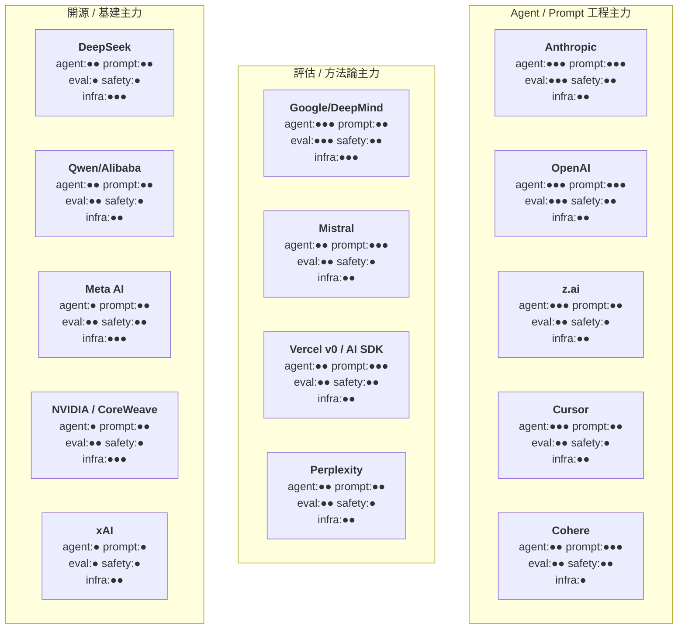

# 04 各大 AI 公司工程分享 | AI Company Engineering Insights

> 本章收錄主流 AI 公司的官方工程分享（engineering blog、官方文件、開源 repo、公開論文），幫助 tech leader 與各職能快速定位可用的第一手資源。
> This chapter collects official engineering content from major AI companies — engineering blogs, official docs, open-source repos, and public papers — for tech leaders and cross-functional teams.
> 每條來源皆經查證為官方網域、官方 GitHub org 或 arXiv；論文標「論文」，第三方來源不收錄於正式條目。所有條目附適用角色（PM / QA / DEV / RD / SRE / Platform / ERP / EM / Data）索引。
> Every entry links to a verified first-party source with a one-line English summary, a Traditional Chinese summary, and its value for tech leaders.
> 研究與驗證日期：2026-11-09 | Researched and verified: 2026-11-09

> Part of [Awesome Tech Leadership](../README.md) · [README (EN)](../README.md) · [繁體中文](../README.zh-TW.md)

## 公司×主題矩陣 | Company × Theme Matrix

各公司在 agent（代理工程）/ prompt（提示指南）/ eval（評估）/ safety（安全治理）/ infra（基礎設施與成本工程）的著墨分佈。●●● 深、●● 中、● 僅觸及。

**讀圖小結**：agent + prompt 雙高的是 Anthropic / OpenAI（文件體系最完整）；eval 方法論以 Google/DeepMind 與 Anthropic 最系統化；infra/成本工程最深的是 DeepSeek（開源全堆疊）、Google、Meta、NVIDIA；xAI 公開工程分享最稀少。

## Anthropic | Anthropic

Anthropic 的工程分享以「方法論」見長：context engineering、tool 設計、agent 評估與長任務 harness 各有旗艦長文。官方入口：Engineering blog: [anthropic.com/engineering](https://www.anthropic.com/engineering) · Docs: [docs.claude.com](https://docs.claude.com/) · GitHub: [github.com/anthropics](https://github.com/anthropics)

### Effective Context Engineering for AI Agents | Context Engineering
<!-- entry:id=companies/anthropic-context-engineering type=guide roles=ALL tags=agents,context-engineering license=n/a last_verified=2026-11-09 -->
- **一句話**: Treat context as a finite attention budget and aim for the smallest possible set of high-signal tokens via compaction, structured note-taking, just-in-time retrieval and sub-agent isolation.
- **一句話（繁中）**: 把 context 視為「有限的注意力預算」，用 compaction、結構化筆記、即時（just-in-time）檢索與 sub-agent 隔離維持高訊號密度，並點名 context rot（上下文腐化）問題。
- **對 tech leader 的價值**: 建立團隊共通的 context 紀律語言，是設計任何 AI 工作流程的根本心智模型。
- **來源 Sources**: [Effective Context Engineering for AI Agents](https://www.anthropic.com/engineering/effective-context-engineering-for-ai-agents) — 官方 (n/a)
- **適用角色**: PM / QA / DEV / RD / SRE / Platform / ERP

### Writing Effective Tools for AI Agents | Tool Design
<!-- entry:id=companies/anthropic-writing-effective-tools type=guide roles=DEV,RD,PLATFORM tags=agents,tool-use license=n/a last_verified=2026-11-09 -->
- **一句話**: Design workflow-shaped, consolidated, namespaced tools with meaningful, token-efficient returns — and prompt-engineer tool descriptions as if onboarding a new hire.
- **一句話（繁中）**: 工具要「貼近工作流」而非包 API：整併命名空間、回傳高訊號欄位、省 token、把工具描述當新人教學文件來寫。
- **對 tech leader 的價值**: MCP / tool-use 整合的最佳設計規範，可直接當 code review checklist。
- **來源 Sources**: [Writing effective tools for AI agents](https://www.anthropic.com/engineering/writing-tools-for-agents) — 官方 (n/a)
- **適用角色**: DEV / RD / Platform

### How We Built Our Multi-Agent Research System | Multi-Agent
<!-- entry:id=companies/anthropic-multi-agent-research-system type=guide roles=PM,RD,PLATFORM tags=agents,orchestration license=n/a last_verified=2026-11-09 -->
- **一句話**: An orchestrator-worker architecture (lead agent + parallel subagents + citation agent) beat single-agent Opus by 90.2% on internal research evals; multi-agent runs consumed ~15x the tokens of chats.
- **一句話（繁中）**: 官方拆解 Research 功能的 orchestrator-worker 架構與量化數據：多代理在內部評估勝過單代理 90.2%，但 token 消耗約為聊天的 15 倍。
- **對 tech leader 的價值**: 罕見的多代理系統成本/效益實測數據，為導入 agentic 工作流的預算與規模決策提供依據。
- **來源 Sources**: [How we built our multi-agent research system](https://www.anthropic.com/engineering/multi-agent-research-system) — 官方 (n/a)
- **適用角色**: PM / RD / Platform / SRE

### Building Effective Agents | Agent Design
<!-- entry:id=companies/anthropic-building-effective-agents type=guide roles=PM,DEV,RD,PLATFORM tags=agents,architecture license=n/a last_verified=2026-11-09 -->
- **一句話**: Distinguish simple composable workflows (prompt chaining, routing, parallelization, orchestrator-workers, evaluator-optimizer) from true autonomous agents, and add autonomy only when needed.
- **一句話（繁中）**: 先分清 workflow（固定編排）與 agent（自主動態），從最簡單的組合式設計開始，必要時才加自主性。
- **對 tech leader 的價值**: 防止團隊過度工程化 agent 專案的架構決策框架。
- **來源 Sources**: [Building effective agents](https://www.anthropic.com/engineering/building-effective-agents) — 官方 (n/a)
- **適用角色**: PM / DEV / RD / Platform

### Demystifying Evals for AI Agents | Evals
<!-- entry:id=companies/anthropic-demystifying-evals type=guide roles=QA,PM,RD,DEV tags=evals,agents license=n/a last_verified=2026-11-09 -->
- **一句話**: A practitioner's guide to agent evaluation — tasks, trials, graders (code/model/human), pass@k vs pass^k under non-determinism, and an 8-step roadmap for building evals.
- **一句話（繁中）**: 系統化拆解 agent 評估：任務設計、多次試行、三種 grader、非決定性下的 pass@k / pass^k 指標，與 8 步驟建置路線圖。
- **對 tech leader 的價值**: QA 團隊從「人工抽查」升級為制度化評估的教科書，直接對應 eval-driven development。
- **來源 Sources**: [Demystifying evals for AI agents](https://www.anthropic.com/research/demystifying-evals-for-ai-agents) — 官方 (n/a)
- **適用角色**: QA / PM / RD / DEV

### Effective Harnesses for Long-Running Agents | Harness
<!-- entry:id=companies/anthropic-long-running-agent-harnesses type=guide roles=DEV,RD,PLATFORM tags=agents,harness license=n/a last_verified=2026-11-09 -->
- **一句話**: Structure long-running work with an initializer agent (setup, progress file, feature list, initial commit) plus a coding agent that leaves clean state after each increment.
- **一句話（繁中）**: 長任務 harness 設計：initializer agent 建立 init 腳本與進度檔案，coding agent 每次增量完成一項功能並留下乾淨狀態。
- **對 tech leader 的價值**: 解決 agent 跑長任務就 drift/中斷的工程方法，對大型重構與長專案自動化極實用。
- **來源 Sources**: [Effective harnesses for long-running agents](https://www.anthropic.com/research/effective-harnesses-for-long-running-agents) — 官方 (n/a)
- **適用角色**: DEV / RD / Platform

### Equipping Agents for the Real World with Agent Skills | Skills
<!-- entry:id=companies/anthropic-agent-skills type=guide roles=ALL tags=agents,skills license=n/a last_verified=2026-11-09 -->
- **一句話**: Agent Skills use progressive disclosure — metadata at startup, SKILL.md on trigger, bundled resources on demand — so agents can carry effectively unbounded procedural knowledge.
- **一句話（繁中）**: Agent Skills 以「漸進式載入」三層設計（metadata → SKILL.md → 附帶資源），讓 agent 攜帶幾乎無上限的程序性知識而不爆 context。
- **對 tech leader 的價值**: 組織內部知識（SOP、部署腳本、報表流程）如何產品化給 agent 用的參考架構。
- **來源 Sources**: [Equipping agents for the real world with Agent Skills](https://www.anthropic.com/engineering/equipping-agents-for-the-real-world-with-agent-skills) · [Agent Skills docs](https://platform.claude.com/docs/en/agents-and-tools/agent-skills/overview) — 官方 (n/a)
- **適用角色**: PM / QA / DEV / RD / SRE / Platform / ERP

### Claude Code Best Practices | Claude Code
<!-- entry:id=companies/anthropic-claude-code-best-practices type=guide roles=ALL tags=agentic-coding,workflow license=n/a last_verified=2026-11-09 -->
- **一句話**: Explore-plan-code-commit workflow, CLAUDE.md hygiene, subagents for investigation and adversarial review, hooks for deterministic actions, and context resets between tasks.
- **一句話（繁中）**: 官方最佳實踐：探索→規劃→實作→提交、CLAUDE.md 維護、用 subagent 調查與對抗式 review、hooks 做確定性守門、任務間重置 context。
- **對 tech leader 的價值**: 全團隊導入 agentic coding 的統一操作規範，新人訓即可採用。
- **來源 Sources**: [Claude Code Best Practices](https://www.anthropic.com/engineering/claude-code-best-practices) — 官方 (n/a)
- **適用角色**: PM / QA / DEV / RD / SRE / Platform / ERP

### Scaling Agentic Coding Across Your Organization | TDD & Adoption
<!-- entry:id=companies/anthropic-scaling-agentic-coding-tdd type=guide roles=PM,QA,DEV,RD tags=agentic-coding,tdd license=n/a last_verified=2026-11-09 -->
- **一句話**: Applied AI playbook for rolling out Claude Code at scale, positioning TDD (write failing tests first, one at a time, checkpoint commits) as the answer to the "do everything" failure mode.
- **一句話（繁中）**: 官方企業導入 playbook，核心方法論是 TDD：先寫測試、確認失敗、逐步實作、在檢查點提交，用以對抗 agent「一次做太多」的失敗模式。
- **對 tech leader 的價值**: 直接回答「怎麼讓 AI coding 產出可信」——測試先行＋流程紀律，是最可落地的工程方法論文件。
- **來源 Sources**: [Scaling Agentic Coding Across Your Organization](https://claude.com/resources/guides/scaling-agentic-coding-across-your-organization/) · [PDF](https://resources.anthropic.com/hubfs/Scaling%20agentic%20coding%20across%20your%20organization.pdf) — 官方 (n/a)
- **適用角色**: PM / QA / DEV / RD

### A Postmortem of Three Recent Issues | Reliability
<!-- entry:id=companies/anthropic-incident-postmortem type=guide roles=SRE,PLATFORM,PM tags=reliability,postmortem license=n/a last_verified=2026-11-09 -->
- **一句話**: Anthropic's own incident postmortem, published transparently on the engineering blog.
- **一句話（繁中）**: 官方公開的事故事後檢討（postmortem），示範 AI 基礎設施公司如何做 blameless 事故回顧。
- **對 tech leader 的價值**: SRE 文化與事故管理的實例教材；AI 服務的可靠性風險不是抽象的。
- **來源 Sources**: [A postmortem of three recent issues](https://www.anthropic.com/engineering/a-postmortem-of-three-recent-issues) — 官方 (n/a)
- **適用角色**: SRE / Platform / PM

### Constitutional AI: Harmlessness from AI Feedback | Alignment Paper
<!-- entry:id=companies/anthropic-constitutional-ai type=paper roles=PM,RD tags=alignment,safety license=n/a last_verified=2026-11-09 -->
- **一句話**: The foundational paper on training models to follow a written constitution via AI feedback instead of human labels alone.
- **一句話（繁中）**: 以「憲法」原則＋AI 自我回饋取代純人工標註做 harmlessness 訓練的奠基論文。
- **對 tech leader 的價值**: 理解對齊（alignment）工程化方法，對 AI 治理、政策設計有直接參考。
- **來源 Sources**: [Constitutional AI (arXiv:2212.08073)](https://arxiv.org/abs/2212.08073) — 論文 (n/a)
- **適用角色**: PM / RD

### Claude Agent SDK | Agent SDK
<!-- entry:id=companies/anthropic-claude-agent-sdk type=tool roles=DEV,RD,PLATFORM tags=agents,sdk license=MIT last_verified=2026-11-09 -->
- **一句話**: The official SDK for building custom agents on the Claude harness — subagents, hooks, MCP support and session controls out of the box.
- **一句話（繁中）**: 建構客製 agent 的官方 SDK，內建 subagents、hooks、MCP 支援與工作階段控制。
- **對 tech leader 的價值**: 自建 agent 產品的起點，等同把 Claude Code 的 harness 能力嵌入自家工作流。
- **來源 Sources**: [Claude Agent SDK docs](https://docs.claude.com/en/api/agent-sdk/overview) · [claude-agent-sdk-python](https://github.com/anthropics/claude-agent-sdk-python) — 官方 (MIT)
- **適用角色**: DEV / RD / Platform
- **注意事項**: TypeScript 版（claude-agent-sdk-typescript）repo 存在但未標 license，採用前請自行確認。

### Anthropic API SDKs | API SDK
<!-- entry:id=companies/anthropic-api-sdks type=tool roles=DEV,RD tags=sdk,api license=Apache-2.0 last_verified=2026-11-09 -->
- **一句話**: Official Python and TypeScript SDKs for the Anthropic API.
- **一句話（繁中）**: Anthropic API 的官方 Python / TypeScript SDK。
- **對 tech leader 的價值**: 標準接入層，含串流、tool use、token 計數等實作範例。
- **來源 Sources**: [anthropic-sdk-python](https://github.com/anthropics/anthropic-sdk-python) · [anthropic-sdk-typescript](https://github.com/anthropics/anthropic-sdk-typescript) — 官方 (Apache-2.0)
- **適用角色**: DEV / RD

### Claude Cookbooks & Courses | Learning
<!-- entry:id=companies/anthropic-claude-cookbooks type=tool roles=ALL tags=cookbook,learning license=MIT last_verified=2026-11-09 -->
- **一句話**: Official collections of Claude recipes (cookbooks) and interactive courses covering prompting, tool use and more.
- **一句話（繁中）**: 官方 recipes 範例集與互動式課程（prompting、tool use 等），是最短的上手路徑。
- **對 tech leader 的價值**: 團隊內訓教材現成可用，降低導入門檻。
- **來源 Sources**: [claude-cookbooks](https://github.com/anthropics/claude-cookbooks) · [courses](https://github.com/anthropics/courses) — 官方 (MIT)
- **適用角色**: PM / QA / DEV / RD / SRE / Platform / ERP
- **注意事項**: courses repo 的 GitHub license 標示為 NOASSERTION，採用前請確認條款。

### Prompt Engineering Overview | Prompting
<!-- entry:id=companies/anthropic-prompt-engineering-overview type=prompt roles=ALL tags=prompting,docs license=n/a last_verified=2026-11-09 -->
- **一句話**: The official prompt-engineering hub — structuring prompts, XML sections, few-shot examples, chain-of-thought and iterative refinement.
- **一句話（繁中）**: 官方提示工程總綱：結構化提示、XML 區段、few-shot、chain-of-thought 與迭代優化技巧。
- **對 tech leader 的價值**: 統一團隊提示寫法的官方基準，適合納入內部規範。
- **來源 Sources**: [Prompt engineering overview](https://docs.anthropic.com/en/docs/build-with-claude/prompt-engineering/overview) — 官方 (n/a)
- **適用角色**: PM / QA / DEV / RD / SRE / Platform / ERP

### Claude Code Subagents | Subagents
<!-- entry:id=companies/anthropic-claude-code-subagents type=guide roles=DEV,RD,QA tags=agents,subagents license=n/a last_verified=2026-11-09 -->
- **一句話**: Official guide to Claude Code subagents — delegating scoped work into isolated context windows that report back distilled summaries.
- **一句話（繁中）**: 官方 subagents 指南：把工作委派到隔離的 context window，只回報蒸餾後的摘要，保持主對話乾淨。
- **對 tech leader 的價值**: 組織「調查/實作分離」與對抗式 review 流程的官方依據。
- **來源 Sources**: [Claude Code Subagents](https://docs.claude.com/en/docs/claude-code/sub-agents) — 官方 (n/a)
- **適用角色**: DEV / RD / QA

## OpenAI | OpenAI

OpenAI 的強項是「流程化」：evals/graders 工具鏈、Codex harness 規格與 agent 建置白皮書。官方入口：News: [openai.com/news](https://openai.com/news/) · Docs: [platform.openai.com/docs](https://platform.openai.com/docs) · Cookbook: [cookbook.openai.com](https://cookbook.openai.com/) · GitHub: [github.com/openai](https://github.com/openai)

### Introducing GPT-5 | GPT-5
<!-- entry:id=companies/openai-gpt-5 type=guide roles=PM,DEV,RD,PLATFORM tags=models,release license=n/a last_verified=2026-11-09 -->
- **一句話**: A unified system combining fast responses, deeper reasoning and routing, with 74.9% SWE-bench Verified (with thinking) and 88% Aider Polyglot at release.
- **一句話（繁中）**: GPT-5 官方發表：整合快速回應、深度推理與路由器的統一系統，附 coding 基準數據。
- **對 tech leader 的價值**: 了解旗艦模型的能力定位與基準，做模型選型與成本規劃的基礎。
- **來源 Sources**: [Introducing GPT-5](https://openai.com/index/introducing-gpt-5/) — 官方 (n/a)
- **適用角色**: PM / DEV / RD / Platform

### Introducing Codex | Codex
<!-- entry:id=companies/openai-codex type=guide roles=PM,DEV,RD tags=agentic-coding,release license=n/a last_verified=2026-11-09 -->
- **一句話**: Launched Codex, a cloud software-engineering agent powered by codex-1 (an o3 variant optimized for SWE), able to run many tasks in parallel.
- **一句話（繁中）**: 發表雲端軟體工程 agent Codex（codex-1 模型），可並行處理多個工程任務。
- **對 tech leader 的價值**: 「雲端 agent 平行跑任務」工作模式的官方起點，影響團隊 CI/工單流程設計。
- **來源 Sources**: [Introducing Codex](https://openai.com/index/introducing-codex/) — 官方 (n/a)
- **適用角色**: PM / DEV / RD

### A Practical Guide to Building Agents | Agent Guide
<!-- entry:id=companies/openai-practical-guide-building-agents type=guide roles=ALL tags=agents,guide license=n/a last_verified=2026-11-09 -->
- **一句話**: OpenAI's field guide on when to build an agent, single-agent vs multi-agent patterns, workflow orchestration and guardrails design.
- **一句話（繁中）**: 官方 agent 建置白皮書：何時該做 agent、單/多代理編排模式、guardrails 欄位設計。
- **對 tech leader 的價值**: 給非工程背景的 PM/管理者看的 agent 專案評估框架，適合當內部共識文件。
- **來源 Sources**: [A practical guide to building agents (PDF)](https://cdn.openai.com/business-guides-and-resources/a-practical-guide-to-building-agents.pdf) — 官方 (n/a)
- **適用角色**: PM / QA / DEV / RD / SRE / Platform / ERP

### Building with the GPT-5 Model Series: A Practical Guide | GPT-5 Guide
<!-- entry:id=companies/openai-building-with-gpt-5 type=guide roles=PM,QA,DEV,RD tags=evals,prompting license=n/a last_verified=2026-11-09 -->
- **一句話**: Recommends starting from evals as a baseline, streaming reasoning summaries to diagnose failures, and metaprompting to improve prompts.
- **一句話（繁中）**: 官方實務建議：以 evals 為起點建立基線、串流推理摘要診斷失敗、用 metaprompting 迭代提示。
- **對 tech leader 的價值**: 把「先建 evals 再動手」寫進團隊流程的官方背書。
- **來源 Sources**: [Building with the GPT-5 Model Series](https://openai.com/business/guides-and-resources/a-practical-guide-to-building-with-ai/) — 官方 (n/a)
- **適用角色**: PM / QA / DEV / RD

### Codex Prompting Guide | Codex Prompting
<!-- entry:id=companies/openai-codex-prompting-guide type=prompt roles=DEV,RD,PLATFORM tags=agentic-coding,prompting license=n/a last_verified=2026-11-09 -->
- **一句話**: The eval-optimized starter system prompt for Codex agentic coding, plus harness-migration guidance (apply_patch, shell_command, update_plan), AGENTS.md support and metaprompting recipes.
- **一句話（繁中）**: 針對 agentic coding 最佳化的起始 system prompt 與 harness 遷移指南（含 AGENTS.md、工具設計、自我改進提示技巧）。
- **對 tech leader 的價值**: 直接可抄的 agent coding harness 規格書，內含官方 evals 驗證過的提示結構。
- **來源 Sources**: [Codex Prompting Guide](https://developers.openai.com/cookbook/examples/gpt-5/codex_prompting_guide) — 官方 (n/a)
- **適用角色**: DEV / RD / Platform

### Prompting Guide | Prompting
<!-- entry:id=companies/openai-prompting-guide type=prompt roles=ALL tags=prompting,docs license=n/a last_verified=2026-11-09 -->
- **一句話**: The official prompting guide — clear instructions, examples, splitting tasks and iterating.
- **一句話（繁中）**: 官方提示指南：明確指令、範例、拆分任務與迭代改進。
- **對 tech leader 的價值**: 團隊提示寫法的統一基準。
- **來源 Sources**: [Prompting guide](https://platform.openai.com/docs/guides/prompting) — 官方 (n/a)
- **適用角色**: PM / QA / DEV / RD / SRE / Platform / ERP

### Building Agents Guide | Agents
<!-- entry:id=companies/openai-building-agents-guide type=guide roles=DEV,RD,PLATFORM tags=agents,docs license=n/a last_verified=2026-11-09 -->
- **一句話**: Official docs for building agents — the agent loop, tools, guardrails and orchestration.
- **一句話（繁中）**: agent 建置官方文件：agent loop、工具、guardrails 與編排。
- **對 tech leader 的價值**: 對照檢查自家 agent 實作是否缺件的官方藍圖。
- **來源 Sources**: [Building agents](https://platform.openai.com/docs/guides/agents) — 官方 (n/a)
- **適用角色**: DEV / RD / Platform

### Function Calling Guide | Tool Use
<!-- entry:id=companies/openai-function-calling type=prompt roles=DEV,RD tags=tool-use,docs license=n/a last_verified=2026-11-09 -->
- **一句話**: Official guide to connecting models to external tools via function calling, incl. structured outputs and parallel calls.
- **一句話（繁中）**: 以 function calling 串接外部工具的官方指南，含結構化輸出與平行呼叫。
- **對 tech leader 的價值**: tool loop 最小實作規格，agent 整合的起手式。
- **來源 Sources**: [Function calling](https://platform.openai.com/docs/guides/function-calling) — 官方 (n/a)
- **適用角色**: DEV / RD

### OpenAI Evals Guides (Evals API, Graders, Best Practices) | Evals
<!-- entry:id=companies/openai-evals-guides type=guide roles=QA,PM,RD,DEV tags=evals,graders license=n/a last_verified=2026-11-09 -->
- **一句話**: The official evaluation docs — Evals API, grader specs (incl. trace grading for agent trajectories), evaluation best practices and a getting-started path.
- **一句話（繁中）**: 官方評估文件群：Evals API、grader 規格（含對 agent 軌跡的 trace grading）、評估最佳實踐與入門指南。
- **對 tech leader 的價值**: eval-driven development 的工具鏈依據，可直接建置團隊評估流程。
- **來源 Sources**: [Evals](https://platform.openai.com/docs/guides/evals) · [Evaluation best practices](https://platform.openai.com/docs/guides/evaluation-best-practices) · [Graders](https://platform.openai.com/docs/guides/graders) · [Getting started with evals](https://platform.openai.com/docs/guides/evaluation-getting-started) — 官方 (n/a)
- **適用角色**: QA / PM / RD / DEV

### Training LMs to Follow Instructions with Human Feedback (InstructGPT) | RLHF Paper
<!-- entry:id=companies/openai-instructgpt-rlhf type=paper roles=RD,PM tags=alignment,rlhf license=n/a last_verified=2026-11-09 -->
- **一句話**: The InstructGPT paper that established the RLHF recipe behind modern instruction-tuned models.
- **一句話（繁中）**: InstructGPT 論文，奠定 RLHF（人類回饋強化學習）指令調校配方。
- **對 tech leader 的價值**: 理解現代模型「聽話」背後的工程方法，對評估與提示設計有根本幫助。
- **來源 Sources**: [arXiv:2203.02155](https://arxiv.org/abs/2203.02155) — 論文 (n/a)
- **適用角色**: RD / PM

### GPT-4 Technical Report | Scaling Paper
<!-- entry:id=companies/openai-gpt-4-tech-report type=paper roles=RD,PLATFORM,PM tags=scaling,training license=n/a last_verified=2026-11-09 -->
- **一句話**: The GPT-4 report, notable for predictable scaling (predicting final loss from smaller runs) and its benchmark suite.
- **一句話（繁中）**: GPT-4 技術報告，以「小規模實驗預測大模型表現」的可預測擴展方法與完整基準著稱。
- **對 tech leader 的價值**: 大規模訓練專案的計畫/預算方法學參考。
- **來源 Sources**: [arXiv:2303.08774](https://arxiv.org/abs/2303.08774) — 論文 (n/a)
- **適用角色**: RD / Platform / PM

### Let's Verify Step by Step | Process Supervision
<!-- entry:id=companies/openai-process-supervision type=paper roles=QA,RD,PM tags=alignment,evaluation license=n/a last_verified=2026-11-09 -->
- **一句話**: Process supervision (PRM) beats outcome supervision (ORM) for mathematical reasoning — reward the reasoning steps, not just the answer.
- **一句話（繁中）**: 過程監督（Process Supervision）優於結果監督：對推理過程給獎勵比只看最終答案更可靠。
- **對 tech leader 的價值**: 「驗證過程而不只驗證結果」直接呼應 code review / QA 的流程思維。
- **來源 Sources**: [arXiv:2305.20050](https://arxiv.org/abs/2305.20050) — 論文 (n/a)
- **適用角色**: QA / RD / PM

### OpenAI Agents SDK (Python & JS) | Agents SDK
<!-- entry:id=companies/openai-agents-sdk type=tool roles=DEV,RD,PLATFORM tags=agents,sdk license=MIT last_verified=2026-11-09 -->
- **一句話**: A lightweight framework for multi-agent workflows — handoffs, guardrails, tracing and sessions.
- **一句話（繁中）**: 輕量多代理框架：handoffs、guardrails、tracing 與工作階段管理。
- **對 tech leader 的價值**: 快速搭建 agent 原型的官方框架，附完整觀測（tracing）能力。
- **來源 Sources**: [openai-agents-python](https://github.com/openai/openai-agents-python) · [openai-agents-js](https://github.com/openai/openai-agents-js) — 官方 (MIT)
- **適用角色**: DEV / RD / Platform

### OpenAI Cookbook | Cookbook
<!-- entry:id=companies/openai-cookbook type=tool roles=ALL tags=cookbook,examples license=MIT last_verified=2026-11-09 -->
- **一句話**: Official examples and guides for using the OpenAI API, from prompting to agents and evals.
- **一句話（繁中）**: 官方 API 範例與指南集，涵蓋 prompting、agents、evals 等主題。
- **對 tech leader 的價值**: 團隊內訓與 PoC 起手素材。
- **來源 Sources**: [openai-cookbook](https://github.com/openai/openai-cookbook) · [cookbook.openai.com](https://cookbook.openai.com/) — 官方 (MIT)
- **適用角色**: PM / QA / DEV / RD / SRE / Platform / ERP

### Codex CLI | Coding Agent CLI
<!-- entry:id=companies/openai-codex-cli type=tool roles=DEV,RD tags=agentic-coding,cli license=Apache-2.0 last_verified=2026-11-09 -->
- **一句話**: OpenAI's open-source coding agent that runs in your terminal — the reference implementation of the Codex harness.
- **一句話（繁中）**: 開源終端機 coding agent，是 Codex harness 的官方參考實作。
- **對 tech leader 的價值**: 研究 agent CLI/harness 設計（apply_patch、update_plan 等）的第一手程式碼。
- **來源 Sources**: [openai/codex](https://github.com/openai/codex) — 官方 (Apache-2.0)
- **適用角色**: DEV / RD

### openai/evals & simple-evals | Eval Frameworks
<!-- entry:id=companies/openai-evals type=tool roles=QA,RD tags=evals,benchmarks license=MIT last_verified=2026-11-09 -->
- **一句話**: OpenAI's eval frameworks — a registry-of-benchmarks eval framework and a minimal evals library used in model papers.
- **一句話（繁中）**: OpenAI 評估框架：含開源 benchmark registry 的 evals 框架，與模型論文使用的極簡 simple-evals。
- **對 tech leader 的價值**: 快速複用業界基準（MMLU、HumanEval 等）做自家模型驗收。
- **來源 Sources**: [openai/evals](https://github.com/openai/evals) · [openai/simple-evals](https://github.com/openai/simple-evals) — 官方 (MIT)
- **適用角色**: QA / RD
- **注意事項**: openai/evals 的 GitHub license 標示為 NOASSERTION（repo 採 Apache-2.0 內文為主）；simple-evals 為 MIT。

## Google / DeepMind | Google & DeepMind

Google/DeepMind 的特色是「評估方法論」與工程文化文件最完整：agent evals 系列、SRE 書系、code review 實踐。官方入口：Engineering blog: [developers.googleblog.com](https://developers.googleblog.com/) · Research blog: [deepmind.google/blog](https://deepmind.google/blog/) · Docs: [ai.google.dev/gemini-api/docs](https://ai.google.dev/gemini-api/docs) · Engineering practices: [google.github.io/eng-practices](https://google.github.io/eng-practices/review/) · SRE: [sre.google](https://sre.google/) · GitHub: [github.com/google-deepmind](https://github.com/google-deepmind)

### AlphaEvolve: A Gemini-powered coding agent for designing advanced algorithms | AlphaEvolve
<!-- entry:id=companies/google-alphaevolve type=guide roles=RD,DEV,PLATFORM tags=agents,algorithms license=n/a last_verified=2026-11-09 -->
- **一句話**: A Gemini-powered evolutionary coding agent that discovered improved algorithms, optimized Google's data-center scheduling, and sped up Gemini's own training kernels by 23%.
- **一句話（繁中）**: 以 Gemini 驅動的演化式 coding agent，能自動「發現」新演算法，實際優化 Google 資料中心排程，並將 Gemini 訓練 kernel 加速 23%。
- **對 tech leader 的價值**: 展示 AI coding agent 從「補全程式」升級為「演算法研發工具」；把 agent 迭代迴圈當研發基礎設施投資的範例。
- **來源 Sources**: [AlphaEvolve](https://deepmind.google/blog/alphaevolve-a-gemini-powered-coding-agent-for-designing-advanced-algorithms/) — 官方 (n/a)
- **適用角色**: RD / DEV / Platform

### Advancing Gemini's security safeguards | Security
<!-- entry:id=companies/google-gemini-security-safeguards type=guide roles=RD,QA,SRE,PLATFORM tags=safety,prompt-injection license=n/a last_verified=2026-11-09 -->
- **一句話**: A white paper on defending Gemini against indirect prompt injection via automated red-teaming and model hardening.
- **一句話（繁中）**: 透過自動化 red-teaming 與 model hardening 防禦 indirect prompt injection 的官方白皮書。
- **對 tech leader 的價值**: agent 整合外部工具後 prompt injection 是最高風險威脅；本文給出「自動紅隊 → 加固模型」的可重複安全流程。
- **來源 Sources**: [Advancing Gemini's security safeguards](https://deepmind.google/blog/advancing-geminis-security-safeguards/) — 官方 (n/a)
- **適用角色**: RD / QA / SRE / Platform

### Evaluating AI agents: moving past the vibe check | Agent Evals
<!-- entry:id=companies/google-evaluating-ai-agents type=guide roles=QA,PM,DEV,RD tags=evals,agents license=n/a last_verified=2026-11-09 -->
- **一句話**: A practical playbook for agent evaluation — define success via Critical User Journeys (CUJs), simulate users, and measure across unit tests, deterministic metrics, LLM-as-a-judge rubrics and integration tests.
- **一句話（繁中）**: agent 評估實戰手冊：用 Critical User Journeys（CUJs）定義成功標準、模擬使用者產生測試、四層評估（unit tests、確定性指標、LLM-as-a-judge、整合測試），並避開四大陷阱。
- **對 tech leader 的價值**: 直接回答「如何把 AI 功能納入工程品質體系」——boolean pass/fail 評分、OpenTelemetry/OpenInference 保持評估中立、Day 0 手動檢視 trace 到 Day 2 CI/CD merge gate 的路線圖。
- **來源 Sources**: [Evaluating AI agents: moving past the vibe check](https://developers.googleblog.com/evaluating-ai-agents-moving-past-the-vibe-check/) — 官方 (n/a)
- **適用角色**: QA / PM / DEV / RD

### The Anatomy of Harness Engineering | Harness Engineering
<!-- entry:id=companies/google-harness-engineering type=guide roles=DEV,QA,PLATFORM tags=agents,testing license=n/a last_verified=2026-11-09 -->
- **一句話**: Advocates behavioral evals — asserting on intermediate actions like tool calls — over pure end-to-end benchmarks for AI coding agents.
- **一句話（繁中）**: 提出 harness engineering：對 AI coding agent 應驗證「中間行為」（如 tool call 序列）而非只看最終輸出，以「挑 failure mode → 寫彈性 assertion → 自動化批次評估」循環改善。
- **對 tech leader 的價值**: 把「用 AI 寫程式」變成可量測的工程紀律；behavioral assertion 可直接移植到團隊的 agent CI 流程。
- **來源 Sources**: [The Anatomy of Harness Engineering](https://developers.googleblog.com/the-anatomy-of-harness-engineering-how-to-evaluate-iterate-and-guard-ai-coding-agents/) — 官方 (n/a)
- **適用角色**: DEV / QA / Platform

### Hill-Climbing Agent Quality with Agents CLI Evaluation | Eval Loop
<!-- entry:id=companies/google-agents-cli-eval type=tool roles=QA,RD,DEV tags=evals,optimization license=n/a last_verified=2026-11-09 -->
- **一句話**: A closed-loop eval workflow (eval generate → grade → compare → analyze → optimize) with GEPA-based prompt optimization and lessons on dataset design.
- **一句話（繁中）**: agents-cli 的評估閉環（產生→評分→比較→分析→最佳化，含 GEPA prompt 優化），並分享資料集設計經驗：小型代表性資料集、快照結果檔、資料集與期望值分離。
- **對 tech leader 的價值**: eval-driven development 的具體工具化實踐；hill-climbing 式持續改善 loop 適合導入團隊每週品質節奏。
- **來源 Sources**: [Hill-Climbing Agent Quality with Agents CLI Evaluation](https://developers.googleblog.com/hill-climbing-agent-quality-with-agents-cli-evaluation/) — 官方 (n/a)
- **適用角色**: QA / RD / DEV

### Building AI Agents with Gemini 3 and Open Source Frameworks | Gemini 3 Agents
<!-- entry:id=companies/google-gemini-3-agents type=guide roles=DEV,RD,PM tags=agents,frameworks license=n/a last_verified=2026-11-09 -->
- **一句話**: Introduces Gemini 3 agentic features (thinking_level, Thought Signatures for stateful tool use, media_resolution) with Day-0 support in LangChain, Vercel AI SDK, LlamaIndex, Pydantic AI and n8n.
- **一句話（繁中）**: 介紹 Gemini 3 的 agent 導向功能（thinking_level、有狀態 tool use 的 Thought Signatures、media_resolution），以及主流開源 agent 框架的 Day 0 整合最佳實踐。
- **對 tech leader 的價值**: 了解「模型能力」與「框架生態」協同演進；agent framework 選型的互通性參考。
- **來源 Sources**: [Building AI Agents with Google Gemini 3 and Open Source Frameworks](https://developers.googleblog.com/building-ai-agents-with-google-gemini-3-and-open-source-frameworks/) — 官方 (n/a)
- **適用角色**: DEV / RD / PM

### Gemini Embedding: Powering RAG and context engineering | Embeddings
<!-- entry:id=companies/google-gemini-embedding type=guide roles=RD,DEV,PLATFORM tags=rag,embeddings license=n/a last_verified=2026-11-09 -->
- **一句話**: How Box, re:cap, Everlaw and Roo Code use gemini-embedding-001 for RAG, context engineering and semantic search with reported gains in recall, accuracy and latency.
- **一句話（繁中）**: 以四家企業實例說明 gemini-embedding-001 在 RAG、context engineering、語意搜尋的落地方式與 recall/accuracy/latency 改善數據。
- **對 tech leader 的價值**: embedding 選型與 RAG 評估的實務參考，可建立團隊的 retrieval 基線。
- **來源 Sources**: [Gemini Embedding: Powering RAG and context engineering](https://developers.googleblog.com/gemini-embedding-powering-rag-context-engineering/) — 官方 (n/a)
- **適用角色**: RD / DEV / Platform

### Google Engineering Practices — Code Review Developer Guide | Code Review
<!-- entry:id=companies/google-engineering-practices type=guide roles=DEV,PM,QA tags=code-review,culture license=CC-BY-3.0 last_verified=2026-11-09 -->
- **一句話**: The canonical description of Google's code review process — "How To Do A Code Review" and "The CL Author's Guide".
- **一句話（繁中）**: Google code review 流程的官方標準文件（reviewer 指南＋CL 作者指南），明訂審查重點順序：設計 > 功能 > 複雜度 > 測試 > 命名 > 註解 > 樣式 > 文件。
- **對 tech leader 的價值**: 建立團隊 code review 規範可直接採用的範本；強調 review 速度優先（一天內回應）的文化指標。
- **來源 Sources**: [Google Engineering Practices](https://google.github.io/eng-practices/review/) · [google/eng-practices](https://github.com/google/eng-practices) — 官方 (CC-BY-3.0)
- **適用角色**: DEV / PM / QA

### Site Reliability Engineering (SRE Book Series) | SRE
<!-- entry:id=companies/google-sre-books type=guide roles=SRE,PLATFORM,PM tags=reliability,sre license=n/a last_verified=2026-11-09 -->
- **一句話**: Google's official SRE bookshelf — SRE (incl. 2nd Edition), The SRE Workbook, and Building Secure & Reliable Systems, free online.
- **一句話（繁中）**: Google SRE 官方書系入口（含 2026 第二版）：error budget、SLO、on-call、postmortem 等方法論源頭；第二版新增 AI/LLM 基礎設施可靠性主題。
- **對 tech leader 的價值**: 平台團隊的可靠性方法論源頭文件，第二版把 SRE 延伸到 AI 系統正是現在需要的。
- **來源 Sources**: [sre.google/books](https://sre.google/books/) — 官方 (n/a)
- **適用角色**: SRE / Platform / PM

### Code Health: Too Many Comments on Your Code Reviews? | Code Health
<!-- entry:id=companies/google-code-health-comments type=guide roles=DEV,QA,PM tags=code-review,culture license=n/a last_verified=2026-11-09 -->
- **一句話**: Practical tips for code review authors: self-review first, keep diffs small, and answer reviewer questions in the code itself.
- **一句話（繁中）**: 給 code review 作者的實用心法：送審前先自我審查、diff 小而清楚、用「改程式碼」回答 reviewer 的問題。
- **對 tech leader 的價值**: 降低 review 往返成本、改善團隊 review 文化的具體作法。
- **來源 Sources**: [Code Health: Too Many Comments on Your Code Reviews?](https://testing.googleblog.com/2017/06/code-health-too-many-comments-on-your.html) — 官方 (n/a)
- **適用角色**: DEV / QA / PM

### Gemini 1.5: Unlocking multimodal understanding across millions of tokens of context | Long Context Paper
<!-- entry:id=companies/google-gemini-15-paper type=paper roles=RD,PLATFORM tags=long-context,multimodal license=n/a last_verified=2026-11-09 -->
- **一句話**: Technical report on long-context multimodal models with >99% retrieval recall up to 10M tokens, including in-context language learning from a single grammar book.
- **一句話（繁中）**: 長上下文多模態技術報告：百萬 token 級上下文檢索 recall >99%，並展示「一本文法書教會模型一個瀕危語言」的 in-context learning。
- **對 tech leader 的價值**: 長上下文改變系統架構假設（可直接塞整個 codebase 進 context）；safety/evaluation 章節是模型評估的好範本。
- **來源 Sources**: [arXiv:2403.05530](https://arxiv.org/abs/2403.05530) — 論文 (n/a)
- **適用角色**: RD / Platform

### Gemma: Open Models Based on Gemini Research and Technology | Gemma Paper
<!-- entry:id=companies/google-gemma-paper type=paper roles=RD,PLATFORM tags=open-models,release license=n/a last_verified=2026-11-09 -->
- **一句話**: Technical report for the open-weight Gemma family with transparent architecture, training and responsible-release analysis.
- **一句話（繁中）**: 開放權重 Gemma 系列技術報告：架構、訓練配方全公開，附安全評估、記憶化分析與開放發布風險討論。
- **對 tech leader 的價值**: 小型開放模型做自有化/邊緣部署的選項；responsible release 章節是公開發布 AI 模型的風險評估範本。
- **來源 Sources**: [arXiv:2403.08295](https://arxiv.org/abs/2403.08295) — 論文 (n/a)
- **適用角色**: RD / Platform

### Prompt Design Strategies (Gemini Prompting Guide) | Prompting
<!-- entry:id=companies/google-prompt-design-strategies type=prompt roles=ALL tags=prompting,docs license=n/a last_verified=2026-11-09 -->
- **一句話**: The official Gemini prompt-design guide — be specific, use few-shot, provide context, split complex tasks, iterate — with a Gemini 3 chapter on direct instructions and structure.
- **一句話（繁中）**: 官方 prompt 設計總指南：指令具體化、few-shot、提供 context、拆解複雜任務、迭代策略，含 Gemini 3 專章（直接下指令、XML/Markdown 結構化、關鍵指令放開頭或結尾）。
- **對 tech leader 的價值**: 團隊提示方法的官方基準；兩代提示觀念的差異也提醒「prompt 方法要隨模型世代調整」。
- **來源 Sources**: [Prompt design strategies](https://ai.google.dev/gemini-api/docs/prompting-strategies) · [Gemini 3 Developer Guide](https://ai.google.dev/gemini-api/docs/gemini-3) — 官方 (n/a)
- **適用角色**: PM / QA / DEV / RD / SRE / Platform / ERP

### Function calling with the Gemini API | Tool Use
<!-- entry:id=companies/google-function-calling type=prompt roles=DEV,RD tags=tool-use,docs license=n/a last_verified=2026-11-09 -->
- **一句話**: Official function-calling docs — four-step workflow, parallel/compositional calling and tool choice (auto/any/none/validated).
- **一句話（繁中）**: 官方 function calling 文件：四步驟工作流、parallel/compositional calling、tool choice 控制。
- **對 tech leader 的價值**: Gemini 系 tool loop 的標準規格，多模型環境下的整合參考。
- **來源 Sources**: [Function calling](https://ai.google.dev/gemini-api/docs/function-calling) — 官方 (n/a)
- **適用角色**: DEV / RD
- **注意事項**: 該 URL 會 301 重導至 aistudio.google.com 對應頁面（重導後頁面已驗證存在）。

### Gemini CLI | Coding Agent CLI
<!-- entry:id=companies/google-gemini-cli type=tool roles=DEV,RD,PLATFORM tags=agentic-coding,cli license=Apache-2.0 last_verified=2026-11-09 -->
- **一句話**: Google's open-source AI agent for the terminal (108k+ stars) — a living lab for agent CLI design and extensibility.
- **一句話（繁中）**: Google 開源終端機 AI agent，是研究 agent CLI 設計與 extensibility 的活教材。
- **對 tech leader 的價值**: 對照 Claude Code / Codex CLI 等工具的架構與外掛模型。
- **來源 Sources**: [google-gemini/gemini-cli](https://github.com/google-gemini/gemini-cli) — 官方 (Apache-2.0)
- **適用角色**: DEV / RD / Platform

### Agent Development Kit (ADK) | Agent Framework
<!-- entry:id=companies/google-adk type=tool roles=DEV,RD,PLATFORM tags=agents,framework license=Apache-2.0 last_verified=2026-11-09 -->
- **一句話**: Code-first toolkit for building, evaluating and deploying agents — hierarchical multi-agent composition and tracing built in.
- **一句話（繁中）**: code-first 建置、評估、部署 AI agent 的官方工具箱，內建多 agent 階層組合與 tracing。
- **對 tech leader 的價值**: 多 agent 系統的參考架構；「單元測試 + 整合測試 + 行為斷言」映射到 agent 系統的實作範例。
- **來源 Sources**: [google/adk-python](https://github.com/google/adk-python) · [ADK docs](https://google.github.io/adk-docs/) — 官方 (Apache-2.0)
- **適用角色**: DEV / RD / Platform

### Gen AI Evaluation Service & Agent Evaluation | Evals Platform
<!-- entry:id=companies/google-genai-evaluation-service type=platform roles=QA,RD,DEV tags=evals,agents license=n/a last_verified=2026-11-09 -->
- **一句話**: Google Cloud's evaluation stack — model-based rubric metrics, computed metrics, tool-call metrics, plus trajectory evaluation for agents and a Quality Flywheel workflow.
- **一句話（繁中）**: Google Cloud 評估服務：model-based 指標（fluency、groundedness 等）、computed metrics、tool-call 指標，以及 agent 的 trajectory evaluation（工具呼叫序列比對）與品質飛輪流程。
- **對 tech leader 的價值**: 托管式評估平台的選項參考；trajectory 指標定義可借鏡到自家 agent 評測。
- **來源 Sources**: [Evaluate Gen AI agents](https://docs.cloud.google.com/gemini-enterprise-agent-platform/models/evaluation-agents) · [Run an evaluation](https://docs.cloud.google.com/gemini-enterprise-agent-platform/models/run-evaluation) · [Codelab](https://codelabs.developers.google.com/gemini-agent-eval-api) — 官方 (n/a)
- **適用角色**: QA / RD / DEV

## xAI | xAI

誠實說明：xAI 的公開工程分享相對有限——沒有獨立 engineering blog、幾乎不發表技術論文，工程細節散見於 announcement、docs 與 GitHub。官方入口：News: [x.ai/news](https://x.ai/news) · Docs: [docs.x.ai](https://docs.x.ai/overview) · Infra: [x.ai/colossus](https://x.ai/colossus) · GitHub: [github.com/xai-org](https://github.com/xai-org)

### Introducing Grok 4.7 | Grok 4.7
<!-- entry:id=companies/xai-grok-4-7 type=guide roles=PM,RD,DEV tags=models,release license=n/a last_verified=2026-11-09 -->
- **一句話**: xAI's most capable model for coding and knowledge work — larger base model, longer RL run, improved self-verification and a new safeguard stack.
- **一句話（繁中）**: xAI 最強的 coding/知識工作模型：更大的 base model、更長的 RL 訓練、更強的自我驗證與新的安全防護層。
- **對 tech leader 的價值**: xAI 發布文會明講訓練方法重點（RL 規模、self-verification），選型時可讀出模型能力取向。
- **來源 Sources**: [Introducing Grok 4.7](https://x.ai/news/grok-4-7) — 官方 (n/a)
- **適用角色**: PM / RD / DEV

### Grok 4.6 | Grok 4.6
<!-- entry:id=companies/xai-grok-4-6 type=guide roles=RD,DEV,PLATFORM tags=agents,release license=n/a last_verified=2026-11-09 -->
- **一句話**: Focused on long-running agents and interactive/visual work, with agentic RL training and improved safeguards.
- **一句話（繁中）**: 聚焦長時間運行的 agent 與互動/視覺任務，採 agentic RL 訓練並強化安全機制。
- **對 tech leader 的價值**: long-running agent 穩定性是平台化關鍵指標；agentic RL 方向反映「模型為工具使用而訓練」的業界共識。
- **來源 Sources**: [Grok 4.6](https://x.ai/news/grok-4-6) — 官方 (n/a)
- **適用角色**: RD / DEV / Platform

### Grok Code Fast 1 | Coding Model
<!-- entry:id=companies/xai-grok-code-fast-1 type=guide roles=DEV,PM tags=agentic-coding,release license=n/a last_verified=2026-11-09 -->
- **一句話**: A speedy, economical reasoning model that excels at agentic coding, launched with free access via Cursor, GitHub Copilot and Cline.
- **一句話（繁中）**: 快速且經濟的推理模型，專精 agentic coding，發布時與 Cursor、GitHub Copilot、Cline 等工具合作免費提供。
- **對 tech leader 的價值**: 「專用 coding 模型＋多工具渠道同步發售」是 AI coding 工具鏈採購的價格/效能參考點。
- **來源 Sources**: [Grok Code Fast 1](https://x.ai/news/grok-code-fast-1) — 官方 (n/a)
- **適用角色**: DEV / PM

### Colossus: The World's Largest AI Supercomputer | Infra
<!-- entry:id=companies/xai-colossus type=guide roles=SRE,PLATFORM,RD tags=infrastructure,gpu license=n/a last_verified=2026-11-09 -->
- **一句話**: xAI's Memphis supercluster — 200,000 H100s in one interconnected cluster, built in 122 days then doubled in 92 days.
- **一句話（繁中）**: xAI Memphis 超級叢集官方介紹：122 天建成、92 天擴充一倍，單一互連叢集達 20 萬張 H100，~170 PB/s 匯流排頻寬。
- **對 tech leader 的價值**: 大規模 GPU 叢集的建設速度與網路/散熱規格第一手資料；AI infra 容量規劃的對標案例。
- **來源 Sources**: [Colossus](https://x.ai/colossus) — 官方 (n/a)
- **適用角色**: SRE / Platform / RD

### Grok Function Calling & Tools Overview | Tool Use
<!-- entry:id=companies/xai-function-calling-tools type=prompt roles=DEV,RD tags=tool-use,docs license=n/a last_verified=2026-11-09 -->
- **一句話**: Official function-calling guide (JSON schema tools, tool-call loop, tool choice, up to 350 tools per request) and the tools overview contrasting server-side built-ins (web search, X search, code interpreter) with custom functions.
- **一句話（繁中）**: 官方 function calling 指南（JSON schema、tool_call 迴圈、tool choice、每請求最多 350 tools）與工具總覽（內建 Web/X Search、Code Interpreter vs 自訂函式）。
- **對 tech leader 的價值**: tool 設計紀律的實例——native tool calling 優於自製 XML 格式；介面標準化是 agent 可維護性的前提。
- **來源 Sources**: [Function Calling](https://docs.x.ai/developers/tools/function-calling) · [Tools Overview](https://docs.x.ai/developers/tools/overview) — 官方 (n/A)
- **適用角色**: DEV / RD

### Models & Pricing (Alias Strategy) | Model Governance
<!-- entry:id=companies/xai-models-pricing type=guide roles=PM,DEV,PLATFORM tags=model-governance,pricing license=n/a last_verified=2026-11-09 -->
- **一句話**: Documents xAI's three-tier model-alias strategy — bare alias (latest stable), -latest (newest features) and pinned versions for reproducibility.
- **一句話（繁中）**: 官方說明三層 model alias 策略：裸 alias（最新穩定版）、-latest（最新功能）、pinned version（一致重現）。
- **對 tech leader 的價值**: 所有依賴 LLM 的產品都該建立的「模型版本治理」最小方案，工程上應以 pinned version 鎖定行為。
- **來源 Sources**: [Models & Pricing](https://docs.x.ai/developers/models) — 官方 (n/a)
- **適用角色**: PM / DEV / Platform

### grok-prompts | Prompts
<!-- entry:id=companies/xai-grok-prompts type=prompt roles=ALL tags=prompting,open-source license=AGPL-3.0 last_verified=2026-11-09 -->
- **一句話**: The real prompts behind Grok's chat assistant and the @grok bot on X.
- **一句話（繁中）**: Grok 聊天助理與 X 上 @grok bot 的真實 prompts 開源發布。
- **對 tech leader 的價值**: prompt 工程研究素材——看量產級助理的 system prompt 如何組織。
- **來源 Sources**: [xai-org/grok-prompts](https://github.com/xai-org/grok-prompts) — 官方 (AGPL-3.0)
- **適用角色**: PM / QA / DEV / RD / SRE / Platform / ERP

### grok-1 | Open Model
<!-- entry:id=companies/xai-grok-1 type=tool roles=RD,PLATFORM tags=open-models,release license=Apache-2.0 last_verified=2026-11-09 -->
- **一句話**: Open-source release of the Grok-1 model weights and inference code (314B MoE).
- **一句話（繁中）**: Grok-1 模型權重與推論程式碼的開源發布（314B MoE）。
- **對 tech leader 的價值**: 314B MoE 的推論部署參考實作。
- **來源 Sources**: [xai-org/grok-1](https://github.com/xai-org/grok-1) — 官方 (Apache-2.0)
- **適用角色**: RD / Platform

### xAI SDKs (Python & TypeScript) | SDK
<!-- entry:id=companies/xai-sdks type=tool roles=DEV,RD tags=sdk,api license=Apache-2.0 last_verified=2026-11-09 -->
- **一句話**: Official Python and TypeScript SDKs for the xAI API, plus public protobuf definitions (xai-proto).
- **一句話（繁中）**: xAI API 官方 Python / TypeScript SDK，並公開 gRPC API 的 protobuf 定義（xai-proto）。
- **對 tech leader 的價值**: SDK 與 API 設計的參考（protobuf 介面公開本身就是 API 設計案例）。
- **來源 Sources**: [xai-sdk-python](https://github.com/xai-org/xai-sdk-python) · [xai-sdk-ts](https://github.com/xai-org/xai-sdk-ts) — 官方 (Apache-2.0)
- **適用角色**: DEV / RD

### grok-build | Agent Harness
<!-- entry:id=companies/xai-grok-build type=tool roles=DEV,RD tags=agentic-coding,cli license=Apache-2.0 last_verified=2026-11-09 -->
- **一句話**: xAI's coding agent harness and TUI — fullscreen, mouse-interactive and extensible.
- **一句話（繁中）**: xAI 的 coding agent harness 與 TUI（全螢幕、可滑鼠互動、可擴充）。
- **對 tech leader 的價值**: 對照 Claude Code / Codex CLI / Gemini CLI 的第四種 harness 實作。
- **來源 Sources**: [xai-org/grok-build](https://github.com/xai-org/grok-build) — 官方 (Apache-2.0)
- **適用角色**: DEV / RD

## Mistral | Mistral AI

Mistral 的方法論亮點是把 evals 前置到客製化專案啟動階段，並以「漸進式客製化」決策樹貫穿產品線。官方入口：News: [mistral.ai/news](https://mistral.ai/news) · Docs: [docs.mistral.ai](https://docs.mistral.ai/) · GitHub: [github.com/mistralai](https://github.com/mistralai)

### Mistral 7B | Mistral 7B
<!-- entry:id=companies/mistral-7b type=paper roles=RD,PLATFORM,PM tags=open-models,efficiency license=Apache-2.0 last_verified=2026-11-09 -->
- **一句話**: Mistral's first model paper — GQA, Sliding Window Attention and rolling buffer cache delivering Llama 2 3x-size performance at 7.3B under Apache 2.0.
- **一句話（繁中）**: Mistral 7B 論文：GQA、SWA 與 rolling buffer cache 三項效率設計，7B 達到 Llama 2 三倍規模模型的能力；Apache 2.0 全開放。
- **對 tech leader 的價值**: 效率架構的教科書級案例（記憶體省 8 倍的 rolling buffer）；「小模型＋效率架構＋完全開源」的商業模式宣言。
- **來源 Sources**: [Mistral 7B (arXiv:2310.06825)](https://arxiv.org/abs/2310.06825) · [announcing-mistral-7b](https://mistral.ai/news/announcing-mistral-7b/) — 論文 (Apache-2.0)
- **適用角色**: RD / Platform / PM

### Mixtral of Experts | Mixtral
<!-- entry:id=companies/mistral-mixtral type=paper roles=RD,PLATFORM tags=efficiency,moe license=Apache-2.0 last_verified=2026-11-09 -->
- **一句話**: The Mixtral 8x7B paper — sparse MoE (47B total, 13B active), top-2 routing analysis, DPO instruction tuning beating GPT-3.5 at release.
- **一句話（繁中）**: Mixtral 8x7B 論文：稀疏 MoE（47B 總參數、13B 啟動）、top-2 routing 分析、SFT+DPO 指令微調，發布時超越 GPT-3.5 Turbo。
- **對 tech leader 的價值**: MoE 是「成本/品質帕累托改善」代表案例；experts 按語法而非主題分工的發現，對 mixture 設計直覺是重要校正。
- **來源 Sources**: [Mixtral of Experts (arXiv:2401.04088)](https://arxiv.org/abs/2401.04088) · [mixtral-of-experts](https://mistral.ai/news/mixtral-of-experts/) — 論文 (Apache-2.0)
- **適用角色**: RD / Platform

### My Tailor is Mistral (Customization) | Customization
<!-- entry:id=companies/mistral-customization type=guide roles=PM,RD tags=fine-tuning,customization license=n/a last_verified=2026-11-09 -->
- **一句話**: Three customization paths — open-source mistral-finetune (LoRA), serverless fine-tuning on la Plateforme, and full custom training services.
- **一句話（繁中）**: 三條客製化路徑：開源 mistral-finetune（LoRA）、La Plateforme serverless fine-tuning、Mistral 代訓 custom training。
- **對 tech leader 的價值**: 企業 AI 客製化的三層產品化路線圖（自己訓 → 托管訓 → 代訓），是 build/buy/partner 決策的清晰範本。
- **來源 Sources**: [My Tailor is Mistral](https://mistral.ai/news/customization/) — 官方 (n/a)
- **適用角色**: PM / RD

### Build AI agents with the Mistral Agents API | Agents API
<!-- entry:id=companies/mistral-agents-api type=guide roles=DEV,RD,PM,PLATFORM tags=agents,api license=n/a last_verified=2026-11-09 -->
- **一句話**: Mistral's agent framework with built-in connectors (code execution, web search, image generation, document library/RAG), MCP tool support, persistent memory and multi-agent handoffs.
- **一句話（繁中）**: Mistral Agents API：內建 connectors（程式執行、網頁搜尋、圖片生成、文件庫/RAG）、MCP 工具支援、持久記憶與多 agent handoff 編排。
- **對 tech leader 的價值**: 「agents 是 API 原生能力而非框架外掛」的產品化方向；handoff 與 MCP 支援反映 agent 互操作標準的走向。
- **來源 Sources**: [Build AI agents with the Mistral Agents API](https://mistral.ai/news/agents-api/) — 官方 (n/a)
- **適用角色**: DEV / RD / PM / Platform

### Devstral: Agentic Coding Models | Devstral
<!-- entry:id=companies/mistral-devstral type=guide roles=DEV,PM,RD tags=agentic-coding,release license=n/a last_verified=2026-11-09 -->
- **一句話**: Devstral models for agentic coding (61.6% / 53.6% on SWE-Bench Verified) supporting both Mistral function calling and XML tool formats for different agent scaffolds.
- **一句話（繁中）**: Devstral Medium 與 Small 1.1（SWE-Bench Verified 61.6% / 53.6%）：為 agentic coding 設計，同時支援 function calling 與 XML 兩種工具格式。
- **對 tech leader 的價值**: SWE-Bench Verified 是 AI coding 工具的採購驗收基準之一；雙 tool format 支援顯示 agent 生態互通的現實需求。
- **來源 Sources**: [Upgrading agentic coding capabilities with the new Devstral models](https://mistral.ai/news/devstral-2507/) — 官方 (n/a)
- **適用角色**: DEV / PM / RD

### Large Enough (Mistral Large 2) | Large 2
<!-- entry:id=companies/mistral-large-2 type=guide roles=RD,DEV,PM tags=tool-use,release license=n/a last_verified=2026-11-09 -->
- **一句話**: Mistral Large 2 — 128k context with function calling trained for both parallel and sequential tool calls.
- **一句話（繁中）**: Mistral Large 2：128k 上下文，function calling 特別訓練支援平行與序列兩種工具呼叫模式。
- **對 tech leader 的價值**: 「模型為 tool-use 行為做專門訓練」的公開案例；平行/序列 tool call 支援度是 agent 框架選型的實測點。
- **來源 Sources**: [Large Enough](https://mistral.ai/news/mistral-large-2407/) — 官方 (n/a)
- **適用角色**: RD / DEV / PM

### Introducing Forge | Custom Frontier
<!-- entry:id=companies/mistral-forge type=guide roles=PM,RD,PLATFORM tags=customization,rl license=n/a last_verified=2026-11-09 -->
- **一句話**: Enterprise custom frontier models — pre-training, post-training and RL for agentic performance, usable autonomously by agents like Mistral Vibe.
- **一句話（繁中）**: 企業級自訂 frontier 模型服務：pre-training、post-training 與強化學習（針對 tool use、編排、決策的 agentic 表現），支援由 agent 自主調用做 fine-tune。
- **對 tech leader 的價值**: 「agent 幫你訓練模型」的 agent-first 客製化服務雛形；企業建立資料護城河的路徑參考。
- **來源 Sources**: [Introducing Forge](https://mistral.ai/news/forge/) — 官方 (n/a)
- **適用角色**: PM / RD / Platform

### Function Calling Guide | Tool Use
<!-- entry:id=companies/mistral-function-calling type=prompt roles=DEV,RD tags=tool-use,docs license=n/a last_verified=2026-11-09 -->
- **一句話**: The five-step function-calling guide (define tools → query → model generates args → execute → final answer) with tool_choice, parallel_tool_calls and full Python examples.
- **一句話（繁中）**: 完整五步驟 function calling 指南（定義工具 → 查詢 → 模型產生參數 → 執行 → 最終答案），含 tool_choice、parallel_tool_calls 與 Python 範例。
- **對 tech leader 的價值**: 「agent loop 的最小形式」官方定義，是理解 tool-use 迴圈的標準教材。
- **來源 Sources**: [Function Calling](https://docs.mistral.ai/inference/conversations/function-calling) · [Quickstart: call your own functions](https://docs.mistral.ai/inference/quickstarts/call-your-own-functions) — 官方 (n/a)
- **適用角色**: DEV / RD

### Connectors and MCP Guide | MCP
<!-- entry:id=companies/mistral-mcp-connectors type=guide roles=DEV,PLATFORM,SRE tags=mcp,security license=n/a last_verified=2026-11-09 -->
- **一句話**: Connectors (catalog services) vs bring-your-own MCP servers (agents.RemoteMCP, credentials via auth_header_env_vars), with error-handling events — and Mistral's own MCP server exposing Studio capabilities as tools.
- **一句話（繁中）**: connectors vs 自帶 MCP server 的整合指南（憑證以環境變數注入）；含 MCP 錯誤處理事件，以及 Mistral 官方 MCP server（建議 write tools 逐項審批）。
- **對 tech leader 的價值**: MCP 進入企業環境的最小安全基線——write tools 審批、憑證治理都是可直接採用的規範。
- **來源 Sources**: [Connectors and MCP](https://docs.mistral.ai/studio/agents/learn/agent/connectors) · [MCP](https://docs.mistral.ai/resources/mcp) — 官方 (n/a)
- **適用角色**: DEV / Platform / SRE

### Mistral Client SDKs & mistral-common | SDK
<!-- entry:id=companies/mistral-sdks type=tool roles=DEV,RD tags=sdk,api license=Apache-2.0 last_verified=2026-11-09 -->
- **一句話**: Official Python/TypeScript SDKs plus mistral-common, the preprocessing library for tokenizers (text, images, tool calls) and request validation.
- **一句話（繁中）**: 官方 Python / TypeScript SDK，加上前處理 library mistral-common（tokenizer 與請求/tool call 驗證正規化）。
- **對 tech leader 的價值**: SDK 內 MIGRATION.md 記錄 breaking changes，是 API 版本治理的好範本。
- **來源 Sources**: [client-python](https://github.com/mistralai/client-python) · [client-ts](https://github.com/mistralai/client-ts) · [mistral-common](https://github.com/mistralai/mistral-common) — 官方 (Apache-2.0)
- **適用角色**: DEV / RD

### mistral-finetune | Fine-Tuning
<!-- entry:id=companies/mistral-finetune type=tool roles=RD,PLATFORM tags=fine-tuning,training license=Apache-2.0 last_verified=2026-11-09 -->
- **一句話**: LoRA fine-tuning codebase training only 1–2% of weights, with data validation tooling and W&B integration.
- **一句話（繁中）**: LoRA 微調 codebase（只訓練 1–2% 低秩權重），含資料驗證工具與 W&B 整合。
- **對 tech leader 的價值**: 自行微調小成本路線的參考實作。
- **來源 Sources**: [mistralai/mistral-finetune](https://github.com/mistralai/mistral-finetune) — 官方 (Apache-2.0)
- **適用角色**: RD / Platform

### Mistral Cookbook & mistral-vibe | Cookbook & CLI
<!-- entry:id=companies/mistral-cookbook type=tool roles=ALL tags=cookbook,agentic-coding license=MIT last_verified=2026-11-09 -->
- **一句話**: Official notebooks (fine-tuning, synthetic data, Classifier Factory, Pixtral vision) and mistral-vibe, Mistral's open-source CLI coding agent.
- **一句話（繁中）**: 官方實作範例集（fine-tune、合成資料、Classifier Factory、Pixtral 視覺微調），以及開源 CLI coding agent mistral-vibe。
- **對 tech leader 的價值**: 動手教材＋第四家可用的開源 coding agent harness。
- **來源 Sources**: [mistralai/cookbook](https://github.com/mistralai/cookbook) · [mistralai/mistral-vibe](https://github.com/mistralai/mistral-vibe) — 官方 (MIT / Apache-2.0)
- **適用角色**: PM / QA / DEV / RD / SRE / Platform / ERP

### Customization Guide (Evals Chapter, legacy) | Eval-Driven
<!-- entry:id=companies/mistral-customization-evals type=guide roles=QA,PM,RD tags=evals,fine-tuning license=n/a last_verified=2026-11-09 -->
- **一句話**: The (deprecated but instructive) fine-tuning guide that puts evals at step 3 of the project lifecycle — build evals first, then iterate data, with red-teaming and continuous monitoring.
- **一句話（繁中）**: （已標 deprecated 但方法論價值高）fine-tuning 指南把「建立 evals」放在專案第 3 步：先建評估 → 測試 MVP → 安全/red-teaming evals → 持續監控。
- **對 tech leader 的價值**: 少見把評估前置到專案啟動階段的官方指南——eval-driven 客製化的完整範本。
- **來源 Sources**: [Customization (legacy guide)](https://docs.mistral.ai/resources/deprecated/customization) · [Changelogs](https://docs.mistral.ai/resources/changelogs) — 官方 (n/a)
- **適用角色**: QA / PM / RD

## Qwen / Alibaba | Qwen (Alibaba)

Qwen 的特色是論文＋release blog 並重，RL 訓練方法論（GRPO→GSPO→蒸餾）與資料飛輪公開得最完整。官方入口：Blog: [qwenlm.github.io/blog](https://qwenlm.github.io/blog/) · Research: [qwen.ai/research](https://qwen.ai/research/) · Docs（阿里雲百鍊）: [help.aliyun.com/zh/model-studio](https://help.aliyun.com/zh/model-studio/usage-guide/) · GitHub: [github.com/QwenLM](https://github.com/QwenLM)

### Qwen3: Think Deeper, Act Faster | Qwen3
<!-- entry:id=companies/qwen3-release type=guide roles=PM,RD,DEV tags=models,release license=n/a last_verified=2026-11-09 -->
- **一句話**: The Qwen3 launch post — hybrid thinking/non-thinking modes in one model, 8 Apache-2.0 open-weight models, 36T-token pre-training and a 4-stage post-training pipeline.
- **一句話（繁中）**: Qwen3 官方發表文：同一模型內建 thinking（長思考）與 non-thinking（快速回應）雙模式，36 兆 token 預訓練＋四階段後訓練管線，8 個 Apache 2.0 開源權重模型。
- **對 tech leader 的價值**: 混合思考模式讓同一模型依任務切換成本/品質，是規劃 LLM 產品分層（快答 vs 深思）的實務參考。
- **來源 Sources**: [Qwen3: Think Deeper, Act Faster](https://qwenlm.github.io/blog/qwen3/) — 官方 (n/a)
- **適用角色**: PM / RD / DEV

### Qwen3 Technical Report | Qwen3 Paper
<!-- entry:id=companies/qwen3-tech-report type=paper roles=RD,PM,PLATFORM tags=training,distillation license=n/a last_verified=2026-11-09 -->
- **一句話**: Full architecture (GQA, SwiGLU, RoPE, QK-Norm, 128-expert MoE), benchmarks and ablations — notably that on-policy distillation beats RL at ~1/10 the GPU hours for small models.
- **一句話（繁中）**: Qwen3 正式技術報告；最重要的工程結論是「小模型用 on-policy distillation 能以約 1/10 GPU 時間達到比 RL 更好的效果」。
- **對 tech leader 的價值**: 把大模型能力「下放」到小模型時，蒸餾 vs RL 的成本效益數據可直接支撐自建/外包決策。
- **來源 Sources**: [arXiv:2505.09388](https://arxiv.org/abs/2505.09388) — 論文 (n/a)
- **適用角色**: RD / PM / Platform

### Qwen2.5 Technical Report | Qwen2.5 Paper
<!-- entry:id=companies/qwen25-tech-report type=paper roles=RD,PM,QA tags=training,data license=n/a last_verified=2026-11-09 -->
- **一句話**: Scaling pre-training data from 7T to 18T tokens, 1M+ sample SFT and multi-stage RL behind the generation that powered the first wave of Qwen adoption.
- **一句話（繁中）**: Qwen2.5 技術報告：預訓練資料 7 兆→18 兆 token、百萬級樣本 SFT、多階段 RL。
- **對 tech leader 的價值**: 示範「資料規模＋資料品質管線」如何取代架構創新成為競爭力來源，對資料治理與合成資料投資順序很有參考價值。
- **來源 Sources**: [arXiv:2412.15115](https://arxiv.org/abs/2412.15115) — 論文 (n/a)
- **適用角色**: RD / PM / QA

### Qwen2.5-VL Technical Report | VL Paper
<!-- entry:id=companies/qwen25-vl type=paper roles=RD,PM,DEV tags=multimodal,agents license=n/a last_verified=2026-11-09 -->
- **一句話**: Window-attention ViT, dynamic-FPS video sampling, MRoPE with absolute time alignment — strong GUI-agent and document-parsing abilities.
- **一句話（繁中）**: 視覺語言模型技術報告：window attention ViT、動態 FPS 影片取樣、對齊絕對時間的 MRoPE，擅長文件解析與 GUI agent 操作。
- **對 tech leader 的價值**: 文件 OCR 與 GUI 操作 agent 是多模態最落地的企業應用；ScreenSpot Pro / DocVQA 成績可作 RPA、文件自動化選型依據。
- **來源 Sources**: [arXiv:2502.13923](https://arxiv.org/abs/2502.13923) · [blog](https://qwenlm.github.io/blog/qwen2.5-vl/) — 論文 (n/a)
- **適用角色**: RD / PM / DEV

### Qwen2.5-Coder Technical Report | Coder Paper
<!-- entry:id=companies/qwen25-coder type=paper roles=DEV,RD,PM tags=agentic-coding,training license=n/a last_verified=2026-11-09 -->
- **一句話**: Repo-level pre-training with dependency-ordered files, FIM objectives, coarse-to-fine SFT and execution-feedback DPO; the 32B model matched GPT-4o-class coding at release.
- **一句話（繁中）**: repo 級程式碼預訓練（依相依性排序檔案）、FIM 填空目標、由粗到細 SFT 加執行回饋 DPO；32B 發表時達 GPT-4o 級 coding。
- **對 tech leader 的價值**: repo 級資料工程是自訓/微調 code 模型的核心 know-how；理解 AI coding 工具能力來源的必讀。
- **來源 Sources**: [arXiv:2409.12186](https://arxiv.org/abs/2409.12186) — 論文 (n/a)
- **適用角色**: DEV / RD / PM

### Qwen2.5-Math: Self-Improvement Pipeline | Data Flywheel
<!-- entry:id=companies/qwen25-math type=paper roles=RD,PM tags=rl,data-flywheel license=n/a last_verified=2026-11-09 -->
- **一句話**: A self-improvement loop across the whole lifecycle — synthetic corpora from the previous model, reward-model-guided iterative SFT, GRPO RL and Best-of-N inference.
- **一句話（繁中）**: 貫穿「預訓練→後訓練→推論」的自我改進閉環：合成資料 → reward model 迭代篩 SFT 資料 → GRPO 強化學習 → Best-of-N。
- **對 tech leader 的價值**: 「模型自我改進」工作流最完整的公開藍本，想建立資料飛輪（data flywheel）的團隊可照著設計閉環。
- **來源 Sources**: [arXiv:2409.12122](https://arxiv.org/abs/2409.12122) — 論文 (n/a)
- **適用角色**: RD / PM

### GSPO: Towards Scalable Reinforcement Learning for Language Models | RL
<!-- entry:id=companies/qwen-gspo type=guide roles=RD,PLATFORM tags=rl,training license=n/a last_verified=2026-11-09 -->
- **一句話**: Qwen's sequence-level importance-sampling RL algorithm (GSPO) that stabilizes large-scale RL training for MoE models.
- **一句話（繁中）**: GSPO 以「序列層級」重要性取樣取代 token 層級，解決 MoE 模型大規模 RL 訓練不穩定的問題。
- **對 tech leader 的價值**: RL 訓練不穩定是自行微調最常見的失敗模式；GSPO 把成因與解法講得很工程面，是 RL 平台團隊的實務教材。
- **來源 Sources**: [GSPO](https://qwenlm.github.io/blog/gspo/) — 官方 (n/a)
- **適用角色**: RD / Platform

### QwQ-32B: Embracing the Power of Reinforcement Learning | QwQ
<!-- entry:id=companies/qwq-32b type=guide roles=RD,QA,PM tags=rl,evaluation license=n/a last_verified=2026-11-09 -->
- **一句話**: A 32B model reaching DeepSeek-R1-class reasoning via two-stage outcome-based RL — math verifiers and code execution as rewards instead of reward models.
- **一句話（繁中）**: 32B 小模型透過兩階段「結果導向 RL」逼近 R1 等級推理：數學用驗證器、程式碼跑測試當 reward，不用傳統 reward model。
- **對 tech leader 的價值**: 「用可執行的驗證器當 reward」把 RLHF 成本砍半；QA 團隊的測試資產（test oracle）直接變成訓練資產。
- **來源 Sources**: [QwQ-32B](https://qwenlm.github.io/blog/qwq-32b/) — 官方 (n/a)
- **適用角色**: RD / QA / PM

### Qwen3-Coder: Agentic Coding in the World | Qwen3-Coder
<!-- entry:id=companies/qwen3-coder type=guide roles=DEV,PM,RD tags=agentic-coding,rl license=n/a last_verified=2026-11-09 -->
- **一句話**: Qwen's agentic-coding release — long-horizon coding agents, 256K-1M context, and RL from real software-engineering environments.
- **一句話（繁中）**: Qwen 的 agentic coding 發表文：長時程自主 coding agent、超長上下文、從真實軟體工程環境做 RL 訓練。
- **對 tech leader 的價值**: 「從真實 SWE 環境做 RL」代表訓練場景就是開發流程本身；導入 AI coding 時可從中理解 agent 需要的環境回饋（CI、測試、repo 狀態）。
- **來源 Sources**: [Qwen3-Coder](https://qwenlm.github.io/blog/qwen3-coder/) — 官方 (n/a)
- **適用角色**: DEV / PM / RD

### Qwen3.8-Max: A New Bar for Coding and Cowork | Qwen3.8-Max
<!-- entry:id=companies/qwen38-max type=guide roles=PM,RD,DEV tags=models,release license=n/a last_verified=2026-11-09 -->
- **一句話**: Qwen's 2026 flagship (2.4T params, 95B active) — first open-weight Max-class Qwen, targeting 10+ day autonomous coding runs and research cowork.
- **一句話（繁中）**: Qwen 2026 旗艦（2.4 兆參數、啟動 95B）：首個開源權重的 Max 級 Qwen，主打 10 天以上自主 coding 長任務。
- **對 tech leader 的價值**: 「10+ 天自主長任務」把 agent 評估維度從單次解題拉到專案級可靠性，值得追蹤其長時程任務勝率的定義方式。
- **來源 Sources**: [Qwen3.8-Max](https://qwen.ai/blog?id=qwen3.8) — 官方 (n/a)
- **適用角色**: PM / RD / DEV

### Qwen-Agent | Agent Framework
<!-- entry:id=companies/qwen-agent type=tool roles=DEV,RD tags=agents,framework license=Apache-2.0 last_verified=2026-11-09 -->
- **一句話**: Qwen's official agent framework — reference implementations of Function Calling, MCP, Code Interpreter and RAG.
- **一句話（繁中）**: 官方 agent 框架：Function Calling、MCP、Code Interpreter、RAG 的參考實作。
- **對 tech leader 的價值**: 等同 Qwen 系的「agent 設計指南」，可對照其他家 agent 框架的抽象設計。
- **來源 Sources**: [QwenLM/Qwen-Agent](https://github.com/QwenLM/Qwen-Agent) — 官方 (Apache-2.0)
- **適用角色**: DEV / RD

### qwen-code | Coding Agent CLI
<!-- entry:id=companies/qwen-code type=tool roles=DEV,RD tags=agentic-coding,cli license=Apache-2.0 last_verified=2026-11-09 -->
- **一句話**: Open-source terminal AI coding agent (29k stars), comparable to Claude Code-class tools.
- **一句話（繁中）**: 開源終端機 AI coding agent，可對照 Claude Code 類工具的架構。
- **對 tech leader 的價值**: 可自架、可改裝的 coding harness 選項之一。
- **來源 Sources**: [QwenLM/qwen-code](https://github.com/QwenLM/qwen-code) — 官方 (Apache-2.0)
- **適用角色**: DEV / RD

### Alibaba Cloud Bailian (Model Studio) Guides | API Docs
<!-- entry:id=companies/qwen-bailian-guides type=prompt roles=DEV,RD,PM tags=prompting,api license=n/a last_verified=2026-11-09 -->
- **一句話**: Official Qwen developer guides — text generation parameters, streaming SSE, first API call walkthroughs in Python/Java/Node/curl, and production recommendations incl. context engineering.
- **一句話（繁中）**: 通義千問官方開發指南：訊息結構與核心參數、流式 SSE、多語言首次調用範例與錯誤排查，含官方「上下文工程」與生產環境建議。
- **對 tech leader 的價值**: 中文模型接入生產的官方規格書。
- **來源 Sources**: [文本生成開發指南](https://help.aliyun.com/zh/model-studio/text-generation) · [首次調用千問 API](https://help.aliyun.com/zh/model-studio/first-api-call-to-qwen) — 官方 (n/a)
- **適用角色**: DEV / RD / PM

### Qwen3.5: Towards Native Multimodal Agents | Qwen3.5
<!-- entry:id=companies/qwen35-native-multimodal-agents type=guide roles=PM,RD,DEV tags=multimodal,agents license=n/a last_verified=2026-11-09 -->
- **一句話**: Alibaba Cloud's official write-up of Qwen3.5, positioning Qwen toward native multimodal agents.
- **一句話（繁中）**: 阿里雲官方對 Qwen3.5 的說明：走向原生多模態 agent 的模型定位。
- **對 tech leader 的價值**: 追蹤 Qwen 系「多模態 agent 優先」的產品方向。
- **來源 Sources**: [Qwen3.5: Towards Native Multimodal Agents (Alibaba Cloud)](https://www.alibabacloud.com/blog/qwen3-5-towards-native-multimodal-agents_602894) — 官方 (n/a)
- **適用角色**: PM / RD / DEV
- **注意事項**: Qwen 官方 blog（qwen.ai/blog?id=qwen3.5）原始發表頁未直接驗證，此處採 Alibaba Cloud 官方轉載。

## z.ai | z.ai (Zhipu AI)

z.ai（智譜 Zhipu 的國際品牌）以「agentic engineering」敘事與 coding 生態（GLM Coding Plan、ZCode）見長。官方入口：Blog: [z.ai/blog/glm-5](https://z.ai/blog/glm-5) · Docs: [docs.z.ai](https://docs.z.ai) · GLM Coding Plan: [docs.z.ai/devpack/overview](https://docs.z.ai/devpack/overview) · GitHub: [github.com/zai-org](https://github.com/zai-org)

### GLM-5: From Vibe Coding to Agentic Engineering | GLM-5
<!-- entry:id=companies/glm-5-release type=guide roles=PM,DEV,RD tags=agentic-coding,release license=n/a last_verified=2026-11-09 -->
- **一句話**: The GLM-5 launch post — moving beyond "vibe coding" toward "agentic engineering": 744B/40B MoE, DeepSeek Sparse Attention for cheaper deployment, and async RL infrastructure for long-horizon coding.
- **一句話（繁中）**: GLM-5 發表文：把定位從 vibe coding 推進到 agentic engineering——744B/40B MoE、導入 DeepSeek Sparse Attention 降低部署成本、非同步 RL 基礎設施訓練長時程 coding。
- **對 tech leader 的價值**: 「從 Vibe Coding 到 Agentic Engineering」是 2026 年 AI 工程團隊最重要的敘事轉變，適合作為團隊 AI 轉型的溝通語言。
- **來源 Sources**: [GLM-5: From Vibe Coding to Agentic Engineering](https://z.ai/blog/glm-5) — 官方 (n/a)
- **適用角色**: PM / DEV / RD

### GLM-5 Technical Report | GLM-5 Paper
<!-- entry:id=companies/glm-5-tech-report type=paper roles=RD,PLATFORM tags=rl,training license=n/a last_verified=2026-11-09 -->
- **一句話**: The GLM-5 technical report — architecture and training innovations incl. DSA cost reduction and new asynchronous reinforcement-learning infrastructure.
- **一句話（繁中）**: GLM-5 正式技術報告：模型設計、以 DSA 稀疏注意力削減成本、全新的非同步強化學習基礎設施與 agentic 訓練方法。
- **對 tech leader 的價值**: 「非同步 RL + agent 環境」的基建設計是 RL 訓練平台規模化的關鍵工程問題；自建 RL 平台的最新參考架構。
- **來源 Sources**: [arXiv:2602.15763](https://arxiv.org/abs/2602.15763) — 論文 (n/a)
- **適用角色**: RD / Platform

### GLM-4.5: Agentic, Reasoning, and Coding (ARC) Foundation Models | ARC
<!-- entry:id=companies/glm-45-arc type=paper roles=PM,RD,DEV tags=agents,training license=n/a last_verified=2026-11-09 -->
- **一句話**: Coins the "ARC" (Agentic, Reasoning, Coding) framing — 355B/32B MoE trained on 23T tokens with GRPO-based RL and open-sourced "slime" RL infra.
- **一句話（繁中）**: 提出 ARC（Agentic／Reasoning／Coding）三能力定位框架：355B/32B MoE、23 兆 token 多階段訓練、GRPO 強化學習，並開源 RL 基礎設施 slime。
- **對 tech leader 的價值**: ARC 是好用的「模型能力分類學」——PM 用它對齊產品需求與模型選型。
- **來源 Sources**: [arXiv:2508.06471](https://arxiv.org/abs/2508.06471) — 論文 (n/a)
- **適用角色**: PM / RD / DEV

### GLM-4.5V & GLM-4.1V-Thinking: Multimodal RL | VLM-RL
<!-- entry:id=companies/glm-45v-multimodal-rl type=paper roles=RD,QA tags=multimodal,rl license=n/a last_verified=2026-11-09 -->
- **一句話**: Multimodal reasoning with RLCS (Reinforcement Learning with Curriculum Sampling), domain-specific reward systems and concrete RL-stability findings (drop KL/entropy losses, top-p=1 rollouts).
- **一句話（繁中）**: 視覺系列技術報告：RLCS（課程取樣強化學習）、各領域 reward 設計，並給出具體 RL 穩定性結論（棄用 KL/entropy loss、rollout 用 top-p=1）。
- **對 tech leader 的價值**: 多模態 RL 的「踩坑清單」——reward 設計與訓練穩定技巧可直接套用到任何 RLHF/RL 專案，降低實驗成本。
- **來源 Sources**: [arXiv:2507.01006](https://arxiv.org/abs/2507.01006) — 論文 (n/a)
- **適用角色**: RD / QA

### ChatGLM: From GLM-130B to GLM-4 All Tools | ChatGLM
<!-- entry:id=companies/chatglm-family type=paper roles=PM,RD tags=agents,models license=n/a last_verified=2026-11-09 -->
- **一句話**: The ChatGLM family report covering the GLM-4 series and the "All Tools" agent paradigm (the model autonomously picks search, code execution, drawing tools).
- **一句話（繁中）**: ChatGLM 系列技術報告：GLM-4 系列與「All Tools」自主調用工具的 agent 範式。
- **對 tech leader 的價值**: 「All Tools」是 agent 產品設計的早期完整論述；理解 GLM 系演化脈絡的總覽。
- **來源 Sources**: [arXiv:2406.12793](https://arxiv.org/abs/2406.12793) — 論文 (n/a)
- **適用角色**: PM / RD

### GLM-130B: An Open Bilingual Pre-trained Model | GLM-130B
<!-- entry:id=companies/glm-130b type=paper roles=RD,PLATFORM tags=training,reliability license=n/a last_verified=2026-11-09 -->
- **一句話**: The foundational bilingual (EN/ZH) 130B open model paper — unusually candid about training failures (loss spikes, divergence) and the engineering workarounds.
- **一句話（繁中）**: GLM 系開山之作：130B 雙語開源預訓練模型，難得地坦白記錄大模型訓練失敗（loss spike、發散）與工程解法。
- **對 tech leader 的價值**: 少見的「訓練事故報告」型論文——failure case 教材，理解大模型訓練風險與觀測指標。
- **來源 Sources**: [arXiv:2210.02414](https://arxiv.org/abs/2210.02414) — 論文 (n/a)
- **適用角色**: RD / Platform

### GLM-5.3 Model Guide | GLM-5.3
<!-- entry:id=companies/glm-53-model-guide type=guide roles=PM,DEV,PLATFORM tags=models,docs license=n/a last_verified=2026-11-09 -->
- **一句話**: Official docs for the current flagship GLM-5.3 — 1M-token context, 128K max output, always-on reasoning with low/high/max effort levels.
- **一句話（繁中）**: z.ai 現役旗艦 GLM-5.3 官方文件：1M token 上下文、128K 最大輸出、常駐推理（可調 low/high/max 思考強度）。
- **對 tech leader 的價值**: 「思考強度可調＋百萬 token 上下文」是 2026 年 API 產品標準配備，文件中的成本/延遲取捨可對照自家規格。
- **來源 Sources**: [GLM-5.3 模型指南](https://docs.z.ai/guides/llm/glm-5.3) — 官方 (n/a)
- **適用角色**: PM / DEV / Platform

### GLM Coding Plan (DevPack) | Pricing
<!-- entry:id=companies/glm-coding-plan type=guide roles=PM,ERP,PLATFORM tags=pricing,governance license=n/a last_verified=2026-11-09 -->
- **一句話**: z.ai's subscription plan for coding agents (Claude Code, Codex, Cline, ZCode…) — credit-based quotas, off-peak discounts and exclusive MCP tools.
- **一句話（繁中）**: coding agent 訂閱方案文件：credit 計量額度（5 小時＋每週雙重額度）、離峰 5 折、專屬 MCP 工具，支援 20+ 工具。
- **對 tech leader 的價值**: 團隊導入 AI coding 工具的「成本治理」參考——credit 制、離峰折扣、Team Plan 與公平使用政策的實務素材。
- **來源 Sources**: [GLM Coding Plan (DevPack) Overview](https://docs.z.ai/devpack/overview) — 官方 (n/a)
- **適用角色**: PM / ERP / Platform

### GLM Capabilities Guides (Function Calling, Structured Output, Thinking Mode) | API Docs
<!-- entry:id=companies/glm-capabilities-guides type=prompt roles=DEV,RD tags=tool-use,prompting license=n/a last_verified=2026-11-09 -->
- **一句話**: Official capability guides — function calling, JSON-schema constrained structured output, thinking-mode depth control, plus DevPack best practices for prompts, plans, skills, workflows and the agent memory mechanism.
- **一句話（繁中）**: 官方能力指南：function calling、結構化輸出（JSON schema 約束）、思考模式深度控制；以及 DevPack 的 prompt/計畫/skills/workflow 管理最佳實踐與 agent 記憶機制。
- **對 tech leader 的價值**: coding agent 的「計畫管理、技能化、工作流沉澱、跨任務記憶」官方做法，是長時程 agent 工程標準的參考。
- **來源 Sources**: [Function Calling](https://docs.z.ai/guides/capabilities/function-calling) · [Structured Output](https://docs.z.ai/guides/capabilities/struct-output) · [Thinking Mode](https://docs.z.ai/guides/capabilities/thinking-mode) · [Best Practice](https://docs.z.ai/devpack/resources/best-practice) · [Memory Mechanism](https://docs.z.ai/devpack/resources/memory-mechanism) — 官方 (n/a)
- **適用角色**: DEV / RD

### slime (RL Scaling Framework) | RL Infra
<!-- entry:id=companies/glm-slime type=tool roles=RD,PLATFORM tags=rl,training license=Apache-2.0 last_verified=2026-11-09 -->
- **一句話**: Open-source LLM reinforcement-learning training framework (RL Scaling) — the infrastructure behind GLM-4.5/5 post-training.
- **一句話（繁中）**: 開源 LLM 強化學習訓練框架（RL Scaling），GLM-4.5/5 的 RL 基礎設施開源版。
- **對 tech leader 的價值**: 自建 RL 訓練平台的直接參考實作。
- **來源 Sources**: [THUDM/slime](https://github.com/THUDM/slime) — 官方 (Apache-2.0)
- **適用角色**: RD / Platform

### ZCode | Coding Agent
<!-- entry:id=companies/glm-zcode type=tool roles=DEV,RD tags=agentic-coding,cli license=Apache-2.0 last_verified=2026-11-09 -->
- **一句話**: z.ai's official coding agent harness.
- **一句話（繁中）**: z.ai 官方 coding agent harness，可對照 Claude Code 類工具架構。
- **對 tech leader 的價值**: 第五種可對照的 coding harness 實作。
- **來源 Sources**: [zai-org/ZCode](https://github.com/zai-org/ZCode) — 官方 (Apache-2.0)
- **適用角色**: DEV / RD

### GLM Model Repos (GLM-5 / GLM-4.5 / GLM-4 / GLM-130B / GLM-V) | Open Models
<!-- entry:id=companies/glm-model-repos type=platform roles=RD,PLATFORM tags=open-models,deployment license=Apache-2.0 last_verified=2026-11-09 -->
- **一句話**: Official model repos with deployment guides (vLLM, SGLang, KTransformers and domestic chips) for the GLM series.
- **一句話（繁中）**: GLM 系列官方 model repo，附各版本部署指引（vLLM、SGLang、KTransformers、國產晶片）。
- **對 tech leader 的價值**: 開源權重部署的參考清單；多後端部署指引對自建推論服務很有用。
- **來源 Sources**: [zai-org/GLM-5](https://github.com/zai-org/GLM-5) · [zai-org/GLM-4.5](https://github.com/zai-org/GLM-4.5) · [zai-org/GLM-4](https://github.com/zai-org/GLM-4) · [zai-org/GLM-130B](https://github.com/zai-org/GLM-130B) — 官方 (Apache-2.0)
- **適用角色**: RD / Platform

### glm-simple-evals | Evals
<!-- entry:id=companies/glm-simple-evals type=benchmark roles=QA,RD tags=evals,benchmarks license=n/a last_verified=2026-11-09 -->
- **一句話**: GLM's official evaluation repository — reusable eval scripts for benchmarking model releases.
- **一句話（繁中）**: GLM 官方評測程式庫，可直接複用其評測腳本對照自家模型。
- **對 tech leader 的價值**: 少數由中國模型公司開源的評測程式庫，可直接複用評測流程。
- **來源 Sources**: [zai-org/glm-simple-evals](https://github.com/zai-org/glm-simple-evals) — 官方 (n/a)
- **適用角色**: QA / RD
- **注意事項**: repo 未標示 license，複用前請確認條款。

## DeepSeek | DeepSeek

DeepSeek 把「訓練/推論基礎設施」開源得最完整，論文以成本工程與 RL 方法論見長。官方入口：Docs: [api-docs.deepseek.com](https://api-docs.deepseek.com/) · GitHub: [github.com/deepseek-ai](https://github.com/deepseek-ai) · Transparency: [deepseek.com/en/transparency](https://www.deepseek.com/en/transparency/)

### DeepSeek-V3 Technical Report | V3
<!-- entry:id=companies/deepseek-v3 type=paper roles=RD,PLATFORM,PM tags=moe,training license=n/a last_verified=2026-11-09 -->
- **一句話**: 671B/37B MoE with Multi-head Latent Attention (MLA) and DeepSeekMoE, pre-trained on 14.8T tokens for only 2.788M H800 GPU-hours.
- **一句話（繁中）**: 671B/37B MoE，採 MLA（多頭潛在注意力）與 DeepSeekMoE 架構，14.8 兆 token 預訓練只花 278.8 萬 H800 GPU 小時。
- **對 tech leader 的價值**: AI 產業的「成本地標」——用公開數字定義訓練前沿模型的預算量級，自建 vs 採購分析的基準。
- **來源 Sources**: [arXiv:2412.19437](https://arxiv.org/abs/2412.19437) — 論文 (n/a)
- **適用角色**: RD / Platform / PM

### DeepSeek-R1: Incentivizing Reasoning via RL | R1
<!-- entry:id=companies/deepseek-r1 type=paper roles=RD,PM tags=rl,reasoning license=n/a last_verified=2026-11-09 -->
- **一句話**: The landmark paper showing pure RL (no human-labeled reasoning trajectories) elicits reasoning with emergent self-reflection — later published in Nature.
- **一句話（繁中）**: 里程碑論文：不靠人工標註推理軌跡、純 RL 誘發推理能力，湧現自我反思與驗證行為；後續獲 Nature 收錄。
- **對 tech leader 的價值**: 「湧現能力來自對的獎勵設計，而非更多標註」重新定義資料投資策略；cold start → RL → 蒸餾的四步流程是 RL 方法論標準參考。
- **來源 Sources**: [arXiv:2501.12948](https://arxiv.org/abs/2501.12948) — 論文 (n/a)
- **適用角色**: RD / PM

### DeepSeek-V3.2: Pushing the Frontier of Open LLMs | V3.2
<!-- entry:id=companies/deepseek-v32 type=paper roles=RD,PLATFORM,PM tags=long-context,agents license=n/a last_verified=2026-11-09 -->
- **一句話**: DeepSeek Sparse Attention (DSA) for cheap long-context, a scalable RL protocol, and a pipeline for synthesizing agentic tool-use training data.
- **一句話（繁中）**: 三大貢獻：DSA 稀疏注意力降低長上下文成本、可擴展 RL 協議、大規模合成 agentic 工具呼叫訓練資料的管線。
- **對 tech leader 的價值**: 「agent 訓練資料從哪來」的直接回答；DSA 影響 RAG vs 長上下文的架構選型。
- **來源 Sources**: [arXiv:2512.02556](https://arxiv.org/abs/2512.02556) — 論文 (n/a)
- **適用角色**: RD / Platform / PM

### DeepSeek-V4: Million-Token Context Intelligence | V4
<!-- entry:id=companies/deepseek-v4 type=paper roles=RD,PLATFORM tags=efficiency,long-context license=n/a last_verified=2026-11-09 -->
- **一句話**: 1.6T-param V4-Pro and 284B V4-Flash with hybrid CSA/HCA attention (10% of V3.2's KV cache at 1M context), FP4 quantization-aware training and three reasoning-effort modes.
- **一句話（繁中）**: V4 技術報告：百萬 token 上下文只需前代 10% 的 KV cache、流形約束 Hyper-Connections、FP4 量化感知訓練、三檔推理強度。
- **對 tech leader 的價值**: 百萬 token 上下文的推理成本工程最前沿；KV cache 與注意力成本是長上下文產品的生死線。
- **來源 Sources**: [arXiv:2606.19348](https://arxiv.org/abs/2606.19348) — 論文 (n/a)
- **適用角色**: RD / Platform

### Fire-Flyer AI-HPC: Cost-Effective Software-Hardware Co-Design | AI-HPC
<!-- entry:id=companies/deepseek-fire-flyer-hpc type=paper roles=PLATFORM,SRE,RD tags=infrastructure,cost license=n/a last_verified=2026-11-09 -->
- **一句話**: DeepSeek's 10,000-GPU PCIe A100 cluster co-design — 80-83% of DGX-A100 performance at 60% cost and 40% less energy, with candid hardware-failure statistics (SC '24).
- **一句話（繁中）**: 萬卡 PCIe A100 叢集軟硬協同設計（SC24）：60% 成本、少 40% 能耗達 DGX-A100 約八成效能，含 HFReduce、HaiScale、3FS 與公開硬體故障統計。
- **對 tech leader 的價值**: 「成本工程」的極致教材——GPU 故障率都公開；建 GPU 叢集或談算力採購的談判與規劃依據。
- **來源 Sources**: [arXiv:2408.14158](https://arxiv.org/abs/2408.14158) — 論文 (n/a)
- **適用角色**: Platform / SRE / RD

### DeepSeekMoE: Ultimate Expert Specialization | MoE
<!-- entry:id=companies/deepseek-moe type=paper roles=RD,PLATFORM tags=moe,architecture license=n/a last_verified=2026-11-09 -->
- **一句話**: Fine-grained expert segmentation and shared-expert isolation — the MoE architecture foundation of DeepSeek-V2/V3 and much of the open-source ecosystem.
- **一句話（繁中）**: 提出「細粒度專家切分」與「共享專家隔離」兩大 MoE 策略，是 DeepSeek-V2/V3 與大量開源模型的架構源頭。
- **對 tech leader 的價值**: 理解「啟動參數 vs 總參數」成本模型的起點；評估各家 MoE 報價與延遲很有幫助。
- **來源 Sources**: [arXiv:2401.06066](https://arxiv.org/abs/2401.06066) — 論文 (n/a)
- **適用角色**: RD / Platform

### DeepSeekMath: GRPO | GRPO
<!-- entry:id=companies/deepseek-math-grpo type=paper roles=RD tags=rl,training license=n/a last_verified=2026-11-09 -->
- **一句話**: Where GRPO (Group Relative Policy Optimization) was born — the RL algorithm now used across the industry.
- **一句話（繁中）**: GRPO（群組相對策略優化）演算法的出處——如今業界廣泛使用的 RL 演算法即源於此文。
- **對 tech leader 的價值**: 一篇論文定義一整個產業的 RL 訓練標準；理解 GRPO（省掉 value model 的簡化 PPO）有助評估各家 RL 訓練成本與自研門檻。
- **來源 Sources**: [arXiv:2402.03300](https://arxiv.org/abs/2402.03300) — 論文 (n/a)
- **適用角色**: RD

### DeepSeek-Coder | Code Models
<!-- entry:id=companies/deepseek-coder type=paper roles=DEV,RD tags=agentic-coding,training license=n/a last_verified=2026-11-09 -->
- **一句話**: The open code-model report — 2T-token repo-level corpus with dependency-ordered files, FIM pre-training and permissive commercial licensing.
- **一句話（繁中）**: 開源程式碼模型報告：2 兆 token repo 級語料（依相依性排序）、FIM 填空預訓練、可商用寬鬆授權。
- **對 tech leader 的價值**: 與 Qwen2.5-Coder 互為對照的 code 模型資料工程藍本；「repo 級語料＋FIM」是 coding 模型標配的由來。
- **來源 Sources**: [arXiv:2401.14196](https://arxiv.org/abs/2401.14196) — 論文 (n/a)
- **適用角色**: DEV / RD

### DeepSeek-OCR & OCR 2: Visual Context Compression | OCR
<!-- entry:id=companies/deepseek-ocr type=paper roles=RD,PLATFORM tags=multimodal,efficiency license=n/a last_verified=2026-11-09 -->
- **一句話**: Reframes vision tokens as a long-context compression medium — ~97% OCR accuracy at 10x compression; OCR 2 adds causal-flow token reordering.
- **一句話（繁中）**: 把視覺 token 定位為長上下文的壓縮媒介：10 倍壓縮下約 97% OCR 準確率；OCR 2 以因果流 token 重排再減 token。
- **對 tech leader 的價值**: 「用 OCR 壓縮上下文」是長文件處理成本的新解法，對 RAG、文件工作流的 token 成本模型有直接衝擊。
- **來源 Sources**: [arXiv:2510.18234](https://arxiv.org/abs/2510.18234) · [arXiv:2601.20552](https://arxiv.org/abs/2601.20552) — 論文 (n/a)
- **適用角色**: RD / Platform

### DeepSeek Open Infra Stack (FlashMLA, DeepEP, DeepGEMM, DualPipe, 3FS, smallpond) | Open Infra
<!-- entry:id=companies/deepseek-open-infra-stack type=tool roles=PLATFORM,SRE,RD tags=infrastructure,kernels license=MIT last_verified=2026-11-09 -->
- **一句話**: The production-verified MoE training/inference stack, open-sourced — efficient MLA decoding kernels, expert-parallel all-to-all comms, FP8 GEMM, bidirectional pipeline parallelism, a distributed filesystem (8 TB/s) and a lightweight data framework.
- **一句話（繁中）**: 生產驗證過的 MoE 訓練/推論全堆疊開源：MLA decoding kernel（FlashMLA）、專家並行通訊庫（DeepEP）、FP8 GEMM（DeepGEMM）、雙向 pipeline parallelism（DualPipe）、分散式檔案系統 3FS（實測 8 TB/s）、資料處理框架 smallpond。
- **對 tech leader 的價值**: 「MoE 全堆疊可被外部複現」是開源基建的里程碑；自建推論/訓練平台可直接借件。
- **來源 Sources**: [FlashMLA](https://github.com/deepseek-ai/FlashMLA) · [DeepEP](https://github.com/deepseek-ai/DeepEP) · [DeepGEMM](https://github.com/deepseek-ai/DeepGEMM) · [DualPipe](https://github.com/deepseek-ai/DualPipe) · [3FS](https://github.com/deepseek-ai/3FS) · [smallpond](https://github.com/deepseek-ai/smallpond) · [open-infra-index](https://github.com/deepseek-ai/open-infra-index) — 官方 (MIT)
- **適用角色**: Platform / SRE / RD

### deepseek-harness | Agent Harness
<!-- entry:id=companies/deepseek-harness type=tool roles=DEV,RD tags=agentic-coding,plugins license=MIT last_verified=2026-11-09 -->
- **一句話**: DeepSeek's official agent harness built on an "Everything is a Plugin" architecture (276k stars).
- **一句話（繁中）**: DeepSeek 官方 agent harness，「Everything is a Plugin」外掛化架構。
- **對 tech leader 的價值**: coding agent 外掛化架構的參考實作。
- **來源 Sources**: [deepseek-ai/deepseek-harness](https://github.com/deepseek-ai/deepseek-harness) · [docs](https://deepseek-harness.github.io/deepseek-harness/en/guide/quickstart) — 官方 (MIT)
- **適用角色**: DEV / RD

### awesome-deepseek-integration | Integrations
<!-- entry:id=companies/deepseek-awesome-integrations type=tool roles=DEV,PLATFORM tags=ecosystem,integrations license=CC0-1.0 last_verified=2026-11-09 -->
- **一句話**: The official list of software integrating the DeepSeek API (39k stars).
- **一句話（繁中）**: DeepSeek API 整合到各軟體的官方清單。
- **對 tech leader 的價值**: 快速盤點可用整合點。
- **來源 Sources**: [deepseek-ai/awesome-deepseek-integration](https://github.com/deepseek-ai/awesome-deepseek-integration) — 官方 (CC0-1.0)
- **適用角色**: DEV / Platform

### Thinking Mode & API Guides | API Docs
<!-- entry:id=companies/deepseek-thinking-mode type=prompt roles=DEV,RD tags=prompting,api license=n/a last_verified=2026-11-09 -->
- **一句話**: Official API guides — thinking mode (reasoning_effort low/high/max, reasoning_content semantics), tool calls (JSON schema, stateless history, 128-function cap), multi-round conversation, JSON output, FIM completion, and KV-cache context caching billing.
- **一句話（繁中）**: 官方 API 指南：thinking 模式（reasoning_effort 三檔、reasoning_content 語意）、tool calls（無狀態 API 需自帶完整歷史、最多 128 函式）、多輪對話、JSON 輸出、FIM 補全、KV cache 快取計費。
- **對 tech leader 的價值**: 無狀態 API 的上下文工程與成本優化（KV cache 計費）是多輪 agent 場景必讀。
- **來源 Sources**: [Thinking Mode](https://api-docs.deepseek.com/guides/thinking_mode) · [Tool Calls](https://api-docs.deepseek.com/guides/tool_calls) · [Multi-round Conversation](https://api-docs.deepseek.com/guides/multi_round_chat) · [Context Caching](https://api-docs.deepseek.com/guides/kv_cache) — 官方 (n/a)
- **適用角色**: DEV / RD

### DeepSeek V3.2 Benchmark Suite | Benchmarks
<!-- entry:id=companies/deepseek-v32-benchmarks type=benchmark roles=QA,PM,RD tags=evals,benchmarks license=n/a last_verified=2026-11-09 -->
- **一句話**: The official benchmark matrix in the V3.2 report — MMLU-Pro, GPQA, SWE-bench, LiveCodeBench, Terminal-Bench and more.
- **一句話（繁中）**: V3.2 技術報告的官方評測矩陣：MMLU-Pro、GPQA、SWE-bench、LiveCodeBench、Terminal-Bench 等 agentic 全套。
- **對 tech leader 的價值**: 「開放模型對標閉源」的基準矩陣，適合當 vendor 評選的題庫來源。
- **來源 Sources**: [arXiv:2512.02556](https://arxiv.org/abs/2512.02556) — 論文 (n/a)
- **適用角色**: QA / PM / RD

## 其他精選 | Others

其他主流 AI 公司與工具商的官方工程分享，按公司分組（Meta AI、Cohere、Perplexity、Cursor / Anysphere、Vercel v0 / AI SDK、NVIDIA / CoreWeave）。

**Meta AI | Meta AI (Llama)** — Engineering blog: [engineering.fb.com](https://engineering.fb.com/) · AI blog: [ai.meta.com/blog](https://ai.meta.com/blog/) · Docs: [dev.meta.ai](https://dev.meta.ai/) · GitHub: [github.com/meta-llama](https://github.com/meta-llama)

### The Llama 3 Herd of Models | Llama 3 Paper
<!-- entry:id=companies/meta-llama3-herd type=paper roles=RD,DEV,PM tags=training,release license=n/a last_verified=2026-11-09 -->
- **一句話**: The comprehensive Llama 3 technical report covering pre-training, post-training, safety and the 405B dense Transformer with 128K context.
- **一句話（繁中）**: Llama 3 完整技術報告：預訓練、後訓練、安全評估與 405B（128K context）dense Transformer 全細節。
- **對 tech leader 的價值**: 業界最透明的 frontier model 訓練全過程文件之一，可作制定自家訓練流程與模型卡標準的參考模板。
- **來源 Sources**: [arXiv:2407.21783](https://arxiv.org/abs/2407.21783) — 論文 (n/a)
- **適用角色**: RD / DEV / PM

### Building Meta's GenAI Infrastructure | Infra
<!-- entry:id=companies/meta-genai-infrastructure type=guide roles=SRE,PLATFORM,RD tags=infrastructure,gpu license=n/a last_verified=2026-11-09 -->
- **一句話**: How Meta built two 24,576-GPU clusters (RoCE and InfiniBand) with Grand Teton, Tectonic storage and topology-aware scheduling to train Llama 3 at 90%+ communication efficiency.
- **一句話（繁中）**: Meta 如何打造兩座 24,576-GPU 叢集（RoCE 與 InfiniBand）、自研 Grand Teton 伺服器與 Tectonic 儲存，以拓撲感知排程把通訊效率拉回 90% 以上。
- **對 tech leader 的價值**: 大規模 GPU 訓練基礎設施的完整決策紀錄（網路、儲存、故障恢復、效能調校），AI 算力投資與 SRE 規劃的頂級參考。
- **來源 Sources**: [Building Meta's GenAI Infrastructure](https://engineering.fb.com/2024/03/12/data-center-engineering/building-metas-genai-infrastructure/) — 官方 (n/a)
- **適用角色**: SRE / Platform / RD

### Introducing Meta Llama 3 / Llama 3.1 | Launch Posts
<!-- entry:id=companies/meta-llama3-launch type=guide roles=RD,DEV,PM,PLATFORM tags=models,release license=n/a last_verified=2026-11-09 -->
- **一句話**: Launch posts with real engineering detail (architecture, 15T tokens, 400+ TFLOPS/GPU on 24K-GPU clusters) and Llama 3.1's 405B model, Llama Guard 3, Prompt Guard and the Llama Stack API standardization.
- **一句話（繁中）**: 兩篇發表文含紮實工程細節（架構、15T token、24K GPU 叢集 400+ TFLOPS/GPU）；Llama 3.1 加入 405B、Llama Guard 3、Prompt Guard 與 Llama Stack API 標準化。
- **對 tech leader 的價值**: 罕見的「發布文即工程文」；開源模型生態「標準化 API＋安全分類器」的產品化範例。
- **來源 Sources**: [Introducing Meta Llama 3](https://ai.meta.com/blog/meta-Llama-3/) · [Introducing Llama 3.1](https://ai.meta.com/blog/meta-llama-3-1/) — 官方 (n/a)
- **適用角色**: RD / DEV / PM / Platform

### LLaMA & Llama 2 Papers (Scaling & Alignment) | Papers
<!-- entry:id=companies/meta-llama2-alignment type=paper roles=RD,PM,QA tags=alignment,scaling license=n/a last_verified=2026-11-09 -->
- **一句話**: The original LLaMA paper (smaller models on more tokens beat larger ones) and the Llama 2 report detailing SFT, RLHF, red-teaming and safety evaluations.
- **一句話（繁中）**: LLaMA 開山論文（小模型×更多 token 的 scaling 策略）與 Llama 2 報告（SFT、RLHF、red-teaming 與安全評估流程）。
- **對 tech leader 的價值**: 模型選型/訓練資料投資的 scaling 依據，加上對齊管線與安全評估流程的公開參考實作。
- **來源 Sources**: [arXiv:2302.13971](https://arxiv.org/abs/2302.13971) · [arXiv:2307.09288](https://arxiv.org/abs/2307.09288) — 論文 (n/a)
- **適用角色**: RD / PM / QA

### Our responsible approach to Meta AI and Meta Llama 3 (Model Card Methodology) | Policy
<!-- entry:id=companies/meta-responsible-approach type=policy roles=PM,QA tags=safety,governance license=n/a last_verified=2026-11-09 -->
- **一句話**: Where Meta documents what a model card should contain — capabilities, limitations, benchmark results and the safety/red-teaming methodology.
- **一句話（繁中）**: Meta 說明 model card 應涵蓋的內容：能力、限制、基準結果與安全/red-teaming 方法學。
- **對 tech leader 的價值**: model card 該寫什麼的官方答案，可直接當自家模型/供應商評估的文件標準。
- **來源 Sources**: [Our responsible approach to Meta AI and Meta Llama 3](https://ai.meta.com/blog/meta-llama-3-meta-ai-responsibility/) — 官方 (n/a)
- **適用角色**: PM / QA

### meta-llama/llama-models (Model Cards & Policies) | Open Models
<!-- entry:id=companies/meta-llama-models type=tool roles=PM,RD tags=open-models,licensing license=n/a last_verified=2026-11-09 -->
- **一句話**: Version-by-version model cards, use policies and licenses for Llama 2 through Llama 4 (Scout/Maverick), plus the llama-models CLI utilities.
- **一句話（繁中）**: Llama 2 至 Llama 4 每版的 model card、使用政策與授權條款集中於此，附 llama-models CLI 工具。
- **對 tech leader 的價值**: 選用 Llama 系列時授權與能力邊界的第一手依據（各版本 license 不同，商用前必讀）。
- **來源 Sources**: [meta-llama/llama-models](https://github.com/meta-llama/llama-models) · [meta-llama/llama](https://github.com/meta-llama/llama) — 官方 (Llama Community License)
- **適用角色**: PM / RD
- **注意事項**: 各版本採 Llama Community License 系列（非標準 SPDX），商用前請逐一確認對應版本條款。

### Meta Cookbook & Llama Guard / Prompt Guard | Cookbook & Safety
<!-- entry:id=companies/meta-cookbook-guardrails type=guide roles=DEV,RD,QA tags=agents,safety license=n/a last_verified=2026-11-09 -->
- **一句話**: Official cookbook quickstarts (multi-agent orchestration, computer use, search grounding) and the Llama Guard 3 / Prompt Guard safety classifiers.
- **一句話（繁中）**: 官方 Cookbook（多代理編排、computer use、搜尋接地快速入門）與 Llama Guard 3 / Prompt Guard 安全分類器。
- **對 tech leader 的價值**: 治理層（輸出審查、prompt injection 防護）的參考實作，落地 LLM 應用必備。
- **來源 Sources**: [Meta Cookbook](https://dev.meta.ai/) · [Llama Guard 3 / Prompt Guard](https://ai.meta.com/blog/meta-llama-3-1/) — 官方 (n/a)
- **適用角色**: DEV / RD / QA

**Cohere | Cohere** — Blog: [cohere.com/blog](https://cohere.com/blog/) · LLMU: [cohere.com/llmu](https://cohere.com/llmu) · Docs: [docs.cohere.com](https://docs.cohere.com/) · GitHub: [github.com/cohere-ai](https://github.com/cohere-ai)

### Agentic RAG: A Practical Guide for Enterprises | Agentic RAG
<!-- entry:id=companies/cohere-agentic-rag type=guide roles=PM,DEV,RD tags=rag,agents license=n/a last_verified=2026-11-09 -->
- **一句話**: A practical guide to implementing agentic RAG in enterprise workflows, covering RAG agent patterns and real-world use cases.
- **一句話（繁中）**: 企業導入 agentic RAG 的實務指南，說明 RAG agent 模式與真實應用情境。
- **對 tech leader 的價值**: 把 RAG 從 PoC 推進到企業工作流的落地清單，可對照自家 RAG 專案成熟度。
- **來源 Sources**: [Agentic RAG: A Practical Guide for Enterprises](https://cohere.com/blog/agentic-rag) — 官方 (n/a)
- **適用角色**: PM / DEV / RD

### Building a Generative AI Agent with Cohere | Agent Tutorial
<!-- entry:id=companies/cohere-agent-tutorial type=prompt roles=DEV,RD tags=agents,tool-use license=n/a last_verified=2026-11-09 -->
- **一句話**: The official v2 API tutorial walking through tool definition, planning/calling, execution, citations and multi-step tool use in Python.
- **一句話（繁中）**: 官方 v2 API 教學：工具定義、規劃/呼叫、執行、引用到多步驟 tool use 的完整 Python 演練。
- **對 tech leader 的價值**: 「Agent 迴圈該有哪些步驟」的官方拆解（plan → call → execute → respond with citations），可對照檢查自家 agent 設計。
- **來源 Sources**: [Building a Generative AI Agent with Cohere](https://docs.cohere.com/docs/building-an-agent-with-cohere) — 官方 (n/a)
- **適用角色**: DEV / RD

### LLMU: From RAG to Tool Use / Agentic RAG with Chat, Embed, Rerank | LLMU
<!-- entry:id=companies/cohere-llmu-tool-use type=guide roles=DEV,RD,PM tags=rag,learning license=n/a last_verified=2026-11-09 -->
- **一句話**: Cohere's free LLMU curriculum bridging RAG to tool use, plus a hands-on chapter building agentic RAG end-to-end with the Chat API.
- **一句話（繁中）**: Cohere 免費 LLMU 課程：從 RAG 到 tool use 的觀念橋接，加上用 Chat API 從零打造 agentic RAG 的動手章節。
- **對 tech leader 的價值**: 適合當團隊內訓教材——「RAG → Agent」產業敘事轉變的最短學習路徑。
- **來源 Sources**: [From RAG to Tool Use](https://cohere.com/llmu/from-rag-to-tool-use) · [Agentic RAG with Chat, Embed, and Rerank](https://cohere.com/llmu/agentic-rag-with-chat-embed-and-rerank) — 官方 (n/a)
- **適用角色**: DEV / RD / PM

### cohere-toolkit, SDKs & Connectors | Toolkit
<!-- entry:id=companies/cohere-toolkit type=tool roles=DEV,RD tags=rag,framework license=MIT last_verified=2026-11-09 -->
- **一句話**: Pre-built RAG application components (cohere-toolkit), official Python/TypeScript SDKs, quick-start connectors for enterprise datastores and a lightweight Python sandbox for data agents (cohere-terrarium).
- **一句話（繁中）**: 預建 RAG 應用元件（cohere-toolkit）、官方 Python/TypeScript SDK、企業資料源連接器（quick-start-connectors）與 data agent 用輕量 Python sandbox（cohere-terrarium）。
- **對 tech leader 的價值**: 最短導入路徑——拿 Toolkit 當起手骨架、connectors 對接企業資料。
- **來源 Sources**: [cohere-toolkit](https://github.com/cohere-ai/cohere-toolkit) · [cohere-python](https://github.com/cohere-ai/cohere-python) · [quick-start-connectors](https://github.com/cohere-ai/quick-start-connectors) — 官方 (MIT)
- **適用角色**: DEV / RD

**Perplexity | Perplexity** — Blog: [perplexity.ai/hub/blog](https://www.perplexity.ai/hub/blog) · Docs: [docs.perplexity.ai](https://docs.perplexity.ai/) · GitHub: [github.com/perplexityai](https://github.com/perplexityai)

### Accelerating Sonar Through Speculation | Inference
<!-- entry:id=companies/perplexity-sonar-speculation type=guide roles=RD,SRE,PLATFORM tags=efficiency,inference license=n/a last_verified=2026-11-09 -->
- **一句話**: A Perplexity Research deep dive using speculative decoding (Llama-1B draft model, EAGLE tree schemes, MTP heads) with FlashInfer-based scheduling to speed up Sonar.
- **一句話（繁中）**: 硬核推論加速文：speculative decoding（Llama-1B draft model、EAGLE 樹狀方案、MTP head）搭配 FlashInfer 排程加速 Sonar。
- **對 tech leader 的價值**: 罕見的「新創公司推論優化實戰」長文——自建推論服務的成本/延遲優化選單。
- **來源 Sources**: [Accelerating Sonar Through Speculation](https://www.perplexity.ai/hub/blog/accelerating-sonar-through-speculation) — 官方 (n/a)
- **適用角色**: RD / SRE / Platform

### Perplexity Search API & search_evals | Search + Evals
<!-- entry:id=companies/perplexity-search-api-evals type=tool roles=QA,PM,DEV tags=evals,search license=MIT last_verified=2026-11-09 -->
- **一句話**: The Search API over an index of hundreds of billions of webpages, launched together with an open-source search_evals evaluation framework.
- **一句話（繁中）**: 涵蓋數千億網頁索引的搜尋 API，發布同時附開源 search_evals 評測框架。
- **對 tech leader 的價值**: 「發布 API 同時發布 eval 框架」的做法典範——評測即產品的一部分。
- **來源 Sources**: [Introducing the Perplexity Search API](https://www.perplexity.ai/hub/blog/introducing-the-perplexity-search-api) · [search_evals](https://github.com/perplexityai/search_evals) — 官方 (MIT)
- **適用角色**: PM / QA / DEV

### Perplexity Agent API | Agent API
<!-- entry:id=companies/perplexity-agent-api type=guide roles=PM,DEV tags=agents,api license=n/a last_verified=2026-11-09 -->
- **一句話**: One programmable endpoint for web search, URL fetching, code execution, MCP and finance/people search — retiring Sonar tiers in favor of Agent API presets (Sept 2026).
- **一句話（繁中）**: 單一可程式化端點整合網頁搜尋、URL 抓取、程式執行、MCP、金融/人物搜尋；宣告 Sonar 分層退役、改以 Agent API presets 取代。
- **對 tech leader 的價值**: API 產品線整併與向後相容遷移（breaking change 溝通、preset 對照表）的實務範本。
- **來源 Sources**: [Agent API](https://www.perplexity.ai/hub/blog/agent-api-one-place-to-build-with-llms-the-web-and-agents) · [Migrate from Sonar](https://docs.perplexity.ai/docs/agent-api/migrate-from-sonar/how-to) — 官方 (n/a)
- **適用角色**: PM / DEV

### Perplexity MCP Server & API Cookbook | MCP & Cookbook
<!-- entry:id=companies/perplexity-mcp-cookbook type=tool roles=DEV,PLATFORM tags=mcp,cookbook license=MIT last_verified=2026-11-09 -->
- **一句話**: The official MCP server for the Perplexity API platform plus an api-cookbook of projects and guides (also open-sourced: pplx-kernels and the SPACE sandboxed code-execution platform).
- **一句話（繁中）**: Perplexity API 平台的官方 MCP server 實作與 api-cookbook（另有開源 GPU kernels pplx-kernels 與沙箱化程式執行平台 SPACE）。
- **對 tech leader 的價值**: MCP 整合的參考實作；沙箱化程式執行平台是 agent 安全執行環境的選項。
- **來源 Sources**: [perplexityai/modelcontextprotocol](https://github.com/perplexityai/modelcontextprotocol) · [perplexityai/api-cookbook](https://github.com/perplexityai/api-cookbook) — 官方 (MIT)
- **適用角色**: DEV / Platform

**Cursor / Anysphere | Cursor / Anysphere** — Blog: [cursor.com/blog](https://cursor.com/blog) · Docs: [cursor.com/docs](https://cursor.com/docs) · GitHub: [github.com/anysphere](https://github.com/anysphere)

### Composer: Building a fast frontier model with RL | Composer
<!-- entry:id=companies/cursor-composer-rl type=guide roles=RD,PM tags=rl,agentic-coding license=n/a last_verified=2026-11-09 -->
- **一句話**: How Anysphere built Composer — an MoE agent model trained with RL on real software-engineering tasks and production tools (file edits, terminal, semantic search as action space), 4x faster generation, MXFP8 training on custom PyTorch/Ray infra.
- **一句話（繁中）**: Anysphere 如何打造 Composer：以 RL 在真實 SWE 任務與生產工具上訓練的 MoE agent 模型（工具整合進 action space），生成速度為同級 4 倍，自研 PyTorch/Ray 基建＋MXFP8 訓練。
- **對 tech leader 的價值**: 「工具整合進 RL 環境」是 agent 模型訓練的前衛做法，對規劃 AI 編程產品護城河極有啟發。
- **來源 Sources**: [Composer: Building a fast frontier model with RL](https://cursor.com/blog/composer) — 官方 (n/a)
- **適用角色**: RD / PM

### Cursor 2.0 & Composer Series | IDE & Models
<!-- entry:id=companies/cursor-2 type=guide roles=PM,DEV,RD tags=agentic-coding,tools license=n/a last_verified=2026-11-09 -->
- **一句話**: Cursor 2.0 re-centers the IDE on agents (parallel agents via git worktrees/remote machines, built-in browser for testing); the Composer 1.5/2/2.5 series documents RL scaling, continued-pretraining on open checkpoints, synthetic task pipelines and the Muon optimizer.
- **一句話（繁中）**: Cursor 2.0 把 IDE 核心從檔案改成 agent（git worktree / 遠端機器跑平行 agent、內建測試瀏覽器）；Composer 1.5/2/2.5 系列記錄 RL 擴大、借開源 checkpoint 續訓、合成任務管線與 Muon 優化器實戰。
- **對 tech leader 的價值**: AI 時代開發工具的 UI 範式轉移案例（agent-first）；「借開源 checkpoint 續訓專用模型」的務實模型策略與公開基準/定價可作採購比較基準線。
- **來源 Sources**: [Introducing Cursor 2.0 and Composer](https://cursor.com/blog/2-0) · [Composer 1.5](https://cursor.com/blog/composer-1-5) · [Composer 2](https://cursor.com/blog/composer-2) · [Composer 2.5](https://cursor.com/blog/composer-2-5) — 官方 (n/a)
- **適用角色**: PM / DEV / RD

### Cursor Agent Docs (Prompting, Rules, Subagents, Run Modes) | Agent Governance
<!-- entry:id=companies/cursor-agent-governance-docs type=prompt roles=DEV,RD,PLATFORM tags=agents,governance license=n/a last_verified=2026-11-09 -->
- **一句話**: Official docs on agent prompting, custom rules, subagents and security run modes — the governance levers for AI coding agents in the enterprise.
- **一句話（繁中）**: 官方文件：agent 提示寫法、自訂 rules、subagents 分工與安全執行模式（run modes）。
- **對 tech leader 的價值**: rules / subagents / run-modes 三件套正是「讓 AI coding agent 在企業內安全落地」的治理抓手。
- **來源 Sources**: [Agent — Prompting](https://cursor.com/docs/agent/prompting.md) · [Rules](https://cursor.com/docs/rules.md) · [Subagents](https://cursor.com/docs/subagents.md) · [Run modes](https://cursor.com/docs/agent/security/run-modes.md) — 官方 (n/a)
- **適用角色**: DEV / RD / Platform

**Vercel v0 / AI SDK | Vercel v0 / AI SDK** — Blog: [vercel.com/blog](https://vercel.com/blog) · Docs: [ai-sdk.dev](https://ai-sdk.dev/docs) · GitHub: [github.com/vercel](https://github.com/vercel)

### How we made v0 an effective coding agent | Quality Engineering
<!-- entry:id=companies/vercel-v0-quality-engineering type=guide roles=PM,QA,DEV,RD tags=agentic-coding,quality license=n/a last_verified=2026-11-09 -->
- **一句話**: v0's engineering deep dive — optimizing "percentage of successful generations" with dynamic system prompts, "LLM Suspense" streaming rewriting (<100ms) and deterministic autofixers (<250ms) that repair ~10% of LLM code.
- **一句話（繁中）**: v0 工程深度文：以「成功生成率」為核心指標，用動態 system prompt、"LLM Suspense" 串流改寫層（<100ms）與確定性 autofixer（<250ms）修掉 LLM 程式碼約 10% 的出錯率。
- **對 tech leader 的價值**: 「生成式產品的品質工程」最佳範本——指標定義、串流中修正、後處理修復三層防線，任何 LLM 產品團隊都該讀。
- **來源 Sources**: [How we made v0 an effective coding agent](https://vercel.com/blog/how-we-made-v0-an-effective-coding-agent) — 官方 (n/a)
- **適用角色**: PM / QA / DEV / RD

### AI SDK 6 (and the AI SDK series) | AI SDK
<!-- entry:id=companies/vercel-ai-sdk-6 type=guide roles=DEV,PLATFORM,PM tags=agents,framework license=n/a last_verified=2026-11-09 -->
- **一句話**: The major AI SDK release adding agents (ToolLoopAgent), tool execution approval, MCP support, DevTools and reranking — building on the v5/v3 series that open-sourced v0's Generative UI.
- **一句話（繁中）**: AI SDK 重大版本：加入 agent（ToolLoopAgent）、工具執行審批、MCP 支援、DevTools、reranking；沿襲 v5/v3 開源 v0 Generative UI 的路線。
- **對 tech leader 的價值**: 開源 agent 框架的功能路線圖樣本——「工具審批＋MCP」進主流框架代表 agent 治理需求正式產品化。
- **來源 Sources**: [AI SDK 6](https://vercel.com/blog/ai-sdk-6) · [AI SDK 5](https://vercel.com/blog/ai-sdk-5) · [AI SDK 3.0 Generative UI](https://vercel.com/blog/ai-sdk-3-generative-ui) — 官方 (n/a)
- **適用角色**: DEV / Platform / PM

### vercel/ai (AI SDK for TypeScript) | Framework
<!-- entry:id=companies/vercel-ai-sdk type=tool roles=DEV tags=framework,sdk license=Apache-2.0 last_verified=2026-11-09 -->
- **一句話**: The AI Toolkit for TypeScript — a free open-source library for building AI applications and agents (27.8k stars).
- **一句話（繁中）**: TypeScript 的 AI 工具箱：建構 AI 應用與 agent 的免費開源函式庫。
- **對 tech leader 的價值**: 前端/全端 AI 技術棧的主流選項。
- **來源 Sources**: [vercel/ai](https://github.com/vercel/ai) — 官方 (Apache-2.0)
- **適用角色**: DEV

### AI SDK Agents Docs & Cookbook | Agent Docs
<!-- entry:id=companies/vercel-ai-sdk-agents-docs type=guide roles=DEV,RD tags=agents,cookbook license=n/a last_verified=2026-11-09 -->
- **一句話**: Official agent-building docs (ToolLoopAgent, HarnessAgent, context design) and a cookbook of guides — RAG agent, multi-modal agent, Slackbot agent, SQL agent, computer use and agent skills.
- **一句話（繁中）**: 官方 agent 建構文件（ToolLoopAgent、HarnessAgent、context 設計）與 cookbook 指南集（RAG Agent、多模態 Agent、Slackbot、SQL Agent、Computer Use、Agent skills）。
- **對 tech leader 的價值**: agent 框架抽象設計（loop orchestration、tool approval、context compaction）的教科書。
- **來源 Sources**: [Agents Overview](https://ai-sdk.dev/docs/agents/overview) · [Tool Calling](https://ai-sdk.dev/docs/ai-sdk-core/tools-and-tool-calling) · [Cookbook / Guides](https://ai-sdk.dev/cookbook/guides) — 官方 (n/a)
- **適用角色**: DEV / RD

**NVIDIA / CoreWeave | NVIDIA / CoreWeave** — NVIDIA blog: [developer.nvidia.com/blog](https://developer.nvidia.com/blog/) · GitHub: [github.com/NVIDIA](https://github.com/NVIDIA) · CoreWeave blog: [coreweave.com/blog](https://www.coreweave.com/blog)

### Optimizing Inference on LLMs with TensorRT-LLM | Inference
<!-- entry:id=companies/nvidia-tensorrt-llm-inference type=guide roles=RD,SRE,PLATFORM tags=inference,optimization license=n/a last_verified=2026-11-09 -->
- **一句話**: The foundational TensorRT-LLM post — kernel fusion, quantization, in-flight batching, paged attention, multi-GPU/multi-node inference and FP8, with a Llama 2 + Triton deployment walkthrough.
- **一句話（繁中）**: TensorRT-LLM 奠基文：kernel fusion、量化、in-flight batching、paged attention、多 GPU/多節點推論與 FP8，附 Llama 2 + Triton 部署演練。
- **對 tech leader 的價值**: LLM 推論優化技術詞彙表＋架構總覽，自建推論服務前的必讀底課。
- **來源 Sources**: [Optimizing Inference on LLMs with NVIDIA TensorRT-LLM](https://developer.nvidia.com/blog/optimizing-inference-on-llms-with-tensorrt-llm-now-publicly-available/) — 官方 (n/a)
- **適用角色**: RD / SRE / Platform

### LLM Inference Benchmarking (trtllm-bench / trtllm-serve) | Benchmarking
<!-- entry:id=companies/nvidia-inference-benchmarking type=guide roles=SRE,QA,PLATFORM tags=evals,performance license=n/a last_verified=2026-11-09 -->
- **一句話**: A practical guide to reproducible benchmarking and deployment — concurrency sweeps, latency-throughput tradeoffs (TTFT/TPOT) and translating benchmark settings into production config.
- **一句話（繁中）**: 可重現基準測試與部署實務：併發掃描、延遲-吞吐權衡（TTFT/TPOT）、把基準設定翻譯成生產組態。
- **對 tech leader 的價值**: 讓 SRE/效能工程建立可重現的推論基準流程，GPU 採購/選型不再憑感覺。
- **來源 Sources**: [LLM Inference Benchmarking: Performance Tuning with TensorRT-LLM](https://developer.nvidia.com/blog/llm-inference-benchmarking-performance-tuning-with-tensorrt-llm/) — 官方 (n/a)
- **適用角色**: SRE / QA / Platform

### Scaling LLMs with Triton & TensorRT-LLM on Kubernetes | Serving
<!-- entry:id=companies/nvidia-triton-k8s type=guide roles=SRE,PLATFORM tags=infrastructure,kubernetes license=n/a last_verified=2026-11-09 -->
- **一句話**: End-to-end production deployment — building TensorRT-LLM engines, serving with Triton and autoscaling on Kubernetes with Prometheus metrics and HPA using a custom queue-to-compute ratio metric.
- **一句話（繁中）**: 端到端生產部署：建立 engine、以 Triton 服務、Kubernetes 上用 Prometheus 指標與自訂 queue-to-compute 比例指標做 HPA 自動擴縮。
- **對 tech leader 的價值**: LLM 服務的 K8s 運維藍圖（含自訂擴縮指標設計），SRE 團隊可直接照做。
- **來源 Sources**: [Scaling LLMs with NVIDIA Triton and NVIDIA TensorRT-LLM Using Kubernetes](https://developer.nvidia.com/blog/scaling-llms-with-nvidia-triton-and-nvidia-tensorrt-llm-using-kubernetes/) — 官方 (n/a)
- **適用角色**: SRE / Platform

### NVIDIA Inference & Training Libraries (TensorRT-LLM, Megatron-LM) | Libraries
<!-- entry:id=companies/nvidia-inference-libs type=tool roles=RD,PLATFORM tags=inference,training license=Apache-2.0 last_verified=2026-11-09 -->
- **一句話**: NVIDIA's open-source LLM inference optimization library (TensorRT-LLM) and large-scale Transformer training toolkit (Megatron-LM).
- **一句話（繁中）**: NVIDIA 開源 LLM 推論優化函式庫（TensorRT-LLM）與大規模 Transformer 訓練工具（Megatron-LM）。
- **對 tech leader 的價值**: 自建推論/訓練平台的核心元件來源。
- **來源 Sources**: [NVIDIA/TensorRT-LLM](https://github.com/NVIDIA/TensorRT-LLM) · [NVIDIA/Megatron-LM](https://github.com/NVIDIA/Megatron-LM) — 官方 (Apache-2.0)
- **適用角色**: RD / Platform
- **注意事項**: Megatron-LM 的 LICENSE 內文為 BSD 3-clause 風格但 GitHub 偵測為 NOASSERTION，採用前請確認條款。

### Agentic Inference in Production: Four Infrastructure Decisions (CoreWeave) | Inference Ops
<!-- entry:id=companies/coreweave-agentic-inference type=guide roles=SRE,PLATFORM,PM tags=inference,architecture license=n/a last_verified=2026-11-09 -->
- **一句話**: Four decisions for production agents — what to optimize (TTFT vs completion), route on (least-connections vs prefix/KV-cache-aware), scale on (latency vs concurrency, warm floors vs scale-to-zero) and measure (cost per token vs cost per task).
- **一句話（繁中）**: 生產 agent 推論的四個關鍵決策：優化什麼、怎麼路由（含前綴/KV cache 感知）、依據什麼擴縮、量測什麼（每 token 成本 vs 每任務成本）。
- **對 tech leader 的價值**: 一頁式「agent 推論架構決策框架」，規劃推理基建的會議可直接當議程表。
- **來源 Sources**: [Agentic Inference in Production](https://www.coreweave.com/blog/agentic-inference-in-production-the-four-infrastructure-decisions-that-matter) — 官方 (n/a)
- **適用角色**: SRE / Platform / PM

### Engineering Confidence: AI Infrastructure Resilience (CoreWeave) | Resilience
<!-- entry:id=companies/coreweave-resilience type=guide roles=SRE,PLATFORM tags=reliability,sre license=n/a last_verified=2026-11-09 -->
- **一句話**: A resilience playbook for large GPU clusters — failure-tolerant training code, full-stack instrumentation, automated alert/recovery (~3x faster than manual, >96% ETTR) and deliberate stress-testing (NCCL tests, GPU burn-in, controlled failure drills).
- **一句話（繁中）**: 大型 GPU 叢集韌性手冊：容錯訓練程式碼、全堆疊觀測、自動告警/恢復（比人工快約 3 倍、>96% ETTR）、刻意壓力測試（NCCL 測試、GPU burn-in、受控故障演練）。
- **對 tech leader 的價值**: AI 基建 SRE 成熟度檢核表，含可量化的恢復目標（ETTR），適合轉化為團隊 SLA/SLO。
- **來源 Sources**: [Engineering Confidence: 4 Ways to Validate and Strengthen Your AI Infrastructure Resilience](https://www.coreweave.com/blog/engineering-confidence-4-ways-to-validate-and-strengthen-your-ai-infrastructure-resilience) — 官方 (n/a)
- **適用角色**: SRE / Platform
