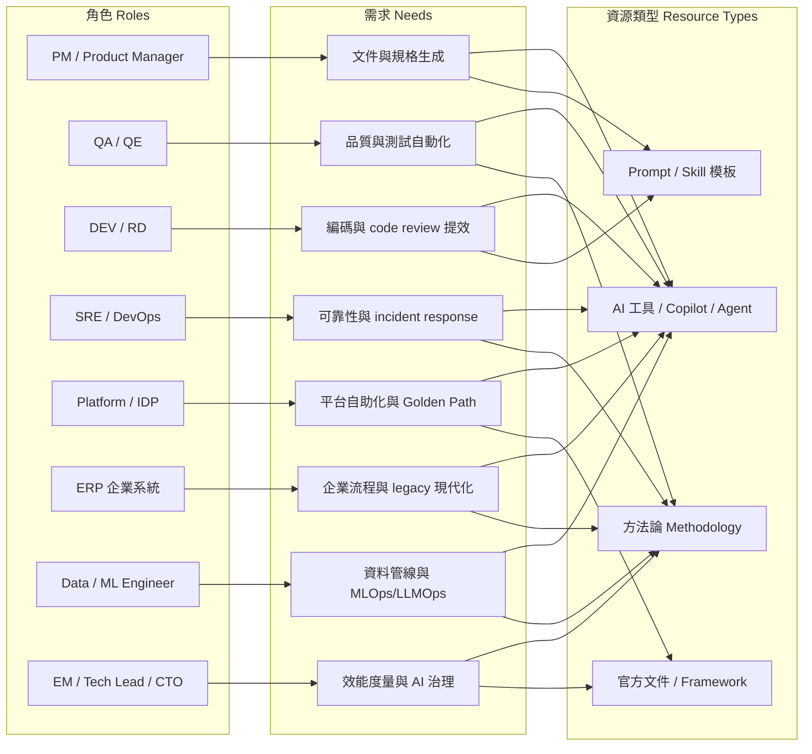

# 05 角色導向資源地圖 | Role-Based Resource Map

> 為 PM、QA、DEV/RD、SRE、Platform、ERP、Data/ML、EM/CTO 八大角色整理的「方法論 × AI 工具 × Prompt」資源地圖。
> A role-by-role map of methodologies, AI tools, and prompt/skill ideas for PM, QA, DEV/RD, SRE, Platform, ERP, Data/ML, and EM/CTO.
> 每個條目皆附官方來源 URL，並於 2026-11-08 逐條驗證。All entries link to official sources, each URL verified on 2026-11-08.
> Prompt 範例皆為本 repo 原創，可直接改寫成團隊自己的 skill。All prompt examples are original and safe to adapt into your own skills.

> Part of [Awesome Tech Leadership](../README.md) · [README (EN)](../README.md) · [繁體中文](../README.zh-TW.md)

## 角色×需求矩陣 | Role × Need Matrix



---

## PM | Product Manager 產品經理

**工作流痛點 → AI/方法對策**

| 痛點 Pain Point | 對策 Approach | 工具/資源 |
|---|---|---|
| PRD 撰寫耗時、格式不一致 | AI 生成 PRD 骨架 + 品質 checklist | ChatPRD、Notion AI |
| User story 拆解靠經驗 | Prompt 驅動 story 拆分 + acceptance criteria 生成 | Claude Code + 自建 prompt |
| Roadmap 排序難、stakeholder 對不齊 | AI 輔助優先級 + roadmap 敘事 | Productboard、Linear、Jira |
| Spec-driven 開發中 PM 與工程脫節 | Spec 先行、PM 主導 intent | GitHub Spec Kit |
| 用戶訪談分析（數十場）人工編碼慢 | AI 轉錄 + 主題編碼 + 引用溯源 | Dovetail |
| 數據洞察不會寫 SQL | 自然語言查數、AI 洞察摘要 | Amplitude |
| 會議白板收斂成結論慢 | AI 聚類 sticky notes、生成會議摘要 | Miro AI |

**推薦工具 Tools**

### ChatPRD | AI PRD 助理
<!-- entry:id=roles/chatprd type=tool roles=PM tags=prd,docs,ai-assistant license=proprietary last_verified=2026-11-08 -->
- **一句話**: AI copilot that drafts and refines PRDs, user stories, and product docs with PM-specific guidance.
- **一句話（繁中）**: 專為 PM 設計的 PRD／user story 生成與潤稿助理。
- **來源 Sources**: [官網](https://www.chatprd.ai) — 官方 SaaS
- **定價模式**: 付費（含免費額度）

### Notion AI | Notion 工作區 AI
<!-- entry:id=roles/notion-ai type=tool roles=PM,EM tags=docs,knowledge-base,ai-assistant license=proprietary last_verified=2026-11-08 -->
- **一句話**: AI writing, Q&A, and autofill built into the Notion workspace for product docs and specs.
- **一句話（繁中）**: 內建於 Notion 工作區的 AI 寫作、問答與欄位自動填寫。
- **來源 Sources**: [官網](https://www.notion.com/product/ai) — 官方 SaaS
- **定價模式**: 付費（隨 Notion 方案）

### Linear | Linear 議題管理
<!-- entry:id=roles/linear type=tool roles=PM,DEV,EM tags=issue-tracking,project-management license=proprietary last_verified=2026-11-08 -->
- **一句話**: Opinionated issue tracking with built-in AI for triage, duplicate detection, and sub-issue generation.
- **一句話（繁中）**: 現代化 issue tracking，內建 AI 分派、去重與子任務生成。
- **來源 Sources**: [官網](https://linear.app) — 官方 SaaS
- **定價模式**: 付費（含免費方案）

### Jira | Atlassian Jira
<!-- entry:id=roles/jira type=tool roles=PM,QA,EM tags=issue-tracking,project-management license=proprietary last_verified=2026-11-08 -->
- **一句話**: Enterprise issue and project tracking with Atlassian Intelligence AI features such as summaries and Rovo.
- **一句話（繁中）**: 企業級專案／議題管理，內建 Atlassian Intelligence AI 功能。
- **來源 Sources**: [官網](https://www.atlassian.com/software/jira) — 官方 SaaS
- **定價模式**: 付費（含免費方案）

### Productboard | Productboard Roadmap 平台
<!-- entry:id=roles/productboard type=platform roles=PM,EM tags=roadmap,customer-feedback license=proprietary last_verified=2026-11-08 -->
- **一句話**: Product management platform that turns customer feedback into prioritized roadmaps with AI-assisted feedback synthesis.
- **一句話（繁中）**: 以客戶回饋驅動的 roadmap 平台，AI 輔助回饋彙整與排序。
- **來源 Sources**: [官網](https://www.productboard.com) — 官方 SaaS
- **定價模式**: 付費

### Dovetail | Dovetail 用戶研究
<!-- entry:id=roles/dovetail type=tool roles=PM tags=user-research,interview-analysis license=proprietary last_verified=2026-11-08 -->
- **一句話**: Customer research platform that transcribes, tags, and analyzes interviews to surface themes with evidence.
- **一句話（繁中）**: 用戶研究平台：訪談轉錄、標記、主題分析並保留引用證據。
- **來源 Sources**: [官網](https://dovetail.com) — 官方 SaaS
- **定價模式**: 付費（含免費方案）

### Amplitude | Amplitude 產品分析
<!-- entry:id=roles/amplitude type=platform roles=PM,DATA tags=analytics,experimentation license=proprietary last_verified=2026-11-08 -->
- **一句話**: Product analytics with AI-assisted insight generation and natural-language charting.
- **一句話（繁中）**: 產品數據分析平台，具 AI 洞察生成與自然語言查數。
- **來源 Sources**: [官網](https://www.amplitude.com) — 官方 SaaS
- **定價模式**: 付費（含免費方案）

### Miro AI | Miro 白板 AI
<!-- entry:id=roles/miro-ai type=tool roles=PM,EM tags=collaboration,workshop,whiteboard license=proprietary last_verified=2026-11-08 -->
- **一句話**: AI clustering, summarizing, and diagram generation inside a collaborative whiteboard.
- **一句話（繁中）**: 協作白板內建 AI：便利貼聚類、會議摘要、自動生成圖表。
- **來源 Sources**: [官網](https://www.miro.com/ai/) — 官方 SaaS
- **定價模式**: 付費（含免費方案）

**推薦方法論 Methodologies**

### Spec-Driven Development | GitHub Spec Kit
<!-- entry:id=roles/spec-kit type=method roles=PM,DEV tags=spec-driven,workflow license=MIT last_verified=2026-11-08 -->
- **一句話**: A spec-first development methodology where structured specifications drive AI coding agents to implement features.
- **一句話（繁中）**: 規格驅動開發：先寫好結構化 spec，再讓 AI coding agent 依規格實作。
- **來源 Sources**: [GitHub](https://github.com/github/spec-kit) — 開源 (MIT)
- **注意事項**: PM 主導 intent 與驗收條件，工程師主導實作細節；spec 是唯一真相來源。

### User Story Mapping | 使用者故事地圖
<!-- entry:id=roles/user-story-mapping type=method roles=PM,QA tags=requirements,discovery license=n/a last_verified=2026-11-08 -->
- **一句話**: A visual practice that arranges user stories into a shared narrative of how users move through the product.
- **一句話（繁中）**: 把 user story 排成使用者旅程敘事的視覺化需求整理方法。
- **來源 Sources**: [Agile Alliance Glossary](https://www.agilealliance.org/glossary/story-mapping/) — 公開方法論
- **定價模式**: 免費

### Continuous Discovery Habits | 持續探索習慣
<!-- entry:id=roles/continuous-discovery type=method roles=PM tags=discovery,research license=n/a last_verified=2026-11-08 -->
- **一句話**: A weekly cadence of customer touchpoints that keeps product discovery continuous and evidence-driven.
- **一句話（繁中）**: 以每週客戶接觸節奏持續探索需求，讓決策建立在證據上。
- **來源 Sources**: [ProductTalk](https://www.producttalk.org/) — 公開方法論（Teresa Torres）
- **定價模式**: 免費（另有付費課程與書籍）

### Specification by Example | 規格化實例
<!-- entry:id=roles/specification-by-example type=method roles=PM,QA,DEV tags=requirements,acceptance-criteria license=n/a last_verified=2026-11-08 -->
- **一句話**: A collaborative approach where concrete examples of expected behavior become the shared specification and living documentation.
- **一句話（繁中）**: 用具體範例描述預期行為，成為團隊共通規格與活文件。
- **來源 Sources**: [方法論說明](https://en.wikipedia.org/wiki/Specification_by_example) — 公開方法論
- **定價模式**: 免費

**推薦 Prompt 點子 Prompts**

### PRD Completeness Auditor | PRD 完整性審查
<!-- entry:id=roles/prd-completeness-auditor type=prompt roles=PM,EM tags=prd,review,quality license=n/a last_verified=2026-11-08 -->
- **一句話**: An audit prompt that scores a PRD's completeness and pinpoints the riskiest gaps before development starts.
- **一句話（繁中）**: 對 PRD 做結構化體檢、給完整度分數並指出最高風險缺口的審查 prompt。
- **來源 Sources**: 原創 prompt（本 repo）— 可搭配 [ChatPRD](https://www.chatprd.ai) 等工具使用
- **Prompt 範例**:

  ```text
  你是一位資深產品審查者。請閱讀以下 PRD，逐項檢查並輸出表格：
  1) 問題陳述是否量化（誰、多痛、多頻繁）？
  2) 成功指標是否可測量且有基線？
  3) 非目標（non-goals）是否明列？
  4) 每個 user story 是否都有驗收條件（Given/When/Then）？
  5) 邊界情境與失敗路徑是否覆蓋？
  6) 相依系統與資料移動是否列出？
  對每個缺失項，給出一句「補寫建議」。最後輸出 0-100 的完整度分數與前 3 個最高風險缺口。
  PRD 內文：
  {{PRD}}
  ```

### Story Splitter | User Story 拆分
<!-- entry:id=roles/story-splitter type=prompt roles=PM,EM tags=user-story,sprint,acceptance-criteria license=n/a last_verified=2026-11-08 -->
- **一句話**: A prompt that splits a large feature into INVEST-compliant sprint-sized stories with acceptance criteria.
- **一句話（繁中）**: 把大型 feature 拆成 INVEST 原則、sprint 可交付的 story，並自動補驗收條件。
- **來源 Sources**: 原創 prompt（本 repo）— 可搭配 [Spec Kit](https://github.com/github/spec-kit)
- **Prompt 範例**:

  ```text
  將以下 feature 拆成 INVEST 原則合規的 user story（每個 sprint 可獨立交付）。
  每個 story 輸出：標題、作為<角色>我想要<能力>以便<價值>、
  驗收條件（Given/When/Then 至少 3 條，含 1 條失敗路徑）、
  依賴項、估點（T-shirt size）。若發現跨 story 的共享資料庫變更，
  單獨標記為「需提前討論的架構風險」。
  Feature 描述：
  {{FEATURE}}
  ```

### Interview Insight Synthesizer | 訪談洞察綜合
<!-- entry:id=roles/interview-insight-synthesizer type=prompt roles=PM tags=user-research,synthesis license=n/a last_verified=2026-11-08 -->
- **一句話**: A prompt that synthesizes interview transcripts into themes with citations, counter-examples, and opportunity areas.
- **一句話（繁中）**: 把訪談逐字稿彙整成主題、引用證據、反例與機會點的綜合分析 prompt。
- **來源 Sources**: 原創 prompt（本 repo）— 可搭配 [Dovetail](https://dovetail.com)
- **Prompt 範例**:

  ```text
  以下是 {{N}} 場用戶訪談逐字稿。請：
  1) 提煉 5-8 個主題，每個主題附至少 2 條逐字引用（標明訪談編號）；
  2) 標記每個主題的強度：反覆出現 / 單一強烈 / 偶發；
  3) 額外列出「反例」——與主流主題矛盾的聲音；
  4) 產出 3 個機會點（Opportunity），各連回支持它的主題。
  禁止編造引用；找不到證據就寫「證據不足」。
  ```

---

## QA | Quality Engineering 品質工程

**工作流痛點 → AI/方法對策**

| 痛點 Pain Point | 對策 Approach | 工具/資源 |
|---|---|---|
| 測試案例撰寫覆蓋率不足 | AI 依需求/程式碼生成測試案例與邊界值 | LLM prompt、Diffblue Cover |
| UI 測試維護成本高（selector 改就壞） | Self-healing tests + AI 修復 locator | Testim、mabl |
| 視覺回歸難以人工比對 | AI 視覺測試（視覺比對 + 忽略雜訊） | Applitools、Percy |
| E2E 探索/除錯要人工操作瀏覽器 | 讓 AI agent 直接操作瀏覽器 | Playwright MCP |
| Flaky test 侵蝕 CI 信心 | Flaky 偵測隔離 + 根因分析 | Launchable |
| 測試看似通過但斷言薄弱 | Mutation testing 驗證測試殺傷力 | Stryker |
| 微服務介面改動互相破壞 | Contract testing 鎖定介面契約 | Pact |
| 回歸測試選擇靠直覺 | 依 code change 做風險測試選擇 | Launchable、Tricentis |

**推薦工具 Tools**

### Playwright MCP | Playwright 瀏覽器 MCP
<!-- entry:id=roles/playwright-mcp type=mcp roles=QA,DEV tags=browser-automation,test-generation,agent license=Apache-2.0 last_verified=2026-11-08 -->
- **一句話**: An MCP server that lets LLM agents drive a real browser via Playwright for test authoring and exploration.
- **一句話（繁中）**: 讓 LLM agent 透過 Playwright 操作真實瀏覽器，用於撰寫與探索測試。
- **來源 Sources**: [GitHub](https://github.com/microsoft/playwright-mcp) — 開源 (Apache-2.0)
- **定價模式**: 開源

### Applitools Eyes | Applitools 視覺 AI
<!-- entry:id=roles/applitools type=tool roles=QA tags=visual-testing,regression license=proprietary last_verified=2026-11-08 -->
- **一句話**: Visual AI testing that detects meaningful UI visual regressions while ignoring rendering noise.
- **一句話（繁中）**: 用視覺 AI 比對 UI 截圖，只抓「真正有差異」的視覺回歸。
- **來源 Sources**: [官網](https://applitools.com) — 官方 SaaS
- **定價模式**: 付費

### Percy | Percy 視覺回歸
<!-- entry:id=roles/percy type=tool roles=QA tags=visual-testing,regression license=proprietary last_verified=2026-11-08 -->
- **一句話**: A visual review platform that snapshots UI across browsers and surfaces visual diffs in CI review flows.
- **一句話（繁中）**: 跨瀏覽器截圖比對的視覺審查平台，整合 CI 審查流程。
- **來源 Sources**: [官網](https://percy.io) — 官方 SaaS（BrowserStack 旗下）
- **定價模式**: 付費

### Testim | Testim Self-healing 測試
<!-- entry:id=roles/testim type=tool roles=QA tags=ui-testing,self-healing license=proprietary last_verified=2026-11-08 -->
- **一句話**: AI-assisted UI test automation with smart locators that self-heal when the DOM changes.
- **一句話（繁中）**: AI 輔助 UI 測試自動化，DOM 變動時 locator 自動修復。
- **來源 Sources**: [官網](https://www.testim.io) — 官方 SaaS
- **定價模式**: 付費

### mabl | mabl 智慧測試平台
<!-- entry:id=roles/mabl type=tool roles=QA tags=low-code-testing,self-healing license=proprietary last_verified=2026-11-08 -->
- **一句話**: Low-code test automation with auto-healing, AI-generated assertions, and unified web/API/mobile coverage.
- **一句話（繁中）**: 低程式碼測試自動化，具自動修復與 AI 斷言建議，涵蓋 Web/API/Mobile。
- **來源 Sources**: [官網](https://www.mabl.com) — 官方 SaaS
- **定價模式**: 付費

### Diffblue Cover | Diffblue 單測生成
<!-- entry:id=roles/diffblue-cover type=tool roles=QA,DEV tags=unit-test-generation,java license=proprietary last_verified=2026-11-08 -->
- **一句話**: AI that autonomously writes unit tests with assertions for Java code, used for coverage and regression safety.
- **一句話（繁中）**: 自動為 Java 程式碼生成含斷言的單元測試，提升覆蓋率與回歸安全。
- **來源 Sources**: [官網](https://www.diffblue.com) — 官方 SaaS／企業版
- **定價模式**: 付費

### Stryker | Stryker Mutation Testing
<!-- entry:id=roles/stryker type=tool roles=QA,DEV tags=mutation-testing,test-quality license=Apache-2.0 last_verified=2026-11-08 -->
- **一句話**: A mutation testing framework that measures whether your tests actually catch bugs by injecting small faults.
- **一句話（繁中）**: 注入小型變異來量測測試是否真的能抓到 bug，揭露薄弱斷言。
- **來源 Sources**: [官網](https://stryker-mutator.io) — 開源 (Apache-2.0，以 stryker-js 為代表)
- **定價模式**: 開源

### Pact | Pact 契約測試
<!-- entry:id=roles/pact type=tool roles=QA,DEV,SRE tags=contract-testing,microservices license=MIT last_verified=2026-11-08 -->
- **一句話**: Consumer-driven contract testing that keeps microservice integrations honest without full E2E.
- **一句話（繁中）**: 消費者驅動的契約測試，不靠完整 E2E 就能守住微服務介面。
- **來源 Sources**: [官網](https://pact.io) / [pact-js](https://github.com/pact-foundation/pact-js) — 開源 (MIT)
- **定價模式**: 開源（Pact Broker 有託管付費版）

### Launchable | Launchable 測試選擇
<!-- entry:id=roles/launchable type=tool roles=QA,SRE tags=test-selection,flaky-test license=proprietary last_verified=2026-11-08 -->
- **一句話**: ML-driven test selection that runs the tests most likely to fail for each change, plus flaky test insights.
- **一句話（繁中）**: 依每次變更預測最可能失敗的測試子集，並提供 flaky test 洞察。
- **來源 Sources**: [官網](https://www.launchableinc.com) — 官方 SaaS
- **定價模式**: 付費

### Playwright | Playwright E2E 框架
<!-- entry:id=roles/playwright type=tool roles=QA,DEV tags=e2e-testing,framework license=Apache-2.0 last_verified=2026-11-08 -->
- **一句話**: Reliable end-to-end testing for modern web apps with auto-wait, tracing, and cross-browser support.
- **一句話（繁中）**: 現代 Web 應用的可靠 E2E 測試框架，具自動等待與追蹤紀錄。
- **來源 Sources**: [官網](https://playwright.dev) — 開源 (Apache-2.0)
- **定價模式**: 開源

**推薦方法論 Methodologies**

### Test Pyramid | 測試金字塔
<!-- entry:id=roles/test-pyramid type=method roles=QA,DEV tags=test-strategy license=n/a last_verified=2026-11-08 -->
- **一句話**: A test strategy shape balancing many fast unit tests, fewer integration tests, and minimal E2E tests.
- **一句話（繁中）**: 以大量快速單測、少量整合測試、極少量 E2E 組成的測試投資組合策略。
- **來源 Sources**: [Martin Fowler bliki](https://martinfowler.com/bliki/TestPyramid.html) — 公開方法論
- **定價模式**: 免費

### TDD | 測試驅動開發
<!-- entry:id=roles/tdd type=method roles=QA,DEV tags=test-first,quality license=n/a last_verified=2026-11-08 -->
- **一句話**: A test-first practice of writing a failing test, making it pass, then refactoring in small cycles.
- **一句話（繁中）**: 先寫失敗測試、再讓它通過、後重構的小循環開發方法。
- **來源 Sources**: [Agile Alliance Glossary](https://www.agilealliance.org/glossary/tdd/) — 公開方法論
- **定價模式**: 免費

### Contract Testing | 契約測試
<!-- entry:id=roles/contract-testing type=method roles=QA,DEV,SRE tags=microservices,integration license=n/a last_verified=2026-11-08 -->
- **一句話**: Testing the agreements between services so integration breakage is caught without full end-to-end stacks.
- **一句話（繁中）**: 測試服務間的介面契約，在不跑完整 E2E 的情況下抓到整合破壞。
- **來源 Sources**: [Martin Fowler bliki](https://martinfowler.com/bliki/ContractTest.html) — 公開方法論
- **定價模式**: 免費

### Risk-based Testing | 風險導向測試
<!-- entry:id=roles/risk-based-testing type=method roles=QA,PM tags=prioritization,test-strategy license=n/a last_verified=2026-11-08 -->
- **一句話**: Prioritizing test effort by product risk so the highest-impact failure modes are covered first.
- **一句話（繁中）**: 依產品風險排定測試投入，優先覆蓋高影響的失敗模式。
- **來源 Sources**: [ISTQB Glossary](https://glossary.istqb.org/en_US/risk-based-testing/) — 公開方法論
- **定價模式**: 免費

**推薦 Prompt 點子 Prompts**

### Test Case Generator | 測試案例生成
<!-- entry:id=roles/test-case-generator type=prompt roles=QA,PM tags=test-generation,boundary-values license=n/a last_verified=2026-11-08 -->
- **一句話**: A prompt that turns requirements into test case tables covering boundaries, equivalence classes, and failure paths.
- **一句話（繁中）**: 把需求轉成含邊界值、等價劃分與失敗路徑的測試案例表的生成 prompt。
- **來源 Sources**: 原創 prompt（本 repo）— 可搭配 [Playwright MCP](https://github.com/microsoft/playwright-mcp)
- **Prompt 範例**:

  ```text
  以下是需求描述與（可選的）函式簽名。請產出測試案例表格，欄位：
  案例 ID、類型（正常/邊界/異常/安全）、前置條件、步驟、預期結果。
  要求：
  - 邊界值至少 4 組（0、1、上限、上限+1 或空值等）
  - 等價劃分每個類別至少 1 筆
  - 至少 2 筆「非預期輸入」（型別錯誤、超長字串、並發）
  - 標註每筆案例對應的需求條款編號
  不要寫程式碼，只要案例表。
  ```

### Flaky Test Triage | Flaky Test 診斷
<!-- entry:id=roles/flaky-test-triage type=prompt roles=QA,DEV tags=flaky-test,root-cause license=n/a last_verified=2026-11-08 -->
- **一句話**: A prompt that classifies flaky test root causes and proposes isolation-first fixes over blind retries.
- **一句話（繁中）**: 對 flaky test 做根因分類並提出「隔離優先於重試」修復建議的診斷 prompt。
- **來源 Sources**: 原創 prompt（本 repo）— 可搭配 [Launchable](https://www.launchableinc.com)
- **Prompt 範例**:

  ```text
  以下測試在 CI 中隨機失敗。請分析並輸出：
  1) 根因分類：時間相依 / 順序相依 / 共用狀態 / 非決定性外部服務 / 資源競爭 / 其他
  2) 支持該分類的證據（引用程式碼行或日誌片段）
  3) 修復建議（偏重「隔離而非重試」；若建議 retry，須說明為何隔離不可行）
  4) 是否應暫時 quarantines 並附追蹤票券範本
  ```

### Coverage Gap Reviewer | 測試覆蓋差距審查
<!-- entry:id=roles/coverage-gap-reviewer type=prompt roles=QA,DEV tags=coverage,review license=n/a last_verified=2026-11-08 -->
- **一句話**: A prompt that builds a requirements-to-tests coverage matrix and flags weak assertions.
- **一句話（繁中）**: 產出「需求條款 × 測試」覆蓋矩陣並標記斷言薄弱處的審查 prompt。
- **來源 Sources**: 原創 prompt（本 repo）— 可搭配 [Stryker](https://stryker-mutator.io) 驗證斷言強度
- **Prompt 範例**:

  ```text
  給你：需求條款清單、既有測試程式碼。請輸出覆蓋矩陣：
  條款 × 是否有測試 × 斷言強度（強/弱/無）。
  列出「有測試但斷言薄弱」的案例（例如只 assert 不拋例外），
  並為每個缺口建議 1 條最有價值的補強測試（用 Given/When/Then 描述即可）。
  ```

---

## DEV | Software Engineer 軟體工程師

**工作流痛點 → AI/方法對策**

| 痛點 Pain Point | 對策 Approach | 工具/資源 |
|---|---|---|
| 重複性程式碼撰寫耗時 | AI coding assistant 行內補全/代理式改寫 | Claude Code、Cursor、Copilot、Windsurf |
| 想要終端機原生 agent 工作流 | 終端機 coding agent（CLI） | Claude Code、Gemini CLI、Codex CLI、Qwen Code、Aider、Cline |
| Code review 人力瓶頸、品質不一 | AI 初審（自動 PR review 評論） | CodeRabbit |
| 陌生 codebase 導覽成本高 | 程式碼知識圖譜 + MCP 語意索引 | CodeGraph、Serena MCP、Sourcegraph |
| Refactoring 風險高、影響範圍不明 | Symbol 級重構 + 參照分析 | Serena MCP |
| 規格與實作脫節 | Spec-driven 開發 | GitHub Spec Kit |

**推薦工具 Tools**

### Claude Code | Claude Code
<!-- entry:id=roles/claude-code type=tool roles=DEV,QA,DATA tags=coding-agent,terminal,mcp license=proprietary last_verified=2026-11-08 -->
- **一句話**: An agentic coding tool that lives in your terminal, reads whole codebases, edits files, runs tests, and uses MCP tools and skills.
- **一句話（繁中）**: 終端機裡的代理式 coding 工具：讀整個 codebase、改檔、跑測試，支援 MCP 與 skill。
- **來源 Sources**: [官網](https://claude.com/claude-code) / [官方文件](https://docs.anthropic.com/en/docs/claude-code/overview) — 官方
- **定價模式**: 付費（訂閱或 API 計費）

### Cursor | Cursor AI 編輯器
<!-- entry:id=roles/cursor type=tool roles=DEV tags=ide,coding-agent license=proprietary last_verified=2026-11-08 -->
- **一句話**: An AI-first code editor with tab completion, agent mode, and codebase-aware chat built on VS Code.
- **一句話（繁中）**: AI 優先的編輯器（VS Code 分支）：tab 補全、agent 模式、codebase 感知問答。
- **來源 Sources**: [官網](https://cursor.com) — 官方 SaaS
- **定價模式**: 付費（含免費方案）

### GitHub Copilot | GitHub Copilot
<!-- entry:id=roles/github-copilot type=tool roles=DEV,QA tags=coding-assistant,pr-review license=proprietary last_verified=2026-11-08 -->
- **一句話**: An AI pair programmer with completions, chat, agent mode, and PR summarization across the GitHub platform.
- **一句話（繁中）**: 平台整合度最高的 AI 結對程式員：補全、chat、agent mode、PR 摘要。
- **來源 Sources**: [官網](https://github.com/features/copilot) — 官方 SaaS
- **定價模式**: 付費（含免費方案）

### Windsurf | Windsurf Agentic IDE
<!-- entry:id=roles/windsurf type=tool roles=DEV tags=ide,coding-agent license=proprietary last_verified=2026-11-08 -->
- **一句話**: An agentic IDE whose Cascade agent plans and executes multi-file edits with deep codebase context.
- **一句話（繁中）**: Agentic IDE，Cascade agent 可規劃並執行跨檔案修改。
- **來源 Sources**: [官網](https://windsurf.com) — 官方 SaaS
- **定價模式**: 付費（含免費方案）

### Cline | Cline 開源 Coding Agent
<!-- entry:id=roles/cline type=tool roles=DEV tags=coding-agent,vscode,agent license=Apache-2.0 last_verified=2026-11-08 -->
- **一句話**: An open-source autonomous coding agent in VS Code that plans, edits, and runs commands with human approval gates.
- **一句話（繁中）**: VS Code 內的開源自主 coding agent，帶人工核准關卡的規劃—執行循環。
- **來源 Sources**: [官網](https://cline.bot) / [GitHub](https://github.com/cline/cline) — 開源 (Apache-2.0)
- **定價模式**: 開源（自帶 API key）

### Aider | Aider 終端機結對
<!-- entry:id=roles/aider type=tool roles=DEV tags=coding-agent,terminal,git license=Apache-2.0 last_verified=2026-11-08 -->
- **一句話**: AI pair programming in your terminal that edits code in your local git repo with automatic commits.
- **一句話（繁中）**: 終端機 AI 結對程式設計，直接改本地 git repo 並自動 commit。
- **來源 Sources**: [官網](https://aider.chat) / [GitHub](https://github.com/Aider-AI/aider) — 開源 (Apache-2.0)
- **定價模式**: 開源（自帶 API key）

### Gemini CLI | Google Gemini CLI
<!-- entry:id=roles/gemini-cli type=tool roles=DEV tags=coding-agent,terminal,mcp license=Apache-2.0 last_verified=2026-11-08 -->
- **一句話**: An open-source terminal AI agent from Google with large context, ReAct loop, and MCP/extensions support.
- **一句話（繁中）**: Google 開源終端機 AI agent，大上下文 + ReAct 迴圈 + MCP/擴充支援。
- **來源 Sources**: [GitHub](https://github.com/google-gemini/gemini-cli) — 開源 (Apache-2.0)
- **定價模式**: 開源（含免費額度）

### Codex CLI | OpenAI Codex CLI
<!-- entry:id=roles/codex-cli type=tool roles=DEV tags=coding-agent,terminal license=Apache-2.0 last_verified=2026-11-08 -->
- **一句話**: OpenAI's open-source terminal coding agent that reads, modifies, and runs code locally.
- **一句話（繁中）**: OpenAI 的開源終端機 coding agent，在本地讀寫與執行程式碼。
- **來源 Sources**: [GitHub](https://github.com/openai/codex) — 開源 (Apache-2.0)
- **定價模式**: 開源（需帳號或 API key）

### Qwen Code | Qwen Code
<!-- entry:id=roles/qwen-code type=tool roles=DEV tags=coding-agent,terminal license=Apache-2.0 last_verified=2026-11-08 -->
- **一句話**: An open-source terminal coding agent based on the Qwen models with a generous free tier.
- **一句話（繁中）**: 基於 Qwen 模型的開源終端機 coding agent，免費額度高。
- **來源 Sources**: [GitHub](https://github.com/QwenLM/qwen-code) — 開源 (Apache-2.0)
- **定價模式**: 開源（含免費額度）

### CodeRabbit | CodeRabbit AI Review
<!-- entry:id=roles/coderabbit type=tool roles=DEV,EM tags=code-review,pr-review license=proprietary last_verified=2026-11-08 -->
- **一句話**: An AI code reviewer that comments on pull requests with line-level feedback and learnable repo conventions.
- **一句話（繁中）**: AI code review bot，在 PR 上給行級評論並可學習 repo 慣例。
- **來源 Sources**: [官網](https://www.coderabbit.ai) — 官方 SaaS
- **定價模式**: 付費（開源專案免費）

### Serena MCP | Serena 語意工具組
<!-- entry:id=roles/serena-mcp type=mcp roles=DEV tags=refactoring,symbol-search,mcp license=n/a last_verified=2026-11-08 -->
- **一句話**: An MCP server of symbol-level code tools (find symbol, references, rename, safe delete) built on language servers.
- **一句話（繁中）**: 基於 language server 的 symbol 級程式碼 MCP 工具組：找定義、找參照、改名、安全刪除。
- **來源 Sources**: [GitHub](https://github.com/oraios/serena) — 開源（自訂授權，GitHub 歸類 Other）
- **定價模式**: 開源
- **注意事項**: 授權非標準 SPDX，商用前請自行閱讀 repo 內授權條款。

### CodeGraph | CodeGraph 知識圖譜
<!-- entry:id=roles/codegraph type=tool roles=DEV,PLATFORM tags=code-graph,codebase-navigation,mcp license=MIT last_verified=2026-11-08 -->
- **一句話**: A pre-indexed code knowledge graph with CLI and MCP access for exploring symbols, callers, and blast radius.
- **一句話（繁中）**: 預建索引的程式碼知識圖譜（CLI + MCP）：探索 symbol、呼叫者與變更影響範圍。
- **來源 Sources**: [GitHub](https://github.com/colbymchenry/codegraph) / [文件](https://colbymchenry.github.io/codegraph/reference/cli/) — 開源 (MIT)
- **定價模式**: 開源

### Sourcegraph | SourceGraph 程式碼搜尋
<!-- entry:id=roles/sourcegraph type=platform roles=DEV,PLATFORM tags=code-search,code-intelligence license=proprietary last_verified=2026-11-08 -->
- **一句話**: Universal code search and intelligence across large multi-repo codebases, with the Cody AI assistant.
- **一句話（繁中）**: 跨大型多 repo 的程式碼搜尋與語意智慧，附 Cody AI 助理。
- **來源 Sources**: [官網](https://sourcegraph.com) — 官方
- **定價模式**: 付費

**推薦方法論 Methodologies**

### Refactoring | 重構
<!-- entry:id=roles/refactoring type=method roles=DEV,EM tags=refactoring,code-quality license=n/a last_verified=2026-11-08 -->
- **一句話**: Improving code structure in small behavior-preserving steps, backed by tests and a catalog of refactorings.
- **一句話（繁中）**: 在測試保護下以「行為不變」的小步驟改善程式結構，附重構手法目錄。
- **來源 Sources**: [refactoring.com](https://refactoring.com/) — 公開方法論（Martin Fowler）
- **定價模式**: 免費

### Trunk-Based Development | 主幹開發
<!-- entry:id=roles/trunk-based-development type=method roles=DEV,SRE tags=ci-cd,workflow license=n/a last_verified=2026-11-08 -->
- **一句話**: A branching model where everyone integrates to one trunk with small, frequent commits and feature flags.
- **一句話（繁中）**: 全員向單一主幹高頻小量整合、以 feature flag 控制未完成功能的分支模型。
- **來源 Sources**: [trunkbaseddevelopment.com](https://trunkbaseddevelopment.com/) — 公開方法論
- **定價模式**: 免費

### Architecture Decision Records | 架構決策紀錄
<!-- entry:id=roles/architecture-decision-records type=guide roles=DEV,EM,ERP tags=adr,documentation,governance license=n/a last_verified=2026-11-08 -->
- **一句話**: Lightweight records of architecturally significant decisions that keep modernization choices explainable over time.
- **一句話（繁中）**: 輕量紀錄重大架構決策，讓現代化的每一步都有脈絡可追溯。
- **來源 Sources**: [GitHub](https://github.com/architecture-decision-record/architecture-decision-record) — 開源指南（自訂授權）
- **定價模式**: 免費

**推薦 Prompt 點子 Prompts**

### Codebase Tour Guide | Codebase 導覽精靈
<!-- entry:id=roles/codebase-tour-guide type=prompt roles=DEV,PLATFORM tags=onboarding,codebase-navigation license=n/a last_verified=2026-11-08 -->
- **一句話**: A prompt that generates an onboarding guide with an architecture map and "where to change X" quick reference.
- **一句話（繁中）**: 生成含架構地圖與「改 X 看這裡」對照表的新人接手導覽的 prompt。
- **來源 Sources**: 原創 prompt（本 repo）— 可搭配 [CodeGraph](https://github.com/colbymchenry/codegraph)
- **Prompt 範例**:

  ```text
  請為此 repo 產出一份新人導覽（Markdown）：
  1) 系統分層圖（用文字描述模組與依賴方向）
  2) 「想改 X 就看這 3 個檔案」的任務對照表（API、UI、DB schema、測試 各一組）
  3) 建置/測試/格式化指令各一條（引用自設定檔，不要猜）
  4) 3 個最可能踩雷的慣例（命名、錯誤處理、交易邊界）
  要求每項都附檔案路徑:行號作為證據；找不到的明說「repo 中未發現」。
  ```

### Refactoring Safety Planner | 安全重構規劃
<!-- entry:id=roles/refactoring-safety-planner type=prompt roles=DEV tags=refactoring,planning license=n/a last_verified=2026-11-08 -->
- **一句話**: A prompt that produces an impact analysis and incremental, rollback-safe refactoring plan before any code changes.
- **一句話（繁中）**: 動手前先產出影響範圍與可回滾漸進計畫的重構規劃 prompt。
- **來源 Sources**: 原創 prompt（本 repo）— 可搭配 [Serena MCP](https://github.com/oraios/serena)
- **Prompt 範例**:

  ```text
  我想重構 {{目標}}。動手前請先產出計畫：
  1) 影響範圍：所有直接/間接參照（附檔案路徑:行號）
  2) 行為不變的保證：列出既有測試可覆蓋的行為；沒測試覆蓋的行為要先補 characterization test
  3) 漸進步驟（每步都要可獨立 commit、測試可過）
  4) 回滾策略：每步如何撤銷
  未經我確認計畫前，不要修改任何檔案。
  ```

### Pre-PR Self Review | PR 自我審查
<!-- entry:id=roles/pre-pr-self-review type=prompt roles=DEV tags=code-review,quality license=n/a last_verified=2026-11-08 -->
- **一句話**: A prompt that reviews your own diff for correctness bugs, silent failures, and test gaps before opening a PR.
- **一句話（繁中）**: 提交 PR 前自我審查 diff，抓 silent failure、行為變更與測試缺口的 prompt。
- **來源 Sources**: 原創 prompt（本 repo）— 可搭配 [CodeRabbit](https://www.coderabbit.ai)
- **Prompt 範例**:

  ```text
  審查目前的 git diff，只看正確性問題，按嚴重度輸出：
  [Critical] 會造成錯誤行為 / [Major] 邊界或錯誤處理缺口 / [Minor] 可簡化處。
  特別檢查：無聲失敗（catch 了不處理）、非預期的行為變更、
  測試沒覆蓋的新分支、會破壞既有 API 契約的改動。
  每個 finding 附檔案路徑:行號與一句修法建議；沒有問題就明說「未發現」。
  ```

---

## SRE | DevOps & Observability 可靠性與維運

**工作流痛點 → AI/方法對策**

| 痛點 Pain Point | 對策 Approach | 工具/資源 |
|---|---|---|
| 告警風暴、雜訊淹沒真訊號 | AIOps 告警降噪／聚合 | PagerDuty Signal Intelligence、Datadog Bits AI、Dynatrace Davis AI |
| Incident 應變依賴老手經驗 | AI incident companion（分派、筆記、RCA 草稿） | incident.io AI、PagerDuty AI Agents |
| 事後檢討撰寫耗時 | AI 生成 postmortem 時間軸草稿 | incident.io |
| On-call 疲勞、升級流程繁瑣 | On-call 自動化 + AI 排班/升級 | PagerDuty（Shift agent） |
| Runbook 紙上談兵、執行靠人 | Runbook 自動化（可執行手冊） | Rundeck |
| 業務只在故障時才學到韌性 | 主動注入故障（Chaos Engineering） | Gremlin、LitmusChaos |
| 效能瓶頸難以量化 | DORA/VSM 效能度量平台 | DORA、Harness、LinearB |
| SRE 知識傳承斷層 | SRE workbook／錯誤預算治理 | Google SRE Books、SRE Workbook |

**推薦工具 Tools**

### PagerDuty AI Agents | Paige SRE Agent
<!-- entry:id=roles/pagerduty-ai-agents type=tool roles=SRE,EM tags=incident-response,aiops,on-call license=proprietary last_verified=2026-11-08 -->
- **一句話**: AI agents for operations — Paige the SRE agent plus Scribe/Shift/Insights for noise reduction, triage, and RCA.
- **一句話（繁中）**: 營運 AI agent 家族：SRE agent Paige 加上紀錄、排班、洞察 agent，負責降噪、分派與根因分析。
- **來源 Sources**: [官方產品頁](https://www.pagerduty.com/platform/ai-agents/) / [AIOps 文件](https://docs.pagerduty.com/ai-automation/aiops) — 官方 SaaS
- **定價模式**: 付費（credit-based）
- **注意事項**: 官方已將 AIOps 整併為 PD Reliability Platform 的「Signal Intelligence」。

### incident.io AI | incident.io AI 平台
<!-- entry:id=roles/incident-io-ai type=platform roles=SRE,EM tags=incident-response,postmortem,aiops license=proprietary last_verified=2026-11-08 -->
- **一句話**: An AI companion across the incident lifecycle — initial diagnosis, triage, investigation, updates, and auto-generated postmortems.
- **一句話（繁中）**: 涵蓋事件全生命週期的 AI 夥伴：初步診斷、分派、調查、更新與自動生成檢討報告。
- **來源 Sources**: [AI 平台頁](https://incident.io/ai-platform) / [調查功能](https://incident.io/investigations) — 官方 SaaS
- **定價模式**: 付費

### Datadog Bits AI | Bits AI
<!-- entry:id=roles/datadog-bits-ai type=tool roles=SRE,DATA tags=observability,aiops,assistant license=proprietary last_verified=2026-11-08 -->
- **一句話**: An AI assistant for observability that investigates alerts, queries telemetry in natural language, and drafts incident context.
- **一句話（繁中）**: 可觀測性 AI 助理：調查告警、自然語言查 telemetry、草擬事件脈絡。
- **來源 Sources**: [官網](https://www.datadoghq.com/product/platform/bits-ai/) — 官方 SaaS
- **定價模式**: 付費（隨方案/用量）

### Dynatrace Davis AI | Davis AI 引擎
<!-- entry:id=roles/dynatrace-davis-ai type=tool roles=SRE tags=observability,aiops,root-cause license=proprietary last_verified=2026-11-08 -->
- **一句話**: A causal-AI engine that pinpoints root causes across metrics, logs, traces, and topology automatically.
- **一句話（繁中）**: 因果 AI 引擎，跨指標/日誌/追蹤/拓撲自動定位根因。
- **來源 Sources**: [官網](https://www.dynatrace.com/platform/davis-ai/) — 官方 SaaS
- **定價模式**: 付費（用量計費）

### Rundeck | Rundeck Runbook 自動化
<!-- entry:id=roles/rundeck type=tool roles=SRE,PLATFORM tags=runbook,automation,on-call license=proprietary last_verified=2026-11-08 -->
- **一句話**: A job scheduling and runbook automation platform that turns operational procedures into self-service automated jobs.
- **一句話（繁中）**: 將維運程序轉成自助式自動化工作的 runbook 自動化平台。
- **來源 Sources**: [官網](https://www.rundeck.com) — 官方（PagerDuty 旗下；另有開源核心專案）
- **定價模式**: 付費（含開源版）

### Gremlin | Gremlin 混沌工程
<!-- entry:id=roles/gremlin type=tool roles=SRE tags=chaos-engineering,resilience license=proprietary last_verified=2026-11-08 -->
- **一句話**: A managed chaos engineering platform for safely injecting failures to find reliability weaknesses before outages do.
- **一句話（繁中）**: 託管式混沌工程平台，安全注入故障，在真正故障前找出可靠性弱點。
- **來源 Sources**: [官網](https://www.gremlin.com/product/chaos-engineering) — 官方 SaaS
- **定價模式**: 付費（含免費方案）

### LitmusChaos | LitmusChaos
<!-- entry:id=roles/litmuschaos type=tool roles=SRE,PLATFORM tags=chaos-engineering,kubernetes license=Apache-2.0 last_verified=2026-11-08 -->
- **一句話**: A CNCF chaos engineering framework for Kubernetes that orchestrates chaos experiments as CRDs with a GitOps-friendly workflow.
- **一句話（繁中）**: CNCF 混沌工程框架，以 CRD 編排 Kubernetes 混沌實驗，友善 GitOps 流程。
- **來源 Sources**: [官網](https://litmuschaos.io) / [GitHub](https://github.com/litmuschaos/litmus) — 開源 (Apache-2.0)
- **定價模式**: 開源

### Harness | Harness 交付平台
<!-- entry:id=roles/harness type=platform roles=SRE,EM tags=ci-cd,dora,delivery license=proprietary last_verified=2026-11-08 -->
- **一句話**: A software delivery platform with CI/CD, feature flags, and engineering effectiveness dashboards built on DORA metrics.
- **一句話（繁中）**: 軟體交付平台：CI/CD、feature flags 與內建 DORA 指標的工程效能儀表板。
- **來源 Sources**: [官網](https://www.harness.io) — 官方 SaaS
- **定價模式**: 付費（含免費方案）

### LinearB | LinearB 工程效能
<!-- entry:id=roles/linearb type=tool roles=SRE,EM tags=dora,vsm,engineering-metrics license=proprietary last_verified=2026-11-08 -->
- **一句話**: An engineering effectiveness platform correlating DORA metrics, flow data, and investment mix for delivery improvement.
- **一句話（繁中）**: 整合 DORA、流程數據與投入結構的工程效能度量平台。
- **來源 Sources**: [官網](https://linearb.io) — 官方 SaaS
- **定價模式**: 付費

### Google SRE Books | Google SRE 經典
<!-- entry:id=roles/google-sre-books type=guide roles=SRE,EM tags=sre,slo,operations license=n/a last_verified=2026-11-08 -->
- **一句話**: Google's freely available Site Reliability Engineering books and workbook covering SLOs, error budgets, and operational practices.
- **一句話（繁中）**: Google 免費公開的 SRE 經典書與工作手冊，涵蓋 SLO、錯誤預算與維運實務。
- **來源 Sources**: [SRE Books](https://sre.google/books/) / [SRE Workbook](https://sre.google/workbook/) — 官方免費
- **定價模式**: 免費

**推薦方法論 Methodologies**

### SLO & Error Budget | 服務層級目標與錯誤預算
<!-- entry:id=roles/slo-error-budget type=method roles=SRE,EM tags=sre,slo,reliability license=n/a last_verified=2026-11-08 -->
- **一句話**: Reliability governance that sets service level objectives and spends an explicit error budget between features and reliability.
- **一句話（繁中）**: 以 SLO 定義可靠性目標，用錯誤預算在「功能速度」與「穩定度」之間做明確取捨。
- **來源 Sources**: [Google SRE Book — Embracing Risk](https://sre.google/sre-book/embracing-risk/) — 官方免費
- **定價模式**: 免費

### Blameless Postmortem | 免責事後檢討
<!-- entry:id=roles/blameless-postmortem type=method roles=SRE,EM tags=incident,learning license=n/a last_verified=2026-11-08 -->
- **一句話**: A post-incident learning practice focused on systemic contributing factors rather than individual blame.
- **一句話（繁中）**: 事後檢討聚焦系統性貢獻因素與改進，不追究個人責任的學習方法。
- **來源 Sources**: [Google SRE Book — Postmortem Culture](https://sre.google/sre-book/postmortem-culture/) — 官方免費
- **定價模式**: 免費

### Chaos Engineering | 混沌工程
<!-- entry:id=roles/chaos-engineering type=method roles=SRE,PLATFORM tags=resilience,experimentation license=n/a last_verified=2026-11-08 -->
- **一句話**: Experimenting on a system to build confidence in its ability to withstand turbulent production conditions.
- **一句話（繁中）**: 以受控實驗主動注入動盪，建立系統在生產環境存活能力的信心。
- **來源 Sources**: [Principles of Chaos Engineering](https://principlesofchaos.org/) — 公開方法論
- **定價模式**: 免費

**推薦 Prompt 點子 Prompts**

### Alert Noise Analyst | 告警降噪分析
<!-- entry:id=roles/alert-noise-analyst type=prompt roles=SRE tags=alerting,aiops license=n/a last_verified=2026-11-08 -->
- **一句話**: A prompt that profiles alert history to find noisy sources and proposes suppression, aggregation, or demotion.
- **一句話（繁中）**: 依告警歷史找出雜訊來源並提出壓制、聚合或降級建議的分析 prompt。
- **來源 Sources**: 原創 prompt（本 repo）— 可搭配 [PagerDuty AIOps](https://docs.pagerduty.com/ai-automation/aiops)
- **Prompt 範例**:

  ```text
  以下是過去 30 天告警匯出（含時間、來源、規則名、是否為真事件）。
  請輸出：
  1) Top 5 雜訊來源（佔比、樣本）
  2) 每個來源的對策：聚合規則 / 門檻調整 / 降級為工單 / 直接停用（附理由）
  3) 預估壓制後的每日告警量下降百分比
  只根據提供的數據推論，缺資料的欄位請標記「資料不足」。
  ```

### Blameless Postmortem Drafter | 檢討報告草稿
<!-- entry:id=roles/postmortem-drafter type=prompt roles=SRE,EM tags=postmortem,incident license=n/a last_verified=2026-11-08 -->
- **一句話**: A prompt that turns incident timelines and chat logs into a blameless postmortem draft with action items.
- **一句話（繁中）**: 把事件時間軸與對話紀錄轉成免責檢討報告草稿（含行動項）的 prompt。
- **來源 Sources**: 原創 prompt（本 repo）— 可搭配 [incident.io](https://incident.io/ai-platform)
- **Prompt 範例**:

  ```text
  依以下事件時間軸與對話紀錄，生成 blameless postmortem 草稿：
  摘要（影響面/時長/用戶數）、時間軸（UTC）、
  貢獻因素（系統性因素，禁止指名個人）、
  「哪些做得好 / 哪些可改進」、行動項（每項：owner 類型、期限建議、預防 vs 檢測）。
  用語規則：一律用「系統/流程」為主詞，不用「某人忘了/沒做」。
  ```

### Runbook-to-Automation Converter | Runbook 可執行化
<!-- entry:id=roles/runbook-to-automation type=prompt roles=SRE,PLATFORM tags=runbook,automation license=n/a last_verified=2026-11-08 -->
- **一句話**: A prompt that converts a human runbook into an automation-ready job spec with preconditions and rollback steps.
- **一句話（繁中）**: 把人讀 runbook 改寫成含前置檢查與回滾的自動化工作規格的 prompt。
- **來源 Sources**: 原創 prompt（本 repo）— 可搭配 [Rundeck](https://www.rundeck.com)
- **Prompt 範例**:

  ```text
  這是一份人讀 runbook。請轉成結構化自動化規格：
  每步：指令/動作、前置條件、成功判準、失敗時處置、是否需人工確認。
  最後補上：整體回滾步驟、必須保留人工關卡的步驟（附理由，例如不可逆的資料變更）。
  輸出 YAML-like 結構，讓工程師可以直接拿去建 job。
  ```

---

## Platform | Platform Engineer 平台工程

**工作流痛點 → AI/方法對策**

| 痛點 Pain Point | 對策 Approach | 工具/資源 |
|---|---|---|
| 新服務從零設定慢、每次不一樣 | Golden Path 模板化 + IDP 自助開通 | Backstage、Port、Cortex、Kratix |
| 內部工具分散、找不到入口 | 統一開發者入口（服務目錄） | Backstage |
| IaC 撰寫與審查費時 | AI 輔助 Terraform/Pulumi 撰寫 | Pulumi Copilot、Terraform |
| GitOps 部署漂移、手動 kubectl | 聲明式 GitOps 持續交付 | Argo CD、Flux |
| Kubernetes 異常診斷門檻高 | AI K8s 診斷（自然語言查集群） | k8sgpt |
| 平台能力交付慢、被 app 團隊追著要 | 平台即產品（Platform as a Product） | Humanitec、Team Topologies |
| 多雲/多集群資源治理散亂 | Crossplane 控制平面統一管理 | Crossplane |

**推薦工具 Tools**

### Backstage | Backstage 開發者入口
<!-- entry:id=roles/backstage type=platform roles=PLATFORM,DEV,SRE tags=idp,catalog,golden-path license=Apache-2.0 last_verified=2026-11-08 -->
- **一句話**: An open platform for building developer portals — service catalog, software templates (golden paths), and docs-as-code.
- **一句話（繁中）**: 建構開發者入口的開源平台：服務目錄、軟體模板（Golden Path）、文件即程式碼。
- **來源 Sources**: [官網](https://backstage.io) / [文件](https://backstage.io/docs) — 開源 (Apache-2.0)
- **定價模式**: 開源

### Port | Port 開發者入口
<!-- entry:id=roles/port type=platform roles=PLATFORM,EM tags=idp,self-service,scorecards license=proprietary last_verified=2026-11-08 -->
- **一句話**: A self-service developer portal with a software catalog, golden paths, and scorecards for standards adoption.
- **一句話（繁中）**: 自助式開發者入口：軟體目錄、golden path 與標準遵從記分卡。
- **來源 Sources**: [官網](https://www.getport.io) — 官方 SaaS
- **定價模式**: 付費（含免費方案）

### Cortex | Cortex 開發者入口
<!-- entry:id=roles/cortex type=platform roles=PLATFORM,SRE tags=idp,reliability,scorecards license=proprietary last_verified=2026-11-08 -->
- **一句話**: An internal developer portal focused on service ownership, reliability scorecards, and production readiness.
- **一句話（繁中）**: 以服務所有權、可靠性記分卡與上線就緒度為核心的內部開發者入口。
- **來源 Sources**: [官網](https://www.cortex.io) — 官方 SaaS
- **定價模式**: 付費

### Kratix | Kratix 平台框架
<!-- entry:id=roles/kratix type=platform roles=PLATFORM tags=kubernetes,platform-api,promise license=Apache-2.0 last_verified=2026-11-08 -->
- **一句話**: A framework for building platform APIs on Kubernetes using "Promises" that deliver curated, configurable platform capabilities.
- **一句話（繁中）**: 以 Promise 抽象封裝平台能力的 Kubernetes 平台框架，交付精選可組態的自助資源。
- **來源 Sources**: [官網](https://kratix.io) / [GitHub](https://github.com/syntasso/kratix) — 開源 (Apache-2.0)
- **定價模式**: 開源

### Humanitec | Humanitec Platform Orchestrator
<!-- entry:id=roles/humanitec type=platform roles=PLATFORM tags=idp,orchestration,golden-path license=proprietary last_verified=2026-11-08 -->
- **一句話**: A platform orchestrator that resolves workload configs dynamically and paves golden paths with a score-based developer portal.
- **一句話（繁中）**: 平台編排器：動態解析工作負載配置，鋪設 golden path，搭配記分卡式入口。
- **來源 Sources**: [官網](https://humanitec.com) — 官方（開源核心 + 企業版）
- **定價模式**: 付費（含免費方案）

### Crossplane | Crossplane 控制平面
<!-- entry:id=roles/crossplane type=tool roles=PLATFORM,SRE tags=kubernetes,infrastructure-as-code,multi-cloud license=Apache-2.0 last_verified=2026-11-08 -->
- **一句話**: A CNCF framework that extends Kubernetes to manage any cloud infrastructure declaratively through composites and providers.
- **一句話（繁中）**: 以 Kubernetes 控制平面宣告式管理跨雲基礎設施（composite + provider 模式）。
- **來源 Sources**: [官網](https://www.crossplane.io) / [GitHub](https://github.com/crossplane/crossplane) — 開源 (Apache-2.0)
- **定價模式**: 開源

### Terraform | Terraform IaC
<!-- entry:id=roles/terraform type=tool roles=PLATFORM,SRE tags=infrastructure-as-code,provisioning license=BUSL-1.1 last_verified=2026-11-08 -->
- **一句話**: The de facto infrastructure-as-code tool for provisioning cloud resources declaratively, pairing well with AI coding assistants.
- **一句話（繁中）**: 事實標準的 IaC 工具，宣告式配置雲資源（搭配 AI coding assistant 效果佳）。
- **來源 Sources**: [官方文件](https://developer.hashicorp.com/terraform/docs) — 官方（BUSL-1.1 授權）
- **定價模式**: 免費（CLI）+ 付費企業版
- **注意事項**: 授權為 Business Source License 1.1，商用情境請確認條款。

### Pulumi | Pulumi + Copilot
<!-- entry:id=roles/pulumi type=tool roles=PLATFORM,DEV tags=infrastructure-as-code,ai-assistant license=Apache-2.0 last_verified=2026-11-08 -->
- **一句話**: Infrastructure as code in real programming languages, with a Copilot that generates and explains Pulumi programs.
- **一句話（繁中）**: 用真實程式語言寫 IaC，Copilot 可生成與解說 Pulumi 程式。
- **來源 Sources**: [官網](https://www.pulumi.com) / [Copilot](https://www.pulumi.com/copilot/) / [GitHub](https://github.com/pulumi/pulumi) — 開源核心 (Apache-2.0) + 官方 SaaS
- **定價模式**: 付費（含免費方案）

### Argo CD | Argo CD GitOps
<!-- entry:id=roles/argo-cd type=tool roles=PLATFORM,SRE tags=gitops,continuous-delivery,kubernetes license=Apache-2.0 last_verified=2026-11-08 -->
- **一句話**: A declarative, GitOps-based continuous delivery tool for Kubernetes that syncs cluster state from git.
- **一句話（繁中）**: 宣告式 GitOps 持續交付工具，讓 K8s 集群狀態與 git 同步。
- **來源 Sources**: [官網/文件](https://argo-cd.readthedocs.io) / [GitHub](https://github.com/argoproj/argo-cd) — 開源 (Apache-2.0)
- **定價模式**: 開源

### Flux | Flux GitOps
<!-- entry:id=roles/flux type=tool roles=PLATFORM,SRE tags=gitops,continuous-delivery,kubernetes license=Apache-2.0 last_verified=2026-11-08 -->
- **一句話**: A CNCF GitOps toolkit that keeps Kubernetes clusters in sync with sources of configuration from git.
- **一句話（繁中）**: CNCF GitOps 工具組，讓 K8s 集群持續與 git 組態來源同步。
- **來源 Sources**: [官網](https://fluxcd.io) / [GitHub](https://github.com/fluxcd/flux2) — 開源 (Apache-2.0)
- **定價模式**: 開源

### k8sgpt | k8sgpt K8s 診斷
<!-- entry:id=roles/k8sgpt type=tool roles=PLATFORM,SRE tags=kubernetes,diagnosis,aiops license=Apache-2.0 last_verified=2026-11-08 -->
- **一句話**: An open-source tool that scans Kubernetes clusters for misconfigurations and explains issues in natural language via LLMs.
- **一句話（繁中）**: 掃描 K8s 集群錯誤組態並用自然語言解釋問題的開源 AI 診斷工具。
- **來源 Sources**: [官網](https://k8sgpt.ai) / [GitHub](https://github.com/k8sgpt-ai/k8sgpt) — 開源 (Apache-2.0)
- **定價模式**: 開源（自帶 LLM key）

**推薦方法論 Methodologies**

### Team Topologies | 團隊拓撲
<!-- entry:id=roles/team-topologies type=method roles=PLATFORM,EM tags=organization,team-design license=n/a last_verified=2026-11-08 -->
- **一句話**: A model for organizing teams into stream-aligned, enabling, complicated-subsystem, and platform teams with clear interaction modes.
- **一句話（繁中）**: 把團隊組織成順流、賦能、複雜子系統、平台四型，並定義清楚互動模式。
- **來源 Sources**: [官網](https://teamtopologies.com) — 公開方法論（書籍與知識庫）
- **定價模式**: 免費（另有付費書籍/工作坊）

### GitOps Principles | GitOps 原則
<!-- entry:id=roles/gitops-principles type=method roles=PLATFORM,SRE tags=gitops,declarative license=n/a last_verified=2026-11-08 -->
- **一句話**: Four principles for declarative, versioned, automated, and observable infrastructure and app delivery via git.
- **一句話（繁中）**: 以 git 為唯一真相、宣告式、自動化、可觀測的交付四原則。
- **來源 Sources**: [OpenGitOps](https://opengitops.dev/) — 公開方法論（CNCF 專案）
- **定價模式**: 免費

### Platform as a Product | 平台即產品
<!-- entry:id=roles/platform-as-a-product type=method roles=PLATFORM,EM tags=idp,product-thinking license=n/a last_verified=2026-11-08 -->
- **一句話**: Treating the internal platform as a product with users, feedback loops, and paved roads instead of tickets.
- **一句話（繁中）**: 把內部平台當產品經營：有使用者、回饋迴圈與鋪好的路，而不是接單做 ticket。
- **來源 Sources**: [PlatformEngineering.org](https://platformengineering.org/) — 公開方法論社群
- **定價模式**: 免費

### Policy as Code | 政策即程式碼
<!-- entry:id=roles/policy-as-code type=method roles=PLATFORM,SRE tags=governance,security,automation license=n/a last_verified=2026-11-08 -->
- **一句話**: Expressing operational and security policies as versioned, testable code enforced automatically in delivery pipelines.
- **一句話（繁中）**: 把營運與安全政策寫成可版本化、可測試的程式碼，在交付流程自動強制執行。
- **來源 Sources**: [Open Policy Agent](https://www.openpolicyagent.org/) — 開源工具官網（方法代表實作）
- **定價模式**: 免費／開源

**推薦 Prompt 點子 Prompts**

### Golden Path Template Reviewer | 模板審查
<!-- entry:id=roles/golden-path-template-reviewer type=prompt roles=PLATFORM tags=golden-path,template license=n/a last_verified=2026-11-08 -->
- **一句話**: A prompt that scores a service template for out-of-the-box CI/CD, observability, security, and docs readiness.
- **一句話（繁中）**: 審查 service template 是否開箱即用（CI/CD、觀測、安全、文件齊全）的評分 prompt。
- **來源 Sources**: 原創 prompt（本 repo）— 可搭配 [Backstage](https://backstage.io)
- **Prompt 範例**:

  ```text
  這是一個新服務模板（目錄結構 + 設定檔）。請檢查 checklist 並輸出評分：
  CI/CD 流水線、IaC、health check、SLO 儀表板、告警預設、
  依賴掃描、文件骨架、範例測試、feature flag 骨架。
  每項：已具備（附檔案）/ 缺失 / 部分具備（缺什麼）。
  最後給出「新團隊上手所需天數」估計與 Top 3 改善建議。
  ```

### IaC Security & Cost Reviewer | IaC 審查
<!-- entry:id=roles/iac-security-cost-reviewer type=prompt roles=PLATFORM,SRE tags=iac,security,cost license=n/a last_verified=2026-11-08 -->
- **一句話**: A prompt that reviews Terraform/Pulumi diffs for security exposure, cost impact, and rollback safety.
- **一句話（繁中）**: 對 IaC 變更做安全、成本與可回滾性三重審查的 prompt。
- **來源 Sources**: 原創 prompt（本 repo）— 可搭配 [Pulumi Copilot](https://www.pulumi.com/copilot/)
- **Prompt 範例**:

  ```text
  審查此 IaC 變更（Terraform plan 或 Pulumi diff），輸出：
  1) 安全風險：公開暴露、過寬 IAM、未加密儲存、缺少網路分段
  2) 成本影響：新增/升級的計費資源（定性判斷即可）
  3) 可回滾性：此變更是否可直接 rollback，有無資料面風險
  4) 建議的分階段套用順序
  每項附資源位址；不確定的標記「需人工確認」。
  ```

### K8s Diagnosis Explainer | K8s 故障解說
<!-- entry:id=roles/k8s-diagnosis-explainer type=prompt roles=PLATFORM,SRE tags=kubernetes,diagnosis license=n/a last_verified=2026-11-08 -->
- **一句話**: A prompt that turns Kubernetes diagnostic output into a prioritized, plain-language action list per owning team.
- **一句話（繁中）**: 把 K8s 診斷結果轉成按影響排序、指派負責團隊的白話行動清單的 prompt。
- **來源 Sources**: 原創 prompt（本 repo）— 可搭配 [k8sgpt](https://k8sgpt.ai)
- **Prompt 範例**:

  ```text
  以下是集群診斷結果（含 pod 狀態、事件、設定）。請輸出：
  1) 影響用戶的問題（排第一）vs 衛生問題
  2) 每個問題：根因假設（附證據）、立即緩解、永久修法
  3) 需要哪個團隊負責（app / platform / SRE）
  用非專家也看得懂的語言；把 YAML 細節收在附錄。
  ```

---

## ERP | Enterprise Systems 企業系統（SAP、Oracle、Odoo、Dynamics、NetSuite）

**工作流痛點 → AI/方法對策**

| 痛點 Pain Point | 對策 Approach | 工具/資源 |
|---|---|---|
| ERP 客製開發（ABAP 等）人力密集 | 廠商內建 AI 開發助理（生成/解釋/測試） | SAP Joule for Developers |
| 業務使用者查報表要 IT 排隊 | 對話式 ERP 助理（自然語言查數/操作） | NetSuite Ask Oracle、Odoo AI、Dynamics 365 Copilot、SAP Joule |
| 想把 ERP 資料接進自家 AI agent | MCP/API 連接器（bring your own AI） | NetSuite AI Connector、Odoo MCP server |
| Legacy ERP 現代化不敢大爆炸重寫 | 漸進式現代化 + 架構決策紀錄 | Strangler Fig、Branch by Abstraction、ADR |
| ERP 升級回歸測試風險大 | 關鍵流程自動化回歸 + 契約測試 | Playwright MCP、Pact |
| 老 code 沒人敢動、品質參差 | ERP 語言專用清理/分析工具 | abap-cleaner、SuiteCloud Agent Skills |

**推薦工具 Tools**

### SAP Joule | SAP Joule
<!-- entry:id=roles/sap-joule type=tool roles=ERP,PM,EM tags=erp,ai-assistant,agents license=proprietary last_verified=2026-11-08 -->
- **一句話**: SAP's AI assistant spanning Joule Work (intent-driven workspace), Joule Assistants/Agents (workflow automation), and Joule Studio (custom agentic apps).
- **一句話（繁中）**: SAP 的商用 AI 助理：工作區問答、預建 AI agents、自建 agentic 應用，以 SAP 知識圖譜為基礎。
- **來源 Sources**: [官網](https://www.sap.com/products/artificial-intelligence.html) — 官方
- **定價模式**: 付費（Base AI 隨雲端訂閱；Premium 按 [AI Units 用量計費](https://www.sap.com/products/artificial-intelligence/pricing.html)）
- **注意事項**: sap.com 對自動請求回 403，URL 經官方搜尋結果驗證。

### SAP Joule for Developers | Joule 開發助理
<!-- entry:id=roles/sap-joule-for-developers type=tool roles=ERP tags=erp,abap,code-generation license=proprietary last_verified=2026-11-08 -->
- **一句話**: A design-time AI copilot in SAP Build and ABAP tooling for code generation, test generation, and code explanation.
- **一句話（繁中）**: SAP Build 與 ABAP 工具鏈的開發期 AI 助理：程式碼生成、測試生成、程式碼解釋。
- **來源 Sources**: [官網](https://www.sap.com/products/artificial-intelligence/joule-for-developers.html) — 官方
- **定價模式**: 付費（含免費試用）
- **注意事項**: URL 經官方搜尋結果驗證（sap.com 封鎖自動請求）。

### Microsoft Copilot for Dynamics 365 | Dynamics 365 Copilot
<!-- entry:id=roles/dynamics-365-copilot type=tool roles=ERP,PM tags=erp,crm,ai-assistant license=proprietary last_verified=2026-11-08 -->
- **一句話**: AI assistants natively embedded across Dynamics 365 ERP/CRM apps plus agentic business process agents.
- **一句話（繁中）**: 原生內建於 Dynamics 365 各 ERP/CRM 模組的 Copilot，並延伸到業務流程 agents。
- **來源 Sources**: [官網](https://www.microsoft.com/en-us/dynamics-365/solutions/ai) / [官方 FAQ](https://learn.microsoft.com/en-us/dynamics365/copilot/faqs-about-ai-dynamics365) — 官方
- **定價模式**: 付費（隨 Dynamics 365 授權/加購）

### NetSuite AI | Ask Oracle + AI Connector
<!-- entry:id=roles/netsuite-ai type=platform roles=ERP tags=erp,ai-assistant,mcp license=proprietary last_verified=2026-11-08 -->
- **一句話**: The "Ask Oracle" conversational assistant embedded in NetSuite Next, plus an MCP-based AI Connector Service for bringing your own AI tools.
- **一句話（繁中）**: 內建於 NetSuite Next 的「Ask Oracle」對話助理，加上 MCP 架構 AI Connector，可接外部 AI 工具。
- **來源 Sources**: [AI 主頁](https://www.netsuite.com/artificial-intelligence.shtml) / [Ask Oracle](https://www.netsuite.com/artificial-intelligence/conversational-ai-assistant.shtml) / [AI Connector](https://www.netsuite.com/portal/products/artificial-intelligence-ai/mcp-server.shtml) — 官方
- **定價模式**: 付費（隨 NetSuite 訂閱 + AI Units 用量）
- **注意事項**: netsuite.com 對自動請求回 403，URL 經官方搜尋結果驗證。

### Odoo AI | Odoo AI Agents
<!-- entry:id=roles/odoo-ai type=tool roles=ERP tags=erp,ai-agents,mcp license=proprietary last_verified=2026-11-08 -->
- **一句話**: AI built into Odoo apps — configurable AI agents with roles, tools, knowledge and guardrails, AI fields, and an MCP server.
- **一句話（繁中）**: 內建於 Odoo 各模組的 AI：可組態 AI agents（角色、工具、知識、護欄）、AI 欄位與 MCP server。
- **來源 Sources**: [AI 主頁](https://www.odoo.com/app/artificial-intelligence) / [Odoo 20 文件](https://www.odoo.com/documentation/20.0/applications/productivity/ai.html) — 官方（社群版開源）
- **定價模式**: 付費（社群版免費；AI 用 IAP credits）

### Oracle Fusion Cloud ERP | Oracle 雲 ERP
<!-- entry:id=roles/oracle-erp type=platform roles=ERP tags=erp,finance,cloud license=proprietary last_verified=2026-11-08 -->
- **一句話**: Oracle's cloud ERP suite with embedded AI for finance, procurement, and project workflows.
- **一句話（繁中）**: Oracle 雲端 ERP 套件，內建財務、採購、專案流程的 AI 功能。
- **來源 Sources**: [官網](https://www.oracle.com/erp/) — 官方
- **定價模式**: 付費

### abap-cleaner | SAP ABAP 清理工具
<!-- entry:id=roles/abap-cleaner type=tool roles=ERP tags=abap,refactoring,static-analysis license=Apache-2.0 last_verified=2026-11-08 -->
- **一句話**: An official SAP tool that automatically cleans and refactors ABAP code with configurable rules.
- **一句話（繁中）**: SAP 官方 ABAP 程式碼清理/重構工具，規則可組態。
- **來源 Sources**: [GitHub](https://github.com/SAP/abap-cleaner) — 開源 (Apache-2.0)
- **定價模式**: 開源

### NetSuite SuiteCloud Agent Skills | NetSuite Agent Skills
<!-- entry:id=roles/netsuite-suitecloud-agent-skills type=skill roles=ERP tags=erp,suitescript,agent-skills license=UPL-1.0 last_verified=2026-11-08 -->
- **一句話**: Official NetSuite agent skills for coding assistants (finance analyst, OWASP secure coding, SuiteScript learning, records reference) usable in Claude Code, Codex, Cline, and more.
- **一句話（繁中）**: NetSuite 官方 agent skills（財務分析、OWASP 安全編碼、SuiteScript 學習、records 參考），可掛載到 Claude Code、Codex、Cline 等。
- **來源 Sources**: [GitHub](https://github.com/oracle/netsuite-suitecloud-sdk) — 開源 (UPL-1.0)
- **定價模式**: 開源

### NetSuite SuiteCloud 平台文件 | SuiteScript 官方文件
<!-- entry:id=roles/netsuite-suitecloud-docs type=guide roles=ERP tags=erp,suitescript,documentation license=n/a last_verified=2026-11-08 -->
- **一句話**: Official NetSuite online help and SuiteScript/SuiteCloud platform documentation for ERP customization developers.
- **一句話（繁中）**: NetSuite 官方線上文件，含 SuiteScript/SuiteCloud 平台開發參考。
- **來源 Sources**: [官方文件](https://docs.oracle.com/en/cloud/saas/netsuite/ns-online-help/) — 官方免費
- **定價模式**: 免費

**推薦方法論 Methodologies**

### Strangler Fig Pattern | 絞殺者模式
<!-- entry:id=roles/strangler-fig type=method roles=ERP,DEV,EM tags=legacy-modernization,migration license=n/a last_verified=2026-11-08 -->
- **一句話**: Incrementally replacing legacy systems by routing calls through a façade and migrating capability by capability.
- **一句話（繁中）**: 以門面層逐步把 legacy 功能「絞殺」替換，避免大爆炸重寫。
- **來源 Sources**: [Martin Fowler bliki](https://martinfowler.com/bliki/StranglerFigApplication.html) — 公開方法論
- **定價模式**: 免費

### Branch by Abstraction | 抽象分支
<!-- entry:id=roles/branch-by-abstraction type=method roles=ERP,DEV tags=legacy-modernization,refactoring license=n/a last_verified=2026-11-08 -->
- **一句話**: A technique for replacing a legacy subsystem behind an abstraction so migration can ship in small safe steps.
- **一句話（繁中）**: 在抽象介面後方替換 legacy 子系統，讓遷移能以小而安全的步驟上線。
- **來源 Sources**: [Martin Fowler bliki](https://martinfowler.com/bliki/BranchByAbstraction.html) — 公開方法論
- **定價模式**: 免費

**推薦 Prompt 點子 Prompts**

### ABAP Explainer & Modernizer | ABAP 解釋與現代化
<!-- entry:id=roles/abap-explainer-modernizer type=prompt roles=ERP tags=abap,legacy-modernization license=n/a last_verified=2026-11-08 -->
- **一句話**: A prompt that explains legacy ABAP in business terms and proposes behavior-preserving modernization tiers.
- **一句話（繁中）**: 用業務語意解讀老 ABAP 並提出「行為不變」分級現代化建議的 prompt。
- **來源 Sources**: 原創 prompt（本 repo）— 可搭配 [abap-cleaner](https://github.com/SAP/abap-cleaner)
- **Prompt 範例**:

  ```text
  以下是一支 ABAP 程式。請：
  1) 用白話說明它做什麼（業務語意，不是逐行翻譯）
  2) 標出：效能問題（N+1 查詢、未用索引的 SELECT）、
     安全問題（SQL injection、authority-check 缺失）、可維護性問題
  3) 給出「保持行為不變」的現代化建議（分 A. 立即修 / B. 需測試 / C. 需架構討論 三檔）
  4) 建議此邏輯應該留在 core 還是搬到 side-by-side 擴充（附理由）
  ```

### Fit-to-Standard Reviewer | 標準流程審查
<!-- entry:id=roles/fit-to-standard-reviewer type=prompt roles=ERP tags=erp,requirements,clean-core license=n/a last_verified=2026-11-08 -->
- **一句話**: A prompt that decides whether an ERP requirement should use standard features, configuration, or custom code.
- **一句話（繁中）**: 判斷 ERP 需求該用標準功能、組態還是客製開發，控制核心破口的審查 prompt。
- **來源 Sources**: 原創 prompt（本 repo）— 可搭配 [SAP Joule for Developers](https://www.sap.com/products/artificial-intelligence/joule-for-developers.html)
- **Prompt 範例**:

  ```text
  需求：{{REQUIREMENT}}
  請以 fit-to-standard 流程評估：
  1) 標準功能可否滿足（列出具體標準功能名稱；不確定就說「需在 sandbox 驗證」）
  2) 若需組態/延伸點（BAdI、extension field、custom record 等），列出選項
  3) 若一定要客製：估算維護成本（每次升級的回歸風險 高/中/低）並建議放哪一層
  輸出決策樹 + 建議方案 + 需與流程 owner 確認的 3 個問題。
  ```

### ERP Integration Contract Tester | ERP 整合契約測試
<!-- entry:id=roles/erp-integration-contract-tester type=prompt roles=ERP,QA tags=contract-testing,integration license=n/a last_verified=2026-11-08 -->
- **一句話**: A prompt that generates consumer-driven contract test specs for ERP integration points before upgrades.
- **一句話（繁中）**: 為 ERP 整合點生成 consumer-driven 契約測試規格、升級前守住介面的 prompt。
- **來源 Sources**: 原創 prompt（本 repo）— 可搭配 [Pact](https://pact.io)
- **Prompt 範例**:

  ```text
  以下是 ERP 與 {{外部系統}} 的整合說明（API/檔案/中間表）。
  請生成 consumer-driven contract 測試規格：
  - 互動清單（請求格式、必要欄位、型別、範圍約束）
  - 回應契約（成功/失敗 schema、錯誤碼語意）
  - 幂等性與重複送件的預期行為
  - 每條契約的破壞性變更判定（何種改動算 breaking）
  輸出為表格 + 一份可貼進 Pact 之類工具的偽程式碼骨架。
  ```

---

## Data | Data / ML Engineer 資料與機器學習工程

**工作流痛點 → AI/方法對策**

| 痛點 Pain Point | 對策 Approach | 工具/資源 |
|---|---|---|
| 實驗無法重現、模型版本失控 | 實驗追蹤與模型版本管理 | MLflow、W&B |
| ML 流程手動、上線靠人搬 | 端到端 MLOps pipeline 編排 | Kubeflow、Airflow |
| 特徵計算線上線下不一致 | Feature store 統一特徵供應 | Feast |
| 資料品質問題到下游才爆發 | 資料契約/品質檢驗 | Great Expectations、dbt |
| LLM 應用輸出品質不可控 | LLMOps：追蹤、評估、除錯 | LangSmith、W&B Weave |

**推薦工具 Tools**

### MLflow | MLflow MLOps
<!-- entry:id=roles/mlflow type=tool roles=DATA tags=mlops,experiment-tracking,model-registry license=Apache-2.0 last_verified=2026-11-08 -->
- **一句話**: An open-source platform for the ML lifecycle — experiment tracking, model registry, and deployment.
- **一句話（繁中）**: 涵蓋 ML 生命週期的開源平台：實驗追蹤、模型註冊、部署。
- **來源 Sources**: [官網](https://mlflow.org) / [GitHub](https://github.com/mlflow/mlflow) — 開源 (Apache-2.0)
- **定價模式**: 開源（另有託管版）

### Kubeflow | Kubeflow
<!-- entry:id=roles/kubeflow type=platform roles=DATA,PLATFORM tags=mlops,kubernetes,pipeline license=Apache-2.0 last_verified=2026-11-08 -->
- **一句話**: A Kubernetes-native platform for composing, running, and scaling ML workflows from notebook to production.
- **一句話（繁中）**: Kubernetes 原生 ML 平台：從 notebook 到生產的可組合 ML 工作流。
- **來源 Sources**: [官網](https://www.kubeflow.org) / [GitHub](https://github.com/kubeflow/kubeflow) — 開源 (Apache-2.0)
- **定價模式**: 開源

### Feast | Feast Feature Store
<!-- entry:id=roles/feast type=tool roles=DATA tags=feature-store,mlops license=Apache-2.0 last_verified=2026-11-08 -->
- **一句話**: An open-source feature store that keeps offline training and online serving features consistent.
- **一句話（繁中）**: 開源 feature store，保證離線訓練與線上服務的特徵一致。
- **來源 Sources**: [官網](https://feast.dev) / [文件](https://docs.feast.dev/) / [GitHub](https://github.com/feast-dev/feast) — 開源 (Apache-2.0)
- **定價模式**: 開源

### Great Expectations | GX 資料品質
<!-- entry:id=roles/great-expectations type=tool roles=DATA tags=data-quality,data-contracts license=Apache-2.0 last_verified=2026-11-08 -->
- **一句話**: A data quality framework for validating, documenting, and profiling data with expectation suites.
- **一句話（繁中）**: 以 expectation suite 驗證、記錄與剖析資料品質的框架。
- **來源 Sources**: [官網](https://greatexpectations.io) / [GitHub](https://github.com/great-expectations/great_expectations) — 開源 (Apache-2.0)
- **定價模式**: 開源 + 付費雲端版

### dbt | dbt 分析工程
<!-- entry:id=roles/dbt type=tool roles=DATA tags=data-transformation,analytics-engineering license=Apache-2.0 last_verified=2026-11-08 -->
- **一句話**: An analytics engineering tool that transforms data in-warehouse with versioned SQL, tests, and lineage docs.
- **一句話（繁中）**: 以版本化 SQL 在資料倉庫內做轉換，內建測試與血緣文件的分析工程工具。
- **來源 Sources**: [官網](https://www.getdbt.com) / [dbt-core](https://github.com/dbt-labs/dbt-core) — 開源核心 (Apache-2.0) + 官方 SaaS
- **定價模式**: 付費（含免費方案）

### Apache Airflow | Airflow 工作流編排
<!-- entry:id=roles/airflow type=tool roles=DATA tags=orchestration,pipeline license=Apache-2.0 last_verified=2026-11-08 -->
- **一句話**: The standard open-source workflow orchestrator for scheduling and monitoring data pipelines as code.
- **一句話（繁中）**: 以程式碼定義、排程與監控資料管線的標準開源工作流編排器。
- **來源 Sources**: [官網](https://airflow.apache.org) / [GitHub](https://github.com/apache/airflow) — 開源 (Apache-2.0)
- **定價模式**: 開源

### LangSmith | LangSmith LLMOps
<!-- entry:id=roles/langsmith type=platform roles=DATA,DEV tags=llmops,evaluation,tracing license=proprietary last_verified=2026-11-08 -->
- **一句話**: A platform for tracing, evaluating, and monitoring LLM applications with datasets and feedback loops.
- **一句話（繁中）**: LLM 應用的追蹤、評估與監控平台，支援資料集與回饋迴圈。
- **來源 Sources**: [官網](https://www.langchain.com/langsmith) — 官方 SaaS
- **定價模式**: 付費（含免費額度）

### Weights & Biases | W&B
<!-- entry:id=roles/wandb type=tool roles=DATA tags=mlops,experiment-tracking,llmops license=proprietary last_verified=2026-11-08 -->
- **一句話**: Experiment tracking, model evaluation, and LLM tooling (Weave) for ML teams.
- **一句話（繁中）**: ML 團隊的實驗追蹤、模型評估與 LLM 工具組（Weave）。
- **來源 Sources**: [官網](https://wandb.ai) — 官方 SaaS
- **定價模式**: 付費（個人免費）

**推薦方法論 Methodologies**

### MLOps | MLOps
<!-- entry:id=roles/mlops type=method roles=DATA tags=mlops,pipeline,automation license=n/a last_verified=2026-11-08 -->
- **一句話**: Continuous integration, delivery, and training practices that operationalize machine learning reliably.
- **一句話（繁中）**: 以 CI/CD/CT 把機器學習可靠地推上生產的工程化方法。
- **來源 Sources**: [Google Cloud — MLOps](https://cloud.google.com/architecture/mlops-continuous-delivery-and-automation-pipelines-in-machine-learning) — 官方架構指南
- **定價模式**: 免費

### Data Contracts | 資料契約
<!-- entry:id=roles/data-contracts type=method roles=DATA,PLATFORM tags=data-quality,governance license=n/a last_verified=2026-11-08 -->
- **一句話**: Agreements between data producers and consumers on schema, quality, and SLAs, enforced in pipelines.
- **一句話（繁中）**: 資料生產者與消費者對 schema、品質與 SLA 的契約，在管線中強制執行。
- **來源 Sources**: [datacontract.com](https://datacontract.com/) — 公開方法論與開源規格
- **定價模式**: 免費

### Feature Store Pattern | Feature Store 模式
<!-- entry:id=roles/feature-store-pattern type=method roles=DATA tags=feature-store,mlops license=n/a last_verified=2026-11-08 -->
- **一句話**: A pattern serving one consistent set of features to both model training and online inference.
- **一句話（繁中）**: 讓訓練與線上推論共用同一套一致特徵的資料架構模式。
- **來源 Sources**: [Feast 文件](https://docs.feast.dev/) — 開源文件
- **定價模式**: 免費

**推薦 Prompt 點子 Prompts**

### Data Contract Drafter | 資料契約草案
<!-- entry:id=roles/data-contract-drafter type=prompt roles=DATA,PLATFORM tags=data-contracts,quality license=n/a last_verified=2026-11-08 -->
- **一句話**: A prompt that drafts schema constraints, SLAs, and quality rules with violation handling from a data profile.
- **一句話（繁中）**: 依資料 profile 草擬 schema 約束、SLA 與品質規則（含違反處置）的 prompt。
- **來源 Sources**: 原創 prompt（本 repo）— 可搭配 [Great Expectations](https://greatexpectations.io)
- **Prompt 範例**:

  ```text
  依以下資料集 profile（欄位、型別、樣本值、更新頻率），生成資料契約草案：
  schema 約束（可空性、範圍、主鍵）、更新 SLA、品質規則（可轉成 Great Expectations 之類的檢驗）、
  破壞性變更定義與通知流程。每條規則附「違反時的處置：阻斷 / 隔離 / 僅告警」。
  ```

### LLM Eval Set Designer | LLM 評估集設計
<!-- entry:id=roles/llm-eval-set-designer type=prompt roles=DATA,DEV tags=llmops,evaluation license=n/a last_verified=2026-11-08 -->
- **一句話**: A prompt that designs regression eval sets and scoring rubrics for an LLM application.
- **一句話（繁中）**: 為 LLM 應用設計回歸評估集、案例類別與評分規則的 prompt。
- **來源 Sources**: 原創 prompt（本 repo）— 可搭配 [LangSmith](https://www.langchain.com/langsmith)
- **Prompt 範例**:

  ```text
  這是一個 LLM 應用（用途、輸入、預期輸出）。請設計評估集：
  1) 20 個測試案例類別（正常、模糊、對抗、超範圍、多語）
  2) 評分規則（正確性、格式遵從、拒答恰當性，各 1-5 分定義）
  3) 回歸門檻建議（例如總分退步 >0.2 即擋版）
  輸出 CSV 欄位結構，可直接貼進評估工具。
  ```

---

## EM | Engineering Manager / Tech Lead / CTO 工程管理與技術領導

**工作流痛點 → AI/方法對策**

| 痛點 Pain Point | 對策 Approach | 工具/資源 |
|---|---|---|
| 「工程效能」只能用出貨量衡量 | 多維度效能度量（DORA + SPACE） | DORA、DX、Harness、LinearB |
| AI 工具引入後效果說不清 | AI adoption 策略 + 效能度量對照 | DX、DORA |
| 團隊依賴關係亂、瓶頸難定位 | 團隊拓撲重新設計 | Team Topologies |
| 技術債盤不出來、還債沒依據 | 熱點分析（變更頻率×複雜度） | CodeScene、Sonar |
| AI 政策/合規壓力（EU AI Act、NIST） | AI 治理框架落地 | EU AI Act、NIST AI RMF |
| 事故與決策知識流失 | Blameless postmortem + ADR 制度化 | ADR、incident.io |

**推薦工具 Tools**

### DORA Metrics | DORA 四關鍵指標
<!-- entry:id=roles/dora-metrics type=benchmark roles=EM,SRE tags=dora,metrics,delivery license=n/a last_verified=2026-11-08 -->
- **一句話**: The research-backed four key delivery metrics (deploy frequency, lead time, change failure rate, MTTR) and their benchmarks.
- **一句話（繁中）**: 以研究為基礎的交付效能四關鍵指標（部署頻率、前置時間、變更失敗率、MTTR）與基準。
- **來源 Sources**: [官網](https://dora.dev) / [四指標指南](https://dora.dev/guides/dora-metrics-four-keys/) — 官方研究專案
- **定價模式**: 免費

### SPACE Framework | SPACE 效能框架
<!-- entry:id=roles/space-framework type=paper roles=EM tags=metrics,productivity,research license=n/a last_verified=2026-11-08 -->
- **一句話**: The five-dimension framework (Satisfaction, Performance, Activity, Communication, Efficiency) proving productivity is multidimensional.
- **一句話（繁中）**: 效能五維度框架（滿意度、績效、活動、溝通、效率），證明效能無法用單一指標衡量。
- **來源 Sources**: [ACM Queue 原文](https://queue.acm.org/doi/10.1145/3454122.3454124) — 學術文章
- **定價模式**: 免費
- **注意事項**: ACM 站台封鎖自動請求，URL 經搜尋結果驗證。

### DX | DX 效能平台
<!-- entry:id=roles/dx type=tool roles=EM tags=developer-experience,metrics,ai-adoption license=proprietary last_verified=2026-11-08 -->
- **一句話**: A developer productivity platform measuring DORA, DX Core 4, and AI adoption impact with research-backed surveys.
- **一句話（繁中）**: 開發者效能平台：DORA、DX Core 4 與 AI 採用成效度量，搭配研究型問卷。
- **來源 Sources**: [官網](https://getdx.com) — 官方 SaaS
- **定價模式**: 付費

### CodeScene | CodeScene 熱點分析
<!-- entry:id=roles/codescene type=tool roles=EM,DEV tags=technical-debt,hotspots,code-analysis license=proprietary last_verified=2026-11-08 -->
- **一句話**: Behavioral code analysis that maps hotspots (change frequency × complexity), coupling, and technical debt business impact.
- **一句話（繁中）**: 行為式程式碼分析：熱點圖（變更頻率×複雜度）、耦合分析與技術債的業務影響。
- **來源 Sources**: [官網](https://codescene.com) — 官方 SaaS
- **定價模式**: 付費（部分功能免費）

### Sonar | Sonar 品質閘道
<!-- entry:id=roles/sonar type=tool roles=EM,DEV,QA tags=code-quality,static-analysis,gate license=proprietary last_verified=2026-11-08 -->
- **一句話**: A code quality and security gate (SonarQube/SonarCloud) enforcing clean code standards in CI across languages.
- **一句話（繁中）**: 程式碼品質與安全閘道（SonarQube/SonarCloud），在 CI 強制 clean code 標準。
- **來源 Sources**: [官網](https://www.sonarsource.com) — 官方（社群版 + 商業版）
- **定價模式**: 付費（社群版免費）

**政策與治理 Policy & Governance**

### EU AI Act | 歐盟人工智慧法規
<!-- entry:id=roles/eu-ai-act type=policy roles=EM tags=ai-governance,compliance,regulation license=n/a last_verified=2026-11-08 -->
- **一句話**: The EU's risk-based AI regulation establishing obligations for AI system providers and deployers.
- **一句話（繁中）**: 歐盟基於風險分級的 AI 法規，對 AI 系統提供者與部署者設定義務。
- **來源 Sources**: [EUR-Lex 官方文本](https://eur-lex.europa.eu/eli/reg/2024/1689/oj) — 官方法規
- **定價模式**: 免費

### NIST AI Risk Management Framework | NIST AI RMF
<!-- entry:id=roles/nist-ai-rmf type=policy roles=EM,SRE tags=ai-governance,risk-management license=n/a last_verified=2026-11-08 -->
- **一句話**: A voluntary US framework (Govern, Map, Measure, Manage) for identifying and managing AI risks.
- **一句話（繁中）**: 美國自願性 AI 風險管理框架，以治理、映射、衡量、管理四功能運作。
- **來源 Sources**: [官網](https://www.nist.gov/itl/ai-risk-management-framework) — 官方框架
- **定價模式**: 免費

**推薦方法論 Methodologies**

### Technical Debt Quadrant | 技術債四象限
<!-- entry:id=roles/technical-debt-quadrant type=method roles=EM,DEV tags=technical-debt,decision-making license=n/a last_verified=2026-11-08 -->
- **一句話**: A quadrant separating reckless vs prudent and deliberate vs accidental debt to make repayment decisions explicit.
- **一句話（繁中）**: 以「魯莽/審慎 × 刻意/意外」四象限分類技術債，讓還債決策變成明確討論。
- **來源 Sources**: [Martin Fowler bliki](https://martinfowler.com/bliki/TechnicalDebtQuadrant.html) — 公開方法論
- **定價模式**: 免費

**推薦 Prompt 點子 Prompts**

### Metrics Portfolio Designer | 度量組合設計
<!-- entry:id=roles/metrics-portfolio-designer type=prompt roles=EM tags=dora,space,metrics license=n/a last_verified=2026-11-08 -->
- **一句話**: A prompt that designs a balanced DORA + SPACE metrics portfolio and flags gameable metrics.
- **一句話（繁中）**: 設計 DORA + SPACE 跨維度度量組合、並標出可被「刷指標」扭曲項目的 prompt。
- **來源 Sources**: 原創 prompt（本 repo）— 可搭配 [DORA](https://dora.dev)
- **Prompt 範例**:

  ```text
  為一支 {{N}} 人的產品工程團隊設計季度度量組合：
  - DORA 四指標中選 2-3 個（說明為何不選其餘的）
  - SPACE 至少覆蓋 3 個維度，且至少 1 個是問卷/主觀量測
  - 每個指標：資料來源、量測頻率、健康區間、可能被「刷指標」扭曲的方式
  - 明確列出「不採用的指標」（如 commit 數、LOC）與理由
  ```

### Tech Debt Business Case | 技術債投資提案
<!-- entry:id=roles/tech-debt-business-case type=prompt roles=EM tags=technical-debt,business-case license=n/a last_verified=2026-11-08 -->
- **一句話**: A prompt that translates technical debt into business cost, ROI, and a prioritized repayment proposal.
- **一句話（繁中）**: 把技術債翻譯成業務成本與 ROI、產出優先序還債提案的 prompt。
- **來源 Sources**: 原創 prompt（本 repo）— 可搭配 [CodeScene](https://codescene.com)
- **Prompt 範例**:

  ```text
  以下是技術債清單（來自熱點分析/事故回顧）。請生成一份給管理層的提案：
  每項技術債 → 造成的業務成本（事故頻率、交付延遲、人事風險，用現有證據）、
  還債成本（人日估計）、不還的 6 個月後情景。
  最後給出 Top 3 投資建議（ROI 排序）與「本季度不處理」的項目及理由。
  用非技術語言；證據不足處標明假設。
  ```

### AI Policy Compliance Checklist | AI 政策合規盤點
<!-- entry:id=roles/ai-policy-compliance-checklist type=prompt roles=EM tags=ai-governance,compliance license=n/a last_verified=2026-11-08 -->
- **一句話**: A prompt that maps an organization's AI use cases to EU AI Act risk tiers and NIST AI RMF gaps.
- **一句話（繁中）**: 把組織 AI 用例對照 EU AI Act 風險分級與 NIST AI RMF 缺口的盤點 prompt。
- **來源 Sources**: 原創 prompt（本 repo）— 可搭配 [NIST AI RMF](https://www.nist.gov/itl/ai-risk-management-framework)
- **Prompt 範例**:

  ```text
  我們團隊正在使用 {{AI 工具清單與用途}}。請輸出合規盤點表：
  1) 每個用例依 EU AI Act 風險分級（不可接受/高/有限/最小）的初判與理由
  2) NIST AI RMF 四功能（Govern/Map/Measure/Manage）各缺什麼制度文件
  3) 90 天內可完成的 5 個行動（例：AI 使用政策、資料不外流設定、審查關卡）
  這只是初判不是法律意見——最後附「需法律顧問確認」清單。
  ```
