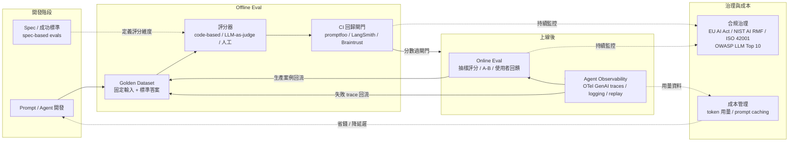

# 06 AI Evals × Env/Config × 治理 | AI Evals, Env/Config & Governance

> 幫助 tech leader、工程師、PM、QA、RD、SRE、Platform 快速找到 AI evals、環境設定、可觀測性與合規治理的可用資源：從 eval 框架、agent benchmark、方法論一路到 secrets 管理與 AI 法規。
> For tech leaders, engineers, PMs, QA, RD, SRE and platform folks: a one-stop map of AI evals, env/config, observability and governance — frameworks, agent benchmarks, methodologies, secrets management and AI regulation.
> 每條皆附真實可點的官方來源；開源專案標註 SPDX licence；benchmark 附論文與 repo 連結。 All entries link to real, verified sources; open-source projects carry SPDX license IDs; benchmarks include paper and repo links.

> Part of [Awesome Tech Leadership](../README.md) · [README (EN)](../README.md) · [繁體中文](../README.zh-TW.md)

## 全景圖

## Eval 框架（開源）

### OpenAI Evals | OpenAI Evals
<!-- entry:id=evals/openai-evals type=tool roles=DEV,RD,QA tags=llm-eval,framework,open-source license=MIT last_verified=2026-11-08 -->
- **一句話**: OpenAI's open-source framework for evaluating LLMs and LLM-powered systems with a registry of community evals.
- **一句話（繁中）**: OpenAI 官方開源的 LLM 評測框架，附社群 eval registry。
- **適用角色**: DEV / RD / QA
- **來源 Sources**: [openai/evals](https://github.com/openai/evals) — 開源（MIT）
- **怎麼開始用 / 範例**: `git clone https://github.com/openai/evals && pip install -e .`，再用 `oaieval` 跑 registry 內建 eval
- **注意事項 / 陷阱**: 主要維護能量已轉向 platform 上的 evals 介面；registry 內題目品質參差，自建 eval 建議直接寫 code-based grader

### promptfoo | promptfoo
<!-- entry:id=evals/promptfoo type=tool roles=DEV,QA,PLATFORM tags=llm-eval,prompt-testing,red-teaming,ci license=MIT last_verified=2026-11-08 -->
- **一句話**: Open-source CLI for LLM eval, red teaming, and prompt regression testing with YAML config and CI gates.
- **一句話（繁中）**: 開源 CLI，用 YAML 定義 prompt 測試案例、評分與紅隊測試，可直接接進 CI。
- **適用角色**: DEV / QA / Platform
- **來源 Sources**: [promptfoo/promptfoo](https://github.com/promptfoo/promptfoo) — 開源（MIT）；[CI/CD 整合文件](https://www.promptfoo.dev/docs/integrations/ci-cd/)
- **怎麼開始用 / 範例**: `npx promptfoo init` 產生 `promptfooconfig.yaml`，再 `npx promptfoo eval`
- **注意事項 / 陷阱**: 免費版與企業版功能有落差（部分 red team 功能屬付費）；LLM-as-judge 的 assertion 要寫明 rubric，否則分數會假性漂亮

### DeepEval | DeepEval
<!-- entry:id=evals/deepeval type=tool roles=QA,DEV,RD tags=llm-eval,unit-testing,rag-eval license=Apache-2.0 last_verified=2026-11-08 -->
- **一句話**: "Pytest for LLMs" — unit-test style metrics like G-Eval, hallucination, faithfulness, and agent tool-use correctness.
- **一句話（繁中）**: 把 LLM 評測寫成 pytest 單測的框架，內建幻覺、忠實度、工具呼叫正確性等指標。
- **適用角色**: QA / DEV / RD
- **來源 Sources**: [confident-ai/deepeval](https://github.com/confident-ai/deepeval) — 開源（Apache-2.0）；[metrics 文件](https://docs.confident-ai.com/docs/metrics-introduction)
- **怎麼開始用 / 範例**: `pip install deepeval`，寫 `test_answer_relevancy.py` 並執行 `deepeval test run`
- **注意事項 / 陷阱**: 許多指標內含 LLM-as-judge 呼叫，跑大 dataset 成本快速累積；Confident AI 平台為加購服務，開源版可獨立使用

### Ragas | Ragas
<!-- entry:id=evals/ragas type=tool roles=RD,DEV,QA tags=rag,llm-eval,metrics license=Apache-2.0 last_verified=2026-11-08 -->
- **一句話**: Evaluation toolkit specialized for RAG pipelines — context precision/recall, faithfulness, answer relevancy.
- **一句話（繁中）**: 專門評測 RAG 的工具箱，量化檢索品質（context precision/recall）與生成忠實度。
- **適用角色**: RD / DEV / QA
- **來源 Sources**: [vibrantlabsai/ragas](https://github.com/vibrantlabsai/ragas) — 開源（Apache-2.0，原 exploding-gradients/ragas，repo 已搬移）；[docs.ragas.io](https://docs.ragas.io/)
- **怎麼開始用 / 範例**: `pip install ragas`，以 `evaluate()` 對 `(question, contexts, answer, ground_truth)` 資料集跑 metrics
- **注意事項 / 陷阱**: 多數指標依賴 LLM judge，需先設定 judge model；指標對 chunking 策略敏感，回歸測試要固定 pipeline 設定

### MLflow LLM Evaluate | MLflow
<!-- entry:id=evals/mlflow-llm-evaluate type=tool roles=RD,PLATFORM,QA tags=llm-eval,experiment-tracking,evaluation license=Apache-2.0 last_verified=2026-11-08 -->
- **一句話**: MLflow's built-in LLM evaluation module with default/custom metrics, tracing, and experiment tracking.
- **一句話（繁中）**: MLflow 內建的 LLM 評估模組，整合實驗追蹤、tracing 與自訂指標。
- **適用角色**: RD / Platform / QA
- **來源 Sources**: [mlflow/mlflow](https://github.com/mlflow/mlflow) — 開源（Apache-2.0）；[llm-evaluate 文件](https://mlflow.org/docs/latest/llms/llm-evaluate/index.html)
- **怎麼開始用 / 範例**: `pip install mlflow`，呼叫 `mlflow.evaluate(model, eval_data, evaluators="default")`
- **注意事項 / 陷阱**: 功能面廣但介面版本變動快、文件路徑常調整；已在用 MLflow 追蹤實驗的團隊整合成本最低

### LM Evaluation Harness | lm-eval-harness
<!-- entry:id=evals/lm-evaluation-harness type=tool roles=RD,QA tags=llm-eval,benchmark-suite,open-weights license=MIT last_verified=2026-11-08 -->
- **一句話**: The de-facto open harness for zero/few-shot evaluation of open-weight LLMs across hundreds of benchmarks.
- **一句話（繁中）**: 評測開源權重模型的標準工具，數百個 few-shot benchmark 一次跑完。
- **適用角色**: RD / QA
- **來源 Sources**: [EleutherAI/lm-evaluation-harness](https://github.com/EleutherAI/lm-evaluation-harness) — 開源（MIT）
- **怎麼開始用 / 範例**: `pip install lm-eval`，執行 `lm_eval --model hf --model_args pretrained=<model> --tasks mmlu`
- **注意事項 / 陷阱**: 跑的是「模型能力」不是「你的應用品質」；全任務跑極耗 GPU/時間，先挑 3-5 個與業務相關的任務

### Stanford HELM | HELM
<!-- entry:id=evals/helm type=tool roles=RD,PM,DATA tags=llm-eval,benchmark-suite,leaderboard license=Apache-2.0 last_verified=2026-11-08 -->
- **一句話**: Stanford CRFM's holistic, multi-scenario evaluation of language models covering accuracy, calibration, robustness, fairness, toxicity, and efficiency.
- **一句話（繁中）**: 史丹佛 CRFM 的全方位模型評估框架，一次看準確率、穩健度、公平性、毒性、效率等多個面向。
- **適用角色**: RD / PM / DATA
- **來源 Sources**: [stanford-crfm/helm](https://github.com/stanford-crfm/helm) — 開源（Apache-2.0）；[crfm.stanford.edu/helm](https://crfm.stanford.edu/helm/)（leaderboard）；[論文 arXiv:2211.09110](https://arxiv.org/abs/2211.09110) — 論文
- **怎麼開始用 / 範例**: `pip install crfm-helm`，以 `helm-run` 指定 suite 跑場景，或直接看官網 leaderboard 做模型選型
- **注意事項 / 陷阱**: 完整跑一次成本高；leaderboard 分數僅供選型起點，仍需用自己的任務做 in-domain eval

### TruLens | TruLens
<!-- entry:id=evals/trulens type=tool roles=RD,QA,DEV tags=rag-eval,llm-eval,tracing license=MIT last_verified=2026-11-08 -->
- **一句話**: Open-source evaluation and tracing for LLM apps with the "RAG Triad" (context relevance, groundedness, answer relevance).
- **一句話（繁中）**: 以「RAG 三角」指標評估 RAG 品質的開源評測 + tracing 工具。
- **適用角色**: RD / QA / DEV
- **來源 Sources**: [truera/trulens](https://github.com/truera/trulens) — 開源（MIT）；[trulens.org](https://www.trulens.org/)
- **怎麼開始用 / 範例**: `pip install trulens-eval`，用 `TruChain`/`TruLlama` 等 wrapper 包住 RAG pipeline 記錄 feedback functions
- **注意事項 / 陷阱**: 與特定 LLM framework 的 wrapper 綁定較深，framework 升版容易壞；feedback function 也是 LLM-as-judge，注意成本

## Eval 平台

### Braintrust | Braintrust
<!-- entry:id=evals/braintrust type=platform roles=DEV,RD,QA,PM tags=llm-eval,platform,eval-driven-development license=proprietary last_verified=2026-11-08 -->
- **一句話**: A developer platform for AI evals with datasets, scorers, experiments, CI gating, and production logging in one feedback loop.
- **一句話（繁中）**: 把 dataset、評分器、實驗、CI 閘門與線上紀錄串成同一條回饋迴圈的 eval 平台。
- **適用角色**: DEV / RD / QA / PM
- **來源 Sources**: [braintrust.dev/docs](https://www.braintrust.dev/docs) — 官方；[braintrust-sdk-python](https://github.com/braintrustdata/braintrust-sdk-python) — 開源 SDK（Apache-2.0）；[What is an eval?](https://www.braintrust.dev/foundations/what-is-an-eval)
- **怎麼開始用 / 範例**: `pip install braintrust`，用 `Eval(name, data=..., task=..., scores=[...])` 定義一次 eval，本地即產生實驗紀錄
- **注意事項 / 陷阱**: 平台為商業 SaaS（有免費額度）；核心觀念是「data + task + scores」三件套，別只把 trace 當 logging 用

### LangSmith | LangSmith
<!-- entry:id=evals/langsmith type=platform roles=DEV,RD,QA,PLATFORM tags=llm-eval,tracing,regression-testing license=proprietary last_verified=2026-11-08 -->
- **一句話**: LangChain's platform for LLM tracing, datasets, experiments, and regression testing with CI-friendly evaluation.
- **一句話（繁中）**: LangChain 家的 trace + dataset + 實驗平台，主打 prompt 回歸測試與 CI 整合。
- **適用角色**: DEV / RD / QA / Platform
- **來源 Sources**: [docs.smith.langchain.com](https://docs.smith.langchain.com/)、[evaluation concepts](https://docs.smith.langchain.com/evaluation/concepts) — 官方；[langsmith-sdk](https://github.com/langchain-ai/langsmith-sdk) — 開源 SDK（MIT）
- **怎麼開始用 / 範例**: 設定 `LANGSMITH_API_KEY` + `LANGSMITH_TRACING=true` 即自動收 trace，再從 trace 建 dataset 跑 experiments
- **注意事項 / 陷阱**: 與 LangChain/LangGraph 生態整合最順，純 SDK 專案也可用但要自己接；商用為 SaaS 計費

### Langfuse | Langfuse
<!-- entry:id=evals/langfuse type=platform roles=PLATFORM,RD,DEV,SRE tags=llm-eval,tracing,cost-tracking,self-hosted license=MIT last_verified=2026-11-08 -->
- **一句話**: Open-source LLM engineering platform for tracing, prompt management, evals, and cost tracking — self-hostable.
- **一句話（繁中）**: 可自架的 LLM 工程平台：tracing、prompt 管理、評測、成本追蹤一條龍。
- **適用角色**: Platform / RD / DEV / SRE
- **來源 Sources**: [langfuse/langfuse](https://github.com/langfuse/langfuse) — 開源（核心 MIT，`ee/` 企業模組另依 ee/LICENSE）；[langfuse.com/docs](https://langfuse.com/docs)、[tracing](https://langfuse.com/docs/tracing)、[evaluation](https://langfuse.com/docs/evaluation)、[model usage & cost](https://langfuse.com/docs/model-usage-and-cost)
- **怎麼開始用 / 範例**: `npm i langfuse` 或用 OTEL 相容匯出，設定 `LANGFUSE_PUBLIC_KEY` / `LANGFUSE_SECRET_KEY` 起 trace
- **注意事項 / 陷阱**: `ee/` 目錄下功能屬企業版需授權，收錄/商用前確認用到的模組；自架需自行維運 ClickHouse/Postgres 等依賴

### Weights & Biases Weave | W&B Weave
<!-- entry:id=evals/wandb-weave type=platform roles=RD,QA,DATA tags=llm-eval,experiment-tracking,platform license=Apache-2.0 last_verified=2026-11-08 -->
- **一句話**: W&B's toolkit for tracking, evaluating, and iterating on LLM applications with experiments and datasets.
- **一句話（繁中）**: W&B 出的 LLM 應用評測與實驗追蹤工具，與既有 MLOps 平台整合。
- **適用角色**: RD / QA / DATA
- **來源 Sources**: [wandb/weave](https://github.com/wandb/weave) — 開源（Apache-2.0）；[Weave evaluations 文件](https://weave-docs.wandb.ai/guides/core-types/evaluations)
- **怎麼開始用 / 範例**: `pip install weave`，以 `@weave.op()` 裝飾函式後用 `Evaluation(dataset, scorers=[...]).evaluate(model)` 跑
- **注意事項 / 陷阱**: 已是 W&B 用戶時整合最順；開源 repo 與雲端服務帳號體系綁定，換平台要遷移資料

### PromptLayer | PromptLayer
<!-- entry:id=evals/promptlayer type=platform roles=PM,DEV,QA tags=prompt-management,llm-eval,versioning license=proprietary last_verified=2026-11-08 -->
- **一句話**: A prompt management platform with versioning, logging, evaluations, and CMS-style collaboration for prompt engineering.
- **一句話（繁中）**: prompt 版本管理與協作平台，提供 prompt CMS、紀錄與評測。
- **適用角色**: PM / DEV / QA
- **來源 Sources**: [MagnivOrg/prompt-layer-library](https://github.com/MagnivOrg/prompt-layer-library) — 開源 SDK（Apache-2.0）；[docs.promptlayer.com](https://docs.promptlayer.com/)（平台為 SaaS）
- **怎麼開始用 / 範例**: `pip install promptlayer`，設定 `PROMPTLAYER_API_KEY` 後用 `promptlayer_client.run()` 呼叫並自動記錄
- **注意事項 / 陷阱**: 核心價值在 prompt 版本管理與非工程角色協作；無完整開源自架方案

## Agent Benchmarks

### SWE-bench | SWE-bench
<!-- entry:id=evals/swe-bench type=benchmark roles=DEV,RD,QA tags=agent-eval,coding-agent,benchmark license=MIT last_verified=2026-11-08 -->
- **一句話**: A benchmark of real GitHub issues — can an agent produce a patch that resolves the issue and passes hidden tests?
- **一句話（繁中）**: 用真實 GitHub issue 考驗 coding agent：能否產出能通過隱藏測試的修補。
- **適用角色**: DEV / RD / QA
- **來源 Sources**: [SWE-bench/SWE-bench](https://github.com/SWE-bench/SWE-bench) — 開源（MIT，原 princeton-nlp/SWE-bench）；[論文 arXiv:2310.06770](https://arxiv.org/abs/2310.06770) — 論文；[swebench.com](https://www.swebench.com/) — leaderboard
- **怎麼開始用 / 範例**: `pip install swebench`，以 harness 對指定 model + repo instance 跑並以 fail-to-pass 測試判定
- **注意事項 / 陷阱**: 原版題目有瑕疵（解不唯一、測試過寬），對外比較請用 OpenAI 與原作者合作人工驗證的 SWE-bench Verified 子集；leaderboard 分數與自家 legacy codebase 表現相關性有限

### WebArena | WebArena
<!-- entry:id=evals/webarena type=benchmark roles=RD,DEV,QA tags=agent-eval,web-agent,benchmark license=Apache-2.0 last_verified=2026-11-08 -->
- **一句話**: A realistic, reproducible web environment benchmark with 812 tasks across e-commerce, forum, and CMS sites.
- **一句話（繁中）**: 可重現的真實網站環境 benchmark，812 個任務考驗網頁操作 agent。
- **適用角色**: RD / DEV / QA
- **來源 Sources**: [web-arena-x/webarena](https://github.com/web-arena-x/webarena) — 開源（Apache-2.0）；[論文 arXiv:2307.13854](https://arxiv.org/abs/2307.13854) — 論文；[webarena.dev](https://webarena.dev/) — leaderboard
- **怎麼開始用 / 範例**: 依 repo 指引以 Docker 起自架網站環境，對 agent 跑 task set 並以 functional correctness 指標評分
- **注意事項 / 陷阱**: 環境部署吃資源（建議 4 CPU / 8GB+ per instance）；早期模型成功率僅個位數百分比，評估自家 agent 要設合理期望值

### GAIA | GAIA
<!-- entry:id=evals/gaia type=benchmark roles=RD,PM tags=agent-eval,general-assistant,benchmark license=proprietary last_verified=2026-11-08 -->
- **一句話**: 466 human-crafted questions requiring multi-step reasoning, web browsing, and tool use, with unambiguous verifiable answers.
- **一句話（繁中）**: 466 題人工設計、答案可明確驗證的通用助理考題，考推理、多模態、上網與工具使用。
- **適用角色**: RD / PM
- **來源 Sources**: [論文 arXiv:2311.12983](https://arxiv.org/abs/2311.12983) — 論文；[HuggingFace leaderboard](https://huggingface.co/spaces/gaia-benchmark/leaderboard)、[GAIA dataset](https://huggingface.co/datasets/gaia-benchmark/GAIA) — 資料集（gated）
- **怎麼開始用 / 範例**: 下載 validation set（166 題）跑 agent，以 JSONL（`task_id` + `model_answer`）提交 leaderboard
- **注意事項 / 陷阱**: 對人類簡單、對 AI 極難（原論文：人類 92% vs GPT-4+plugins 約 15%）；dataset 為 gated、禁止轉傳 test set，需同意 HF 使用條款

### AgentBench | AgentBench
<!-- entry:id=evals/agentbench type=benchmark roles=RD tags=agent-eval,multi-environment,benchmark license=Apache-2.0 last_verified=2026-11-08 -->
- **一句話**: A benchmark of 8 diverse environments (OS, DB, knowledge graph, card game, home, web...) for evaluating LLM-as-agent.
- **一句話（繁中）**: 涵蓋作業系統、資料庫、知識圖譜、卡牌、家居、網頁等 8 種環境的 LLM agent 綜合能力測驗。
- **適用角色**: RD
- **來源 Sources**: [THUDM/AgentBench](https://github.com/THUDM/AgentBench) — 開源（Apache-2.0）；[論文 arXiv:2308.03688](https://arxiv.org/abs/2308.03688) — 論文
- **怎麼開始用 / 範例**: 依 repo 以 Docker Compose 起各環境，設定對應 API 金鑰後跑 evaluation script
- **注意事項 / 陷阱**: 環境多、部署繁瑣且部分子環境維護趨緩；跨環境平均分數的可比性需注意各子環境版本

### Terminal-Bench | Terminal-Bench
<!-- entry:id=evals/terminal-bench type=benchmark roles=DEV,RD,PLATFORM,SRE tags=agent-eval,cli-agent,benchmark license=Apache-2.0 last_verified=2026-11-08 -->
- **一句話**: Benchmarking agents on hard, realistic tasks in command line interfaces, with per-task environments and human-written solutions.
- **一句話（繁中）**: 在真實終端機環境中考驗 agent 解決困難實務任務，每題附人工解答與完整驗證測試。
- **適用角色**: DEV / RD / Platform / SRE
- **來源 Sources**: [laude-institute/terminal-bench-2](https://github.com/laude-institute/terminal-bench-2) — 開源（Apache-2.0）；[論文 arXiv:2601.11868](https://arxiv.org/abs/2601.11868) — 論文；[tbench.ai](https://www.tbench.ai/)、[官方 leaderboard](https://www.tbench.ai/leaderboard/terminal-bench/2.0)
- **怎麼開始用 / 範例**: `pip install harbor`，執行 `harbor run --dataset terminal-bench@2.0`
- **注意事項 / 陷阱**: 1.0 版曾發現題目品質問題，2.0 已重新驗證（89 題、前沿模型約 5 成多）；HF 上有非官方榜，數字請以官方 leaderboard 為準

### τ-bench / τ²-bench | tau-bench
<!-- entry:id=evals/tau-bench type=benchmark roles=RD,PM,QA tags=agent-eval,customer-service,user-simulator,benchmark license=MIT last_verified=2026-11-08 -->
- **一句話**: Benchmarks for Tool-Agent-User interaction where a simulated user collaborates (or conflicts) with the agent to complete real-world tasks.
- **一句話（繁中）**: 由「模擬使用者」與 agent 互動協作完成客服等實務任務，τ² 版加入雙向控制環境（telecom）。
- **適用角色**: RD / PM / QA
- **來源 Sources**: [sierra-research/tau-bench](https://github.com/sierra-research/tau-bench) — 開源（MIT）、[論文 arXiv:2406.12045](https://arxiv.org/abs/2406.12045) — 論文；[sierra-research/tau2-bench](https://github.com/sierra-research/tau2-bench) — 開源（MIT）、[論文 arXiv:2506.07982](https://arxiv.org/abs/2506.07982) — 論文（ICML 2026 Oral）；[taubench.com](https://taubench.com) — leaderboard
- **怎麼開始用 / 範例**: `git clone https://github.com/sierra-research/tau2-bench && pip install -e .`，設定 provider API key 跑 `python run.py --task-name ...`
- **注意事項 / 陷阱**: 使用者模擬器本身有誤差（τ² 報告 retail/airline 誤差達 40-47%，telecom 降到 16%）；結果以 pass^k（多次全對）衡量，非確定性高要多跑取樣

### OSWorld | OSWorld
<!-- entry:id=evals/osworld type=benchmark roles=RD,QA tags=agent-eval,gui-agent,computer-use,benchmark license=Apache-2.0 last_verified=2026-11-08 -->
- **一句話**: A benchmark of 369 real-computer tasks across Ubuntu, LibreOffice, Chrome, Thunderbird, and VS Code for multimodal agents.
- **一句話（繁中）**: 在真實桌面電腦環境（Ubuntu + 常用軟體）中考驗多模態 agent 完成 369 個操作任務。
- **適用角色**: RD / QA
- **來源 Sources**: [xlang-ai/OSWorld](https://github.com/xlang-ai/OSWorld) — 開源（Apache-2.0）；[論文 arXiv:2404.07972](https://arxiv.org/abs/2404.07972) — 論文
- **怎麼開始用 / 範例**: 依 repo 以 VM/Docker 起執行環境，跑 `run.py` 指定 agent 與 task
- **注意事項 / 陷阱**: 需要虛擬機資源、執行環境易碎（GUI 版本變動會壞）；與 SWE-bench/Terminal-Bench 互補，適合驗證 computer-use 類 agent

## Eval 方法論

### Offline vs Online Evaluation | Offline/Online Eval
<!-- entry:id=evals/offline-vs-online-eval type=method roles=QA,RD,DEV,PM tags=llm-eval,methodology,production license=n/a last_verified=2026-11-08 -->
- **一句話**: Offline evals gate changes before ship with fixed datasets; online evals score live traffic to catch real-world drift.
- **一句話（繁中）**: 上線前用固定資料集把關（offline），上線後對真實流量抽樣評分（online），兩者共用同一套評分邏輯。
- **適用角色**: QA / RD / DEV / PM
- **來源 Sources**: [Braintrust：How to build your first offline eval](https://www.braintrust.dev/blog/offline-eval-guide)、[Eval feedback loops](https://www.braintrust.dev/blog/eval-feedback-loops)；[Langfuse：Evaluation](https://langfuse.com/docs/evaluation)
- **怎麼開始用 / 範例**: 先建立 5-10 筆「你在意的失敗案例」當 offline dataset，上線後把生產 trace 以相同 scorer 抽樣評分
- **注意事項 / 陷阱**: 只做 offline 會過擬合、忽略真實流量；只做 online 會在線上踩雷。注意隨機性：temperature 0、重複跑取平均，別把「剛好跑贏一次」當結論

### Golden Datasets & Prompt Regression Testing | Prompt Regression
<!-- entry:id=evals/prompt-regression type=method roles=QA,DEV,PLATFORM tags=llm-eval,regression-testing,ci license=n/a last_verified=2026-11-08 -->
- **一句話**: Version prompts like code: fixed golden inputs with expected outputs, and CI fails when scores regress.
- **一句話（繁中）**: 把 prompt 當程式碼管理：固定輸入 + 期望輸出的 golden dataset，改 prompt 就跑回歸測試，退步就擋下。
- **適用角色**: QA / DEV / Platform
- **來源 Sources**: [LangSmith：Evaluation concepts](https://docs.smith.langchain.com/evaluation/concepts)、[evaluation how-to](https://docs.smith.langchain.com/evaluation/how_to_guides)；[promptfoo：CI/CD 整合](https://www.promptfoo.dev/docs/integrations/ci-cd/)；[Langfuse：Scores](https://langfuse.com/docs/scores)
- **怎麼開始用 / 範例**: 把每次線上失敗案例存成 (input, 期望) 一列；CI 加 `npx promptfoo eval --fail-on-error` 或 LangSmith dataset experiment 步驟
- **注意事項 / 陷阱**: golden dataset 要隨產品演進維護，否則測的是舊需求；A/B 測試 prompt 版本要注意樣本數與顯著性，小樣本的「變好」常是雜訊

### LLM-as-a-Judge | LLM-as-Judge
<!-- entry:id=evals/llm-as-judge type=method roles=QA,RD,DEV,PM tags=llm-eval,grading,methodology license=n/a last_verified=2026-11-08 -->
- **一句話**: Use a model to grade model outputs with rubrics — powerful but biased; official guides agree on "code > LLM judge > human" as the grading hierarchy.
- **一句話（繁中）**: 用 LLM 依 rubric 幫輸出評分，快速但有偏誤；官方指南一致建議「程式判分 > LLM judge > 人工」的判分優先序。
- **適用角色**: QA / RD / DEV / PM
- **來源 Sources**: [論文 arXiv:2306.05685（Judging LLM-as-a-Judge / MT-Bench）](https://arxiv.org/abs/2306.05685) — 論文；[Anthropic：Define success criteria and build evaluations](https://platform.claude.com/docs/en/test-and-evaluate/develop-tests)、[Demystifying evals for AI agents](https://www.anthropic.com/research/demystifying-evals-for-ai-agents) — 官方；[OpenAI：Evals 指南](https://platform.openai.com/docs/guides/evals) — 官方
- **怎麼開始用 / 範例**: 先寫可程式化判分（regex、exact match、單測）；不夠再上 LLM judge：明確 rubric、先推理再給分、輸出結構化結果（含 `unknown` 逃脫口）
- **注意事項 / 陷阱**: 已知偏誤——自我偏好（偏愛同家模型）、位置偏誤、長答案偏好、分數集中。官方建議：judge 用不同家的模型、先人工評一小批校準 judge、追蹤 judge 漂移；agent eval 要看 pass@k / pass^k

### Eval-Driven Development | EDD
<!-- entry:id=evals/eval-driven-development type=method roles=DEV,RD,QA,EM tags=llm-eval,methodology,workflow license=n/a last_verified=2026-11-08 -->
- **一句話**: Treat evals as the living specification: every change is measured against eval scores before it reaches production.
- **一句話（繁中）**: 把 eval 當「活的規格書」：任何改動都要先過評分門檻才上線，如同 TDD 但以多維分數取代二元通過。
- **適用角色**: DEV / RD / QA / EM
- **來源 Sources**: [Braintrust：What is eval-driven development](https://www.braintrust.dev/articles/eval-driven-development)、[What is an eval?](https://www.braintrust.dev/foundations/what-is-an-eval) — 官方指南
- **怎麼開始用 / 範例**: 為每個 LLM 功能定義 3-5 個評分維度與 dataset → 每次 prompt/model 改動跑 eval → 以回歸閘門（分數不低於基線）決定是否推進環境（含 A/B 或金絲雀發布）
- **注意事項 / 陷阱**: eval 本身會過擬合與「飽和」，需定期回顧題目；沒有 prompt 版本管理與可重跑的實驗紀錄，EDD 走不下去

### Spec-based Quality for Vibe Coding | Vibe Coding QA
<!-- entry:id=evals/vibe-coding-quality type=method roles=DEV,QA,PM,EM tags=vibe-coding,spec-driven,code-review license=n/a last_verified=2026-11-08 -->
- **一句話**: Keep AI-generated code honest with explicit specs, spec-based evals, and mandatory human review of diffs.
- **一句話（繁中）**: 用明確規格（spec）+ 依規格的 eval + 人工 review diff 來管理「憑感覺寫 code」的品質風險。
- **適用角色**: DEV / QA / PM / EM
- **來源 Sources**: [github/spec-kit](https://github.com/github/spec-kit) — 開源（MIT，GitHub 官方 spec-driven development 工具包）；[Claude Academy：Build a minimum viable eval](https://academy.claude.com/courses/introduction-to-evals/build-a-minimum-viable-eval) — 官方課程
- **怎麼開始用 / 範例**: 用 Spec Kit 的 `/specify` `/plan` `/tasks` 把需求寫成可驗證規格；AI 產出一律走 PR + 人工 review，並為關鍵行為補測試
- **注意事項 / 陷阱**: 「跑得起來」不等於「符合規格」——務必把規格轉成可執行檢查（單測、eval、lint 關卡）；人工 review 是最後防線不可省略；注意產出殘留的 TODO/佔位碼是完成度假象

## 可觀測性（Observability / Tracing）

### Arize Phoenix | Phoenix
<!-- entry:id=ops/arize-phoenix type=platform roles=RD,PLATFORM,QA tags=observability,tracing,llm-eval,opentelemetry license=Elastic-2.0 last_verified=2026-11-08 -->
- **一句話**: Open-source, OpenTelemetry-native LLM observability and eval tool for tracing, drift detection, and embedding analysis.
- **一句話（繁中）**: 以 OpenTelemetry 為核心的開源 LLM 可觀測性工具，支援 trace、embedding 分析與評測。
- **適用角色**: RD / Platform / QA
- **來源 Sources**: [Arize-ai/phoenix](https://github.com/Arize-ai/phoenix) — 開源（Elastic License 2.0）；[arize.com/docs/phoenix](https://arize.com/docs/phoenix)、[tracing 文件](https://arize.com/docs/phoenix/tracing)
- **怎麼開始用 / 範例**: `pip install arize-phoenix`，`phoenix serve` 起本地 UI，再用 OpenInference instrumentation 收 trace
- **注意事項 / 陷阱**: ELv2 授權可用於商用但不可作為託管服務轉售；與 Arize 商業平台為同一團隊的開源/付費分工

### Helicone | Helicone
<!-- entry:id=ops/helicone type=platform roles=PLATFORM,SRE,PM tags=observability,cost-tracking,proxy license=Apache-2.0 last_verified=2026-11-08 -->
- **一句話**: LLM observability platform focused on logging, cost/latency analytics, caching, and rate-limit control via a proxy.
- **一句話（繁中）**: 以 proxy 方式接入的 LLM 觀測平台，主打成本/延遲分析、快取與流量控制。
- **適用角色**: Platform / SRE / PM
- **來源 Sources**: [Helicone/helicone](https://github.com/Helicone/helicone) — 開源（Apache-2.0）；[docs.helicone.ai](https://docs.helicone.ai/)
- **怎麼開始用 / 範例**: 把 API base URL 換成 `https://oai.helicone.ai`（OpenAI）並帶上 `Helicone-Auth` header 即開始記錄
- **注意事項 / 陷阱**: 走 proxy 代表請求經過第三方，機敏資料要先評估資料流；自架版需自行部署 ClickHouse 等元件

### OpenTelemetry GenAI Semantic Conventions | OTel GenAI semconv
<!-- entry:id=ops/otel-genai-semconv type=tool roles=PLATFORM,SRE,RD tags=observability,tracing,opentelemetry,standard license=Apache-2.0 last_verified=2026-11-08 -->
- **一句話**: Vendor-neutral OpenTelemetry semantic conventions for generative AI spans, events, and metrics (gen_ai.* attributes).
- **一句話（繁中）**: GenAI 呼叫的 OTEL 標準語意約定（gen_ai.* 屬性），讓各家工具的 trace 可互通。
- **適用角色**: Platform / SRE / RD
- **來源 Sources**: [opentelemetry.io：GenAI semconv](https://opentelemetry.io/docs/specs/semconv/gen-ai/) — 官方規格；[open-telemetry/semantic-conventions](https://github.com/open-telemetry/semantic-conventions) — 開源（Apache-2.0）
- **怎麼開始用 / 範例**: 用各語言 OTEL SDK + GenAI instrumentation（或框架內建 OTEL 匯出）把 span 匯出到你的 collector/後端
- **注意事項 / 陷阱**: semconv 仍在演進（屬性名稱與事件模型有版本變動），鎖定版本再上生產；注意 prompt/個資是否寫進 span attributes 的隱私政策

### OpenLLMetry | OpenLLMetry
<!-- entry:id=ops/openllmetry type=tool roles=PLATFORM,SRE,RD tags=observability,tracing,opentelemetry,instrumentation license=Apache-2.0 last_verified=2026-11-08 -->
- **一句話**: Traceloop's OpenTelemetry-based instrumentation that auto-instruments LLM frameworks and ships traces to any OTEL backend.
- **一句話（繁中）**: 以 OpenTelemetry 為底的自動插樁工具，把 LLM/agent 框架的呼叫自動變成 trace，匯出任一 OTEL 後端。
- **適用角色**: Platform / SRE / RD
- **來源 Sources**: [traceloop/openllmetry](https://github.com/traceloop/openllmetry) — 開源（Apache-2.0）；[traceloop.com/docs](https://traceloop.com/docs)
- **怎麼開始用 / 範例**: `pip install openllmetry-instrumentation-openai`（或對應框架套件）+ `Traceloop.init()`，agent 步驟與工具呼叫會成為 span，可用於 replay / 逐回合檢視
- **注意事項 / 陷阱**: 自動插樁覆蓋不了自訂工具呼叫，需手動補 span；大量記錄 prompt/回應內容前要過資安與保留期限政策

### Langtrace | Langtrace
<!-- entry:id=ops/langtrace type=tool roles=PLATFORM,SRE,RD tags=observability,tracing,opentelemetry,self-hosted license=AGPL-3.0 last_verified=2026-11-08 -->
- **一句話**: OpenTelemetry-based, self-hostable end-to-end observability for LLM and agent applications.
- **一句話（繁中）**: 以 OpenTelemetry 為底、可自架的 LLM/agent 端到端可觀測性工具。
- **適用角色**: Platform / SRE / RD
- **來源 Sources**: [Scale3-Labs/langtrace](https://github.com/Scale3-Labs/langtrace) — 開源（AGPL-3.0）
- **怎麼開始用 / 範例**: `pip install langtrace-python-sdk`，於應用啟動時呼叫 `langtrace.init()`，trace 進入自架或雲端 dashboard
- **注意事項 / 陷阱**: AGPL-3.0 授權——若修改並對外提供服務需回饋原始碼，商用前務必評估授權相容性

## Env / Config

### Claude Code Settings | Claude Code settings.json
<!-- entry:id=ops/claude-code-settings type=tool roles=DEV,PLATFORM tags=agent-cli,configuration,permissions license=proprietary last_verified=2026-11-08 -->
- **一句話**: Claude Code's layered settings (user / project / local / managed) with permissions, hooks, model, and env configuration.
- **一句話（繁中）**: Claude Code 的分層設定檔（全域/專案/本地/受管），管理權限、hooks、模型與環境變數。
- **適用角色**: DEV / Platform
- **來源 Sources**: [code.claude.com/docs/en/settings](https://code.claude.com/docs/en/settings) — 官方文件
- **怎麼開始用 / 範例**: 在專案建 `.claude/settings.json`，例如 `{"permissions": {"allow": ["Bash(npm test:*)"]}, "env": {"FOO": "bar"}}`
- **注意事項 / 陷阱**: 設定分層有優先序（managed > CLI args > local > project > user），排錯先確認生效來源；`.claude/settings.local.json` 不要 commit；權限 allowlist 要收斂，避免整包 `Bash(*)` 放行

### Codex CLI Config | Codex config.toml
<!-- entry:id=ops/codex-config type=tool roles=DEV,PLATFORM tags=agent-cli,configuration,toml license=Apache-2.0 last_verified=2026-11-08 -->
- **一句話**: Codex CLI's TOML config for model, approval policy, sandboxing, MCP servers, and profiles.
- **一句話（繁中）**: Codex CLI 的 TOML 設定：模型、審批政策、沙箱、MCP server 與多組 profile。
- **適用角色**: DEV / Platform
- **來源 Sources**: [openai/codex docs/config.md](https://github.com/openai/codex/blob/main/docs/config.md)、[openai/codex](https://github.com/openai/codex) — 開源（Apache-2.0）
- **怎麼開始用 / 範例**: 編輯 `~/.codex/config.toml`：`model = "..."`、`approval_policy = "on-request"`、`[sandbox_workspace_write]`，可用 `--profile` 切換情境
- **注意事項 / 陷阱**: 與 Claude Code 的 JSON 格式不同，跨工具搬移設定要人工轉換；`approval_policy` 與沙箱選項直接影響安全性，別為了省事設 bypass

### Gemini CLI Settings | Gemini CLI settings.json
<!-- entry:id=ops/gemini-cli-settings type=tool roles=DEV,PLATFORM tags=agent-cli,configuration,json license=Apache-2.0 last_verified=2026-11-08 -->
- **一句話**: Gemini CLI's settings hierarchy (.gemini/settings.json, user and project level) with approval mode, tools, and MCP.
- **一句話（繁中）**: Gemini CLI 的設定層級（`.gemini/settings.json` 等），管理審批模式、工具與 MCP。
- **適用角色**: DEV / Platform
- **來源 Sources**: [docs/cli/settings.md](https://github.com/google-gemini/gemini-cli/blob/main/docs/cli/settings.md)、[docs/reference/configuration.md](https://github.com/google-gemini/gemini-cli/blob/main/docs/reference/configuration.md)；[google-gemini/gemini-cli](https://github.com/google-gemini/gemini-cli) — 開源（Apache-2.0）
- **怎麼開始用 / 範例**: 在專案根目錄建 `.gemini/settings.json`，設定 `approvalMode`、`tools`、`mcpServers`；另有 `.env` 支援
- **注意事項 / 陷阱**: 文件分 settings 與 configuration 兩篇，別混淆（CLI 行為 vs 環境/模型設定）；專案層設定若 commit 進 repo，注意不要夾帶金鑰

### python-dotenv & dotenvx | .env 檔案管理
<!-- entry:id=ops/dotenv type=tool roles=DEV,PLATFORM,SRE tags=env-vars,secrets,tooling license=BSD-3-Clause last_verified=2026-11-08 -->
- **一句話**: Load environment variables from .env files — python-dotenv for Python apps, dotenvx for encrypted .env committed to git.
- **一句話（繁中）**: 從 `.env` 檔載入環境變數：Python 應用用 python-dotenv，要加密後進 git 用 dotenvx。
- **適用角色**: DEV / Platform / SRE
- **來源 Sources**: [theskumar/python-dotenv](https://github.com/theskumar/python-dotenv) — 開源（BSD-3-Clause）；[dotenvx/dotenvx](https://github.com/dotenvx/dotenvx) — 開源（BSD-3-Clause）
- **怎麼開始用 / 範例**: `pip install python-dotenv` 後 `load_dotenv()`；或 `npx @dotenvx/dotenvx run -- node app.js`、`dotenvx encrypt`
- **注意事項 / 陷阱**: `.env` 絕對要進 `.gitignore`；dotenvx 加密後可 commit，但 `.env.keys` 私鑰要另外安全保存

### direnv | direnv
<!-- entry:id=ops/direnv type=tool roles=DEV,PLATFORM,SRE tags=env-vars,shell,tooling license=MIT last_verified=2026-11-08 -->
- **一句話**: Shell extension that loads and unloads environment variables automatically per directory via .envrc files.
- **一句話（繁中）**: 依目錄自動載入/卸載環境變數的 shell 擴充，用 `.envrc` 管理每個專案的環境。
- **適用角色**: DEV / Platform / SRE
- **來源 Sources**: [direnv/direnv](https://github.com/direnv/direnv) — 開源（MIT）；[direnv.net](https://direnv.net/)
- **怎麼開始用 / 範例**: `brew install direnv`，在 `.envrc` 寫 `dotenv` 或 `export FOO=bar`，再 `direnv allow`
- **注意事項 / 陷阱**: 忘記 `direnv allow` 會發現變數沒生效；`.envrc` 可 commit 但不要放生產金鑰；離開目錄變數自動卸載，別依賴它傳遞跨目錄設定

## Secrets 管理

### GitHub Actions Secrets & gh CLI | gh secret
<!-- entry:id=ops/github-secrets type=tool roles=PLATFORM,DEV,SRE tags=secrets,ci-cd,github-actions license=proprietary last_verified=2026-11-08 -->
- **一句話**: Store CI secrets at org/repo/environment scope and inject them via the secrets context, managed with `gh secret`.
- **一句話（繁中）**: CI 密鑰分組織/儲存庫/環境三層管理，workflow 以 `secrets` context 取用，可用 `gh secret` 指令維護。
- **適用角色**: Platform / DEV / SRE
- **來源 Sources**: [GitHub Docs：Using secrets in GitHub Actions](https://docs.github.com/en/actions/how-tos/write-workflows/choose-what-workflows-do/use-secrets) — 官方文件
- **怎麼開始用 / 範例**: `gh secret set OPENAI_API_KEY`（repo 層級）；workflow 內 `env: { KEY: ${{ secrets.OPENAI_API_KEY }} }`
- **注意事項 / 陷阱**: fork 觸發的 workflow 拿不到 secrets；secrets 不能直接用在 `if:` 條件；單一 secret 上限 48KB；長期憑證建議改用 OIDC 換短效 token

### 1Password CLI | op
<!-- entry:id=ops/1password-cli type=tool roles=PLATFORM,SRE,DEV tags=secrets,cli,team license=proprietary last_verified=2026-11-08 -->
- **一句話**: 1Password's CLI for referencing secrets from vaults in scripts, dev environments, and GitHub Actions without copying them.
- **一句話（繁中）**: 1Password 的 CLI，讓腳本、開發環境與 GitHub Actions 以 secret reference 方式取用保險庫內的密鑰，不必明文複製。
- **適用角色**: Platform / SRE / DEV
- **來源 Sources**: [1Password CLI 文件](https://developer.1password.com/docs/cli/)、[secret references](https://developers.1password.com/docs/cli/secret-references/) — 官方（CLI 免費商用、非開源）；[1Password/load-secrets-action](https://github.com/1Password/load-secrets-action) — 開源 GitHub Action
- **怎麼開始用 / 範例**: `op run --env-file .env.template -- node app.js`，`.env.template` 內用 `op://Vault/Item/field` 形式的 secret reference
- **注意事項 / 陷阱**: 需要 1Password 帳號與 service account token（CI 用）；secret reference 拼錯不會在啟動時報錯，要有驗證步驟

### HashiCorp Vault | Vault
<!-- entry:id=ops/vault type=tool roles=PLATFORM,SRE tags=secrets,dynamic-credentials,self-hosted license=BUSL-1.1 last_verified=2026-11-08 -->
- **一句話**: Self-hosted secrets platform with dynamic credentials, leasing/revocation, encryption-as-a-service, and audit logging.
- **一句話（繁中）**: 可自架的密鑰平台，支援動態憑證、租期/撤銷、加密即服務與稽核記錄。
- **適用角色**: Platform / SRE
- **來源 Sources**: [hashicorp/vault](https://github.com/hashicorp/vault) — 開源（BUSL-1.1，非 OSI 授權）；[developer.hashicorp.com/vault/docs](https://developer.hashicorp.com/vault/docs) — 官方文件
- **怎麼開始用 / 範例**: `vault server -dev` 起開發模式，`vault kv put secret/foo bar=baz` 存取；生產建議用 Kubernetes auth / OIDC 取短效 token
- **注意事項 / 陷阱**: BUSL 授權限制「提供作為託管服務」的商用場景，評估是否觸及；Vault 本身的 unseal、HA、備援是不小的維運成本

### SOPS | SOPS
<!-- entry:id=ops/sops type=tool roles=PLATFORM,SRE,DEV tags=secrets,gitops,encryption license=MPL-2.0 last_verified=2026-11-08 -->
- **一句話**: Encrypts values (not files) in YAML/JSON/ENV files so encrypted configs can live safely in git.
- **一句話（繁中）**: 只加密檔案內「值」的密文工具，讓設定檔加密後可以安全放進 git。
- **適用角色**: Platform / SRE / DEV
- **來源 Sources**: [getsops/sops](https://github.com/getsops/sops) — 開源（MPL-2.0）；[getsops.com](https://getsops.com/)
- **怎麼開始用 / 範例**: `sops --encrypt --age age1... secrets.yaml > secrets.enc.yaml`；`.sops.yaml` 設定 creation_rules 指定金鑰
- **注意事項 / 陷阱**: 加密檔可 review diff（key 可見、value 密文），但 metadata（key 名）會外洩；金鑰輪換要規劃；CI 內要安全注入解密金鑰

### age | age
<!-- entry:id=ops/age type=tool roles=PLATFORM,SRE,DEV tags=secrets,encryption license=BSD-3-Clause last_verified=2026-11-08 -->
- **一句話**: Simple, modern file encryption with small, auditable codebase — the common key backend for SOPS.
- **一句話（繁中）**: 簡潔現代的檔案加密工具，程式碼小而易稽核，常作為 SOPS 的金鑰後端。
- **適用角色**: Platform / SRE / DEV
- **來源 Sources**: [FiloSottile/age](https://github.com/FiloSottile/age) — 開源（BSD-3-Clause）
- **怎麼開始用 / 範例**: `age-keygen -o key.txt` 產生金鑰；`age -r age1... -o secrets.age secrets.txt` 加密
- **注意事項 / 陷阱**: 私鑰無密碼恢復機制，遺失即資料遺失，務必離線備份；`age` 無內建金鑰輪換，需配合 SOPS 或外部流程

## 合規 / 治理

### EU AI Act | EU AI Act
<!-- entry:id=governance/eu-ai-act type=policy roles=PM,EM,ALL tags=ai-act,regulation,eu license=n/a last_verified=2026-11-08 -->
- **一句話**: The EU's risk-based AI regulation (Regulation (EU) 2024/1689) with obligations for providers and deployers of AI systems.
- **一句話（繁中）**: 歐盟以風險為基礎的 AI 法規（Regulation (EU) 2024/1689），對 AI 系統提供者與部署者課予義務。
- **適用角色**: PM / EM / ALL（跨角色合規議題）
- **來源 Sources**: [EUR-Lex：CELEX:32024R1689](https://eur-lex.europa.eu/legal-content/EN/TXT/?uri=CELEX:32024R1689)、[ELI 版本](https://eur-lex.europa.eu/eli/reg/2024/1689/oj) — 官方法規原文
- **怎麼開始用 / 範例**: 先做 AI 系統盤點並依風險分級（不可接受/高風險/有限風險/最小風險），確認自己是 provider 還是 deployer，再對照義務清單
- **注意事項 / 陷阱**: 罰則按全球營業額比例計；各章義務生效時程不同需追蹤官方公告；訓練資料治理、記錄保存（logging）與人工監督是技術團隊直接相關的項目

### NIST AI Risk Management Framework | NIST AI RMF
<!-- entry:id=governance/nist-ai-rmf type=policy roles=PM,EM,QA,SRE tags=risk-management,governance,us license=n/a last_verified=2026-11-08 -->
- **一句話**: A voluntary US framework to map, measure, manage, and govern AI risks across the lifecycle, with a Generative AI profile.
- **一句話（繁中）**: 美國國家標準技術研究院的自願性 AI 風險管理框架：Govern/Map/Measure/Manage 四大功能，另有生成式 AI 專章。
- **適用角色**: PM / EM / QA / SRE
- **來源 Sources**: [NIST AI RMF 官方頁](https://www.nist.gov/itl/ai-risk-management-framework)、[Generative AI Profile](https://www.nist.gov/publications/artificial-intelligence-risk-management-framework-generative-artificial-intelligence) — 官方；[AI RMF Knowledge Base](https://airc.nist.gov/AI_RMF_Knowledge_Base/AI_RMF)
- **怎麼開始用 / 範例**: 下載 Playbook，用 GOVERN/MAP/MEASURE/MANAGE 對現有 AI 專案做一次差距盤點
- **注意事項 / 陷阱**: 非強制但常被寫入採購/合規要求（可對照 ISO 42001 落地）；GenAI Profile 補上資料隱私、智產權、資訊完整性等風險項

### ISO/IEC 42001 AI Management System | ISO/IEC 42001
<!-- entry:id=governance/iso-42001 type=policy roles=EM,PM,QA tags=management-system,certification,iso license=n/a last_verified=2026-11-08 -->
- **一句話**: The world's first certifiable AI management system standard (AIMS) for establishing, implementing, and improving responsible AI practices.
- **一句話（繁中）**: 全球第一個可驗證的 AI 管理系統標準，用 PDCA 建立組織級 AI 治理與持續改善機制。
- **適用角色**: EM / PM / QA
- **來源 Sources**: [ISO/IEC 42001:2023 官方頁](https://www.iso.org/standard/42001)、[IEC Webstore](https://webstore.iec.ch/en/publication/90574) — 官方（標準本體需付費）
- **怎麼開始用 / 範例**: 對照 Annex A 控制項做自我評估，或洽第三方認證機構（ISO 本身不發證）
- **注意事項 / 陷阱**: 標準本體需購買；可與 ISO/IEC 23894（AI 風險管理）、ISO/IEC 42005（AI 影響評估）搭配使用

### Taiwan AI Basic Act & Guidelines | 台灣 AI 法規
<!-- entry:id=governance/taiwan-ai-basic-act type=policy roles=PM,EM,ALL tags=regulation,taiwan,governance license=n/a last_verified=2026-11-08 -->
- **一句話**: Taiwan's AI Basic Act (promulgated 2026-01-14) plus the moda AI Risk Taxonomy and the Executive Yuan's generative AI guidelines for agencies.
- **一句話（繁中）**: 台灣《人工智慧基本法》（2026-01-14 總統令公布）+ 數位發展部「人工智慧風險分類框架」+ 行政院及所屬機關使用生成式 AI 參考指引。
- **適用角色**: PM / EM / ALL
- **來源 Sources**: [人工智慧基本法（國科會法規系統）](https://law.nstc.gov.tw/LawContent.aspx?id=GL000592)；[數發部公告：人工智慧風險分類框架](https://moda.gov.tw/press/bulletin/20086)、[數發部 AI 專區說明](https://moda.gov.tw/major-policies/ai/governance/19244)；[行政院及所屬機關(構)使用生成式AI參考指引](https://www.ey.gov.tw/Page/448DE008087A1971/40c1a925-121d-4b6b-8f40-7e9e1a5401f2) — 均為官方來源
- **怎麼開始用 / 範例**: 依數發部框架做「盤點應用情境 → 識別風險 → 評估風險 → 應對風險」四步驟；公部門專案直接對照院版指引 10 點（禁用 GenAI 製作機密文書、產出須人工最終判斷等）
- **注意事項 / 陷阱**: 主管機關為國科會（非數發部），數發部負責風險分類框架與國際介接；風險分 3 大類 20 子類（含「AI 自主代理授權外行為」——agent 團隊必看）；各機關法規須於施行後 2 年內檢討修正，後續子法持續追蹤

### Provider Data Policies | Provider 資料政策
<!-- entry:id=governance/provider-data-policies type=policy roles=PM,EM,SRE tags=data-privacy,compliance,vendor license=n/a last_verified=2026-11-08 -->
- **一句話**: Understand and configure how each provider uses your API data — retention, human review, and whether data is used for training.
- **一句話（繁中）**: 搞清楚各模型供應商怎麼用你的 API 資料：保留多久、是否人工審閱、是否用於訓練，並按需求設定。
- **適用角色**: PM / EM / SRE
- **來源 Sources**: OpenAI：[How we use your data](https://platform.openai.com/docs/models/how-we-use-your-data)、[Your data](https://developers.openai.com/api/docs/guides/your-data)；Anthropic：[Commercial Terms](https://www.anthropic.com/legal/commercial-terms)、[Privacy Policy](https://www.anthropic.com/legal/privacy)、[Data Retention](https://platform.claude.com/docs/en/data-retention)；Google：[Gemini API Terms](https://ai.google.dev/gemini-api/terms)、[Data Handling](https://ai.google.dev/gemini-api/docs/data-handling) — 均為官方
- **怎麼開始用 / 範例**: 逐 provider 對照三件事：(1) API 資料是否預設不訓練 (2) 保留期限與人工審閱條件 (3) 是否可申請 Zero Data Retention / 不保留方案，並寫進內部規範
- **注意事項 / 陷阱**: API 商用條款與消費端（ChatGPT/Claude 免費版等）政策完全不同，別混用；觸發安全分類器的內容可能被人工審閱並延長保留（ZDR 也有例外）；政策會改版，簽約前重新確認

### OSS License Compliance | SPDX & choosealicense
<!-- entry:id=governance/oss-license-compliance type=policy roles=PLATFORM,EM,PM tags=licensing,compliance,supply-chain license=n/a last_verified=2026-11-08 -->
- **一句話**: Check licenses before vendoring skills, MCP servers, or models — use SPDX identifiers and choosealicense.com to pick and audit.
- **一句話（繁中）**: 收錄 skill / MCP server / 模型前先查授權：用 SPDX 標準識別授權類型，用 choosealicense.com 選擇與稽核。
- **適用角色**: Platform / EM / PM
- **來源 Sources**: [spdx.dev](https://spdx.dev/) — SPDX 標準官網；[choosealicense.com](https://choosealicense.com/) — GitHub 官方授權選擇指引
- **怎麼開始用 / 範例**: 收錄任何開源元件前記錄 SPDX ID（如 `MIT`、`Apache-2.0`、`BUSL-1.1`、`AGPL-3.0`、`Elastic-2.0`）進依賴清單（SBOM），並確認商用/轉售限制
- **注意事項 / 陷阱**: 「開源」不等於「可商用轉售」——BUSL、SSPL、AGPL、ELv2、CC BY-NC 都有使用限制；GitHub 的 licence 偵測常回 `NOASSERTION`（混合授權），要人工讀 LICENSE 本文

## 安全

### OWASP Top 10 for LLM Applications | OWASP LLM Top 10
<!-- entry:id=governance/owasp-llm-top-10 type=policy roles=DEV,RD,QA,SRE tags=security,owasp,prompt-injection license=CC-BY-SA-4.0 last_verified=2026-11-08 -->
- **一句話**: The community-driven list of the most critical LLM application security risks, led by prompt injection and insecure output handling.
- **一句話（繁中）**: 社群維護的 LLM 應用資安風險 Top 10，第一項就是 prompt injection。
- **適用角色**: DEV / RD / QA / SRE（資安）
- **來源 Sources**: [OWASP 專案頁](https://owasp.org/www-project-top-10-for-large-language-model-applications/)、[genai.owasp.org](https://genai.owasp.org/) — 官方；[OWASP/www-project-top-10-for-large-language-model-applications](https://github.com/OWASP/www-project-top-10-for-large-language-model-applications) — 開源文件（CC BY-SA 4.0）
- **怎麼開始用 / 範例**: 用 LLM01（Prompt Injection）、LLM02（Sensitive Information Disclosure）、LLM06（Excessive Agency）等條目對你的 agent 做威脅建模
- **注意事項 / 陷阱**: agent 場景重點看「過度授權（Excessive Agency）」——工具權限最小化、高風險操作人工確認；版本會更新，注意引用的是哪一版

### Prompt Injection Explained | Simon Willison 系列
<!-- entry:id=governance/prompt-injection-series type=guide roles=DEV,RD,QA tags=security,prompt-injection,personal-blog license=n/a last_verified=2026-11-08 -->
- **一句話**: A long-running personal-blog series documenting prompt injection attacks, indirect injection, and why untrusted content is an unsolved problem.
- **一句話（繁中）**: 長期追蹤 prompt injection 攻擊手法與防禦困境的系列文章（個人部落格，非官方標準）。
- **適用角色**: DEV / RD / QA
- **來源 Sources**: [simonwillison.net/series/prompt-injection/](https://simonwillison.net/series/prompt-injection/) — 個人部落格（作者 Simon Willison 為 Datasette 作者；屬個人觀點，非官方標準，引用時請註明）
- **怎麼開始用 / 範例**: 從系列入門文章讀起，建立威脅模型：任何進入 context 的外部文字（網頁、信件、工具回傳）都不可信任
- **注意事項 / 陷阱**: 作者自己都說 prompt injection 目前無根本解；與 OWASP LLM01 對照閱讀最佳

## 成本管理

### Usage & Cost Tracking | 成本與用量追蹤
<!-- entry:id=ops/usage-cost-tracking type=method roles=PM,PLATFORM,SRE,EM tags=cost,usage,finops license=proprietary last_verified=2026-11-08 -->
- **一句話**: Track token usage and spend per request via observability platforms or the providers' native usage/cost APIs.
- **一句話（繁中）**: 逐請求追蹤 token 與花費：可用觀測平台（Helicone、Langfuse）或供應商原生 usage/cost API。
- **適用角色**: PM / Platform / SRE / EM
- **來源 Sources**: [docs.helicone.ai](https://docs.helicone.ai/)；[Langfuse：Model usage & cost](https://langfuse.com/docs/model-usage-and-cost)；Anthropic：[Usage and Cost API](https://platform.claude.com/docs/en/manage-claude/usage-cost-api)、[Usage and Cost Analytics API](https://platform.claude.com/docs/en/manage-claude/usage-cost-analytics-api) — 均為官方
- **怎麼開始用 / 範例**: 先在 request metadata 打上專案/功能標籤（Helicone custom properties 或 Langfuse generation metadata），月底用 Usage & Cost API 對帳
- **注意事項 / 陷阱**: 不打標籤就只能看到總帳、無法歸因到功能；Anthropic cost endpoint 不含 Priority Tier 成本、資料約延遲 5 分鐘；admin API key / org:admin 權限要控管；OpenAI 亦提供 Usage API，官方文件本次無法驗證故未附連結

### Prompt Caching | Prompt Caching
<!-- entry:id=ops/prompt-caching type=method roles=DEV,RD,PLATFORM,EM tags=cost,latency,api license=proprietary last_verified=2026-11-08 -->
- **一句話**: Cache the stable prefix of long prompts to cut cost and latency — automatic on OpenAI, explicit cache breakpoints on Anthropic.
- **一句話（繁中）**: 把 prompt 的固定前綴快取起來，大幅省成本與延遲：OpenAI 自動快取，Anthropic 用 `cache_control` 設斷點。
- **適用角色**: DEV / RD / Platform / EM
- **來源 Sources**: Anthropic：[Prompt caching](https://platform.claude.com/docs/en/build-with-claude/prompt-caching)、[docs.anthropic.com 版](https://docs.anthropic.com/en/docs/build-with-claude/prompt-caching) — 官方；OpenAI：[Prompt caching 指南](https://platform.openai.com/docs/guides/prompt-caching)、[developers 版](https://developers.openai.com/api/docs/guides/prompt-caching) — 官方
- **怎麼開始用 / 範例**: 把「系統提示詞 + 工具定義 + 大文件」放最前面（固定前綴），動態內容放最後；Anthropic 在前綴尾端加 `cache_control: {"type": "ephemeral"}`
- **注意事項 / 陷阱**: 快取是「前綴完全一致」才命中，前綴一改全失效——別把時間戳塞在 prompt 前段；OpenAI 需達 1,024 tokens 門檻才啟用、命中折扣依模型世代不同；快取有存活期，低流量情境要評估命中率；驗證方式是看 `usage` 的 cached tokens 欄位
