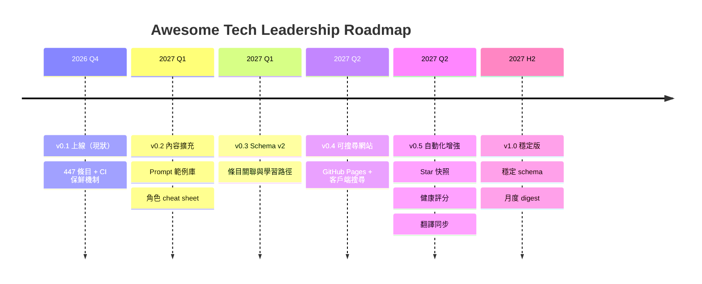

# Feature Plan / 功能規劃

> Roadmap for turning this curated list into a living platform.
> 把策展清單變成「活平台」的路線圖。Day-to-day items live in [todo.md](todo.md)。
> 版本號是內容與機制的里程碑，不代表 semver API。

## Roadmap / 路線圖

## v0.2 — 內容擴充 / Content expansion

**目標**：讓「快速找到可用的 prompt/skill」從清單變成可直接複製的資產。

- **Prompt 範例庫獨立化** — 把 docs/05 內的 21 個原創 prompt 遷到 `prompts/<role>/<name>.md`，每個附：用途、適用模型、變數說明、輸出範例
- **角色 cheat sheet** — 每個角色（PM/QA/DEV/RD/SRE/Platform/ERP/Data/EM）一頁紙：我的痛點 → 第一週做什麼 → 三個必收藏連結
- **方法論「怎麼開始」擴寫** — docs/01 每條已有入門實踐，抽 10 個高頻方法論寫 30 分鐘可完成的 first exercise

驗收標準：`prompts/` 至少 20 個可直接複製的 prompt；8 張角色 cheat sheet 全數完成。

## v0.3 — Schema v2 / 條目關聯與學習路徑

**目標**：讓 catalog 從「扁平清單」變成「可推理的圖」。

- schema 加欄位：`related`（條目 id 互引）、`level`（intro/intermediate/advanced）、`cost`（free/paid/oss）
- **學習路徑**（`paths/`）：例如「SRE 的 AI 入門 30 天」「從 TDD 到 SDD」— 有序條目 id 清單 + 每步說明
- `build_catalog.py` 升級：驗證 `related`/`path` 引用的 id 存在（broken-reference 檢查進 CI）
- 條目健康評分（新鮮度 × 來源權威性）寫入 index.json，供下游排序

驗收標準：schema v2 文件化、CI 涵蓋引用完整性、至少 5 條學習路徑。

## v0.4 — 可搜尋網站 / Searchable site

**目標**：不開 GitHub 也能「角色 × 關鍵字」秒找資源。

- GitHub Pages + 純前端（無後端）：載入 `catalog/index.json` 客戶端搜尋
- 篩選器：角色 / 類型 / license / 最後驗證日期；雙語切換
- 每個條目頁深鏈回 GitHub 原文（內容仍是 SSOT，網站是視圖）
- 部署 workflow：push main 自動重建

驗收標準：搜尋延遲 < 100ms（本地 index）；手機可用；內容零重複（SSOT 不破壞）。

## v0.5 — 自動化增強 / Automation

**目標**：維護成本趨近於零。

- **Star/stars 快照 workflow** — 每月跑 `gh api` 更新 docs 內標註的 star 快照（bot PR）
- **條目健康評分** — CI 產出 health report（stale + 403 站 + 最近被點擊），月報開 issue
- **翻譯同步檢查** — EN/zh 行對齊工具化（v0.2 的雙語規則自動化）
- **broken-link 自動建議** — issue 回報後，用 web search 找替代 URL 附在 issue 上（半自動）

驗收標準：三個月內人工維護介入次數 < 5 次/月。

## v1.0 — 穩定版 / Stable

**目標**：可以放心推薦給其他 tech leader 長期使用。

- schema v2 凍結（變更需 migration 說明）
- 月度 digest：新增/失效/更新條目摘要（Discussions 或 issue）
- 貢獻者指南完整（含 reviewer checklist）、CODEOWNERS 全覆蓋
- 內容規模參考值：600+ 條目、1000+ 來源、10+ 學習路徑

## 非目標 / Non-goals

- 不做條目內容的全文複製（只收摘要 + 來源連結，版權歸原作者）
- 不做付費牆內容
- 不做「排行榜/評分推薦」類的主觀評比（策展 ≠ 廣告，見 [CONTRIBUTING.md](CONTRIBUTING.md)）
- 不引入需要後端的搜尋服務（保持純靜態、可 fork、可離線）

---

排序原則：**內容品質 > 可發現性 > 自動化**。任何版本前先消化 [todo.md](todo.md) 的保鮮項目。
